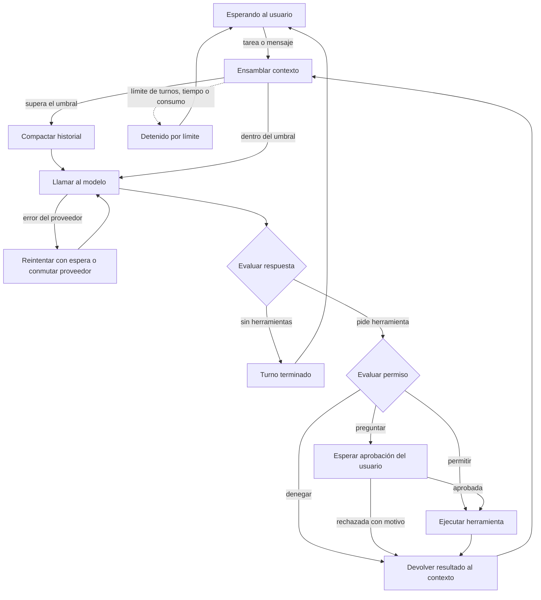
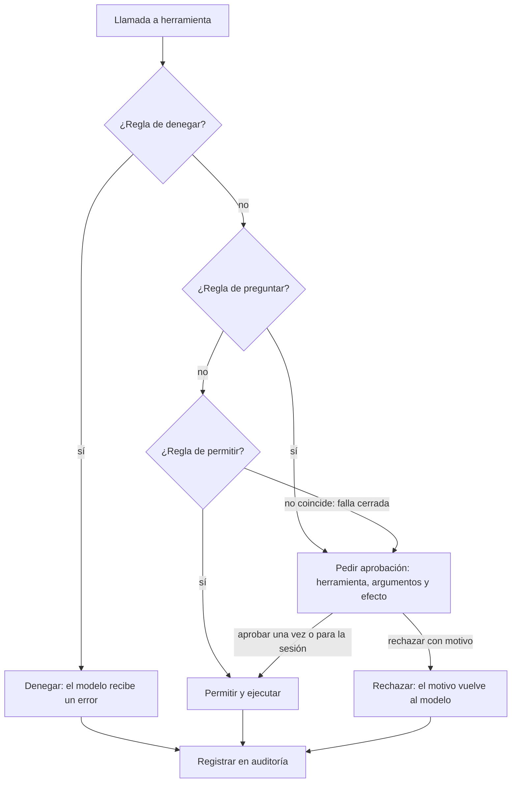

# Arquitectura y contratos

> [← 01-vision-y-decisiones.md](01-vision-y-decisiones.md) · [Índice](00-indice.md) · [03-plan-sprints.md →](03-plan-sprints.md)  
> Secciones 3 y 4 del contexto original.  
> Ver también: [01-vision-y-decisiones.md](01-vision-y-decisiones.md) · [03-plan-sprints.md](03-plan-sprints.md)

## 3. Arquitectura

### 3.1 Bucle del agente

### 3.2 Decisión de permisos

### 3.3 Delegación en subagentes

1. El orquestador delega con objetivo, contexto mínimo, formato de salida esperado y perfil del subagente.
2. El harness crea una sesión hija (con `padre_id`), contexto vacío, instrucciones del perfil y herramientas permitidas (sin delegación).
3. El subagente ejecuta su propio bucle con límites de turnos y consumo. Si necesita aprobación, sube al usuario indicando qué subagente la pide.
4. Devuelve `{resultado, hallazgos clave, fuentes, error}` o un resultado parcial.
5. El harness valida el resultado contra el esquema y lo entrega.
6. El orquestador continúa con su ventana intacta.

### 3.4 Dónde vive cada cosa (contexto, historial y memoria)

| Qué | Dónde | Para qué | Al compactar |
|---|---|---|---|
| Historial completo | SQLite, `eventos`, solo se añade | Reanudar, auditar, exportar | No se toca; se marcan los eventos cubiertos |
| Memoria persistente | SQLite, `memorias` | Preferencias y datos entre sesiones | No se toca |
| Contexto esencial | SQLite, `contexto_esencial` (objetivo, instrucciones, reglas, ticket, referencia a criterios, decisiones) | Lo que nunca puede perderse | No se toca ni se resume |
| Ventana de contexto | RAM, se arma en cada turno | Lo que ve el modelo ahora | Se reconstruye más corta |

La ventana se arma en este orden: prefijo fijo (instrucciones, herramientas y contexto esencial: objetivo, reglas, ticket, criterios y decisiones) → memoria dentro de su presupuesto → resumen de lo antiguo → eventos recientes completos. El modelo no recuerda nada entre llamadas.

### 3.5 Relevo entre sesiones (artículo de Anthropic)

Fuente: Anthropic Engineering, «Effective harnesses for long-running agents» (26 de noviembre de 2025). Se toman las ideas que encajan con el flujo del ticket; el artículo no propone reducir herramientas, eso es decisión de este proyecto.

| Idea del artículo | Cómo se aplica aquí | Historias |
|---|---|---|
| Dos fallos de los agentes de larga duración: hacer todo de golpe y declarar victoria antes de tiempo. | Se atacan con un criterio por vez y con verificación externa antes de cerrar. | [HU-11-04.1](04e-historias-coding-harness.md#hu-11-04.1), [HU-11-08.2](04e-historias-coding-harness.md#hu-11-08.2) |
| Lista de funcionalidades en JSON con «passes» en falso; el agente solo puede cambiar «passes». | Criterios del ticket en SQLite con una copia JSON de solo lectura. Aquí lo impone el harness (escritura denegada, único punto que marca y copia restaurada si cambia), no solo el prompt. | [HU-11-01](04e-historias-coding-harness.md#hu-11-01), [HU-11-04.1](04e-historias-coding-harness.md#hu-11-04.1) |
| Archivo de progreso y commits descriptivos como relevo entre sesiones. | Archivo de progreso por ticket en el repositorio; SQLite sigue guardando el historial completo. | [HU-11-08.1](04e-historias-coding-harness.md#hu-11-08.1), [HU-11-02](04e-historias-coding-harness.md#hu-11-02) |
| Rutina de arranque: ubicar el directorio, leer progreso y log de git, levantar el entorno y correr una prueba básica antes de trabajar. | Paso fijo del harness al reanudar un ticket; si la prueba básica falla, se repara antes de avanzar. | [HU-11-08.2](04e-historias-coding-harness.md#hu-11-08.2) |
| Verificar de punta a punta, como un usuario, y no solo con pruebas unitarias o curl. | Cada criterio objetivo lleva el comando que lo comprueba y el harness lo ejecuta. El subagente verificador (Sprint 3) aporta evidencia sobre los semánticos, que además confirma una persona. Una herramienta de navegador por MCP queda como extensión. | [HU-09-06](04d-historias-conexiones.md#hu-09-06), [HU-11-04.1](04e-historias-coding-harness.md#hu-11-04.1), [HU-11-04.2](04e-historias-coding-harness.md#hu-11-04.2) |
| Mismo harness en todas las sesiones; solo cambia el primer prompt (inicializador y agente de código). | Un solo bucle y dos prompts: uno que prepara el ticket (criterios y entorno) y otro que trabaja de a un criterio. | [HU-11-01](04e-historias-coding-harness.md#hu-11-01), [HU-11-08.2](04e-historias-coding-harness.md#hu-11-08.2) |
| Pregunta abierta: ¿un agente general o varios especializados? | Se prueba con dos perfiles de subagente (explorador y verificador) sin multiplicar los agentes. | [HU-09-06](04d-historias-conexiones.md#hu-09-06) |

### 3.6 Conjunto mínimo de herramientas

El modelo ve pocas herramientas generales. Git, pruebas y lint son comandos del `shell`; lo que los controla son las reglas de permisos.

| Herramienta | Para qué | Control | Historias |
|---|---|---|---|
| shell | Ejecutar comandos: git, pruebas, lint, búsquedas y la CLI de GitHub. | Permisos por comando y por subcomando; encadenados evaluados por partes; push y merge siempre piden aprobación. | [HU-01-04](04a-historias-fundacion.md#hu-01-04), [HU-05-02](04c-historias-control.md#hu-05-02), [HU-11-02](04e-historias-coding-harness.md#hu-11-02), [HU-11-03](04e-historias-coding-harness.md#hu-11-03) |
| leer_archivo | Leer texto de un archivo. | Bajo riesgo. El contenido leído se marca como dato, no como instrucción. | [HU-01-03](04a-historias-fundacion.md#hu-01-03) |
| escribir_archivo | Crear o reemplazar un archivo. | Solo se permite dentro del área de trabajo autorizada (ruta real); fuera de ella se pregunta y, en el Sprint 1, se deniega con motivo. La base de datos y la copia de los criterios están denegadas. | [HU-01-03](04a-historias-fundacion.md#hu-01-03), [HU-11-01](04e-historias-coding-harness.md#hu-11-01) |
| editar_archivo | Reemplazar un fragmento exacto de un archivo. | Igual que escribir; falla si el fragmento no es único. | [HU-01-03](04a-historias-fundacion.md#hu-01-03) |
| preguntar_usuario | Pedir una decisión o un dato con opciones. | Es el canal de la aprobación humana. | [HU-06-02](04c-historias-control.md#hu-06-02), [HU-05-03](04c-historias-control.md#hu-05-03) |
| delegar_subagente | Lanzar una sesión hija con perfil explorador o verificador. | Un solo nivel de anidamiento; el perfil restringe las herramientas. | [HU-09-01](04d-historias-conexiones.md#hu-09-01), [HU-09-06](04d-historias-conexiones.md#hu-09-06) |
| Complementos | Memoria persistente y herramientas MCP. | Se registran en el mismo ToolRegistry y pasan por la misma política. | [HU-04-02](04b-historias-estado.md#hu-04-02), [HU-08-03](04d-historias-conexiones.md#hu-08-03) |

Lo que cuesta esta decisión:

| Tema | Problema | Respuesta |
|---|---|---|
| Windows y Linux | No existe bash en Windows de forma nativa. | La interfaz Shell tiene una implementación para PowerShell y otra para bash; el prefijo informa cuál se usa; el shell se prueba en integración continua en ambos sistemas ([HU-01-04](04a-historias-fundacion.md#hu-01-04)). |
| Permisos | Es más difícil decidir sobre una cadena de texto que sobre una herramienta con parámetros. | Se separan los comandos encadenados, manda la parte más restrictiva y lo no entendido se pregunta ([HU-05-02](04c-historias-control.md#hu-05-02)). |
| Aislamiento | Un shell abierto puede tocar cualquier carpeta del usuario. | Directorio de trabajo acotado, aprobación fuera de él y worktree por ticket ([HU-11-07](04e-historias-coding-harness.md#hu-11-07), hoy Should); el entorno aislado queda como innovación ([HU-IN-02](04d-historias-conexiones.md#hu-in-02)) y es la forma verificable de aislar el shell (R-21). |

## 4. Contratos entre módulos

> Los nombres de métodos y atributos están en inglés (decisión del 2026-10-17); los nombres de interfaz y los de los eventos del bus se mantienen como están. Los identificadores en español de las historias y de los documentos archivados corresponden a la redacción original.

Se escriben y acuerdan en [HU-00-01](04a-historias-fundacion.md#hu-00-01) para trabajar en paralelo con dobles de prueba. Ningún módulo del núcleo importa un SDK de proveedor.

| Interfaz | Operaciones | Función |
|---|---|---|
| Provider | complete(messages, tools) → respuesta con texto, llamadas y uso | Aísla a LiteLLM; cambiar de proveedor no toca el núcleo. |
| Tool | name, description, schema, risk, run(args) → resultado | Todas las herramientas, nativas, MCP o de subagente, se ven igual. |
| ToolRegistry | register, get, list, validate_args(name, args) | Valida contra el esquema antes de ejecutar. |
| PermissionPolicy | evaluate(call) → deny \| ask \| allow | Falla cerrada; se aplica en el harness, no en el prompt. |
| Approver | request(call, details) → decisión (approve_once, approve_session, reject con motivo) | Lo implementa la CLI; el núcleo solo espera. |
| SessionStore | save_event(event), load_session(session_id), list_sessions() | SQLite; escribe cada evento al ocurrir. |
| ContextManager | assemble(session_id, model_id) → mensajes; compact(session_id) | Controla prefijo, recortes y umbral. |
| MemoryStore | save(key, content), search(token_budget), delete(key) | Separada del historial. |
| McpClient | connect, list_tools, call_tool(name, arguments) | Traduce cada herramienta MCP a Tool. |
| SubagentRunner | execute(profile, objective, context, output_schema) → resultado | Crea la sesión hija y devuelve el resultado estructurado. |
| Shell | execute(command, timeout_seconds) → código de salida y salida; interpreter_name | Una implementación para bash y otra para PowerShell. Es la única puerta a comandos del sistema. |
| TaskCriteria | load_criteria(session_id), get_pending(session_id), mark_passes(criteria_id, evidence), export_readonly_copy(session_id, destination) | Lee y escribe la tabla criterios de SQLite. Solo el harness llama a marcar_pasa. La copia JSON es de solo lectura y se restaura si cambia. |
| AreaAutorizada | contains(path) → verdadero o falso sobre la ruta real; root | Resuelve «..», enlaces simbólicos, unidades y rutas UNC antes de comparar. La usan las herramientas de archivos y la política de permisos. |
| EventBus | emit(event), subscribe(event_type, handler) | Único canal del núcleo hacia las interfaces. |

### Formato interno de mensajes

| Elemento | Descripción |
|---|---|
| Roles | sistema, usuario, asistente, herramienta. |
| Bloque de texto | texto plano. |
| Llamada a herramienta | {id, nombre, argumentos}. |
| Resultado de herramienta | {id_llamada, contenido, es_error}. |
| Uso | tokens de entrada y de salida informados por la API. |
| Marca de origen | indica que el contenido viene de fuera (archivo, web, MCP) y no es una instrucción del usuario. |

### Eventos del bus

`mensaje_usuario`, `mensaje_asistente`, `herramienta_solicitada`, `herramienta_terminada`, `aprobacion_pedida`, `aprobacion_resuelta`, `contexto_compactado`, `permiso_decidido`, `criterios_alterados`, `limite_alcanzado`, `error_proveedor`, `proveedor_conmutado`, `subagente_iniciado`, `subagente_terminado`, `interrumpido`, `sesion_arrancada`, `criterio_verificado`.

### Modelo de datos (SQLite)

| Tabla | Campos principales |
|---|---|
| sesiones | id, padre_id (para subagentes), creada, modelo, objetivo, estado |
| eventos | id, sesion_id, orden, tipo, contenido, compactado_por |
| resumenes | id, sesion_id, evento_desde, evento_hasta, texto |
| contexto_esencial | id, sesion_id, clave (objetivo, instrucciones, reglas, ticket, criterios_ref, decisiones), valor, origen, actualizado. Fuera de los eventos: la compactación no lo toca |
| criterios | id, sesion_id, orden, descripcion, tipo (objetivo o semantico), comando, condicion, passes, evidencia, confirmado_por. Fuente de verdad; solo la escribe el harness |
| memorias | id, clave, contenido, creada, actualizada |
| auditoria | id, sesion_id, herramienta, argumentos_redactados, decision, momento |
| trazas | id, sesion_id, tipo, duracion_ms, tokens, detalle_redactado |

`compactado_por` marca qué eventos cubre cada resumen; `padre_id` enlaza la sesión de un subagente con su orquestador.

---

[← 01-vision-y-decisiones.md](01-vision-y-decisiones.md) · [Índice](00-indice.md) · [03-plan-sprints.md →](03-plan-sprints.md)
