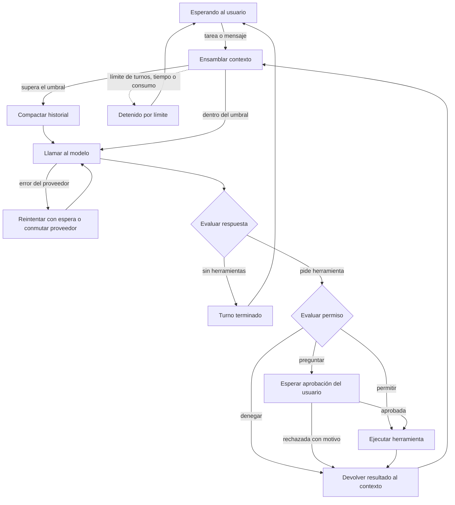
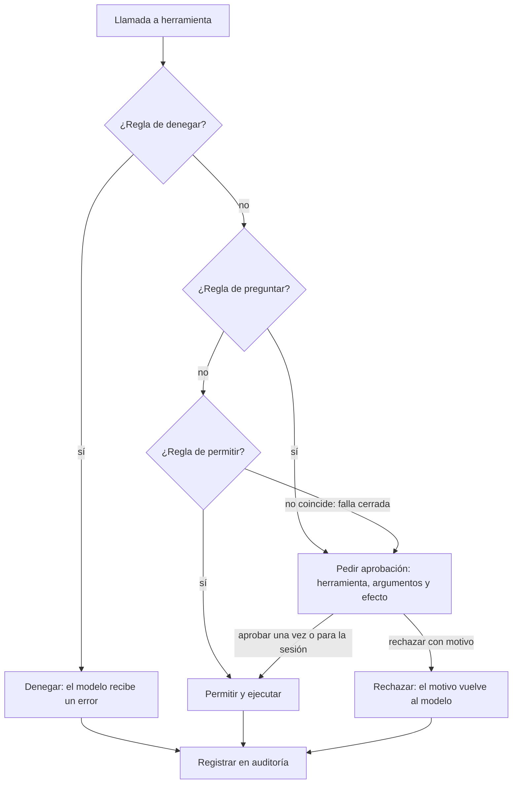

# Arquitectura y contratos

> [← 01-vision-y-decisiones.md](01-vision-y-decisiones.md) · [Índice](00-indice.md) · [03-plan-sprints.md →](03-plan-sprints.md)  
> Secciones 3 y 4 del contexto original.  
> Ver también: [01-vision-y-decisiones.md](01-vision-y-decisiones.md) · [03-plan-sprints.md](03-plan-sprints.md)

## 3. Arquitectura

### 3.1 Bucle del agente

### 3.2 Decisión de permisos

### 3.3 Delegación en subagentes

1. El orquestador delega con objetivo, contexto mínimo, formato de salida esperado y perfil del subagente.
2. El harness crea una sesión hija (con `padre_id`), contexto vacío, instrucciones del perfil y herramientas permitidas (sin delegación).
3. El subagente ejecuta su propio bucle con límites de turnos y consumo. Si necesita aprobación, sube al usuario indicando qué subagente la pide.
4. Devuelve `{resultado, hallazgos clave, fuentes, error}` o un resultado parcial.
5. El harness valida el resultado contra el esquema y lo entrega.
6. El orquestador continúa con su ventana intacta.

### 3.4 Dónde vive cada cosa (contexto, historial y memoria)

| Qué | Dónde | Para qué | Al compactar |
|---|---|---|---|
| Historial completo | SQLite, `eventos`, solo se añade | Reanudar, auditar, exportar | No se toca; se marcan los eventos cubiertos |
| Memoria persistente | SQLite, `memorias` | Preferencias y datos entre sesiones | No se toca |
| Ventana de contexto | RAM, se arma en cada turno | Lo que ve el modelo ahora | Se reconstruye más corta |

La ventana se arma en este orden: prefijo fijo (instrucciones, herramientas, objetivo y decisiones) → memoria dentro de su presupuesto → resumen de lo antiguo → eventos recientes completos. El modelo no recuerda nada entre llamadas.

## 4. Contratos entre módulos

Se escriben y acuerdan en [HU-00-01](04a-historias-fundacion.md#hu-00-01) para trabajar en paralelo con dobles de prueba. Ningún módulo del núcleo importa un SDK de proveedor.

| Interfaz | Operaciones | Función |
|---|---|---|
| Provider | complete(mensajes, herramientas) → respuesta con texto, llamadas y uso | Aísla a LiteLLM; cambiar de proveedor no toca el núcleo. |
| Tool | nombre, descripción, esquema, riesgo, run(args) → resultado | Todas las herramientas, nativas, MCP o de subagente, se ven igual. |
| ToolRegistry | register, get, list, validar(args) | Valida contra el esquema antes de ejecutar. |
| PermissionPolicy | evaluar(llamada) → denegar \| preguntar \| permitir | Falla cerrada; se aplica en el harness, no en el prompt. |
| Approver | pedir(llamada, detalle) → decisión (aprobar, rechazar con motivo, para la sesión) | Lo implementa la CLI; el núcleo solo espera. |
| SessionStore | guardar(evento), cargar(sesión), listar() | SQLite; escribe cada evento al ocurrir. |
| ContextManager | ensamblar(sesión, modelo) → mensajes; compactar() | Controla prefijo, recortes y umbral. |
| MemoryStore | guardar, consultar(presupuesto), borrar | Separada del historial. |
| McpClient | conectar, listar_herramientas, llamar | Traduce cada herramienta MCP a Tool. |
| SubagentRunner | ejecutar(perfil, objetivo, contexto, formato) → resultado | Crea la sesión hija y devuelve el resultado estructurado. |
| EventBus | emitir(evento), suscribir(tipo, función) | Único canal del núcleo hacia las interfaces. |

### Formato interno de mensajes

| Elemento | Descripción |
|---|---|
| Roles | sistema, usuario, asistente, herramienta. |
| Bloque de texto | texto plano. |
| Llamada a herramienta | {id, nombre, argumentos}. |
| Resultado de herramienta | {id_llamada, contenido, es_error}. |
| Uso | tokens de entrada y de salida informados por la API. |
| Marca de origen | indica que el contenido viene de fuera (archivo, web, MCP) y no es una instrucción del usuario. |

### Eventos del bus

`mensaje_usuario`, `mensaje_asistente`, `herramienta_solicitada`, `herramienta_terminada`, `aprobacion_pedida`, `aprobacion_resuelta`, `contexto_compactado`, `limite_alcanzado`, `error_proveedor`, `proveedor_conmutado`, `subagente_iniciado`, `subagente_terminado`, `interrumpido`.

### Modelo de datos (SQLite)

| Tabla | Campos principales |
|---|---|
| sesiones | id, padre_id (para subagentes), creada, modelo, objetivo, estado |
| eventos | id, sesion_id, orden, tipo, contenido, compactado_por |
| resumenes | id, sesion_id, evento_desde, evento_hasta, texto |
| memorias | id, clave, contenido, creada, actualizada |
| auditoria | id, sesion_id, herramienta, argumentos_redactados, decision, momento |
| trazas | id, sesion_id, tipo, duracion_ms, tokens, detalle_redactado |

`compactado_por` marca qué eventos cubre cada resumen; `padre_id` enlaza la sesión de un subagente con su orquestador.

---

[← 01-vision-y-decisiones.md](01-vision-y-decisiones.md) · [Índice](00-indice.md) · [03-plan-sprints.md →](03-plan-sprints.md)
