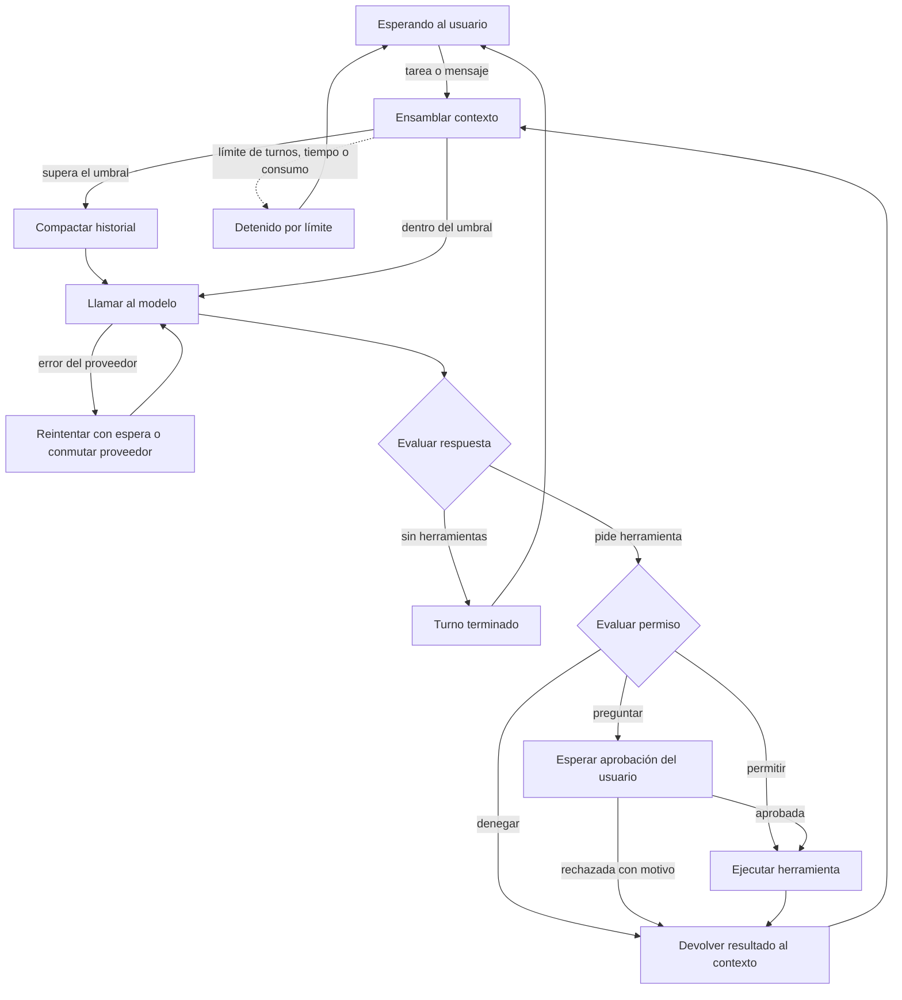
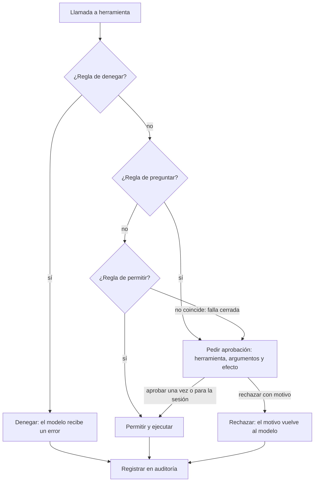

# Harness de agente en terminal — contexto del proyecto

> Archivo de contexto para iniciar el proyecto (úsalo como `CLAUDE.md` o `docs/contexto.md`). Resume los requisitos, las decisiones de diseño, la arquitectura, el backlog de Scrum y el plan de tres sprints. Fuente de verdad del backlog: la hoja `backlog_harness.xlsx` (copia de trabajo) y el documento de análisis.

## 1. Qué es y cómo se trabaja

Un **harness** es la aplicación que rodea a un modelo de lenguaje (el «cerebro») y lo conecta con el mundo: bucle de razonar–actuar–observar, herramientas, permisos, contexto, memoria, sesiones. Este proyecto construye uno propio, en terminal, con un núcleo reutilizable y desacoplado de la interfaz.

| Tema | Decisión |
|---|---|
| Equipo | 3 personas: A = Núcleo, B = Estado, C = Control y conexiones |
| Plazo | 3 sprints de 1 semana |
| Disponibilidad | 15 a 28 h por semana en días hábiles más sábados y domingos completos (27 a 44 h por sprint). Capacidad usada: 13 PHU por persona y sprint (≈ 32 h); se recalibra tras el Sprint 1 |
| Product Owner | Brad (tiene la rúbrica) |
| Scrum Master | Rota: Sprint 1 = A, Sprint 2 = B, Sprint 3 = C |
| Sistemas operativos | Windows y Linux (Arch). Integración continua en ambos |
| Lenguaje | Python 3.12+. TypeScript solo si se hace la interfaz web |
| Interfaz | Terminal (CLI). El núcleo emite eventos por un bus y nunca imprime, para añadir web (FastAPI/WebSocket) sin tocarlo |
| Proveedores | LiteLLM detrás de una interfaz propia `Provider`. Al menos dos de Claude, OpenAI y Gemini (por decidir; presupuesto de API por definir) |
| Persistencia | SQLite (sesiones, eventos, memoria, auditoría, trazas) |
| Herramientas externas | Cliente MCP (SDK de Python), stdio primero. Servidor de demostración local y sin credenciales (se elige en SPK-04) |
| Reto | Subagentes con contexto aislado (obligatorio) |
| Estimación | Puntos de historia (PHU) con Fibonacci; planning poker en el Sprint 1 |

Reglas del equipo: cada área tiene un dueño, pero todo cambio lo revisa otra persona. Definition of Done:
- El código está integrado y la integración continua pasa.
- Tiene pruebas y cumple los criterios de aceptación.
- Pasa el verificador de tipos y el formateador.
- No introduce secretos en el código ni en los registros.
- Otro integrante la revisó.
- Se mostró en la demostración del sprint.

## 2. Alcance

- **Obligatorio (prioridad Alta):** bucle con herramientas, contexto con compactación, sesiones reanudables, memoria, permisos con aprobación humana, CLI, dos proveedores con conmutación por fallo, MCP, subagentes, trazas.
- **Si hay capacidad (Media):** varias llamadas por turno, detección de repeticiones, compactación manual, costos, memoria editable, modo solo lectura, reglas por archivo, subagentes explorador/verificador.
- **Innovación (después del mínimo):** interfaz web, ejecución en entorno aislado, comparación con LangGraph, panel de costos.

## 3. Arquitectura

### 3.1 Bucle del agente



### 3.2 Decisión de permisos



### 3.3 Delegación en subagentes

1. El orquestador delega con objetivo, contexto mínimo, formato de salida esperado y perfil del subagente.
2. El harness crea una sesión hija (con `padre_id`), contexto vacío, instrucciones del perfil y herramientas permitidas (sin delegación).
3. El subagente ejecuta su propio bucle con límites de turnos y consumo. Si necesita aprobación, sube al usuario indicando qué subagente la pide.
4. Devuelve `{resultado, hallazgos clave, fuentes, error}` o un resultado parcial.
5. El harness valida el resultado contra el esquema y lo entrega.
6. El orquestador continúa con su ventana intacta.

### 3.4 Dónde vive cada cosa (contexto, historial y memoria)

| Qué | Dónde | Para qué | Al compactar |
|---|---|---|---|
| Historial completo | SQLite, `eventos`, solo se añade | Reanudar, auditar, exportar | No se toca; se marcan los eventos cubiertos |
| Memoria persistente | SQLite, `memorias` | Preferencias y datos entre sesiones | No se toca |
| Ventana de contexto | RAM, se arma en cada turno | Lo que ve el modelo ahora | Se reconstruye más corta |

La ventana se arma en este orden: prefijo fijo (instrucciones, herramientas, objetivo y decisiones) → memoria dentro de su presupuesto → resumen de lo antiguo → eventos recientes completos. El modelo no recuerda nada entre llamadas.

## 4. Contratos entre módulos

Se escriben y acuerdan en HU-00-01 para trabajar en paralelo con dobles de prueba. Ningún módulo del núcleo importa un SDK de proveedor.

| Interfaz | Operaciones | Función |
|---|---|---|
| Provider | complete(mensajes, herramientas) → respuesta con texto, llamadas y uso | Aísla a LiteLLM; cambiar de proveedor no toca el núcleo. |
| Tool | nombre, descripción, esquema, riesgo, run(args) → resultado | Todas las herramientas, nativas, MCP o de subagente, se ven igual. |
| ToolRegistry | register, get, list, validar(args) | Valida contra el esquema antes de ejecutar. |
| PermissionPolicy | evaluar(llamada) → denegar \| preguntar \| permitir | Falla cerrada; se aplica en el harness, no en el prompt. |
| Approver | pedir(llamada, detalle) → decisión (aprobar, rechazar con motivo, para la sesión) | Lo implementa la CLI; el núcleo solo espera. |
| SessionStore | guardar(evento), cargar(sesión), listar() | SQLite; escribe cada evento al ocurrir. |
| ContextManager | ensamblar(sesión, modelo) → mensajes; compactar() | Controla prefijo, recortes y umbral. |
| MemoryStore | guardar, consultar(presupuesto), borrar | Separada del historial. |
| McpClient | conectar, listar_herramientas, llamar | Traduce cada herramienta MCP a Tool. |
| SubagentRunner | ejecutar(perfil, objetivo, contexto, formato) → resultado | Crea la sesión hija y devuelve el resultado estructurado. |
| EventBus | emitir(evento), suscribir(tipo, función) | Único canal del núcleo hacia las interfaces. |

### Formato interno de mensajes

| Elemento | Descripción |
|---|---|
| Roles | sistema, usuario, asistente, herramienta. |
| Bloque de texto | texto plano. |
| Llamada a herramienta | {id, nombre, argumentos}. |
| Resultado de herramienta | {id_llamada, contenido, es_error}. |
| Uso | tokens de entrada y de salida informados por la API. |
| Marca de origen | indica que el contenido viene de fuera (archivo, web, MCP) y no es una instrucción del usuario. |

### Eventos del bus

`mensaje_usuario`, `mensaje_asistente`, `herramienta_solicitada`, `herramienta_terminada`, `aprobacion_pedida`, `aprobacion_resuelta`, `contexto_compactado`, `limite_alcanzado`, `error_proveedor`, `proveedor_conmutado`, `subagente_iniciado`, `subagente_terminado`, `interrumpido`.

### Modelo de datos (SQLite)

| Tabla | Campos principales |
|---|---|
| sesiones | id, padre_id (para subagentes), creada, modelo, objetivo, estado |
| eventos | id, sesion_id, orden, tipo, contenido, compactado_por |
| resumenes | id, sesion_id, evento_desde, evento_hasta, texto |
| memorias | id, clave, contenido, creada, actualizada |
| auditoria | id, sesion_id, herramienta, argumentos_redactados, decision, momento |
| trazas | id, sesion_id, tipo, duracion_ms, tokens, detalle_redactado |

`compactado_por` marca qué eventos cubre cada resumen; `padre_id` enlaza la sesión de un subagente con su orquestador.

## 5. Decisiones de diseño que no se negocian

Salen de revisar los requisitos. Cada una tiene historias asociadas.

| Id | Hallazgo y decisión | Historias |
|---|---|---|
| V-01 | **La aprobación necesita comunicación en dos sentidos.** El bus de eventos solo emite. Para pedir aprobación el núcleo debe esperar una respuesta de la interfaz. El núcleo espera una decisión asíncrona (interfaz Approver). Se confirma con SPK-02. | HU-01-05, HU-05-03, SPK-02 |
| V-02 | **«Aprobar para la sesión» podía saltarse una denegación.** La captura no decía qué pasa si existe una regla de denegar. Denegar siempre gana. La aprobación de sesión se limita a una herramienta y un patrón de argumentos. | HU-05-02, HU-05-03 |
| V-03 | **Compactar no debe borrar historial.** RF-2 y RF-3 chocaban: reanudar exige el historial completo. La compactación añade un evento de resumen y marca los eventos cubiertos; el original permanece en SQLite. | HU-02-03, HU-03-02 |
| V-04 | **El objetivo y las decisiones no pueden vivir en el historial compactable.** Un resumen mal hecho podía perder la tarea original. El objetivo y las decisiones del usuario se guardan aparte y se inyectan siempre en el prefijo del contexto. | HU-02-06 |
| V-05 | **«Relevancia» de la memoria no estaba definida.** Sin embeddings no hay medida de similitud. Relevancia = recencia dentro de un presupuesto de tokens. Embeddings pasan a innovación. | HU-04-02 |
| V-06 | **El contrato del subagente era vago.** No se sabía qué recibe ni qué devuelve. Entrada: objetivo, contexto mínimo y formato de salida. Salida: resultado, hallazgos clave, fuentes y error. Las aprobaciones suben al usuario. | HU-09-01, HU-09-02, HU-09-03 |
| V-07 | **RNF-5 medía algo que no controlamos.** La latencia del modelo no depende del harness. Se mide el tiempo propio del harness por turno con proveedor simulado. | HU-00-05 |
| V-08 | **Windows y macOS cambian el shell y la lista de comandos peligrosos.** El equipo usa Windows y Linux (Arch). Intérprete y lista de denegación para Windows y Linux; la integración continua corre en ambos. | HU-01-04, HU-00-02 |
| V-09 | **El conteo exacto de tokens no existe para todos los modelos.** Cada proveedor cuenta distinto. Estimación heurística corregida con el uso real que informa la API en cada respuesta. | HU-02-01 |
| V-10 | **El umbral de compactación depende del modelo.** Al conmutar de proveedor cambia la ventana disponible. El umbral se calcula por modelo y se recalcula al conmutar. | HU-02-03, HU-07-05 |
| V-11 | **Cancelar una herramienta en curso no estaba definido.** Interrumpir con Ctrl+C podía dejar el estado a medias. La herramienta se cancela, se registra como interrumpida y el modelo recibe ese resultado en el siguiente turno. | HU-06-03 |
| V-12 | **Faltaba un archivo de instrucciones del proyecto.** Es práctica común en harnesses actuales. Se añade RF-2.9 (Could): cargar un archivo de instrucciones al prefijo. | HU-02-07 |
| V-13 | **La detección de secretos no puede ser total.** No existe garantía absoluta. Se declara el alcance: patrones conocidos más los valores de las variables de entorno cargadas. | HU-04-05, HU-10-02 |
| V-14 | **Hace falta un proveedor simulado.** Sin él las pruebas dependen de la red y de la cuota. Se crea FakeProvider en el Sprint 1 como base de todas las pruebas. | HU-00-03 |

Cambios a la captura de requisitos:

| Requisito | Cambio |
|---|---|
| RF-2.9 (nuevo, Could) | Cargar un archivo de instrucciones del proyecto en el prefijo del contexto. |
| RF-2.4 (precisado) | La compactación conserva el historial original y no puede eliminar el objetivo ni las decisiones del usuario. |
| RF-4.3 (precisado) | Relevancia de la memoria = recencia dentro de un presupuesto de tokens. |
| RF-5.4 (precisado) | Aprobar para la sesión nunca anula una regla de denegar y se limita a herramienta y patrón. |
| RF-9 (precisado) | Se define el contrato de entrada y salida del subagente y la subida de aprobaciones al usuario. |
| RNF-5 (reformulado) | Se mide el tiempo propio del harness por turno, no la latencia del modelo. |

Decisiones tomadas:

| Pregunta | Respuesta |
|---|---|
| ¿El límite de costo en dinero o en tokens? | En tokens. El costo en moneda es solo informativo. |
| ¿Dónde vive la memoria? | En SQLite, con el comando /memoria para consultarla y borrarla. |
| ¿Qué sistema operativo usa cada integrante? | Windows y Linux (Arch Linux). La integración continua y el shell cubren ambos. |
| ¿Quién es el Product Owner? | Brad. |
| ¿Cuántas horas tiene cada persona? | 15 a 28 horas por semana en los 5 días hábiles, más los sábados y domingos completos. Equivale a unas 27 a 44 horas por sprint, según cuánto se trabaje el fin de semana. |
| ¿Qué servidor MCP usamos en la demostración? | Se elige en SPK-04: servidor local por stdio, sin credenciales. |

Preguntas abiertas:

| Pregunta | Por qué importa | Cuándo se cierra |
|---|---|---|
| ¿Qué dos modelos entre Claude, OpenAI y Gemini, y con qué presupuesto de API? | Define el proveedor principal y el de respaldo (HU-07-02, HU-07-03, SPK-01). | Antes de SPK-01 |
| ¿Se confirma asyncio como modelo de concurrencia? | Depende del resultado de SPK-02. | Fin del Sprint 1 |

## 6. Estrategia de pruebas y riesgos

| Tipo | Qué cubre | Cómo | Quién |
|---|---|---|---|
| Unitarias | Registro, validación, política de permisos, estimación de tokens, recorte. | pytest, sin red | Cada integrante |
| Integración con proveedor simulado | Bucle completo, aprobación, rechazo, compactación, reanudación. | FakeProvider con guion | Dueño del módulo |
| Fallos | Cierre forzado, proveedor caído, herramienta con excepción, MCP caído. | Inyección de fallos | A (HU-00-05) |
| Contrato | Cada Provider real cumple la interfaz. | Pocas llamadas reales marcadas aparte | B |
| Aceptación | Guion de demostración de 10 a 15 minutos. | Manual con persona ajena | Todo el equipo |

Casi todo se prueba con el proveedor simulado (`FakeProvider`). Las llamadas reales se reservan para pruebas de contrato y la demostración.

Riesgos nuevos (se suman a R-1 a R-10 de la captura):

| Id | Riesgo | Prob. | Impacto | Mitigación |
|---|---|---|---|---|
| R-11 | Fallo del modelo de concurrencia (asyncio) que obligue a reescribir. | Media | Alto | SPK-02 en el Sprint 1 antes de construir sobre él. |
| R-12 | El equipo usa Windows y Linux y el shell o las rutas fallan en uno. | Alta | Medio | Intérprete por plataforma e integración continua en Windows y Linux. |
| R-13 | Estimaciones demasiado optimistas por falta de datos reales. | Alta | Medio | Recalibrar capacidad tras el Sprint 1; Should como colchón. |
| R-14 | Cuota de API agotada durante pruebas. | Media | Medio | FakeProvider para casi todas las pruebas; límite de consumo. |
| R-15 | Dependencias entre A, B y C bloquean en el Sprint 2. | Media | Alto | Contratos acordados en HU-00-01 y dobles de prueba. |

## 7. Épicas

| Id | Nombre | Descripción | Hist. | PHU |
|---|---|---|---|---|
| E0 | Fundaciones y calidad | Repositorio, interfaces acordadas, integración continua, proveedor simulado, pruebas y documentación. Hace posible el trabajo en paralelo. | 7 | 16 |
| E1 | Bucle y herramientas | Bucle razonar-actuar-observar, registro de herramientas con esquema JSON, herramientas base, bus de eventos y límites. | 9 | 21 |
| E2 | Gestión de contexto | Estimación de tokens, prefijo estable, recorte de salidas y compactación automática sin perder el objetivo. | 8 | 16 |
| E3 | Sesiones | Persistencia de cada evento en SQLite, listado y reanudación de sesiones, resistencia a cortes abruptos. | 6 | 12 |
| E4 | Memoria | Memoria persistente separada del historial, herramienta de memoria, memoria estructurada y protección de secretos. | 5 | 11 |
| E5 | Permisos y human-in-the-loop | Política denegar, preguntar, permitir que falla cerrada; aprobación con detalle; rechazo con motivo; auditoría. | 8 | 15 |
| E6 | Interacción con el usuario | CLI con eventos en tiempo real, herramienta para preguntar con opciones, comandos de control e interrupción. | 4 | 8 |
| E7 | Proveedores de modelo | Interfaz Provider sobre LiteLLM, dos proveedores, reintentos y conmutación por fallo. | 7 | 14 |
| E8 | Integración MCP | Cliente MCP por stdio, descubrimiento y traducción de herramientas, mismos permisos que las nativas, aislamiento de fallos. | 7 | 13 |
| E9 | Subagentes (reto) | Delegación en sesiones hijas con contexto aislado, herramientas restringidas y resultado estructurado. | 7 | 17 |
| E10 | Trazabilidad | Trazas estructuradas, auditoría y redacción de secretos en los registros. | 3 | 6 |
| EI | Innovación | Interfaz web, sandbox, comparación con LangGraph y panel de costos. Solo si el mínimo está cerrado. | 4 | 21 |

## 8. Plan de sprints

### Sprint 1 — Tarea de tres pasos de principio a fin

- **Scrum Master:** A — Núcleo
- **Hito:** El agente lee y escribe archivos en varios turnos con un modelo real, la sesión queda guardada y la política de permisos clasifica cada acción.
- **Demostración:** Demostración de una tarea de tres pasos con un modelo real y con el proveedor simulado.

| Id | Historia | Prioridad | PHU | Responsable |
|---|---|---|---|---|
| HU-00-01 | Esqueleto del repositorio e interfaces acordadas | Alta | 3 | A — Núcleo |
| HU-00-02 | Integración continua con pruebas, tipado y formato | Alta | 2 | C — Control y conexiones |
| HU-00-03 | Proveedor simulado para pruebas | Alta | 2 | B — Estado |
| HU-00-04 | Configuración por archivo y variables de entorno | Alta | 1 | B — Estado |
| HU-01-01 | Bucle agéntico básico | Alta | 5 | A — Núcleo |
| HU-01-02 | Registro de herramientas con esquema y validación | Alta | 3 | C — Control y conexiones |
| HU-01-03 | Herramientas de archivos: leer, escribir, listar y buscar | Alta | 3 | C — Control y conexiones |
| HU-01-05 | Bus de eventos desacoplado de la interfaz | Alta | 2 | B — Estado |
| HU-03-01 | Esquema SQLite y creación de sesión | Alta | 2 | B — Estado |
| HU-03-02 | Persistir cada evento al ocurrir y tolerar cortes abruptos | Alta | 3 | B — Estado |
| HU-05-01 | Política denegar, preguntar, permitir que falla cerrada | Alta | 3 | C — Control y conexiones |
| HU-06-01 | CLI básica con eventos en tiempo real | Alta | 2 | C — Control y conexiones |
| HU-07-01 | Interfaz Provider y formato interno de mensajes | Alta | 3 | A — Núcleo |
| HU-07-02 | Adaptador LiteLLM para el primer proveedor | Alta | 2 | B — Estado |
| SPK-01 | Spike: traducir herramientas entre OpenAI y Anthropic con LiteLLM | Alta | 1 | B — Estado |
| SPK-02 | Spike: modelo asíncrono y cancelación de herramientas | Alta | 1 | A — Núcleo |

PHU obligatorios: A 12 · B 13 · C 13 (capacidad 13 por persona).

### Sprint 2 — Aprobar y reanudar

- **Scrum Master:** B — Estado
- **Hito:** Una acción de shell se detiene para aprobación, un rechazo con motivo hace replantear al agente, una sesión se reanuda tras cierre y el agente delega en un subagente básico.
- **Demostración:** Demostración de aprobación, rechazo, reanudación, compactación y delegación.

| Id | Historia | Prioridad | PHU | Responsable |
|---|---|---|---|---|
| HU-01-04 | Herramienta de shell con tiempo límite | Alta | 2 | C — Control y conexiones |
| HU-01-06 | Límites de turnos, tiempo y costo por sesión | Alta | 2 | A — Núcleo |
| HU-02-01 | Estimación de tokens y prefijo estable | Alta | 2 | B — Estado |
| HU-02-02 | Recorte de salidas largas de herramientas | Alta | 1 | C — Control y conexiones |
| HU-02-03 | Compactación automática por umbral | Alta | 5 | B — Estado |
| HU-03-03 | Listar sesiones | Alta | 1 | B — Estado |
| HU-03-04 | Reanudar una sesión por identificador | Alta | 3 | B — Estado |
| HU-05-02 | Lista de denegados que ninguna configuración puede vaciar | Alta | 1 | C — Control y conexiones |
| HU-05-03 | Aprobación con detalle: una vez, toda la sesión o rechazar | Alta | 3 | C — Control y conexiones |
| HU-05-04 | Rechazo con motivo que vuelve al modelo | Alta | 1 | C — Control y conexiones |
| HU-05-05 | Registro de auditoría de decisiones | Alta | 2 | C — Control y conexiones |
| HU-06-02 | Herramienta para preguntar al usuario con opciones | Alta | 2 | C — Control y conexiones |
| HU-06-04 | Comandos de control de la sesión | Alta | 2 | B — Estado |
| HU-07-03 | Segundo proveedor y selección por configuración | Alta | 2 | A — Núcleo |
| SPK-04 | Spike: cliente MCP por stdio y servidor de demostración | Alta | 1 | C — Control y conexiones |
| HU-09-01 | Delegar en un subagente con contexto limpio | Alta | 5 | A — Núcleo |
| HU-09-02 | Instrucciones propias y herramientas restringidas por subagente | Alta | 2 | A — Núcleo |
| HU-09-03 | Resultado estructurado en lugar de la transcripción | Alta | 2 | A — Núcleo |
| SPK-03 | Spike: compactación sin perder el objetivo | Alta | 1 | B — Estado |

PHU obligatorios: A 13 · B 14 · C 13 (capacidad 13 por persona). B queda 1 por encima; si no cabe, partir HU-06-04.

### Sprint 3 — Subagente, MCP y cierre

- **Scrum Master:** C — Control y conexiones
- **Hito:** Una herramienta MCP corre bajo permisos, el sistema conmuta de proveedor al fallar uno, la memoria sobrevive entre sesiones y el repositorio queda documentado y probado.
- **Demostración:** Demostración completa siguiendo el guion de 10 a 15 minutos.

| Id | Historia | Prioridad | PHU | Responsable |
|---|---|---|---|---|
| HU-00-05 | Pruebas de integración y de fallos | Alta | 3 | A — Núcleo |
| HU-00-06 | README, guion de demostración y documento de arquitectura | Alta | 3 | B — Estado |
| HU-00-07 | Cobertura mínima y prueba de instalación | Alta | 2 | C — Control y conexiones |
| HU-01-07 | Varias llamadas a herramientas en un mismo turno | Media | 2 | A — Núcleo |
| HU-01-08 | Detección de llamadas repetidas | Media | 1 | A — Núcleo |
| HU-02-04 | Comando para compactar manualmente | Media | 1 | B — Estado |
| HU-02-06 | Conservar objetivo, instrucciones y decisiones tras compactar | Alta | 2 | B — Estado |
| HU-03-05 | Consumo de tokens y costo estimado por sesión | Media | 2 | B — Estado |
| HU-04-01 | Almacén de memoria separado del historial | Alta | 2 | B — Estado |
| HU-04-02 | Herramienta de memoria y carga al inicio | Alta | 3 | B — Estado |
| HU-04-03 | Memoria estructurada de la sesión | Media | 3 | B — Estado |
| HU-04-04 | Inspeccionar y editar la memoria | Media | 1 | C — Control y conexiones |
| HU-04-05 | No almacenar secretos en memoria | Alta | 2 | C — Control y conexiones |
| HU-05-06 | Reglas de permisos por archivo | Media | 2 | C — Control y conexiones |
| HU-05-07 | Modo de solo lectura | Media | 1 | C — Control y conexiones |
| HU-05-08 | Contenido externo tratado como datos | Alta | 2 | C — Control y conexiones |
| HU-06-03 | Interrumpir la ejecución sin perder la sesión | Media | 2 | A — Núcleo |
| HU-07-04 | Reintentos con espera exponencial | Alta | 1 | A — Núcleo |
| HU-07-05 | Conmutación por fallo con umbral por modelo | Alta | 3 | A — Núcleo |
| HU-08-01 | Conexión a un servidor MCP por stdio | Alta | 2 | C — Control y conexiones |
| HU-08-02 | Descubrir herramientas MCP y traducirlas al formato interno | Alta | 2 | C — Control y conexiones |
| HU-08-03 | Invocar herramientas MCP bajo la misma política de permisos | Alta | 2 | C — Control y conexiones |
| HU-08-04 | Aislar los fallos de un servidor MCP | Alta | 1 | C — Control y conexiones |
| HU-09-04 | Un solo nivel de anidamiento y límites por subagente | Alta | 2 | A — Núcleo |
| HU-09-05 | Propagación explícita de errores del subagente | Alta | 1 | A — Núcleo |
| HU-09-06 | Dos tipos de subagente: explorador y verificador | Media | 2 | A — Núcleo |
| HU-10-01 | Trazas estructuradas de cada llamada | Alta | 2 | B — Estado |
| HU-10-02 | Redacción de secretos en registros | Alta | 1 | B — Estado |

PHU obligatorios: A 10 · B 13 · C 13 (capacidad 13 por persona).

### Sin sprint (backlog)

| Id | Historia | Prioridad | PHU |
|---|---|---|---|
| HU-02-05 | Compactación solicitada por el propio modelo | Baja | 2 |
| HU-02-07 | Archivo de instrucciones del proyecto | Baja | 2 |
| HU-03-06 | Exportar una sesión a formato legible | Baja | 1 |
| HU-07-06 | Respuesta en streaming | Baja | 2 |
| HU-08-05 | Varios servidores por archivo y prefijos para evitar colisiones | Media | 3 |
| HU-08-06 | Transporte HTTP además de stdio | Baja | 2 |
| HU-09-07 | Subagentes en paralelo con agregación de resultados | Baja | 3 |
| HU-10-03 | Convenciones de OpenTelemetry para IA generativa | Baja | 3 |
| HU-IN-01 | Interfaz web sobre el mismo núcleo | Baja | 8 |
| HU-IN-02 | Ejecución de comandos en entorno aislado | Baja | 5 |
| HU-IN-03 | Comparación del orquestador propio con LangGraph | Baja | 5 |
| HU-IN-04 | Panel de costos y consumo por sesión | Baja | 3 |

## 9. Sprint Backlogs (tareas)

Estimación en horas: reparto inicial de los PHU (1 PHU ≈ 2,5 h) entre las tareas; el equipo la ajusta en el Planning. `(opc.)` = historia de prioridad Media, solo si el mínimo está cerrado.

### Sprint 1

| Id | HU | Tarea | Horas | Resp. |
|---|---|---|---|---|
| Sp1-01 | HU-00-01 | Crear la estructura de paquetes: núcleo, adaptadores, interfaz CLI y pruebas | 2,5 | A |
| Sp1-02 | HU-00-01 | Escribir las firmas de Provider, Tool, ToolRegistry, PermissionPolicy, SessionStore, MemoryStore, ContextManager, McpClient y SubagentRunner | 2,5 | A |
| Sp1-03 | HU-00-01 | Reunión de 1 hora para acordar el formato interno de mensajes y eventos | 2,5 | A |
| Sp1-04 | HU-00-02 | Configurar el pipeline en el repositorio | 1,5 | C |
| Sp1-05 | HU-00-02 | Añadir pytest con informe de cobertura, verificador de tipos y formateador | 1,5 | C |
| Sp1-06 | HU-00-02 | Fijar versiones de dependencias en el archivo de requisitos | 1,5 | C |
| Sp1-07 | HU-00-03 | Implementar FakeProvider que lee un guion | 2,5 | B |
| Sp1-08 | HU-00-03 | Añadir modo de fallo configurable (cuota, tiempo agotado, indisponible) | 2,5 | B |
| Sp1-09 | HU-00-04 | Definir el esquema de configuración y sus valores por defecto | 1 | B |
| Sp1-10 | HU-00-04 | Cargar claves solo desde variables de entorno | 1 | B |
| Sp1-11 | HU-00-04 | Añadir .gitignore y plantilla de ejemplo sin secretos | 1 | B |
| Sp1-12 | HU-01-01 | Implementar un turno: llamar al proveedor, procesar la respuesta, ejecutar herramientas, devolver resultados | 4 | A |
| Sp1-13 | HU-01-01 | Condición de parada y emisión de eventos | 4 | A |
| Sp1-14 | HU-01-01 | Pruebas con el proveedor simulado | 4 | A |
| Sp1-15 | HU-01-02 | Definir la clase base Tool con esquema | 2,5 | C |
| Sp1-16 | HU-01-02 | Implementar el registro y la validación con el esquema | 2,5 | C |
| Sp1-17 | HU-01-02 | Pruebas con argumentos mal formados | 2,5 | C |
| Sp1-18 | HU-01-03 | Implementar leer, escribir, listar y buscar | 2,5 | C |
| Sp1-19 | HU-01-03 | Declarar para cada una su nivel de riesgo | 2,5 | C |
| Sp1-20 | HU-01-03 | Pruebas unitarias de cada herramienta | 2,5 | C |
| Sp1-21 | HU-01-05 | Definir los tipos de evento | 1,5 | B |
| Sp1-22 | HU-01-05 | Implementar el emisor y la suscripción | 1,5 | B |
| Sp1-23 | HU-01-05 | Prueba con un suscriptor de registro | 1,5 | B |
| Sp1-24 | HU-03-01 | Diseñar las tablas de sesiones y eventos | 1,5 | B |
| Sp1-25 | HU-03-01 | Implementar SessionStore con SQLite | 1,5 | B |
| Sp1-26 | HU-03-01 | Pruebas de creación | 1,5 | B |
| Sp1-27 | HU-03-02 | Suscribir el almacén al bus de eventos | 2,5 | B |
| Sp1-28 | HU-03-02 | Escribir en transacciones por evento | 2,5 | B |
| Sp1-29 | HU-03-02 | Prueba de interrupción forzada | 2,5 | B |
| Sp1-30 | HU-05-01 | Implementar PermissionPolicy con orden denegar, preguntar, permitir | 2,5 | C |
| Sp1-31 | HU-05-01 | Clasificar las herramientas por riesgo | 2,5 | C |
| Sp1-32 | HU-05-01 | Pruebas de reglas en conflicto y de lo no previsto | 2,5 | C |
| Sp1-33 | HU-06-01 | Suscribir la CLI al bus de eventos | 1,5 | C |
| Sp1-34 | HU-06-01 | Formato de mensajes y errores | 1,5 | C |
| Sp1-35 | HU-06-01 | Entrada de comandos | 1,5 | C |
| Sp1-36 | HU-07-01 | Definir mensajes, bloques de herramienta y consumo | 2,5 | A |
| Sp1-37 | HU-07-01 | Definir la interfaz chat(mensajes, herramientas) | 2,5 | A |
| Sp1-38 | HU-07-01 | Pruebas de ida y vuelta | 2,5 | A |
| Sp1-39 | HU-07-02 | Implementar el adaptador sobre LiteLLM | 1,5 | B |
| Sp1-40 | HU-07-02 | Traducir llamadas y resultados de herramienta | 1,5 | B |
| Sp1-41 | HU-07-02 | Prueba manual con una tarea de tres pasos | 1,5 | B |
| Sp1-42 | SPK-01 | Probar una herramienta de ejemplo en los dos proveedores | 1 | B |
| Sp1-43 | SPK-01 | Anotar las diferencias que afectan al formato interno | 1 | B |
| Sp1-44 | SPK-02 | Prototipo de bucle con asyncio y cancelación | 1 | A |
| Sp1-45 | SPK-02 | Decisión escrita sobre síncrono o asíncrono y sus consecuencias para MCP y subagentes | 1 | A |

### Sprint 2

| Id | HU | Tarea | Horas | Resp. |
|---|---|---|---|---|
| Sp2-01 | HU-01-04 | Ejecutar subprocesos con tiempo máximo | 1,5 | C |
| Sp2-02 | HU-01-04 | Seleccionar intérprete según plataforma | 1,5 | C |
| Sp2-03 | HU-01-04 | Acotar y marcar la salida larga | 1,5 | C |
| Sp2-04 | HU-01-06 | Comprobar los límites antes de cada llamada al modelo | 1,5 | A |
| Sp2-05 | HU-01-06 | Emitir el evento de límite alcanzado | 1,5 | A |
| Sp2-06 | HU-01-06 | Pruebas por cada tipo de límite | 1,5 | A |
| Sp2-07 | HU-02-01 | Estimar con una heurística y corregir con el consumo reportado | 1,5 | B |
| Sp2-08 | HU-02-01 | Ensamblar prefijo estable primero y contenido variable después | 1,5 | B |
| Sp2-09 | HU-02-01 | Pruebas de estabilidad del prefijo | 1,5 | B |
| Sp2-10 | HU-02-02 | Aplicar el recorte en el registro de herramientas | 1 | C |
| Sp2-11 | HU-02-02 | Prueba con salida de gran tamaño | 1 | C |
| Sp2-12 | HU-02-03 | Disparar la compactación por umbral configurable por modelo | 3 | B |
| Sp2-13 | HU-02-03 | Resumir lo antiguo con una llamada aparte | 3 | B |
| Sp2-14 | HU-02-03 | Reconstruir el contexto: resumen más mensajes recientes | 3 | B |
| Sp2-15 | HU-02-03 | Marcar los eventos compactados sin borrarlos | 3 | B |
| Sp2-16 | HU-03-03 | Consulta de listado | 1 | B |
| Sp2-17 | HU-03-03 | Comando de la CLI | 1 | B |
| Sp2-18 | HU-03-04 | Reconstruir el contexto desde los eventos | 2,5 | B |
| Sp2-19 | HU-03-04 | Aplicar compactación si hace falta | 2,5 | B |
| Sp2-20 | HU-03-04 | Comando de reanudar | 2,5 | B |
| Sp2-21 | HU-05-02 | Definir la lista base por plataforma | 1 | C |
| Sp2-22 | HU-05-02 | Aplicar la prioridad de denegación sobre cualquier aprobación | 1 | C |
| Sp2-23 | HU-05-03 | Evento de aprobación pedida con espera de respuesta | 2,5 | C |
| Sp2-24 | HU-05-03 | Presentación en la CLI | 2,5 | C |
| Sp2-25 | HU-05-03 | Alcance de la aprobación por herramienta y patrón | 2,5 | C |
| Sp2-26 | HU-05-04 | Devolver el rechazo como resultado | 1 | C |
| Sp2-27 | HU-05-04 | Prueba de replanteo con proveedor simulado | 1 | C |
| Sp2-28 | HU-05-05 | Tabla de auditoría | 2,5 | C |
| Sp2-29 | HU-05-05 | Registrar cada decisión de la política | 2,5 | C |
| Sp2-30 | HU-06-02 | Definir la herramienta y su esquema | 1,5 | C |
| Sp2-31 | HU-06-02 | Presentar opciones en la CLI | 1,5 | C |
| Sp2-32 | HU-06-02 | Devolver la respuesta como resultado | 1,5 | C |
| Sp2-33 | HU-06-04 | Analizador de comandos con prefijo | 2,5 | B |
| Sp2-34 | HU-06-04 | Conectar cada comando con su módulo | 2,5 | B |
| Sp2-35 | HU-07-03 | Configurar el segundo proveedor | 1,5 | A |
| Sp2-36 | HU-07-03 | Verificar las diferencias en llamadas a herramienta | 1,5 | A |
| Sp2-37 | HU-07-03 | Pruebas con ambos | 1,5 | A |
| Sp2-38 | SPK-04 | Probar el SDK de MCP con un servidor local | 1 | C |
| Sp2-39 | SPK-04 | Elegir el servidor de la demostración | 1 | C |
| Sp2-40 | SPK-04 | Anotar el resultado y ajustar las estimaciones de HU-08 | 1 | C |
| Sp2-41 | HU-09-01 | Herramienta delegar con objetivo, contexto mínimo y formato de salida esperado | 4 | A |
| Sp2-42 | HU-09-01 | Sesión hija con su propio historial | 4 | A |
| Sp2-43 | HU-09-01 | Ejecutar el bucle del subagente y devolver el control | 4 | A |
| Sp2-44 | HU-09-02 | Perfil de subagente: instrucciones y lista de herramientas permitidas | 2,5 | A |
| Sp2-45 | HU-09-02 | Registro filtrado por perfil | 2,5 | A |
| Sp2-46 | HU-09-03 | Definir el esquema del resultado | 1,5 | A |
| Sp2-47 | HU-09-03 | Validar el resultado antes de devolverlo | 1,5 | A |
| Sp2-48 | HU-09-03 | Prueba con respuesta simulada | 1,5 | A |
| Sp2-49 | SPK-03 | Preparar una sesión larga de prueba | 1 | B |
| Sp2-50 | SPK-03 | Probar el resumen con el modelo | 1 | B |
| Sp2-51 | SPK-03 | Anotar el diseño del bloque fijo de objetivo | 1 | B |

### Sprint 3

| Id | HU | Tarea | Horas | Resp. |
|---|---|---|---|---|
| Sp3-01 | HU-00-05 | Prueba de interrupción forzada con reanudación | 2 | A |
| Sp3-02 | HU-00-05 | Prueba de proveedor caído con conmutación | 2 | A |
| Sp3-03 | HU-00-05 | Prueba de herramienta que lanza excepción | 2 | A |
| Sp3-04 | HU-00-05 | Medir el tiempo propio del harness por turno | 2 | A |
| Sp3-05 | HU-00-06 | Redactar README con instalación, configuración y primeros pasos | 2,5 | B |
| Sp3-06 | HU-00-06 | Escribir el guion de demostración de 10 a 15 minutos | 2,5 | B |
| Sp3-07 | HU-00-06 | Documentar la arquitectura con los diagramas del análisis | 2,5 | B |
| Sp3-08 | HU-00-07 | Revisar la cobertura y cubrir los módulos que falten | 1,5 | C |
| Sp3-09 | HU-00-07 | Coordinar la prueba de instalación con una persona externa | 1,5 | C |
| Sp3-10 | HU-00-07 | Corregir lo detectado | 1,5 | C |
| Sp3-11 | HU-01-07 (opc.) | Ejecutar las llamadas y asociar cada resultado a su identificador | 2,5 | A |
| Sp3-12 | HU-01-07 (opc.) | Prueba con respuesta simulada de varias llamadas | 2,5 | A |
| Sp3-13 | HU-01-08 (opc.) | Contar repeticiones por herramienta y argumentos | 1 | A |
| Sp3-14 | HU-01-08 (opc.) | Prueba de interrupción | 1 | A |
| Sp3-15 | HU-02-04 (opc.) | Añadir el comando a la CLI | 1 | B |
| Sp3-16 | HU-02-04 (opc.) | Reutilizar la compactación existente | 1 | B |
| Sp3-17 | HU-02-06 | Guardar el objetivo y las decisiones en un bloque fuera del historial compactable | 1,5 | B |
| Sp3-18 | HU-02-06 | Incluir una sección de decisiones en el resumen | 1,5 | B |
| Sp3-19 | HU-02-06 | Prueba de tres compactaciones seguidas | 1,5 | B |
| Sp3-20 | HU-03-05 (opc.) | Acumular el consumo por llamada | 2,5 | B |
| Sp3-21 | HU-03-05 (opc.) | Mostrar el resumen en el listado | 2,5 | B |
| Sp3-22 | HU-04-01 | Tabla de memorias en la misma base | 2,5 | B |
| Sp3-23 | HU-04-01 | Implementar MemoryStore | 2,5 | B |
| Sp3-24 | HU-04-02 | Herramienta de escritura en memoria | 2,5 | B |
| Sp3-25 | HU-04-02 | Carga al iniciar con presupuesto de tokens | 2,5 | B |
| Sp3-26 | HU-04-02 | Pruebas de recuperación entre sesiones | 2,5 | B |
| Sp3-27 | HU-04-03 (opc.) | Definir el registro de decisiones, acciones y fallos | 2,5 | B |
| Sp3-28 | HU-04-03 (opc.) | Alimentarlo desde el bucle | 2,5 | B |
| Sp3-29 | HU-04-03 (opc.) | Incluirlo en el contexto reconstruido | 2,5 | B |
| Sp3-30 | HU-04-04 (opc.) | Comando para listar y editar memoria | 2,5 | C |
| Sp3-31 | HU-04-05 | Detector de patrones comunes de claves y de variables de entorno cargadas | 2,5 | C |
| Sp3-32 | HU-04-05 | Prueba con claves de ejemplo | 2,5 | C |
| Sp3-33 | HU-05-06 (opc.) | Cargar reglas desde archivo | 2,5 | C |
| Sp3-34 | HU-05-06 (opc.) | Validar el formato de las reglas | 2,5 | C |
| Sp3-35 | HU-05-07 (opc.) | Perfil de política de solo lectura | 2,5 | C |
| Sp3-36 | HU-05-08 | Marcar el contenido externo en el contexto | 2,5 | C |
| Sp3-37 | HU-05-08 | Pruebas de inyección con archivo y con servidor simulado | 2,5 | C |
| Sp3-38 | HU-06-03 (opc.) | Cancelación cooperativa del turno | 2,5 | A |
| Sp3-39 | HU-06-03 (opc.) | Terminar el proceso de la herramienta en curso | 2,5 | A |
| Sp3-40 | HU-07-04 | Implementar la política de reintentos | 1 | A |
| Sp3-41 | HU-07-04 | Prueba con el proveedor simulado | 1 | A |
| Sp3-42 | HU-07-05 | Orden de proveedores y detección de errores de cuota | 2,5 | A |
| Sp3-43 | HU-07-05 | Repetir el turno en curso con el respaldo | 2,5 | A |
| Sp3-44 | HU-07-05 | Umbral de compactación por modelo | 2,5 | A |
| Sp3-45 | HU-08-01 | Iniciar el proceso del servidor y negociar | 2,5 | C |
| Sp3-46 | HU-08-01 | Cerrar el proceso al terminar la sesión | 2,5 | C |
| Sp3-47 | HU-08-02 | Traducir el esquema MCP al formato interno | 2,5 | C |
| Sp3-48 | HU-08-02 | Registrar las herramientas | 2,5 | C |
| Sp3-49 | HU-08-03 | Enrutar la invocación por la política | 1,5 | C |
| Sp3-50 | HU-08-03 | Devolver el resultado al bucle | 1,5 | C |
| Sp3-51 | HU-08-03 | Prueba con el servidor de la demostración | 1,5 | C |
| Sp3-52 | HU-08-04 | Capturar fallos del servidor | 1 | C |
| Sp3-53 | HU-08-04 | Deshabilitar solo sus herramientas | 1 | C |
| Sp3-54 | HU-09-04 | Quitar la herramienta de delegación a los subagentes | 2,5 | A |
| Sp3-55 | HU-09-04 | Aplicar los límites del bucle a la sesión hija | 2,5 | A |
| Sp3-56 | HU-09-05 | Resultado de error en el esquema | 1 | A |
| Sp3-57 | HU-09-05 | Prueba de fallo del subagente | 1 | A |
| Sp3-58 | HU-09-06 (opc.) | Definir los dos perfiles | 2,5 | A |
| Sp3-59 | HU-09-06 (opc.) | Pruebas por perfil | 2,5 | A |
| Sp3-60 | HU-10-01 | Suscribir un registrador de trazas al bus de eventos | 1,5 | B |
| Sp3-61 | HU-10-01 | Escribir en formato estructurado consultable | 1,5 | B |
| Sp3-62 | HU-10-01 | Comando o consulta para ver una traza | 1,5 | B |
| Sp3-63 | HU-10-02 | Filtro de redacción en el registrador | 1 | B |
| Sp3-64 | HU-10-02 | Prueba con claves de ejemplo | 1 | B |

## 10. Historias de usuario

Formato: plantilla F4 del material de Scrum de la cátedra. PHU = puntos de historia de usuario.

### E0. Fundaciones y calidad

#### HU-00-01 — Esqueleto del repositorio e interfaces acordadas

**Prioridad:** Alta · **PHU:** 3 · **Sprint:** Sprint 1 · **Estado:** Pendiente · **Desarrollador:** A — Núcleo  
**Requisitos:** RNF-12, RNF-13 · **Depende de:** ninguna

- **Como:** equipo de desarrollo
- **Quiero:** tener el repositorio creado y las interfaces del núcleo escritas y acordadas desde el primer día
- **Para:** trabajar los tres en paralelo contra contratos y no bloqueamos entre módulos
- **Descripción:** El equipo crea el repositorio con la estructura de paquetes y escribe las interfaces del núcleo antes de implementar nada, para que A, B y C trabajen en paralelo contra contratos.

**Flujo general**

1. El equipo crea el repositorio y la estructura de paquetes.
2. Se escriben las firmas de las interfaces del núcleo.
3. Se acuerda en una reunión el formato interno de mensajes y eventos.
4. Cada integrante programa contra las interfaces usando dobles de prueba.

**Reglas de negocio**

1. Ningún módulo del núcleo importa un SDK de proveedor directamente.
2. Las interfaces acordadas solo se cambian con el visto bueno de los tres.

**Criterios de aceptación**

- **AC-01 — Programar contra interfaces con dobles.** Dado el repositorio recién clonado, cuando un integrante importa la interfaz de otro módulo, entonces puede programar contra ella usando un doble de prueba.
- **AC-02 — Núcleo sin dependencia de proveedores.** Dado cualquier módulo del núcleo, cuando se revisan sus importaciones, entonces ninguno importa un SDK de proveedor directamente.

#### HU-00-02 — Integración continua con pruebas, tipado y formato

**Prioridad:** Alta · **PHU:** 2 · **Sprint:** Sprint 1 · **Estado:** Pendiente · **Desarrollador:** C — Control y conexiones  
**Requisitos:** RNF-14, RNF-15, RNF-20 · **Depende de:** ninguna

- **Como:** equipo de desarrollo
- **Quiero:** un pipeline que ejecute pruebas, verificación de tipos y formateo en cada cambio
- **Para:** detectar errores antes de integrar
- **Descripción:** El repositorio ejecuta automáticamente pruebas, verificación de tipos y formato en cada cambio, para detectar errores antes de integrar.

**Flujo general**

1. Un integrante propone un cambio.
2. El pipeline ejecuta pruebas, tipos y formato.
3. Si algo falla, el cambio no se puede fusionar.
4. Si todo pasa, otro integrante lo revisa y lo fusiona.

**Reglas de negocio**

1. El pipeline corre en Linux y en el sistema operativo de al menos un integrante.
2. Las versiones de dependencias están fijadas.

**Criterios de aceptación**

- **AC-01 — Pipeline bloquea cambios con errores.** Dado un cambio con una prueba fallida o un error de tipos, cuando se propone su integración, entonces el pipeline falla y el cambio no se puede fusionar.
- **AC-02 — Ejecución en más de un sistema operativo.** Dado el pipeline, cuando corre, entonces ejecuta en Linux y en Windows.

#### HU-00-03 — Proveedor simulado para pruebas

**Prioridad:** Alta · **PHU:** 2 · **Sprint:** Sprint 1 · **Estado:** Pendiente · **Desarrollador:** B — Estado  
**Requisitos:** RNF-1, RNF-6 · **Depende de:** HU-00-01

- **Como:** equipo de desarrollo
- **Quiero:** reproducir respuestas del modelo con un proveedor simulado
- **Para:** probar el bucle sin gastar cuota de API ni depender de la red
- **Descripción:** El equipo dispone de un proveedor simulado que reproduce un guion de respuestas, de modo que casi todas las pruebas corren sin red ni cuota.

**Flujo general**

1. El desarrollador escribe un guion con respuestas de texto y llamadas a herramientas.
2. El bucle usa el proveedor simulado en lugar de uno real.
3. El resultado es el mismo en cada ejecución.
4. Opcionalmente el guion fuerza un error de cuota, tiempo agotado o indisponibilidad.

**Reglas de negocio**

1. El proveedor simulado implementa la misma interfaz Provider que los reales.
2. Los errores simulados tienen el mismo tipo que los reales.

**Criterios de aceptación**

- **AC-01 — Ejecución determinista sin red.** Dado un guion de respuestas con texto y llamadas a herramientas, cuando el bucle corre con el proveedor simulado, entonces el resultado es idéntico en cada ejecución y sin red.
- **AC-02 — Fallos simulados equivalentes a los reales.** Dado el proveedor simulado configurado para fallar con error de cuota, cuando el bucle lo llama, entonces recibe el mismo tipo de error que daría un proveedor real.

#### HU-00-04 — Configuración por archivo y variables de entorno

**Prioridad:** Alta · **PHU:** 1 · **Sprint:** Sprint 1 · **Estado:** Pendiente · **Desarrollador:** B — Estado  
**Requisitos:** RF-7.6, RNF-16, RNF-21 · **Depende de:** HU-00-01

- **Como:** usuario operador
- **Quiero:** configurar modelo, límites y rutas en un archivo y las claves en variables de entorno
- **Para:** cambiar de modelo o de límite sin tocar el código ni exponer claves
- **Descripción:** El sistema se configura con un archivo (modelo, límites, rutas) y las claves se leen solo de variables de entorno.

**Flujo general**

1. El usuario edita el archivo de configuración.
2. Al arrancar, el sistema lee el archivo y las variables de entorno.
3. El sistema usa el modelo y los límites indicados.
4. Si falta una clave, informa cuál falta sin mostrar su valor.

**Reglas de negocio**

1. Las claves nunca se escriben en archivos ni en el repositorio.
2. Existe una plantilla de ejemplo sin secretos y un .gitignore adecuado.

**Criterios de aceptación**

- **AC-01 — Cambio de modelo sin tocar el código.** Dado un archivo de configuración con otro modelo, cuando arranca el sistema, entonces usa ese modelo sin cambios de código.
- **AC-02 — Sin claves en el repositorio.** Dado el repositorio completo, cuando se busca un secreto, entonces ninguna clave aparece en archivos ni en el historial de cambios.

#### HU-00-05 — Pruebas de integración y de fallos

**Prioridad:** Alta · **PHU:** 3 · **Sprint:** Sprint 3 · **Estado:** Pendiente · **Desarrollador:** A — Núcleo  
**Requisitos:** RNF-1, RNF-5, RNF-6, RNF-7, RNF-8 · **Depende de:** HU-03-02, HU-07-05, HU-08-04

- **Como:** evaluador del proyecto
- **Quiero:** evidencia automatizada de que el sistema resiste fallos
- **Para:** confiar en su fiabilidad y en el rendimiento propio del harness
- **Descripción:** El equipo cuenta con pruebas automatizadas que demuestran que el sistema resiste cierres abruptos, proveedores caídos y herramientas defectuosas, y que mide el tiempo propio del harness.

**Flujo general**

1. Se simula un cierre forzado a mitad de sesión y se reanuda.
2. Se simula un proveedor caído y se verifica la conmutación.
3. Se simula un servidor MCP caído y una herramienta con excepción.
4. Se mide el tiempo propio del harness por turno con proveedor simulado.

**Reglas de negocio**

1. Las pruebas de fallos corren en la integración continua.
2. El tiempo del harness se mide sin contar la latencia del modelo.

**Criterios de aceptación**

- **AC-01 — Sin pérdida de eventos tras cierre forzado.** Dado un cierre forzado del proceso a mitad de sesión, cuando se reanuda, entonces no se pierde ningún evento confirmado.
- **AC-02 — Fallo MCP aislado.** Dado un servidor MCP inexistente o caído, cuando arranca la sesión, entonces solo sus herramientas quedan deshabilitadas y el resto funciona.
- **AC-03 — Tiempo propio del harness medido.** Dado un turno con proveedor simulado y herramientas instantáneas, cuando se mide, entonces el tiempo propio del harness es pequeño y queda registrado.

#### HU-00-06 — README, guion de demostración y documento de arquitectura

**Prioridad:** Alta · **PHU:** 3 · **Sprint:** Sprint 3 · **Estado:** Pendiente · **Desarrollador:** B — Estado  
**Requisitos:** RNF-11 · **Depende de:** HU-00-04

- **Como:** persona ajena al equipo
- **Quiero:** instalar y ejecutar el sistema siguiendo solo el README
- **Para:** evaluar el proyecto sin pasos ocultos
- **Descripción:** Una persona ajena al equipo puede instalar y ejecutar el sistema solo con el README y recorrer la demostración de 10 a 15 minutos.

**Flujo general**

1. El equipo redacta el README con instalación, configuración y primeros pasos.
2. Se escribe el guion de demostración.
3. Se documenta la arquitectura con los diagramas del análisis.
4. Una persona ajena sigue el README en una máquina limpia.

**Reglas de negocio**

1. El README no asume pasos que no estén escritos.
2. El guion recorre todos los criterios de aceptación obligatorios.

**Criterios de aceptación**

- **AC-01 — Instalación solo con el README.** Dado una máquina limpia, cuando una persona ajena sigue el README, entonces instala y ejecuta una tarea sin ayuda del equipo.
- **AC-02 — Guion de demostración completo.** Dado el guion de demostración, cuando se sigue, entonces recorre todos los criterios de aceptación en 10 a 15 minutos.

#### HU-00-07 — Cobertura mínima y prueba de instalación

**Prioridad:** Alta · **PHU:** 2 · **Sprint:** Sprint 3 · **Estado:** Pendiente · **Desarrollador:** C — Control y conexiones  
**Requisitos:** RNF-11, RNF-14 · **Depende de:** HU-00-02, HU-00-06

- **Como:** equipo de desarrollo
- **Quiero:** verificar la cobertura del núcleo y la instalación por una persona ajena
- **Para:** cumplir los umbrales de calidad acordados
- **Descripción:** El equipo verifica la cobertura de pruebas del núcleo y la instalación por una persona ajena antes de la entrega.

**Flujo general**

1. Se genera el informe de cobertura.
2. Se cubren los módulos del núcleo que falten.
3. Una persona externa instala siguiendo el README y anota problemas.
4. El equipo corrige lo detectado.

**Reglas de negocio**

1. La cobertura mínima del paquete del núcleo es del 60 %.
2. Los problemas de instalación se corrigen antes de la entrega.

**Criterios de aceptación**

- **AC-01 — Cobertura mínima del núcleo.** Dado el informe de cobertura, cuando se revisa el paquete del núcleo, entonces alcanza al menos el 60 %.
- **AC-02 — Prueba de instalación externa.** Dado una persona ajena al equipo, cuando instala siguiendo el README, entonces registra los problemas y se corrigen antes de la entrega.

### E1. Bucle y herramientas

#### HU-01-01 — Bucle agéntico básico

**Prioridad:** Alta · **PHU:** 5 · **Sprint:** Sprint 1 · **Estado:** Pendiente · **Desarrollador:** A — Núcleo  
**Requisitos:** RF-1.1, RF-1.5 · **Depende de:** HU-00-01, HU-07-01

- **Como:** usuario operador
- **Quiero:** plantear una tarea y que el agente ejecute turnos hasta terminarla
- **Para:** no tener que dirigir cada paso
- **Descripción:** El usuario plantea una tarea y el agente ejecuta turnos de razonar, actuar y observar hasta terminarla, sin que el usuario dirija cada paso.

**Flujo general**

1. El usuario escribe una tarea.
2. El agente llama al modelo con el contexto.
3. Si el modelo pide una herramienta, el agente la ejecuta y devuelve el resultado.
4. El agente repite hasta que el modelo no pide más herramientas.
5. El agente muestra la respuesta final y vuelve a esperar al usuario.

**Reglas de negocio**

1. Un error de herramienta no detiene el bucle: se devuelve al modelo como resultado estructurado.
2. El bucle emite eventos y no imprime directamente.

**Criterios de aceptación**

- **AC-01 — Ejecución de tres pasos en orden.** Dado un guion de tres pasos con herramientas, cuando el bucle corre, entonces ejecuta las tres herramientas en orden y termina cuando el modelo no pide más.
- **AC-02 — Error de herramienta devuelto al modelo.** Dado una herramienta que falla, cuando el bucle recibe el error, entonces lo devuelve al modelo como resultado estructurado y continúa.

#### HU-01-02 — Registro de herramientas con esquema y validación

**Prioridad:** Alta · **PHU:** 3 · **Sprint:** Sprint 1 · **Estado:** Pendiente · **Desarrollador:** C — Control y conexiones  
**Requisitos:** RF-1.2, RF-1.3, RNF-2, RNF-13 · **Depende de:** HU-00-01

- **Como:** equipo de desarrollo
- **Quiero:** registrar una herramienta con nombre, descripción y esquema JSON, y validar sus argumentos antes de ejecutarla
- **Para:** añadir herramientas sin tocar el bucle
- **Descripción:** Cada herramienta se registra con nombre, descripción y esquema JSON, y sus argumentos se validan antes de ejecutarla.

**Flujo general**

1. El desarrollador define una herramienta con su esquema.
2. La herramienta se registra en el ToolRegistry.
3. El modelo la invoca con argumentos.
4. El registro valida los argumentos contra el esquema.
5. Si son válidos se ejecuta; si no, el modelo recibe el campo inválido.

**Reglas de negocio**

1. Una herramienta nueva no requiere cambios en el bucle.
2. Toda herramienta declara su nivel de riesgo.

**Criterios de aceptación**

- **AC-01 — Validación de argumentos.** Dado una llamada con argumentos que no cumplen el esquema, cuando se valida, entonces no se ejecuta y el modelo recibe un error que indica el campo inválido.
- **AC-02 — Herramienta nueva sin tocar el bucle.** Dado una herramienta nueva registrada, cuando el modelo la invoca, entonces funciona sin modificar el bucle.

#### HU-01-03 — Herramientas de archivos: leer, escribir, listar y buscar

**Prioridad:** Alta · **PHU:** 3 · **Sprint:** Sprint 1 · **Estado:** Pendiente · **Desarrollador:** C — Control y conexiones  
**Requisitos:** RF-1.2 · **Depende de:** HU-01-02

- **Como:** usuario operador
- **Quiero:** que el agente pueda leer, escribir, listar y buscar texto en archivos
- **Para:** trabajar sobre mis proyectos
- **Descripción:** El agente puede leer, escribir, listar y buscar texto en archivos del proyecto del usuario.

**Flujo general**

1. El modelo solicita una herramienta de archivos.
2. La política de permisos evalúa la llamada.
3. La herramienta opera sobre la ruta indicada.
4. El resultado o un error claro vuelve al modelo.

**Reglas de negocio**

1. Las lecturas se clasifican como bajo riesgo y las escrituras como acción que requiere permiso.
2. Una ruta inexistente devuelve un error claro, no una excepción.

**Criterios de aceptación**

- **AC-01 — Lectura y error de ruta inexistente.** Dado una ruta existente, cuando el agente la lee, entonces recibe su contenido; si no existe, recibe un error claro.
- **AC-02 — Escritura sujeta a permiso.** Dado una escritura, cuando se ejecuta, entonces queda clasificada como acción que requiere permiso según la política.

#### HU-01-04 — Herramienta de shell con tiempo límite

**Prioridad:** Alta · **PHU:** 2 · **Sprint:** Sprint 2 · **Estado:** Pendiente · **Desarrollador:** C — Control y conexiones  
**Requisitos:** RF-1.2, RNF-20 · **Depende de:** HU-01-02, HU-05-01

- **Como:** usuario operador
- **Quiero:** que el agente pueda ejecutar comandos con tiempo límite y salida acotada
- **Para:** automatizar tareas sin riesgo de que se cuelgue
- **Descripción:** El agente puede ejecutar comandos de shell con un tiempo máximo y salida acotada, usando el intérprete de la plataforma del usuario.

**Flujo general**

1. El modelo solicita ejecutar un comando.
2. La política de permisos pide aprobación.
3. El sistema ejecuta el comando con tiempo máximo.
4. Si excede el tiempo, lo termina y lo informa.
5. La salida se acota y vuelve al modelo.

**Reglas de negocio**

1. El intérprete se elige según el sistema operativo.
2. La lista de comandos denegados es propia de cada plataforma.

**Criterios de aceptación**

- **AC-01 — Tiempo máximo de ejecución.** Dado un comando que excede el tiempo máximo, cuando se ejecuta, entonces se termina y el modelo recibe un resultado de tiempo agotado.
- **AC-02 — Intérprete según plataforma.** Dado el sistema operativo del usuario, cuando se ejecuta un comando, entonces se usa el intérprete propio de esa plataforma.

#### HU-01-05 — Bus de eventos desacoplado de la interfaz

**Prioridad:** Alta · **PHU:** 2 · **Sprint:** Sprint 1 · **Estado:** Pendiente · **Desarrollador:** B — Estado  
**Requisitos:** RF-1.8 · **Depende de:** HU-00-01

- **Como:** equipo de desarrollo
- **Quiero:** que el núcleo emita eventos tipados y no imprima nada
- **Para:** añadir una interfaz web sin tocar el núcleo
- **Descripción:** El núcleo emite eventos tipados a un bus y nunca imprime, de modo que cualquier interfaz (terminal o web) se conecta como suscriptor.

**Flujo general**

1. El núcleo produce un evento por cada hecho relevante.
2. El bus entrega el evento a los suscriptores.
3. La interfaz CLI se suscribe y los muestra.
4. Una interfaz futura se suscribe sin tocar el núcleo.

**Reglas de negocio**

1. El núcleo no contiene impresión ni dependencias de la terminal.
2. Los eventos están definidos y tipados en un solo lugar.

**Criterios de aceptación**

- **AC-01 — Eventos emitidos en un turno completo.** Dado un turno completo, cuando corre, entonces el núcleo emite eventos de mensaje, herramienta solicitada, herramienta terminada, aprobación pedida y error.
- **AC-02 — Núcleo sin dependencias de la terminal.** Dado el núcleo, cuando se revisa su código, entonces no contiene llamadas de impresión ni dependencias de la terminal.

#### HU-01-06 — Límites de turnos, tiempo y costo por sesión

**Prioridad:** Alta · **PHU:** 2 · **Sprint:** Sprint 2 · **Estado:** Pendiente · **Desarrollador:** A — Núcleo  
**Requisitos:** RF-1.6 · **Depende de:** HU-01-01

- **Como:** usuario operador
- **Quiero:** fijar límites de turnos, tiempo y consumo por sesión
- **Para:** evitar bucles que gasten mi cuota
- **Descripción:** El usuario fija límites de turnos, tiempo y consumo por sesión para que un bucle sin salida no gaste su cuota.

**Flujo general**

1. El usuario configura los límites.
2. Antes de cada llamada al modelo el bucle comprueba los límites.
3. Si alguno se alcanza, el bucle se detiene y emite un evento.
4. El sistema explica el motivo y devuelve el control al usuario.

**Reglas de negocio**

1. El límite de consumo se mide en tokens; el costo en dinero es solo informativo.
2. La comprobación ocurre antes de llamar, no después.

**Criterios de aceptación**

- **AC-01 — Límite de turnos.** Dado un límite de N turnos, cuando el bucle lo alcanza, entonces se detiene, emite un evento y explica el motivo.
- **AC-02 — Límite de consumo.** Dado un límite de consumo, cuando se supera, entonces el sistema se detiene antes de la siguiente llamada al modelo.

#### HU-01-07 — Varias llamadas a herramientas en un mismo turno

**Prioridad:** Media · **PHU:** 2 · **Sprint:** Sprint 3 · **Estado:** Pendiente · **Desarrollador:** A — Núcleo  
**Requisitos:** RF-1.4 · **Depende de:** HU-01-01

- **Como:** usuario operador
- **Quiero:** que el agente ejecute varias llamadas pedidas en un mismo turno
- **Para:** terminar tareas con menos turnos
- **Descripción:** Cuando el modelo pide varias herramientas en un mismo turno, el agente las ejecuta y asocia cada resultado a su llamada.

**Flujo general**

1. El modelo responde con varias llamadas.
2. El sistema evalúa permisos de cada una.
3. Ejecuta las llamadas.
4. Devuelve cada resultado con su identificador.

**Reglas de negocio**

1. Cada resultado se asocia al identificador de su llamada.
2. Cada llamada pasa por la política por separado.

**Criterios de aceptación**

- **AC-01 — Resultados asociados a su llamada.** Dado un turno con tres llamadas independientes, cuando se ejecutan, entonces los tres resultados vuelven al modelo asociados a su llamada.

#### HU-01-08 — Detección de llamadas repetidas

**Prioridad:** Media · **PHU:** 1 · **Sprint:** Sprint 3 · **Estado:** Pendiente · **Desarrollador:** A — Núcleo  
**Requisitos:** RF-1.7 · **Depende de:** HU-01-01

- **Como:** usuario operador
- **Quiero:** que el sistema detecte al agente repitiendo la misma llamada con los mismos argumentos
- **Para:** no gastar cuota en un bucle sin salida
- **Descripción:** El sistema detecta cuando el agente repite la misma llamada con los mismos argumentos y lo interrumpe.

**Flujo general**

1. El bucle registra las llamadas recientes.
2. Si una se repite más veces que el umbral, se detecta.
3. El bucle la interrumpe y avisa al modelo y al usuario.

**Reglas de negocio**

1. El umbral de repeticiones es configurable.
2. El aviso incluye la llamada repetida.

**Criterios de aceptación**

- **AC-01 — Repetición detectada e interrumpida.** Dado la misma llamada repetida más veces que el umbral, cuando se detecta, entonces el bucle la interrumpe y avisa al modelo y al usuario.

#### SPK-02 — Spike: modelo asíncrono y cancelación de herramientas

**Prioridad:** Alta · **PHU:** 1 · **Sprint:** Sprint 1 · **Estado:** Pendiente · **Desarrollador:** A — Núcleo  
**Requisitos:** RF-6.5, RF-9.9 · **Depende de:** ninguna

- **Como:** equipo de desarrollo
- **Quiero:** decidir durante medio día si el núcleo es asíncrono y cómo se cancela una herramienta en curso
- **Para:** diseñar el bucle sin rehacerlo después
- **Descripción:** Spike de medio día: decidir si el núcleo es asíncrono y cómo se cancela una herramienta en curso.

**Flujo general**

1. Se prototipa el bucle con asyncio.
2. Se lanza un comando largo.
3. Se cancela y se observa el comportamiento.
4. Se documenta la decisión.

**Reglas de negocio**

1. La decisión condiciona HU-01-05, HU-05-03 y HU-06-03.

**Criterios de aceptación**

- **AC-01 — Cancelación de comando largo en prototipo.** Dado un comando largo en ejecución, cuando se cancela en el prototipo, entonces el proceso termina y el control vuelve al bucle.

### E2. Gestión de contexto

#### HU-02-01 — Estimación de tokens y prefijo estable

**Prioridad:** Alta · **PHU:** 2 · **Sprint:** Sprint 2 · **Estado:** Pendiente · **Desarrollador:** B — Estado  
**Requisitos:** RF-2.1, RF-2.2, RNF-4 · **Depende de:** HU-01-01

- **Como:** equipo de desarrollo
- **Quiero:** estimar los tokens del contexto antes de cada llamada y mantener estable el prefijo del prompt
- **Para:** decidir cuándo compactar y aprovechar la caché del proveedor
- **Descripción:** El sistema estima los tokens del contexto antes de cada llamada y mantiene estable el prefijo del prompt para decidir cuándo compactar y aprovechar la caché.

**Flujo general**

1. Antes de llamar, el ContextManager ensambla el contexto.
2. Estima los tokens con una heurística.
3. Tras la respuesta, corrige la estimación con el consumo real informado por la API.
4. Mantiene idéntico el prefijo entre turnos.

**Reglas de negocio**

1. La estimación es heurística y se corrige con el uso real.
2. El prefijo (instrucciones y definiciones de herramientas) no cambia dentro de la sesión.

**Criterios de aceptación**

- **AC-01 — Prefijo estable entre turnos.** Dado el historial, cuando se ensambla el contexto, entonces el prefijo con instrucciones y definiciones es idéntico entre turnos de la misma sesión.
- **AC-02 — Corrección con el consumo real.** Dado un turno terminado, cuando el proveedor informa su consumo real, entonces la estimación se corrige con ese valor.

#### HU-02-02 — Recorte de salidas largas de herramientas

**Prioridad:** Alta · **PHU:** 1 · **Sprint:** Sprint 2 · **Estado:** Pendiente · **Desarrollador:** C — Control y conexiones  
**Requisitos:** RF-2.5 · **Depende de:** HU-01-02

- **Como:** usuario operador
- **Quiero:** que las salidas muy largas de una herramienta se recorten e indiquen que fueron truncadas
- **Para:** que un solo comando no llene el contexto
- **Descripción:** Las salidas muy largas de una herramienta se recortan y se marca cuánto se omitió, para que un solo comando no llene el contexto.

**Flujo general**

1. Una herramienta devuelve una salida larga.
2. El sistema compara su tamaño con el máximo.
3. Si lo excede, la recorta y añade una marca con la cantidad omitida.
4. El resultado recortado vuelve al contexto.

**Reglas de negocio**

1. El tamaño máximo es configurable.
2. El recorte siempre deja una marca visible.

**Criterios de aceptación**

- **AC-01 — Recorte con marca de omisión.** Dado una salida que supera el tamaño máximo, cuando vuelve al contexto, entonces se recorta e incluye una marca con la cantidad omitida.

#### HU-02-03 — Compactación automática por umbral

**Prioridad:** Alta · **PHU:** 5 · **Sprint:** Sprint 2 · **Estado:** Pendiente · **Desarrollador:** B — Estado  
**Requisitos:** RF-2.3, RF-2.4, RNF-3 · **Depende de:** HU-02-01, SPK-03

- **Como:** usuario operador
- **Quiero:** que el sistema resuma el historial antiguo al acercarse al límite de la ventana
- **Para:** poder trabajar sesiones largas sin perder el hilo
- **Descripción:** Cuando el contexto se acerca al umbral, el sistema resume el historial antiguo con una llamada aparte y conserva íntegros los mensajes recientes.

**Flujo general**

1. Al empezar un turno se estima el contexto.
2. Si supera el umbral, se resume lo antiguo con una llamada aparte.
3. Se añade un evento de resumen y se marcan los eventos cubiertos.
4. El turno continúa con el contexto reducido.

**Reglas de negocio**

1. La compactación nunca borra el historial original.
2. El umbral se calcula por modelo.

**Criterios de aceptación**

- **AC-01 — Resumen por umbral con mensajes recientes íntegros.** Dado un contexto que supera el umbral, cuando empieza un turno, entonces se resume lo antiguo con una llamada aparte y se conservan íntegros los mensajes recientes.
- **AC-02 — Historial original conservado.** Dado una compactación, cuando termina, entonces el historial original sigue guardado en la sesión y no se borra.

#### HU-02-04 — Comando para compactar manualmente

**Prioridad:** Media · **PHU:** 1 · **Sprint:** Sprint 3 · **Estado:** Pendiente · **Desarrollador:** B — Estado  
**Requisitos:** RF-2.6 · **Depende de:** HU-02-03

- **Como:** usuario operador
- **Quiero:** forzar la compactación con un comando
- **Para:** controlar cuándo se resume mi sesión
- **Descripción:** El usuario puede forzar la compactación con un comando aunque no se haya llegado al umbral.

**Flujo general**

1. El usuario escribe el comando de compactar.
2. El sistema ejecuta la compactación.
3. Informa cuántos tokens se liberaron.

**Reglas de negocio**

1. Usa el mismo mecanismo que la compactación automática.

**Prototipo**

```
> /compactar
Contexto compactado: 38 400 → 9 100 tokens (historial original conservado)
```

**Criterios de aceptación**

- **AC-01 — Compactación manual.** Dado una sesión activa, cuando ejecuto el comando de compactar, entonces se compacta aunque no se haya alcanzado el umbral.

#### HU-02-05 — Compactación solicitada por el propio modelo

**Prioridad:** Baja · **PHU:** 2 · **Sprint:** Backlog · **Estado:** Pendiente · **Desarrollador:** B — Estado  
**Requisitos:** RF-2.8 · **Depende de:** HU-02-03

- **Como:** agente principal
- **Quiero:** poder pedir la compactación con una herramienta
- **Para:** hacerla en el momento oportuno
- **Descripción:** El agente principal puede pedir la compactación con una herramienta antes de leer un volumen grande de información.

**Flujo general**

1. El agente decide que va a leer mucho.
2. Invoca la herramienta de compactar.
3. El sistema compacta y el agente continúa.

**Reglas de negocio**

1. Pasa por la misma política de permisos que cualquier herramienta.

**Criterios de aceptación**

- **AC-01 — Compactación pedida por el modelo.** Dado que el agente va a leer un volumen grande de información, cuando invoca la herramienta, entonces se compacta antes de continuar.

#### HU-02-06 — Conservar objetivo, instrucciones y decisiones tras compactar

**Prioridad:** Alta · **PHU:** 2 · **Sprint:** Sprint 3 · **Estado:** Pendiente · **Desarrollador:** B — Estado  
**Requisitos:** RF-2.7 · **Depende de:** HU-02-03, HU-04-03

- **Como:** usuario operador
- **Quiero:** que tras compactar el agente siga recordando el objetivo y las decisiones tomadas
- **Para:** que no empiece de cero después de varias compactaciones
- **Descripción:** Tras compactar, el agente sigue recordando el objetivo, las instrucciones y las decisiones del usuario, porque viven fuera del historial compactable.

**Flujo general**

1. El sistema guarda el objetivo y las decisiones aparte del historial.
2. En cada ensamblado inyecta ese bloque en el prefijo.
3. Tras compactar, reconstruye el contexto con ese bloque.
4. El agente responde sobre el objetivo original sin pérdida.

**Reglas de negocio**

1. Objetivo y decisiones nunca se resumen.
2. Las instrucciones de sistema quedan intactas tras cada compactación.

**Criterios de aceptación**

- **AC-01 — Objetivo recordado tras tres compactaciones.** Dado una sesión compactada tres veces, cuando se pregunta por el objetivo original, entonces el agente lo responde correctamente.
- **AC-02 — Instrucciones de sistema intactas.** Dado una compactación, cuando se reconstruye el contexto, entonces las instrucciones de sistema están intactas.

#### HU-02-07 — Archivo de instrucciones del proyecto

**Prioridad:** Baja · **PHU:** 2 · **Sprint:** Backlog · **Estado:** Pendiente · **Desarrollador:** B — Estado  
**Requisitos:** RF-2.9 · **Depende de:** HU-02-01

- **Como:** usuario operador
- **Quiero:** que el agente cargue un archivo de instrucciones del proyecto al iniciar
- **Para:** darle convenciones y reglas propias sin repetirlas
- **Descripción:** El agente carga al iniciar un archivo de instrucciones del proyecto para recibir convenciones y reglas propias sin repetirlas.

**Flujo general**

1. Al arrancar la sesión, el sistema busca el archivo de instrucciones.
2. Si existe, lo lee.
3. Incorpora su contenido al prefijo estable.

**Reglas de negocio**

1. El contenido del archivo se trata como instrucción del usuario, no como dato externo.

**Criterios de aceptación**

- **AC-01 — Instrucciones cargadas al iniciar.** Dado un archivo de instrucciones en la carpeta de trabajo, cuando arranca la sesión, entonces su contenido entra en el prefijo estable.

#### SPK-03 — Spike: compactación sin perder el objetivo

**Prioridad:** Alta · **PHU:** 1 · **Sprint:** Sprint 2 · **Estado:** Pendiente · **Desarrollador:** B — Estado  
**Requisitos:** RF-2.3, RF-2.4, RF-2.7 · **Depende de:** HU-01-01

- **Como:** equipo de desarrollo
- **Quiero:** probar durante medio día un resumen de historial con una sesión larga simulada
- **Para:** estimar con seguridad la compactación
- **Descripción:** Spike de medio día: probar un resumen de historial con una sesión larga simulada para ver si sobreviven el objetivo y las decisiones.

**Flujo general**

1. Se simula una sesión larga.
2. Se compacta dos veces.
3. Se evalúa qué se perdió.
4. Se anota qué debe vivir fuera del resumen.

**Reglas de negocio**

1. El resultado alimenta HU-02-03 y HU-02-06.

**Criterios de aceptación**

- **AC-01 — Evaluación de la compactación.** Dado una sesión larga simulada, cuando se compacta dos veces, entonces se evalúa si el objetivo y las decisiones sobreviven y se anota qué debe vivir fuera del resumen.

### E3. Sesiones

#### HU-03-01 — Esquema SQLite y creación de sesión

**Prioridad:** Alta · **PHU:** 2 · **Sprint:** Sprint 1 · **Estado:** Pendiente · **Desarrollador:** B — Estado  
**Requisitos:** RF-3.1 · **Depende de:** HU-00-01

- **Como:** usuario operador
- **Quiero:** que cada sesión nueva se cree con un identificador y una fecha
- **Para:** poder volver a ella más tarde
- **Descripción:** Cada sesión nueva se crea en SQLite con identificador, fecha y estado, para poder volver a ella.

**Flujo general**

1. El usuario inicia una sesión.
2. El sistema crea el registro con identificador único y marca de tiempo.
3. La sesión queda en estado activa.

**Reglas de negocio**

1. Una sesión de subagente guarda el identificador de su sesión padre.

**Criterios de aceptación**

- **AC-01 — Sesión creada con identificador y fecha.** Dado el inicio de una sesión, cuando se crea, entonces tiene identificador único, marca de tiempo y estado.

#### HU-03-02 — Persistir cada evento al ocurrir y tolerar cortes abruptos

**Prioridad:** Alta · **PHU:** 3 · **Sprint:** Sprint 1 · **Estado:** Pendiente · **Desarrollador:** B — Estado  
**Requisitos:** RF-3.2, RF-3.5 · **Depende de:** HU-03-01, HU-01-05

- **Como:** usuario operador
- **Quiero:** que cada mensaje y resultado se guarde en el momento en que ocurre
- **Para:** no perder trabajo si el programa se cierra de golpe
- **Descripción:** Cada mensaje y resultado se guarda en el momento en que ocurre, de modo que un cierre abrupto no pierde trabajo.

**Flujo general**

1. Ocurre un evento.
2. El SessionStore lo escribe en la base de datos de inmediato.
3. Si el proceso se interrumpe, el evento sigue en la base al reiniciar.

**Reglas de negocio**

1. Un evento confirmado nunca se pierde.
2. Una escritura cortada no deja la base corrupta.

**Criterios de aceptación**

- **AC-01 — Evento sobrevive a un cierre abrupto.** Dado un evento confirmado, cuando el proceso se interrumpe de golpe, entonces el evento sigue en la base al reiniciar.
- **AC-02 — Base sin corrupción.** Dado una escritura en curso, cuando se corta, entonces la base no queda corrupta.

#### HU-03-03 — Listar sesiones

**Prioridad:** Alta · **PHU:** 1 · **Sprint:** Sprint 2 · **Estado:** Pendiente · **Desarrollador:** B — Estado  
**Requisitos:** RF-3.3 · **Depende de:** HU-03-01

- **Como:** usuario operador
- **Quiero:** ver mis sesiones con título, fecha y estado
- **Para:** elegir cuál reanudar
- **Descripción:** El usuario puede listar sus sesiones con título, fecha y estado para elegir cuál reanudar.

**Flujo general**

1. El usuario ejecuta el comando de listar.
2. El sistema consulta las sesiones guardadas.
3. Muestra título, fecha y estado, de la más reciente a la más antigua.

**Reglas de negocio**

1. Las sesiones de subagente no se listan como sesiones de primer nivel.

**Prototipo**

```
> /sesiones
id        fecha        estado     título
7f3a91    hoy 10:42    activa     Refactor del módulo de pagos
2c8d04    ayer 17:05   cerrada    Revisión de pruebas
```

**Criterios de aceptación**

- **AC-01 — Listado ordenado de sesiones.** Dado varias sesiones guardadas, cuando ejecuto el comando de listar, entonces veo título, fecha y estado de cada una, de la más reciente a la más antigua.

#### HU-03-04 — Reanudar una sesión por identificador

**Prioridad:** Alta · **PHU:** 3 · **Sprint:** Sprint 2 · **Estado:** Pendiente · **Desarrollador:** B — Estado  
**Requisitos:** RF-3.4 · **Depende de:** HU-03-02, HU-02-03

- **Como:** usuario operador
- **Quiero:** reanudar una sesión anterior y continuar donde quedé
- **Para:** no repetir lo que ya le había dicho al agente
- **Descripción:** El usuario reanuda una sesión anterior por su identificador y el agente continúa donde quedó.

**Flujo general**

1. El usuario escribe el comando de reanudar con un identificador.
2. El sistema carga los eventos guardados.
3. Reconstruye el contexto.
4. Si supera el umbral, lo compacta.
5. El agente continúa el trabajo.

**Reglas de negocio**

1. Reanudar usa el historial completo, no el resumen.
2. Si el identificador no existe, se informa con un error claro.

**Criterios de aceptación**

- **AC-01 — Contexto reconstruido al reanudar.** Dado una sesión de ayer, cuando la reanudo por su identificador, entonces el contexto se reconstruye desde lo guardado y el agente continúa el trabajo.
- **AC-02 — Compactación si supera el umbral.** Dado una sesión larga, cuando se reanuda, entonces se compacta si el contexto reconstruido supera el umbral.

#### HU-03-05 — Consumo de tokens y costo estimado por sesión

**Prioridad:** Media · **PHU:** 2 · **Sprint:** Sprint 3 · **Estado:** Pendiente · **Desarrollador:** B — Estado  
**Requisitos:** RF-3.6 · **Depende de:** HU-03-02

- **Como:** usuario operador
- **Quiero:** ver cuántos tokens y qué costo estimado consumió cada sesión
- **Para:** controlar mi gasto
- **Descripción:** El usuario consulta cuántos tokens y qué costo estimado consumió cada sesión.

**Flujo general**

1. El usuario consulta el resumen de una sesión.
2. El sistema suma los tokens de entrada y salida.
3. Calcula un costo aproximado.
4. Lo muestra marcado como estimado.

**Reglas de negocio**

1. El costo se muestra como informativo; el límite se mide en tokens.

**Criterios de aceptación**

- **AC-01 — Consumo y costo estimado por sesión.** Dado una sesión terminada, cuando consulto su resumen, entonces veo los tokens de entrada y salida y un costo estimado marcado como aproximado.

#### HU-03-06 — Exportar una sesión a formato legible

**Prioridad:** Baja · **PHU:** 1 · **Sprint:** Backlog · **Estado:** Pendiente · **Desarrollador:** B — Estado  
**Requisitos:** RF-3.7 · **Depende de:** HU-03-02

- **Como:** usuario operador
- **Quiero:** exportar una sesión a un archivo legible
- **Para:** revisarla o compartirla
- **Descripción:** El usuario exporta una sesión a un archivo legible para revisarla o compartirla.

**Flujo general**

1. El usuario ejecuta el comando de exportar.
2. El sistema genera un archivo con mensajes y herramientas usadas.
3. Informa la ruta del archivo.

**Reglas de negocio**

1. La exportación redacta los secretos conocidos.

**Criterios de aceptación**

- **AC-01 — Exportación legible de la sesión.** Dado una sesión, cuando la exporto, entonces obtengo un archivo con los mensajes y las herramientas usadas.

### E4. Memoria

#### HU-04-01 — Almacén de memoria separado del historial

**Prioridad:** Alta · **PHU:** 2 · **Sprint:** Sprint 3 · **Estado:** Pendiente · **Desarrollador:** B — Estado  
**Requisitos:** RF-4.1 · **Depende de:** HU-03-01

- **Como:** usuario operador
- **Quiero:** que el agente tenga una memoria que sobreviva a las sesiones
- **Para:** no repetirle mis preferencias y decisiones
- **Descripción:** El agente dispone de una memoria persistente separada del historial, que sobrevive a las sesiones y a su compactación.

**Flujo general**

1. El sistema guarda la memoria en una tabla propia de SQLite.
2. El historial se compacta o se borra.
3. La memoria permanece intacta.

**Reglas de negocio**

1. La memoria no se mezcla con el historial de eventos.

**Criterios de aceptación**

- **AC-01 — Memoria independiente del historial.** Dado una memoria guardada, cuando se borra o compacta una sesión, entonces la memoria no se ve afectada.

#### HU-04-02 — Herramienta de memoria y carga al inicio

**Prioridad:** Alta · **PHU:** 3 · **Sprint:** Sprint 3 · **Estado:** Pendiente · **Desarrollador:** B — Estado  
**Requisitos:** RF-4.2, RF-4.3 · **Depende de:** HU-04-01, HU-01-02

- **Como:** usuario operador
- **Quiero:** que el agente pueda guardar datos y recuperarlos al abrir una sesión nueva
- **Para:** continuidad entre sesiones
- **Descripción:** El agente guarda datos con una herramienta y los recupera al abrir una sesión nueva, dentro de un presupuesto de tokens.

**Flujo general**

1. El agente invoca la herramienta de memoria para guardar un dato.
2. En una sesión nueva, el sistema carga la memoria.
3. Selecciona lo más reciente hasta llenar el presupuesto.
4. Informa de lo omitido.

**Reglas de negocio**

1. Relevancia = recencia dentro del presupuesto de tokens.
2. La memoria vive en SQLite.

**Criterios de aceptación**

- **AC-01 — Dato recuperado en sesión nueva.** Dado que el agente guardó un dato en una sesión, cuando abro una sesión nueva, entonces el dato aparece en el contexto inicial.
- **AC-02 — Prioridad por recencia y aviso de omisión.** Dado más memoria de la que cabe en el presupuesto, cuando se carga, entonces se prioriza lo más reciente y se informa de lo omitido.

#### HU-04-03 — Memoria estructurada de la sesión

**Prioridad:** Media · **PHU:** 3 · **Sprint:** Sprint 3 · **Estado:** Pendiente · **Desarrollador:** B — Estado  
**Requisitos:** RF-4.4 · **Depende de:** HU-04-01

- **Como:** agente principal
- **Quiero:** llevar un registro de decisiones, acciones realizadas y fallos
- **Para:** retomar el trabajo tras una compactación sin releer todo
- **Descripción:** El agente lleva un registro de decisiones, acciones realizadas y fallos que sobrevive a la compactación.

**Flujo general**

1. El agente toma una decisión.
2. La registra en la memoria de la sesión.
3. Tras compactar, el registro se inyecta en el contexto.

**Reglas de negocio**

1. El registro no se resume: se conserva literal.

**Criterios de aceptación**

- **AC-01 — Decisión registrada y conservada.** Dado una decisión tomada, cuando se registra, entonces queda en la memoria de la sesión y sobrevive a la compactación.

#### HU-04-04 — Inspeccionar y editar la memoria

**Prioridad:** Media · **PHU:** 1 · **Sprint:** Sprint 3 · **Estado:** Pendiente · **Desarrollador:** C — Control y conexiones  
**Requisitos:** RF-4.5 · **Depende de:** HU-04-01

- **Como:** usuario operador
- **Quiero:** ver y corregir lo que el agente recuerda
- **Para:** mantener el control sobre su memoria
- **Descripción:** El usuario ve y corrige lo que el agente recuerda con el comando /memoria.

**Flujo general**

1. El usuario escribe /memoria.
2. El sistema muestra las entradas.
3. El usuario edita o elimina una.
4. El agente deja de usar el valor anterior.

**Reglas de negocio**

1. Toda edición queda reflejada de inmediato en la memoria.

**Prototipo**

```
> /memoria
1. [hoy] El usuario prefiere pruebas con pytest
2. [ayer] El proyecto usa Python 3.11
```

**Criterios de aceptación**

- **AC-01 — Edición y borrado de memoria.** Dado una entrada de memoria, cuando la edito o elimino con el comando de memoria, entonces el agente deja de usar el valor anterior.

#### HU-04-05 — No almacenar secretos en memoria

**Prioridad:** Alta · **PHU:** 2 · **Sprint:** Sprint 3 · **Estado:** Pendiente · **Desarrollador:** C — Control y conexiones  
**Requisitos:** RF-4.6 · **Depende de:** HU-04-02

- **Como:** usuario operador
- **Quiero:** que el sistema no guarde claves ni secretos en la memoria
- **Para:** evitar filtraciones
- **Descripción:** El sistema rechaza guardar en memoria claves y secretos para evitar filtraciones.

**Flujo general**

1. El agente intenta guardar un texto.
2. El sistema lo contrasta con patrones de claves conocidos y con las variables de entorno cargadas.
3. Si hay coincidencia, rechaza el guardado y avisa al usuario.

**Reglas de negocio**

1. La detección cubre patrones conocidos y valores de entorno; no garantiza detección total.

**Criterios de aceptación**

- **AC-01 — Secreto rechazado en memoria.** Dado un texto que contiene una clave con patrón conocido, cuando el agente intenta guardarlo, entonces se rechaza y se avisa al usuario.

### E5. Permisos y human-in-the-loop

#### HU-05-01 — Política denegar, preguntar, permitir que falla cerrada

**Prioridad:** Alta · **PHU:** 3 · **Sprint:** Sprint 1 · **Estado:** Pendiente · **Desarrollador:** C — Control y conexiones  
**Requisitos:** RF-5.1, RF-5.2, RF-5.3 · **Depende de:** HU-00-01

- **Como:** usuario operador
- **Quiero:** que cada acción del agente se clasifique en denegar, preguntar o permitir, y que lo no previsto pida aprobación
- **Para:** que nada sensible ocurra sin mi control
- **Descripción:** Cada acción del agente se clasifica en denegar, preguntar o permitir, y toda acción no prevista pide aprobación (falla cerrada).

**Flujo general**

1. El modelo solicita una herramienta.
2. La política evalúa la llamada en orden: denegar, preguntar, permitir.
3. Si ninguna regla coincide, pide aprobación.
4. Se ejecuta, se pide aprobación o se deniega según el resultado.

**Reglas de negocio**

1. Denegar siempre prevalece sobre preguntar y permitir.
2. La política se aplica en el harness, no en el prompt.
3. Las instrucciones halladas en archivos no cambian la política.

**Criterios de aceptación**

- **AC-01 — Falla cerrada ante lo no previsto.** Dado una llamada que no coincide con ninguna regla, cuando se evalúa, entonces requiere aprobación manual.
- **AC-02 — Orden de precedencia.** Dado reglas que se contradicen, cuando se evalúan, entonces prevalece el orden denegar, preguntar, permitir.
- **AC-03 — Instrucciones en archivos no alteran la política.** Dado instrucciones en el contenido de un archivo, cuando el modelo las sigue, entonces la política las evalúa igual que cualquier otra llamada.

#### HU-05-02 — Lista de denegados que ninguna configuración puede vaciar

**Prioridad:** Alta · **PHU:** 1 · **Sprint:** Sprint 2 · **Estado:** Pendiente · **Desarrollador:** C — Control y conexiones  
**Requisitos:** RNF-19, RF-5.2 · **Depende de:** HU-05-01, HU-01-04

- **Como:** usuario operador
- **Quiero:** una lista de comandos peligrosos denegados por defecto
- **Para:** que un error de configuración no abra un hueco de seguridad
- **Descripción:** El sistema trae una lista de comandos peligrosos denegados que ninguna configuración puede vaciar ni una aprobación de sesión anular.

**Flujo general**

1. El sistema carga la lista base al arrancar.
2. Fusiona la configuración del usuario sin poder quitar la base.
3. Ante un comando denegado, la política lo rechaza aunque exista aprobación de sesión.

**Reglas de negocio**

1. La lista es propia de cada plataforma.
2. Una aprobación de sesión nunca anula una denegación.

**Criterios de aceptación**

- **AC-01 — Lista base inalterable.** Dado un archivo de configuración que intenta vaciar la lista, cuando arranca el sistema, entonces la lista base se mantiene.
- **AC-02 — Aprobación de sesión no anula denegación.** Dado una aprobación para toda la sesión, cuando se pide un comando denegado, entonces sigue denegado.

#### HU-05-03 — Aprobación con detalle: una vez, toda la sesión o rechazar

**Prioridad:** Alta · **PHU:** 3 · **Sprint:** Sprint 2 · **Estado:** Pendiente · **Desarrollador:** C — Control y conexiones  
**Requisitos:** RF-5.4, RF-5.5, RNF-9 · **Depende de:** HU-05-01, HU-01-05

- **Como:** usuario operador
- **Quiero:** ver qué herramienta, con qué argumentos y qué efecto tendría antes de decidir
- **Para:** aprobar con conocimiento
- **Descripción:** Antes de decidir, el usuario ve qué herramienta se invoca, con qué argumentos y qué efecto tendría, y elige aprobar una vez, para la sesión o rechazar.

**Flujo general**

1. La política requiere aprobación.
2. El sistema muestra herramienta, argumentos y efecto esperado.
3. El usuario elige una opción.
4. El sistema registra la decisión y continúa.

**Reglas de negocio**

1. La aprobación de sesión se limita a una herramienta y un patrón de argumentos.
2. Fuera del patrón, se vuelve a pedir.

**Prototipo**

```
[!] El agente quiere ejecutar: shell
  comando: pip install requests
  efecto: instala un paquete en el entorno
  [1] aprobar una vez  [2] aprobar para la sesión  [3] rechazar con motivo
```

**Criterios de aceptación**

- **AC-01 — Aprobación con detalle.** Dado una acción que requiere aprobación, cuando se pide, entonces veo herramienta, argumentos y efecto esperado y elijo aprobar una vez, aprobar para la sesión o rechazar.
- **AC-02 — Alcance limitado de la aprobación de sesión.** Dado una aprobación para la sesión, cuando se repite la misma herramienta con otros argumentos fuera del patrón, entonces vuelve a pedir.

#### HU-05-04 — Rechazo con motivo que vuelve al modelo

**Prioridad:** Alta · **PHU:** 1 · **Sprint:** Sprint 2 · **Estado:** Pendiente · **Desarrollador:** C — Control y conexiones  
**Requisitos:** RF-5.6 · **Depende de:** HU-05-03

- **Como:** usuario operador
- **Quiero:** rechazar una acción explicando por qué
- **Para:** que el agente replantee su plan en lugar de insistir
- **Descripción:** El usuario puede rechazar una acción explicando el motivo, y el agente replantea su plan en lugar de insistir.

**Flujo general**

1. El usuario rechaza una acción y escribe el motivo.
2. El comando no se ejecuta.
3. El motivo vuelve al modelo como resultado de herramienta.
4. El modelo propone otra vía.

**Reglas de negocio**

1. Un rechazo nunca ejecuta la acción.

**Criterios de aceptación**

- **AC-01 — Rechazo con motivo devuelto al modelo.** Dado un rechazo con motivo, cuando se registra, entonces el comando no se ejecuta y el motivo vuelve al modelo como resultado de herramienta.

#### HU-05-05 — Registro de auditoría de decisiones

**Prioridad:** Alta · **PHU:** 2 · **Sprint:** Sprint 2 · **Estado:** Pendiente · **Desarrollador:** C — Control y conexiones  
**Requisitos:** RF-5.7, RF-10.3 · **Depende de:** HU-05-03

- **Como:** evaluador del proyecto
- **Quiero:** un registro de cada acción sensible y de la decisión tomada
- **Para:** verificar que los controles funcionan
- **Descripción:** El sistema registra cada acción sensible y la decisión tomada para poder verificar que los controles funcionan.

**Flujo general**

1. Ocurre una aprobación, rechazo o denegación automática.
2. El sistema escribe un registro con herramienta, argumentos, decisión y hora.
3. El evaluador consulta el registro.

**Reglas de negocio**

1. Los argumentos se redactan para no exponer secretos.

**Criterios de aceptación**

- **AC-01 — Decisión registrada en auditoría.** Dado una decisión de aprobación, rechazo o denegación automática, cuando ocurre, entonces queda registrada con herramienta, argumentos, decisión y hora.

#### HU-05-06 — Reglas de permisos por archivo

**Prioridad:** Media · **PHU:** 2 · **Sprint:** Sprint 3 · **Estado:** Pendiente · **Desarrollador:** C — Control y conexiones  
**Requisitos:** RF-5.8 · **Depende de:** HU-05-01

- **Como:** usuario operador
- **Quiero:** definir mis reglas de permisos en un archivo
- **Para:** ajustar el control sin tocar el código
- **Descripción:** El usuario define sus reglas de permisos en un archivo para ajustar el control sin tocar el código.

**Flujo general**

1. El usuario edita el archivo de reglas.
2. Al arrancar, el sistema las carga.
3. La política las aplica.

**Reglas de negocio**

1. Las reglas del archivo no pueden anular la lista base de denegados.

**Criterios de aceptación**

- **AC-01 — Reglas aplicadas desde archivo.** Dado una regla nueva en el archivo, cuando arranca el sistema, entonces se aplica sin modificar el código.

#### HU-05-07 — Modo de solo lectura

**Prioridad:** Media · **PHU:** 1 · **Sprint:** Sprint 3 · **Estado:** Pendiente · **Desarrollador:** C — Control y conexiones  
**Requisitos:** RF-5.9 · **Depende de:** HU-05-01

- **Como:** usuario operador
- **Quiero:** un modo que deniegue toda escritura
- **Para:** explorar un proyecto sin riesgo
- **Descripción:** El usuario activa un modo de solo lectura que deniega toda escritura, para explorar un proyecto sin riesgo.

**Flujo general**

1. El usuario activa el modo.
2. El agente intenta una escritura.
3. La política la deniega.

**Reglas de negocio**

1. El modo se aplica también a los subagentes.

**Criterios de aceptación**

- **AC-01 — Escritura denegada en solo lectura.** Dado el modo de solo lectura, cuando el agente intenta escribir o ejecutar un comando de escritura, entonces se deniega.

#### HU-05-08 — Contenido externo tratado como datos

**Prioridad:** Alta · **PHU:** 2 · **Sprint:** Sprint 3 · **Estado:** Pendiente · **Desarrollador:** C — Control y conexiones  
**Requisitos:** RNF-17, RNF-18 · **Depende de:** HU-05-01

- **Como:** evaluador del proyecto
- **Quiero:** evidencia de que las instrucciones escondidas en archivos o servidores no se obedecen
- **Para:** confiar en las defensas frente a inyección de prompt
- **Descripción:** El sistema demuestra que las instrucciones escondidas en archivos o respuestas de servidores se tratan como datos y no alteran los permisos.

**Flujo general**

1. El agente lee un archivo con una instrucción maliciosa.
2. Cualquier acción derivada pasa por la política.
3. El resultado de un servidor MCP vuelve marcado como dato externo.

**Reglas de negocio**

1. Todo contenido externo lleva una marca de origen.
2. Un contenido externo nunca amplía permisos.

**Criterios de aceptación**

- **AC-01 — Archivo con instrucción maliciosa.** Dado un archivo con una instrucción para borrar archivos, cuando el agente lo lee, entonces cualquier acción derivada pasa por la política y pide aprobación.
- **AC-02 — Resultado MCP marcado como dato.** Dado un resultado de servidor MCP con instrucciones, cuando vuelve al contexto, entonces va marcado como dato y no altera los permisos.

### E6. Interacción con el usuario

#### HU-06-01 — CLI básica con eventos en tiempo real

**Prioridad:** Alta · **PHU:** 2 · **Sprint:** Sprint 1 · **Estado:** Pendiente · **Desarrollador:** C — Control y conexiones  
**Requisitos:** RF-6.4, RNF-10 · **Depende de:** HU-01-05

- **Como:** usuario operador
- **Quiero:** una terminal que muestre en vivo qué herramienta se está ejecutando y mensajes de error claros
- **Para:** entender qué hace el agente
- **Descripción:** La terminal muestra en vivo qué herramienta ejecuta el agente y presenta errores claros con una acción sugerida.

**Flujo general**

1. La CLI se suscribe al bus de eventos.
2. Cuando el agente invoca una herramienta, muestra nombre y estado.
3. Ante un error, muestra la causa y una acción sugerida.

**Reglas de negocio**

1. La CLI no contiene lógica del núcleo.
2. Los errores no muestran trazas de pila crudas.

**Prototipo**

```
> Leí el archivo pagos.py
... ejecutando: buscar "def cobrar" …
x Error: la ruta 'src/pago.py' no existe. Sugerencia: usa 'listar' para ver los archivos.
```

**Criterios de aceptación**

- **AC-01 — Estado de herramienta en vivo.** Dado una tarea en curso, cuando el agente invoca una herramienta, entonces la terminal muestra su nombre y estado.
- **AC-02 — Errores claros.** Dado un error, cuando se muestra, entonces indica la causa y una acción sugerida, sin trazas de pila crudas.

#### HU-06-02 — Herramienta para preguntar al usuario con opciones

**Prioridad:** Alta · **PHU:** 2 · **Sprint:** Sprint 2 · **Estado:** Pendiente · **Desarrollador:** C — Control y conexiones  
**Requisitos:** RF-6.1, RF-6.2, RF-6.3 · **Depende de:** HU-01-02, HU-01-05

- **Como:** agente principal
- **Quiero:** formular una pregunta con opciones predefinidas cuando la tarea es ambigua
- **Para:** no adivinar lo que el usuario quiere
- **Descripción:** El agente puede formular una pregunta con opciones predefinidas cuando la tarea es ambigua, y el usuario puede elegir o escribir libremente.

**Flujo general**

1. El agente invoca la herramienta de pregunta con las opciones.
2. La CLI muestra la pregunta.
3. El usuario elige una opción o escribe una respuesta.
4. La respuesta vuelve al bucle como resultado de herramienta.

**Reglas de negocio**

1. Siempre se acepta respuesta libre además de las opciones.

**Prototipo**

```
? ¿Dónde guardo el resultado?
  [1] informe.md  [2] resultados/  [3] otra ruta
> 2
```

**Criterios de aceptación**

- **AC-01 — Elección entre opciones.** Dado una pregunta con tres opciones, cuando el usuario elige una, entonces la respuesta vuelve al bucle como resultado de herramienta.
- **AC-02 — Respuesta libre.** Dado la misma pregunta, cuando el usuario escribe una respuesta libre, entonces también se acepta.

#### HU-06-03 — Interrumpir la ejecución sin perder la sesión

**Prioridad:** Media · **PHU:** 2 · **Sprint:** Sprint 3 · **Estado:** Pendiente · **Desarrollador:** A — Núcleo  
**Requisitos:** RF-6.5 · **Depende de:** SPK-02, HU-01-01

- **Como:** usuario operador
- **Quiero:** interrumpir lo que el agente está haciendo
- **Para:** corregir el rumbo sin perder el trabajo
- **Descripción:** El usuario interrumpe lo que el agente está haciendo sin perder la sesión.

**Flujo general**

1. El usuario pulsa la tecla de interrupción.
2. El sistema cancela la herramienta en curso.
3. Registra la herramienta como interrumpida.
4. El modelo recibe el resultado de cancelado en el siguiente turno.

**Reglas de negocio**

1. La sesión sigue disponible tras interrumpir.
2. La semántica de cancelación se define en SPK-02.

**Criterios de aceptación**

- **AC-01 — Interrupción sin perder la sesión.** Dado un comando en ejecución, cuando interrumpo, entonces se cancela, el modelo recibe un resultado de cancelado y la sesión sigue disponible.

#### HU-06-04 — Comandos de control de la sesión

**Prioridad:** Alta · **PHU:** 2 · **Sprint:** Sprint 2 · **Estado:** Pendiente · **Desarrollador:** B — Estado  
**Requisitos:** RF-6.6 · **Depende de:** HU-03-03, HU-03-04

- **Como:** usuario operador
- **Quiero:** comandos para crear sesión nueva, listar, reanudar, compactar y salir
- **Para:** gobernar mis sesiones desde la terminal
- **Descripción:** El usuario gobierna sus sesiones con comandos de crear, listar, reanudar, compactar y salir.

**Flujo general**

1. El usuario escribe un comando que empieza con /.
2. La CLI lo interpreta.
3. Ejecuta la acción correspondiente sobre el núcleo.

**Reglas de negocio**

1. Los comandos se resuelven en la CLI y llaman a la API del núcleo.

**Prototipo**

```
> /nueva   /sesiones   /reanudar <id>   /compactar   /memoria   /salir
```

**Criterios de aceptación**

- **AC-01 — Comandos de control de sesión.** Dado la terminal, cuando escribo el comando de reanudar con un identificador, entonces se carga esa sesión; lo mismo para listar, nueva y salir.

### E7. Proveedores de modelo

#### HU-07-01 — Interfaz Provider y formato interno de mensajes

**Prioridad:** Alta · **PHU:** 3 · **Sprint:** Sprint 1 · **Estado:** Pendiente · **Desarrollador:** A — Núcleo  
**Requisitos:** RF-7.1, RF-7.2, RNF-12 · **Depende de:** HU-00-01, SPK-01

- **Como:** equipo de desarrollo
- **Quiero:** una interfaz Provider y un formato interno único de mensajes y herramientas
- **Para:** que el bucle no dependa de ningún proveedor
- **Descripción:** El núcleo define una interfaz Provider y un formato interno único de mensajes y herramientas, para no depender de ningún proveedor.

**Flujo general**

1. Se define el formato interno con roles y bloques.
2. El adaptador convierte del formato interno al del proveedor y de vuelta.
3. El bucle solo conoce el formato interno.

**Reglas de negocio**

1. La conversión no pierde información.
2. El bucle no cambia al cambiar de proveedor.

**Criterios de aceptación**

- **AC-01 — Conversión sin pérdida.** Dado el formato interno, cuando se convierte a la entrada de un proveedor y de vuelta, entonces no se pierde información.
- **AC-02 — Bucle independiente del proveedor.** Dado el bucle, cuando se cambia de proveedor, entonces no se modifica ninguna línea del bucle.

#### HU-07-02 — Adaptador LiteLLM para el primer proveedor

**Prioridad:** Alta · **PHU:** 2 · **Sprint:** Sprint 1 · **Estado:** Pendiente · **Desarrollador:** B — Estado  
**Requisitos:** RF-7.3, RF-7.6 · **Depende de:** HU-07-01, HU-00-04

- **Como:** usuario operador
- **Quiero:** conectar el sistema a un primer modelo real
- **Para:** ejecutar tareas reales
- **Descripción:** El sistema se conecta a un primer modelo real mediante LiteLLM para ejecutar tareas reales.

**Flujo general**

1. El usuario configura la clave en el entorno.
2. El adaptador llama al modelo mediante LiteLLM.
3. El modelo responde y puede solicitar herramientas.

**Reglas de negocio**

1. LiteLLM solo se usa dentro del adaptador.

**Criterios de aceptación**

- **AC-01 — Respuesta real del modelo.** Dado una clave válida en el entorno, cuando se plantea una tarea, entonces el modelo real responde y puede solicitar herramientas.

#### HU-07-03 — Segundo proveedor y selección por configuración

**Prioridad:** Alta · **PHU:** 2 · **Sprint:** Sprint 2 · **Estado:** Pendiente · **Desarrollador:** A — Núcleo  
**Requisitos:** RF-7.3, RNF-21 · **Depende de:** HU-07-02

- **Como:** usuario operador
- **Quiero:** usar otro proveedor cambiando la configuración
- **Para:** no depender de uno solo
- **Descripción:** El usuario cambia de proveedor modificando la configuración, sin cambios en el bucle.

**Flujo general**

1. El usuario edita la configuración.
2. El sistema arranca con el segundo proveedor.
3. El bucle funciona igual con los mismos resultados de herramienta.

**Reglas de negocio**

1. Ambos proveedores devuelven resultados de herramienta en el mismo formato interno.

**Criterios de aceptación**

- **AC-01 — Segundo proveedor por configuración.** Dado una configuración con el segundo proveedor, cuando arranca, entonces el bucle funciona sin cambios y con los mismos resultados de herramienta.

#### HU-07-04 — Reintentos con espera exponencial

**Prioridad:** Alta · **PHU:** 1 · **Sprint:** Sprint 3 · **Estado:** Pendiente · **Desarrollador:** A — Núcleo  
**Requisitos:** RF-7.5, RNF-6 · **Depende de:** HU-07-02

- **Como:** usuario operador
- **Quiero:** que ante un error temporal el sistema reintente antes de rendirse
- **Para:** no perder la sesión por un fallo pasajero
- **Descripción:** Ante un error temporal, el sistema reintenta con esperas crecientes antes de rendirse.

**Flujo general**

1. El proveedor devuelve un error de límite de tasa.
2. El sistema espera y reintenta con esperas crecientes.
3. Cada intento se registra.

**Reglas de negocio**

1. Solo se reintentan errores temporales.
2. El número de reintentos es limitado.

**Criterios de aceptación**

- **AC-01 — Reintentos con espera exponencial.** Dado un error de límite de tasa, cuando ocurre, entonces el sistema reintenta con esperas crecientes y registra cada intento.

#### HU-07-05 — Conmutación por fallo con umbral por modelo

**Prioridad:** Alta · **PHU:** 3 · **Sprint:** Sprint 3 · **Estado:** Pendiente · **Desarrollador:** A — Núcleo  
**Requisitos:** RF-7.4, RNF-6 · **Depende de:** HU-07-03, HU-07-04

- **Como:** usuario operador
- **Quiero:** que si un proveedor se queda sin cuota el sistema continúe con el otro
- **Para:** no interrumpir mi trabajo
- **Descripción:** Si un proveedor agota su cuota, el sistema continúa con el de respaldo y recalcula el umbral de compactación.

**Flujo general**

1. Se agotan los reintentos con error de cuota.
2. El sistema cambia al proveedor de respaldo.
3. Repite el turno.
4. Recalcula el umbral de compactación para el nuevo modelo.
5. Registra el cambio en la traza.

**Reglas de negocio**

1. El cambio es automático y queda visible para el usuario.

**Criterios de aceptación**

- **AC-01 — Conmutación por fallo.** Dado un error de cuota tras agotar los reintentos, cuando ocurre, entonces el sistema cambia al respaldo, repite el turno y lo registra en la traza.
- **AC-02 — Umbral propio del nuevo modelo.** Dado el cambio de modelo, cuando se evalúa la compactación, entonces se usa el umbral propio de la ventana del nuevo modelo.

#### HU-07-06 — Respuesta en streaming

**Prioridad:** Baja · **PHU:** 2 · **Sprint:** Backlog · **Estado:** Pendiente · **Desarrollador:** A — Núcleo  
**Requisitos:** RF-7.7 · **Depende de:** HU-07-02

- **Como:** usuario operador
- **Quiero:** ver la respuesta del modelo mientras se genera
- **Para:** percibir el sistema más ágil
- **Descripción:** El usuario ve la respuesta del modelo mientras se genera.

**Flujo general**

1. El proveedor emite fragmentos.
2. El núcleo emite eventos de fragmento.
3. La CLI los muestra progresivamente.

**Reglas de negocio**

1. El streaming no cambia el resultado final guardado.

**Criterios de aceptación**

- **AC-01 — Respuesta progresiva.** Dado una respuesta larga, cuando se genera, entonces la terminal la muestra de forma progresiva.

#### SPK-01 — Spike: traducir herramientas entre OpenAI y Anthropic con LiteLLM

**Prioridad:** Alta · **PHU:** 1 · **Sprint:** Sprint 1 · **Estado:** Pendiente · **Desarrollador:** B — Estado  
**Requisitos:** RF-7.1, RF-7.3 · **Depende de:** ninguna

- **Como:** equipo de desarrollo
- **Quiero:** probar durante medio día una misma herramienta en ambos proveedores
- **Para:** diseñar el formato interno sabiendo qué difiere
- **Descripción:** Spike de medio día: enviar una misma herramienta a OpenAI y a Anthropic con LiteLLM y documentar qué difiere, para diseñar el formato interno.

**Flujo general**

1. Se define una herramienta de prueba.
2. Se envía a ambos proveedores.
3. Se comparan las llamadas y los resultados.
4. Se documentan las diferencias.

**Reglas de negocio**

1. El resultado alimenta HU-07-01.

**Criterios de aceptación**

- **AC-01 — Equivalencia entre proveedores documentada.** Dado un mismo esquema de herramienta, cuando se envía a ambos proveedores mediante LiteLLM, entonces se obtienen llamadas equivalentes y se documentan las diferencias de identificadores y de resultados.

### E8. Integración MCP

#### SPK-04 — Spike: cliente MCP por stdio y servidor de demostración

**Prioridad:** Alta · **PHU:** 1 · **Sprint:** Sprint 2 · **Estado:** Pendiente · **Desarrollador:** C — Control y conexiones  
**Requisitos:** RF-8.1 · **Depende de:** ninguna

- **Como:** equipo de desarrollo
- **Quiero:** probar durante medio día un servidor MCP por stdio y elegir el de la demostración
- **Para:** estimar con seguridad las historias de MCP
- **Descripción:** Spike de medio día: probar un cliente MCP por stdio con un servidor local sin credenciales y elegir el servidor de la demostración.

**Flujo general**

1. Se instala el SDK de MCP.
2. Se inicia un servidor de referencia por stdio.
3. Se negocian capacidades y se lista una herramienta.
4. Se documenta el servidor elegido.

**Reglas de negocio**

1. El servidor de demostración es local y sin credenciales.

**Criterios de aceptación**

- **AC-01 — Servidor de referencia conectado.** Dado un servidor de referencia sin credenciales, cuando se inicia desde el cliente de prueba, entonces se negocian capacidades y se lista al menos una herramienta.

#### HU-08-01 — Conexión a un servidor MCP por stdio

**Prioridad:** Alta · **PHU:** 2 · **Sprint:** Sprint 3 · **Estado:** Pendiente · **Desarrollador:** C — Control y conexiones  
**Requisitos:** RF-8.1 · **Depende de:** SPK-04

- **Como:** usuario operador
- **Quiero:** conectar el agente a un servidor MCP local
- **Para:** usar herramientas de servicios externos
- **Descripción:** El agente se conecta a un servidor MCP local por stdio para usar herramientas de servicios externos.

**Flujo general**

1. Al iniciar la sesión, el cliente lee la configuración.
2. Inicia el servidor como subproceso.
3. Negocia capacidades y queda conectado.

**Reglas de negocio**

1. Un servidor que no arranca no impide iniciar la sesión.

**Criterios de aceptación**

- **AC-01 — Conexión por stdio.** Dado un servidor configurado, cuando arranca la sesión, entonces el cliente lo inicia, negocia capacidades y queda conectado.

#### HU-08-02 — Descubrir herramientas MCP y traducirlas al formato interno

**Prioridad:** Alta · **PHU:** 2 · **Sprint:** Sprint 3 · **Estado:** Pendiente · **Desarrollador:** C — Control y conexiones  
**Requisitos:** RF-8.2 · **Depende de:** HU-08-01, HU-01-02

- **Como:** agente principal
- **Quiero:** ver las herramientas del servidor como si fueran nativas
- **Para:** usarlas con el mismo mecanismo
- **Descripción:** Las herramientas del servidor MCP aparecen en el registro como si fueran nativas.

**Flujo general**

1. El cliente lista las herramientas del servidor.
2. Traduce cada una a Tool con nombre, descripción y esquema.
3. Las registra en el ToolRegistry.

**Reglas de negocio**

1. Una herramienta MCP se usa con el mismo mecanismo que una nativa.

**Criterios de aceptación**

- **AC-01 — Herramientas MCP en el registro.** Dado un servidor conectado, cuando se listan sus herramientas, entonces aparecen en el registro con su nombre, descripción y esquema.

#### HU-08-03 — Invocar herramientas MCP bajo la misma política de permisos

**Prioridad:** Alta · **PHU:** 2 · **Sprint:** Sprint 3 · **Estado:** Pendiente · **Desarrollador:** C — Control y conexiones  
**Requisitos:** RF-8.3, RF-8.4 · **Depende de:** HU-08-02, HU-05-01

- **Como:** usuario operador
- **Quiero:** que las herramientas remotas pasen por los mismos controles que las nativas
- **Para:** que conectar un servidor no abra un hueco de seguridad
- **Descripción:** Las herramientas MCP pasan por la misma política de permisos que las nativas, para que conectar un servidor no abra un hueco de seguridad.

**Flujo general**

1. El modelo invoca una herramienta MCP.
2. La política la evalúa.
3. Si requiere permiso, se pide aprobación.
4. Se ejecuta en el servidor y el resultado vuelve marcado como dato externo.

**Reglas de negocio**

1. Toda herramienta MCP se trata como acción que requiere permiso salvo regla en contra.

**Criterios de aceptación**

- **AC-01 — Aprobación de herramienta MCP.** Dado una herramienta MCP clasificada como que requiere permiso, cuando el modelo la invoca, entonces se pide aprobación y su resultado vuelve al bucle.

#### HU-08-04 — Aislar los fallos de un servidor MCP

**Prioridad:** Alta · **PHU:** 1 · **Sprint:** Sprint 3 · **Estado:** Pendiente · **Desarrollador:** C — Control y conexiones  
**Requisitos:** RF-8.5, RNF-8 · **Depende de:** HU-08-01

- **Como:** usuario operador
- **Quiero:** que la caída de un servidor solo afecte a sus herramientas
- **Para:** que la sesión no se rompa
- **Descripción:** La caída de un servidor MCP solo afecta a sus herramientas.

**Flujo general**

1. Un servidor se cae a mitad de sesión.
2. El modelo invoca una de sus herramientas.
3. Recibe un error.
4. El resto de las herramientas sigue funcionando.

**Reglas de negocio**

1. Una falla MCP nunca termina la sesión.

**Criterios de aceptación**

- **AC-01 — Fallo aislado del servidor.** Dado un servidor que se cae a mitad de sesión, cuando el modelo invoca su herramienta, entonces recibe un error y el resto de las herramientas siguen funcionando.

#### HU-08-05 — Varios servidores por archivo y prefijos para evitar colisiones

**Prioridad:** Media · **PHU:** 3 · **Sprint:** Backlog · **Estado:** Pendiente · **Desarrollador:** C — Control y conexiones  
**Requisitos:** RF-8.6, RF-8.7 · **Depende de:** HU-08-02

- **Como:** usuario operador
- **Quiero:** configurar varios servidores en un archivo
- **Para:** usar más de un servicio a la vez
- **Descripción:** El usuario configura varios servidores en un archivo y sus herramientas llevan el prefijo del servidor para evitar colisiones.

**Flujo general**

1. El usuario lista varios servidores en la configuración.
2. El cliente los conecta.
3. Registra cada herramienta con el prefijo de su servidor.

**Reglas de negocio**

1. Dos herramientas con el mismo nombre nunca se pisan.

**Criterios de aceptación**

- **AC-01 — Prefijos por servidor.** Dado dos servidores con una herramienta del mismo nombre, cuando se registran, entonces cada una lleva el prefijo de su servidor.

#### HU-08-06 — Transporte HTTP además de stdio

**Prioridad:** Baja · **PHU:** 2 · **Sprint:** Backlog · **Estado:** Pendiente · **Desarrollador:** C — Control y conexiones  
**Requisitos:** RF-8.8 · **Depende de:** HU-08-01

- **Como:** usuario operador
- **Quiero:** conectar servidores MCP remotos por HTTP
- **Para:** usar servicios que no corren en mi máquina
- **Descripción:** El usuario conecta servidores MCP remotos por HTTP.

**Flujo general**

1. El usuario configura una URL.
2. El cliente se conecta por HTTP.
3. Lista las herramientas del servidor.

**Reglas de negocio**

1. La autenticación se define al implementarla.

**Criterios de aceptación**

- **AC-01 — Conexión por HTTP.** Dado un servidor remoto configurado por URL, cuando arranca la sesión, entonces se conecta y lista sus herramientas.

### E9. Subagentes (reto)

#### HU-09-01 — Delegar en un subagente con contexto limpio

**Prioridad:** Alta · **PHU:** 5 · **Sprint:** Sprint 2 · **Estado:** Pendiente · **Desarrollador:** A — Núcleo  
**Requisitos:** RF-9.1, RF-9.2 · **Depende de:** HU-01-01, HU-03-01, HU-01-05

- **Como:** agente principal
- **Quiero:** lanzar un subagente mediante una herramienta de delegación
- **Para:** proteger mi ventana de contexto en tareas pesadas
- **Descripción:** El agente principal delega una subtarea en un subagente que corre en una sesión hija con contexto vacío, protegiendo su propia ventana de contexto.

**Flujo general**

1. El orquestador invoca la herramienta de delegación con objetivo, contexto mínimo y formato de salida.
2. El harness crea la sesión hija.
3. El subagente ejecuta su propio bucle.
4. Devuelve su resultado al orquestador.

**Reglas de negocio**

1. El subagente solo recibe lo que el orquestador le pasa.
2. La sesión hija se guarda con el identificador de su padre.

**Criterios de aceptación**

- **AC-01 — Sesión hija con contexto vacío.** Dado una subtarea, cuando el orquestador delega, entonces se crea una sesión hija con contexto vacío que solo contiene la tarea recibida.
- **AC-02 — Sin historial del orquestador.** Dado el subagente en ejecución, cuando se revisa su contexto, entonces no contiene el historial del orquestador.

#### HU-09-02 — Instrucciones propias y herramientas restringidas por subagente

**Prioridad:** Alta · **PHU:** 2 · **Sprint:** Sprint 2 · **Estado:** Pendiente · **Desarrollador:** A — Núcleo  
**Requisitos:** RF-9.3 · **Depende de:** HU-09-01, HU-01-02

- **Como:** usuario operador
- **Quiero:** que cada subagente tenga sus instrucciones y un conjunto reducido de herramientas
- **Para:** que un subagente de lectura no pueda escribir
- **Descripción:** Cada subagente tiene sus instrucciones y un conjunto reducido de herramientas, por ejemplo uno de lectura que no puede escribir.

**Flujo general**

1. El harness lee el perfil del subagente.
2. Registra solo las herramientas del perfil.
3. El subagente trabaja con ese conjunto.

**Reglas de negocio**

1. Un subagente no ve las herramientas que no están en su perfil.
2. Los subagentes nunca incluyen la herramienta de delegación.

**Criterios de aceptación**

- **AC-01 — Herramientas restringidas por perfil.** Dado un subagente de solo lectura, cuando intenta usar una herramienta de escritura, entonces no la encuentra en su registro.

#### HU-09-03 — Resultado estructurado en lugar de la transcripción

**Prioridad:** Alta · **PHU:** 2 · **Sprint:** Sprint 2 · **Estado:** Pendiente · **Desarrollador:** A — Núcleo  
**Requisitos:** RF-9.4 · **Depende de:** HU-09-01

- **Como:** agente principal
- **Quiero:** recibir del subagente un resultado estructurado y breve
- **Para:** continuar con mi ventana intacta
- **Descripción:** El orquestador recibe del subagente un resultado estructurado y breve en lugar de la transcripción completa.

**Flujo general**

1. El subagente termina.
2. Devuelve resultado, hallazgos clave, fuentes y error.
3. El harness valida el resultado contra el esquema.
4. El orquestador continúa con su ventana intacta.

**Reglas de negocio**

1. La transcripción del subagente no entra al contexto del orquestador.
2. Las aprobaciones del subagente suben al usuario indicando quién las pide.

**Criterios de aceptación**

- **AC-01 — Resultado estructurado sin transcripción.** Dado un subagente que terminó, cuando devuelve su resultado, entonces el orquestador recibe resultado, hallazgos clave y fuentes, y no la transcripción.

#### HU-09-04 — Un solo nivel de anidamiento y límites por subagente

**Prioridad:** Alta · **PHU:** 2 · **Sprint:** Sprint 3 · **Estado:** Pendiente · **Desarrollador:** A — Núcleo  
**Requisitos:** RF-9.5, RF-9.6 · **Depende de:** HU-09-01, HU-01-06

- **Como:** usuario operador
- **Quiero:** limitar la profundidad de anidamiento y los turnos y costo de cada subagente
- **Para:** evitar que la delegación se descontrole
- **Descripción:** El sistema limita la profundidad de anidamiento y los turnos y el costo de cada subagente.

**Flujo general**

1. El subagente intenta delegar.
2. El harness lo rechaza.
3. Si alcanza su límite de turnos, termina con un resultado parcial.

**Reglas de negocio**

1. Solo se permite un nivel de anidamiento.
2. Los límites del subagente son independientes de los del orquestador.

**Criterios de aceptación**

- **AC-01 — Anidamiento rechazado.** Dado un subagente que intenta lanzar otro, cuando invoca la delegación, entonces se rechaza.
- **AC-02 — Resultado parcial por límite.** Dado un límite de turnos del subagente, cuando se alcanza, entonces termina y devuelve un resultado parcial.

#### HU-09-05 — Propagación explícita de errores del subagente

**Prioridad:** Alta · **PHU:** 1 · **Sprint:** Sprint 3 · **Estado:** Pendiente · **Desarrollador:** A — Núcleo  
**Requisitos:** RF-9.7 · **Depende de:** HU-09-03

- **Como:** agente principal
- **Quiero:** recibir los errores del subagente de forma explícita
- **Para:** decidir qué hacer en lugar de fallar en silencio
- **Descripción:** El orquestador recibe los errores del subagente de forma explícita para decidir qué hacer.

**Flujo general**

1. El subagente falla.
2. El harness devuelve un resultado de error con la causa.
3. El orquestador decide reintentar, cambiar de plan o avisar al usuario.

**Reglas de negocio**

1. Un fallo del subagente nunca se oculta.

**Criterios de aceptación**

- **AC-01 — Error explícito con causa.** Dado un subagente que falla, cuando termina, entonces el orquestador recibe un resultado de error con la causa.

#### HU-09-06 — Dos tipos de subagente: explorador y verificador

**Prioridad:** Media · **PHU:** 2 · **Sprint:** Sprint 3 · **Estado:** Pendiente · **Desarrollador:** A — Núcleo  
**Requisitos:** RF-9.8 · **Depende de:** HU-09-02

- **Como:** agente principal
- **Quiero:** elegir entre un subagente explorador y uno verificador
- **Para:** delegar según la naturaleza de la tarea
- **Descripción:** El orquestador elige entre un subagente explorador (solo lectura) y uno verificador (ejecuta pruebas, no edita).

**Flujo general**

1. El orquestador elige el tipo según la tarea.
2. El harness aplica el perfil del tipo.
3. El subagente trabaja con sus herramientas.

**Reglas de negocio**

1. Cada tipo tiene instrucciones y herramientas propias.

**Criterios de aceptación**

- **AC-01 — Herramientas por tipo de subagente.** Dado el tipo explorador, cuando se lanza, entonces solo tiene herramientas de lectura; dado el verificador, entonces puede ejecutar pruebas pero no editar archivos.

#### HU-09-07 — Subagentes en paralelo con agregación de resultados

**Prioridad:** Baja · **PHU:** 3 · **Sprint:** Backlog · **Estado:** Pendiente · **Desarrollador:** A — Núcleo  
**Requisitos:** RF-9.9 · **Depende de:** HU-09-03, SPK-02

- **Como:** agente principal
- **Quiero:** lanzar varios subagentes a la vez
- **Para:** reducir el tiempo de tareas con partes independientes
- **Descripción:** El orquestador lanza varios subagentes a la vez y recibe sus resultados agregados.

**Flujo general**

1. El orquestador delega varias subtareas independientes.
2. Los subagentes corren en paralelo.
3. El harness agrega los resultados.

**Reglas de negocio**

1. Cada subagente conserva su contexto aislado.

**Criterios de aceptación**

- **AC-01 — Ejecución concurrente y agregación.** Dado tres subtareas independientes, cuando se delegan juntas, entonces corren a la vez y sus resultados llegan agregados.

### E10. Trazabilidad

#### HU-10-01 — Trazas estructuradas de cada llamada

**Prioridad:** Alta · **PHU:** 2 · **Sprint:** Sprint 3 · **Estado:** Pendiente · **Desarrollador:** B — Estado  
**Requisitos:** RF-10.1, RF-10.2 · **Depende de:** HU-01-05

- **Como:** evaluador del proyecto
- **Quiero:** una traza de cada llamada al modelo y a herramientas con duración, consumo y resultado
- **Para:** ver qué hizo el agente y dónde falló
- **Descripción:** Cada llamada al modelo y a herramientas deja una traza estructurada con duración, consumo y resultado.

**Flujo general**

1. Ocurre una llamada.
2. El sistema registra tipo, duración, tokens y resultado.
3. El evaluador consulta la traza de la sesión.

**Reglas de negocio**

1. El formato de traza es estructurado y consultable.
2. La traza redacta secretos.

**Criterios de aceptación**

- **AC-01 — Traza de cada llamada.** Dado una sesión terminada, cuando consulto la traza, entonces veo cada llamada con su duración, tokens y resultado en formato estructurado.

#### HU-10-02 — Redacción de secretos en registros

**Prioridad:** Alta · **PHU:** 1 · **Sprint:** Sprint 3 · **Estado:** Pendiente · **Desarrollador:** B — Estado  
**Requisitos:** RF-10.4, RNF-16 · **Depende de:** HU-10-01

- **Como:** usuario operador
- **Quiero:** que ningún registro contenga claves ni secretos
- **Para:** poder compartir trazas sin riesgo
- **Descripción:** Ningún registro contiene claves ni secretos: se sustituyen por una marca antes de escribirse.

**Flujo general**

1. El sistema va a escribir un registro.
2. Un filtro busca patrones de claves y valores de entorno.
3. Sustituye lo encontrado por una marca.

**Reglas de negocio**

1. La redacción cubre patrones conocidos y variables de entorno cargadas; no es una garantía total.

**Criterios de aceptación**

- **AC-01 — Secretos sustituidos por marca.** Dado un registro con una clave con patrón conocido, cuando se escribe, entonces la clave aparece sustituida por una marca.

#### HU-10-03 — Convenciones de OpenTelemetry para IA generativa

**Prioridad:** Baja · **PHU:** 3 · **Sprint:** Backlog · **Estado:** Pendiente · **Desarrollador:** B — Estado  
**Requisitos:** RF-10.5 · **Depende de:** HU-10-01

- **Como:** equipo de desarrollo
- **Quiero:** emitir trazas con las convenciones de OpenTelemetry
- **Para:** conectar el sistema a herramientas de observabilidad estándar
- **Descripción:** Las trazas usan las convenciones de OpenTelemetry para IA generativa para conectarse a herramientas de observabilidad estándar.

**Flujo general**

1. El sistema exporta una traza.
2. Usa los nombres de atributos de las convenciones.
3. Una herramienta estándar la consume.

**Reglas de negocio**

1. La exportación es opcional y se puede desactivar.

**Criterios de aceptación**

- **AC-01 — Atributos estándar de IA generativa.** Dado una traza, cuando se exporta, entonces usa los nombres de atributos de las convenciones de IA generativa.

### EI. Innovación

#### HU-IN-01 — Interfaz web sobre el mismo núcleo

**Prioridad:** Baja · **PHU:** 8 · **Sprint:** Backlog · **Estado:** Pendiente · **Desarrollador:** A — Núcleo  
**Requisitos:** Nivel 2 · **Depende de:** HU-01-05

- **Como:** usuario operador
- **Quiero:** usar el agente desde el navegador
- **Para:** una experiencia más cómoda y mostrable
- **Descripción:** El usuario usa el agente desde el navegador sobre el mismo núcleo, con los mismos eventos y aprobaciones.

**Flujo general**

1. El navegador abre una conexión WebSocket.
2. El servidor suscribe la web al bus de eventos.
3. El usuario plantea una tarea.
4. La web muestra eventos y pide aprobaciones.

**Reglas de negocio**

1. No se modifica el núcleo: solo se añade una interfaz.

**Criterios de aceptación**

- **AC-01 — Eventos y aprobación en la web.** Dado el servidor con WebSocket, cuando se plantea una tarea desde el navegador, entonces la web muestra los mismos eventos que la terminal, incluida la aprobación de acciones.

#### HU-IN-02 — Ejecución de comandos en entorno aislado

**Prioridad:** Baja · **PHU:** 5 · **Sprint:** Backlog · **Estado:** Pendiente · **Desarrollador:** C — Control y conexiones  
**Requisitos:** Nivel 2 · **Depende de:** HU-01-04

- **Como:** usuario operador
- **Quiero:** que los comandos corran en un contenedor o entorno aislado
- **Para:** limitar el daño de un comando erróneo
- **Descripción:** Los comandos del agente corren en un contenedor o entorno aislado para limitar el daño de un comando erróneo.

**Flujo general**

1. La herramienta de shell arranca un entorno aislado.
2. Ejecuta el comando allí.
3. Devuelve el resultado.

**Reglas de negocio**

1. Lo que ocurre en el entorno no afecta al sistema anfitrión.

**Criterios de aceptación**

- **AC-01 — Comando aislado del anfitrión.** Dado un comando que escribe fuera de la carpeta de trabajo, cuando corre en el entorno aislado, entonces no afecta al sistema anfitrión.

#### HU-IN-03 — Comparación del orquestador propio con LangGraph

**Prioridad:** Baja · **PHU:** 5 · **Sprint:** Backlog · **Estado:** Pendiente · **Desarrollador:** A — Núcleo  
**Requisitos:** Nivel 2 · **Depende de:** HU-09-03

- **Como:** evaluador del proyecto
- **Quiero:** una comparación entre el orquestador propio y una versión sobre LangGraph
- **Para:** juzgar si el framework aporta
- **Descripción:** El equipo compara su orquestador de subagentes con una versión sobre LangGraph para juzgar qué aporta el framework.

**Flujo general**

1. Se implementa la misma tarea de delegación con ambas versiones.
2. Se compara código, comportamiento y esfuerzo.
3. Se documentan las conclusiones.

**Reglas de negocio**

1. La comparación usa la misma tarea y los mismos límites.

**Criterios de aceptación**

- **AC-01 — Comparación documentada.** Dado una misma tarea de delegación, cuando se ejecuta con ambas versiones, entonces se documentan diferencias de código, comportamiento y esfuerzo.

#### HU-IN-04 — Panel de costos y consumo por sesión

**Prioridad:** Baja · **PHU:** 3 · **Sprint:** Backlog · **Estado:** Pendiente · **Desarrollador:** B — Estado  
**Requisitos:** Nivel 2 · **Depende de:** HU-03-05

- **Como:** usuario operador
- **Quiero:** ver gráficas de consumo y costo por sesión
- **Para:** entender mi gasto de un vistazo
- **Descripción:** El usuario ve gráficas de consumo y costo por sesión y por modelo.

**Flujo general**

1. El usuario abre el panel.
2. El sistema consulta los consumos guardados.
3. Muestra gráficas por sesión y modelo.

**Reglas de negocio**

1. El costo se muestra como estimación.

**Criterios de aceptación**

- **AC-01 — Panel de consumo.** Dado varias sesiones, cuando abro el panel, entonces veo el consumo por sesión y por modelo.

## 11. Trazabilidad requisito → historia

| Requisito | Prioridad | Historias |
|---|---|---|
| RF-1.1 | Alta | HU-01-01 |
| RF-1.2 | Alta | HU-01-02, HU-01-03, HU-01-04 |
| RF-1.3 | Alta | HU-01-02 |
| RF-1.4 | Media | HU-01-07 |
| RF-1.5 | Alta | HU-01-01 |
| RF-1.6 | Alta | HU-01-06 |
| RF-1.7 | Media | HU-01-08 |
| RF-1.8 | Alta | HU-01-05 |
| RF-2.1 | Media | HU-02-01 |
| RF-2.2 | Alta | HU-02-01 |
| RF-2.3 | Alta | HU-02-03, SPK-03 |
| RF-2.4 | Alta | HU-02-03, SPK-03 |
| RF-2.5 | Alta | HU-02-02 |
| RF-2.6 | Media | HU-02-04 |
| RF-2.7 | Alta | HU-02-06, SPK-03 |
| RF-2.8 | Baja | HU-02-05 |
| RF-2.9 | Baja | HU-02-07 |
| RF-3.1 | Alta | HU-03-01 |
| RF-3.2 | Alta | HU-03-02 |
| RF-3.3 | Alta | HU-03-03 |
| RF-3.4 | Alta | HU-03-04 |
| RF-3.5 | Alta | HU-03-02 |
| RF-3.6 | Media | HU-03-05 |
| RF-3.7 | Baja | HU-03-06 |
| RF-4.1 | Alta | HU-04-01 |
| RF-4.2 | Alta | HU-04-02 |
| RF-4.3 | Alta | HU-04-02 |
| RF-4.4 | Media | HU-04-03 |
| RF-4.5 | Media | HU-04-04 |
| RF-4.6 | Alta | HU-04-05 |
| RF-5.1 | Alta | HU-05-01 |
| RF-5.2 | Alta | HU-05-01, HU-05-02 |
| RF-5.3 | Alta | HU-05-01 |
| RF-5.4 | Alta | HU-05-03 |
| RF-5.5 | Alta | HU-05-03 |
| RF-5.6 | Alta | HU-05-04 |
| RF-5.7 | Alta | HU-05-05 |
| RF-5.8 | Media | HU-05-06 |
| RF-5.9 | Media | HU-05-07 |
| RF-6.1 | Alta | HU-06-02 |
| RF-6.2 | Alta | HU-06-02 |
| RF-6.3 | Alta | HU-06-02 |
| RF-6.4 | Alta | HU-06-01 |
| RF-6.5 | Media | HU-06-03, SPK-02 |
| RF-6.6 | Alta | HU-06-04 |
| RF-7.1 | Alta | HU-07-01, SPK-01 |
| RF-7.2 | Alta | HU-07-01 |
| RF-7.3 | Alta | HU-07-02, HU-07-03, SPK-01 |
| RF-7.4 | Alta | HU-07-05 |
| RF-7.5 | Alta | HU-07-04 |
| RF-7.6 | Alta | HU-00-04, HU-07-02 |
| RF-7.7 | Baja | HU-07-06 |
| RF-8.1 | Alta | SPK-04, HU-08-01 |
| RF-8.2 | Alta | HU-08-02 |
| RF-8.3 | Alta | HU-08-03 |
| RF-8.4 | Alta | HU-08-03 |
| RF-8.5 | Alta | HU-08-04 |
| RF-8.6 | Media | HU-08-05 |
| RF-8.7 | Media | HU-08-05 |
| RF-8.8 | Baja | HU-08-06 |
| RF-9.1 | Alta | HU-09-01 |
| RF-9.2 | Alta | HU-09-01 |
| RF-9.3 | Alta | HU-09-02 |
| RF-9.4 | Alta | HU-09-03 |
| RF-9.5 | Alta | HU-09-04 |
| RF-9.6 | Alta | HU-09-04 |
| RF-9.7 | Alta | HU-09-05 |
| RF-9.8 | Media | HU-09-06 |
| RF-9.9 | Baja | HU-09-07, SPK-02 |
| RF-10.1 | Alta | HU-10-01 |
| RF-10.2 | Alta | HU-10-01 |
| RF-10.3 | Alta | HU-05-05 |
| RF-10.4 | Alta | HU-10-02 |
| RF-10.5 | Baja | HU-10-03 |
| RNF-1 | — | HU-00-03, HU-00-05 |
| RNF-2 | — | HU-01-02 |
| RNF-3 | — | HU-02-03 |
| RNF-4 | — | HU-02-01 |
| RNF-5 | — | HU-00-05 |
| RNF-6 | — | HU-00-03, HU-00-05, HU-07-04, HU-07-05 |
| RNF-7 | — | HU-00-05 |
| RNF-8 | — | HU-00-05, HU-08-04 |
| RNF-9 | — | HU-05-03 |
| RNF-10 | — | HU-06-01 |
| RNF-11 | — | HU-00-06, HU-00-07 |
| RNF-12 | — | HU-00-01, HU-07-01 |
| RNF-13 | — | HU-00-01, HU-01-02 |
| RNF-14 | — | HU-00-02, HU-00-07 |
| RNF-15 | — | HU-00-02 |
| RNF-16 | — | HU-00-04, HU-10-02 |
| RNF-17 | — | HU-05-08 |
| RNF-18 | — | HU-05-08 |
| RNF-19 | — | HU-05-02 |
| RNF-20 | — | HU-00-02, HU-01-04 |
| RNF-21 | — | HU-00-04, HU-07-03 |

## 12. Para empezar

1. Planning del Sprint 1 (lunes, 1 hora): confirmar PHU con planning poker y fijar fechas.
2. Cerrar los dos modelos y el presupuesto de API antes de SPK-01.
3. HU-00-01: crear el repositorio y escribir las interfaces del capítulo 4 en una reunión de 1 hora.
4. Spikes del Sprint 1: SPK-01 (OpenAI y Anthropic con LiteLLM) y SPK-02 (asyncio y cancelación).
5. Estructura sugerida: `harness/core/` (bucle, contexto, permisos), `harness/adapters/` (providers, store, MCP), `harness/cli/`, `tests/`.
