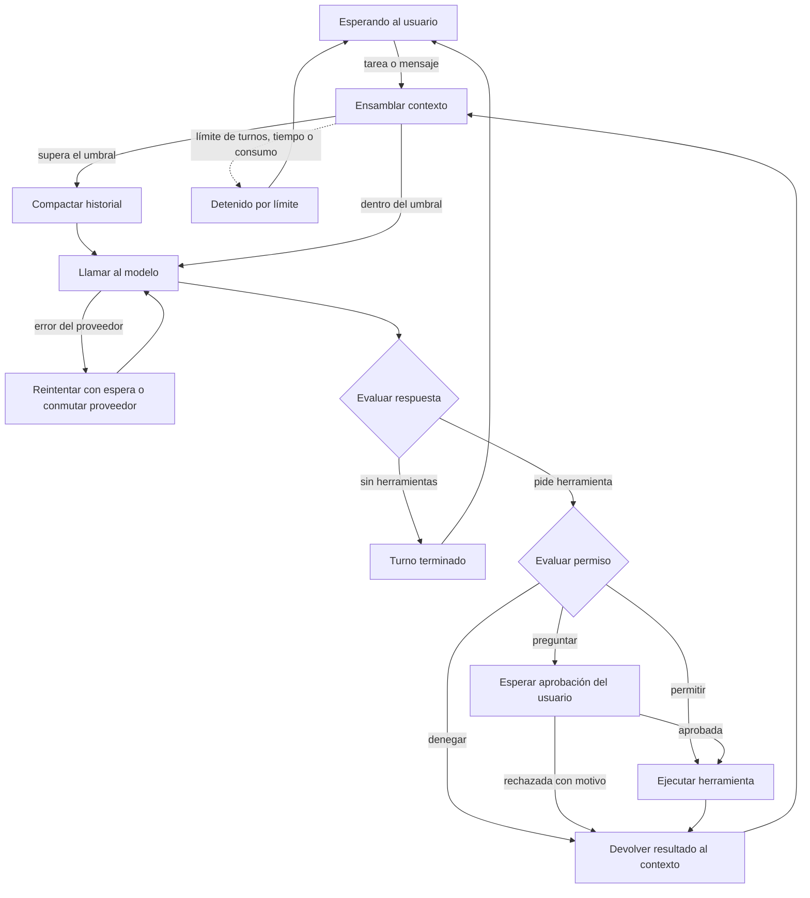
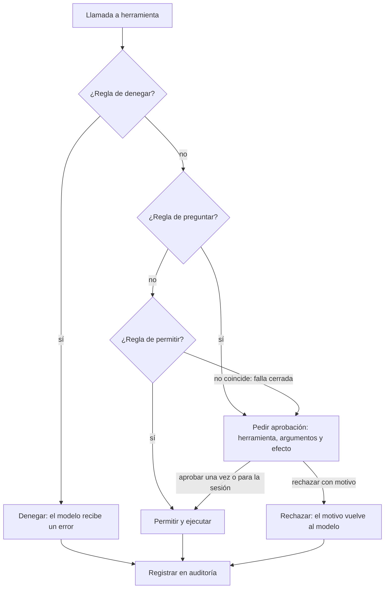

# Harness de agente en terminal — contexto del proyecto (versión 2.5)

> **Estado del plan (17/10/2026):** fuente de verdad = Word «HARNESS Análisis Scrum v2.5 consolidada». Cuarta semana aprobada por el Product Owner (PD-01) con cierre máximo el 14/11/2026. **Pendiente de ratificar en el Planning:** el reparto ampliado del Sprint 4 (11 PHU Alta adicionales: HU-03-03, HU-04-01, HU-04-02, HU-06-02, HU-10-01, HU-10-02); la aprobación solo cubre las 8 PHU de MCP. Mientras no se ratifique, trátalo como plan base provisional.

> Archivo de contexto para iniciar el proyecto (úsalo como `CLAUDE.md` o `docs/contexto.md`). Resume los requisitos, las decisiones de diseño, la arquitectura, el backlog de Scrum y el plan de cuatro sprints. Fuente de verdad del backlog: el Word de análisis v2.5. La hoja `backlog_harness.xlsx` anterior NO está sincronizada con este reparto hasta que se regenere y se audite.

## 1. Qué es y cómo se trabaja

Un **harness** es la aplicación que rodea a un modelo de lenguaje (el «cerebro») y lo conecta con el mundo: bucle de razonar–actuar–observar, herramientas, permisos, contexto, memoria, sesiones. Este proyecto construye uno propio, en terminal, con un núcleo reutilizable y desacoplado de la interfaz.

| Tema | Decisión |
|---|---|
| Equipo | 3 personas: A = Núcleo, B = Estado, C = Control y conexiones |
| Plazo | 4 sprints semanales. Cuarta semana aprobada por el PO el 17/10/2026 (PD-01 de v3); distribución ampliada de v2.5 pendiente de ratificar en Planning. |
| Disponibilidad | 15 a 28 h por semana en días hábiles más sábados y domingos completos (27 a 44 h por sprint). Velocidad hipotética: 39 PHU por sprint para el equipo (no por persona); las horas se estiman por tarea y solo contrastan carga con disponibilidad; se recalibra tras el Sprint 1 |
| Product Owner | Brad (tiene la rúbrica) |
| Scrum Master | Rotación: S1=A, S2=B, S3=C; S4=A provisional, por ratificar por el equipo. |
| Sistemas operativos | Windows y Linux (Arch). Integración continua en ambos |
| Lenguaje | Python 3.11+. TypeScript solo si se hace la interfaz web |
| Interfaz | Terminal (CLI). El núcleo emite eventos por un bus y nunca imprime, para añadir web (FastAPI/WebSocket) sin tocarlo |
| Proveedores | LiteLLM detrás de una interfaz propia `Provider`. Al menos dos de Claude, OpenAI y Gemini (por decidir; presupuesto de API por definir) |
| Persistencia | SQLite (sesiones, eventos, memoria, auditoría, trazas) |
| Herramientas externas | Cliente MCP (SDK de Python), stdio primero. Servidor de demostración local y sin credenciales (se elige en SPK-04) |
| Reto | Subagentes con contexto aislado (obligatorio) |
| Enfoque | Coding Harness basado en tickets (Proyecto 1 de los apuntes). Si hay tiempo, también el Proyecto 2 |
| Plazo informado | Cierre confirmado en el documento v3: a más tardar el 14 de noviembre de 2026. Ventanas de trabajo propuestas: S1 19–23/10; S2 26–30/10; S3 02–06/11; S4 09–13/11. Presentaciones intermedias cada 1–2 semanas sin fecha fija. |
| Estimación | Puntos de historia (PHU) con Fibonacci, relativos y leídos como velocidad del equipo; planning poker en el Sprint 1 |

Reglas del equipo: cada área tiene un dueño, pero todo cambio lo revisa otra persona. Definition of Done:
- El código está integrado y la integración continua pasa.
- Tiene pruebas y cumple los criterios de aceptación.
- Pasa el verificador de tipos y el formateador.
- No introduce secretos en el código ni en los registros.
- Otro integrante la revisó.
- Se mostró en la demostración del sprint.

## 2. Alcance

**Enfoque:** Coding Harness basado en tickets (Proyecto 1 de los apuntes de la cátedra) sobre un núcleo general. Si hay tiempo, se muestra también el Proyecto 2 (agente con herramientas), que el núcleo ya cubre. Flujo de la demostración: ticket → agente → análisis → cambios → pruebas → verificación de criterios → aprobación humana → Pull Request.

- **Obligatorio (prioridad Alta):** bucle con herramientas, contexto con compactación, sesiones reanudables, memoria, permisos con aprobación humana, CLI, dos proveedores con conmutación por fallo, MCP, subagentes, trazas y el flujo de tarea con criterios protegidos en SQLite, Git y pruebas por shell, subagente verificador, aprobación del diff, Pull Request y relevo entre sesiones con archivo de progreso (E11).
- **Si hay capacidad (Media):** varias llamadas por turno, detección de repeticiones, compactación manual, costos, memoria editable, modo solo lectura, reglas por archivo, subagente explorador y reglas de permisos por archivo.
- **Innovación (después del mínimo):** interfaz web, ejecución en entorno aislado, comparación con LangGraph, panel de costos.

## 3. Arquitectura

### 3.1 Bucle del agente



### 3.2 Decisión de permisos



### 3.3 Delegación en subagentes

1. El orquestador delega con objetivo, contexto mínimo, formato de salida esperado y perfil del subagente.
2. El harness crea una sesión hija (con `padre_id`), contexto vacío, instrucciones del perfil y herramientas permitidas (sin delegación).
3. El subagente ejecuta su propio bucle con límites de turnos y consumo. Si necesita aprobación, sube al usuario indicando qué subagente la pide.
4. Devuelve `{resultado, hallazgos clave, fuentes, error}` o un resultado parcial.
5. El harness valida el resultado contra el esquema y lo entrega.
6. El orquestador continúa con su ventana intacta.

### 3.4 Dónde vive cada cosa (contexto, historial y memoria)

| Qué | Dónde | Para qué | Al compactar |
|---|---|---|---|
| Historial completo | SQLite, `eventos`, solo se añade | Reanudar, auditar, exportar | No se toca; se marcan los eventos cubiertos |
| Memoria persistente | SQLite, `memorias` | Preferencias y datos entre sesiones | No se toca |
| Contexto esencial | SQLite, `contexto_esencial` (objetivo, instrucciones, reglas, ticket, referencia a criterios, decisiones) | Lo que nunca puede perderse | No se toca ni se resume |
| Ventana de contexto | RAM, se arma en cada turno | Lo que ve el modelo ahora | Se reconstruye más corta |

La ventana se arma en este orden: prefijo fijo (instrucciones, herramientas y contexto esencial: objetivo, reglas, ticket, criterios y decisiones) → memoria dentro de su presupuesto → resumen de lo antiguo → eventos recientes completos. El modelo no recuerda nada entre llamadas.

### 3.5 Relevo entre sesiones (artículo de Anthropic)

Fuente: Anthropic Engineering, «Effective harnesses for long-running agents» (26 de noviembre de 2025). Se toman las ideas que encajan con el flujo del ticket; el artículo no propone reducir herramientas, eso es decisión de este proyecto.

| Idea del artículo | Cómo se aplica aquí | Historias |
|---|---|---|
| Dos fallos de los agentes de larga duración: hacer todo de golpe y declarar victoria antes de tiempo. | Se atacan con un criterio por vez y con verificación externa antes de cerrar. | HU-11-04.1, HU-11-08.2 |
| Lista de funcionalidades en JSON con «passes» en falso; el agente solo puede cambiar «passes». | Criterios del ticket en SQLite con una copia JSON de solo lectura. Aquí lo impone el harness (escritura denegada, único punto que marca y copia restaurada si cambia), no solo el prompt. | HU-11-01, HU-11-04.1 |
| Archivo de progreso y commits descriptivos como relevo entre sesiones. | Archivo de progreso por ticket en el repositorio; SQLite sigue guardando el historial completo. | HU-11-08.1, HU-11-02 |
| Rutina de arranque: ubicar el directorio, leer progreso y log de git, levantar el entorno y correr una prueba básica antes de trabajar. | Paso fijo del harness al reanudar un ticket; si la prueba básica falla, se repara antes de avanzar. | HU-11-08.2 |
| Verificar de punta a punta, como un usuario, y no solo con pruebas unitarias o curl. | Cada criterio objetivo lleva el comando que lo comprueba y el harness lo ejecuta. El subagente verificador (Sprint 3) aporta evidencia sobre los semánticos, que además confirma una persona. Una herramienta de navegador por MCP queda como extensión. | HU-09-06, HU-11-04.1, HU-11-04.2 |
| Mismo harness en todas las sesiones; solo cambia el primer prompt (inicializador y agente de código). | Un solo bucle y dos prompts: uno que prepara el ticket (criterios y entorno) y otro que trabaja de a un criterio. | HU-11-01, HU-11-08.2 |
| Pregunta abierta: ¿un agente general o varios especializados? | Se prueba con dos perfiles de subagente (explorador y verificador) sin multiplicar los agentes. | HU-09-06 |

### 3.6 Conjunto mínimo de herramientas

El modelo ve pocas herramientas generales. Git, pruebas y lint son comandos del `shell`; lo que los controla son las reglas de permisos.

| Herramienta | Para qué | Control | Historias |
|---|---|---|---|
| shell | Ejecutar comandos: git, pruebas, lint, búsquedas y la CLI de GitHub. | Permisos por comando y por subcomando; encadenados evaluados por partes; push y merge siempre piden aprobación. | HU-01-04, HU-05-02, HU-11-02, HU-11-03 |
| leer_archivo | Leer texto de un archivo. | Bajo riesgo. El contenido leído se marca como dato, no como instrucción. | HU-01-03 |
| escribir_archivo | Crear o reemplazar un archivo. | Solo se permite dentro del área de trabajo autorizada (ruta real); fuera de ella se pregunta y, en el Sprint 1, se deniega con motivo. La base de datos y la copia de los criterios están denegadas. | HU-01-03, HU-11-01 |
| editar_archivo | Reemplazar un fragmento exacto de un archivo. | Igual que escribir; falla si el fragmento no es único. | HU-01-03 |
| preguntar_usuario | Pedir una decisión o un dato con opciones. | Es el canal de la aprobación humana. | HU-06-02, HU-05-03 |
| delegar_subagente | Lanzar una sesión hija con perfil explorador o verificador. | Un solo nivel de anidamiento; el perfil restringe las herramientas. | HU-09-01, HU-09-06 |
| Complementos | Memoria persistente y herramientas MCP. | Se registran en el mismo ToolRegistry y pasan por la misma política. | HU-04-02, HU-08-03 |

Lo que cuesta esta decisión:

| Tema | Problema | Respuesta |
|---|---|---|
| Windows y Linux | No existe bash en Windows de forma nativa. | La interfaz Shell tiene una implementación para PowerShell y otra para bash; el prefijo informa cuál se usa; el shell se prueba en integración continua en ambos sistemas (HU-01-04). |
| Permisos | Es más difícil decidir sobre una cadena de texto que sobre una herramienta con parámetros. | Se separan los comandos encadenados, manda la parte más restrictiva y lo no entendido se pregunta (HU-05-02). |
| Aislamiento | Un shell abierto puede tocar cualquier carpeta del usuario. | Directorio de trabajo acotado, aprobación fuera de él y worktree por ticket (HU-11-07, hoy Should); el entorno aislado queda como innovación (HU-IN-02) y es la forma verificable de aislar el shell (R-21). |

## 4. Contratos entre módulos

Se escriben y acuerdan en HU-00-01 para trabajar en paralelo con dobles de prueba. Ningún módulo del núcleo importa un SDK de proveedor.

| Interfaz | Operaciones | Función |
|---|---|---|
| Provider | complete(mensajes, herramientas) → respuesta con texto, llamadas y uso | Aísla a LiteLLM; cambiar de proveedor no toca el núcleo. |
| Tool | nombre, descripción, esquema, riesgo, run(args) → resultado | Todas las herramientas, nativas, MCP o de subagente, se ven igual. |
| ToolRegistry | register, get, list, validar(args) | Valida contra el esquema antes de ejecutar. |
| PermissionPolicy | evaluar(llamada) → denegar \| preguntar \| permitir | Falla cerrada; se aplica en el harness, no en el prompt. |
| Approver | pedir(llamada, detalle) → decisión (aprobar, rechazar con motivo, para la sesión) | Lo implementa la CLI; el núcleo solo espera. |
| SessionStore | guardar(evento), cargar(sesión), listar() | SQLite; escribe cada evento al ocurrir. |
| ContextManager | ensamblar(sesión, modelo) → mensajes; compactar() | Controla prefijo, recortes y umbral. |
| MemoryStore | guardar, consultar(presupuesto), borrar | Separada del historial. |
| McpClient | conectar, listar_herramientas, llamar | Traduce cada herramienta MCP a Tool. |
| SubagentRunner | ejecutar(perfil, objetivo, contexto, formato) → resultado | Crea la sesión hija y devuelve el resultado estructurado. |
| Shell | ejecutar(comando, tiempo_máximo) → código de salida y salida; nombre del intérprete | Una implementación para bash y otra para PowerShell. Es la única puerta a comandos del sistema. |
| TaskCriteria | cargar(tarea), pendientes(), marcar_pasa(id, evidencia), exportar_copia() | Lee y escribe la tabla criterios de SQLite. Solo el harness llama a marcar_pasa. La copia JSON es de solo lectura y se restaura si cambia. |
| AreaAutorizada | contiene(ruta) → verdadero o falso sobre la ruta real; raiz | Resuelve «..», enlaces simbólicos, unidades y rutas UNC antes de comparar. La usan las herramientas de archivos y la política de permisos. |
| EventBus | emitir(evento), suscribir(tipo, función) | Único canal del núcleo hacia las interfaces. |

### Formato interno de mensajes

| Elemento | Descripción |
|---|---|
| Roles | sistema, usuario, asistente, herramienta. |
| Bloque de texto | texto plano. |
| Llamada a herramienta | {id, nombre, argumentos}. |
| Resultado de herramienta | {id_llamada, contenido, es_error}. |
| Uso | tokens de entrada y de salida informados por la API. |
| Marca de origen | indica que el contenido viene de fuera (archivo, web, MCP) y no es una instrucción del usuario. |

### Eventos del bus

`mensaje_usuario`, `mensaje_asistente`, `herramienta_solicitada`, `herramienta_terminada`, `aprobacion_pedida`, `aprobacion_resuelta`, `contexto_compactado`, `permiso_decidido`, `criterios_alterados`, `limite_alcanzado`, `error_proveedor`, `proveedor_conmutado`, `subagente_iniciado`, `subagente_terminado`, `interrumpido`, `sesion_arrancada`, `criterio_verificado`.

### Modelo de datos (SQLite)

| Tabla | Campos principales |
|---|---|
| sesiones | id, padre_id (para subagentes), creada, modelo, objetivo, estado |
| eventos | id, sesion_id, orden, tipo, contenido, compactado_por |
| resumenes | id, sesion_id, evento_desde, evento_hasta, texto |
| contexto_esencial | id, sesion_id, clave (objetivo, instrucciones, reglas, ticket, criterios_ref, decisiones), valor, origen, actualizado. Fuera de los eventos: la compactación no lo toca |
| criterios | id, sesion_id, orden, descripcion, tipo (objetivo o semantico), comando, condicion, passes, evidencia, confirmado_por. Fuente de verdad; solo la escribe el harness |
| memorias | id, clave, contenido, creada, actualizada |
| auditoria | id, sesion_id, herramienta, argumentos_redactados, decision, momento |
| trazas | id, sesion_id, tipo, duracion_ms, tokens, detalle_redactado |

`compactado_por` marca qué eventos cubre cada resumen; `padre_id` enlaza la sesión de un subagente con su orquestador.

## 5. Decisiones de diseño que no se negocian

Salen de revisar los requisitos. Cada una tiene historias asociadas.

| Id | Hallazgo y decisión | Historias |
|---|---|---|
| V-01 | **La aprobación necesita comunicación en dos sentidos.** El bus de eventos solo emite. Para pedir aprobación el núcleo debe esperar una respuesta de la interfaz. El núcleo espera una decisión asíncrona (interfaz Approver). Se confirma con SPK-02. | HU-01-05, HU-05-03, SPK-02 |
| V-02 | **«Aprobar para la sesión» podía saltarse una denegación.** La captura no decía qué pasa si existe una regla de denegar. Denegar siempre gana. La aprobación de sesión se limita a una herramienta y un patrón de argumentos. | HU-05-02, HU-05-03 |
| V-03 | **Compactar no debe borrar historial.** RF-2 y RF-3 chocaban: reanudar exige el historial completo. La compactación añade un evento de resumen y marca los eventos cubiertos; el original permanece en SQLite. | HU-02-03, HU-03-02 |
| V-04 | **El objetivo y las decisiones no pueden vivir en el historial compactable.** Un resumen mal hecho podía perder la tarea original. El objetivo, las instrucciones, las reglas, el ticket y la referencia a los criterios se guardan aparte (contexto esencial, desde el Sprint 2) y se inyectan siempre en el prefijo; las decisiones del usuario se acumulan en el mismo bloque (Sprint 3). No requiere la memoria estructurada. | HU-02-06.1, HU-02-06.2 |
| V-05 | **«Relevancia» de la memoria no estaba definida.** Sin embeddings no hay medida de similitud. Relevancia = recencia dentro de un presupuesto de tokens. Embeddings pasan a innovación. | HU-04-02 |
| V-06 | **El contrato del subagente era vago.** No se sabía qué recibe ni qué devuelve. Entrada: objetivo, contexto mínimo y formato de salida. Salida: resultado, hallazgos clave, fuentes y error. Las aprobaciones suben al usuario. | HU-09-01, HU-09-02, HU-09-03 |
| V-07 | **RNF-5 medía algo que no controlamos.** La latencia del modelo no depende del harness. Se mide el tiempo propio del harness por turno con proveedor simulado. | HU-00-05.1 |
| V-08 | **Windows y macOS cambian el shell y la lista de comandos peligrosos.** El equipo usa Windows y Linux (Arch). Intérprete y lista de denegación para Windows y Linux; la integración continua corre en ambos. | HU-01-04, HU-00-02 |
| V-09 | **El conteo exacto de tokens no existe para todos los modelos.** Cada proveedor cuenta distinto. Estimación heurística corregida con el uso real que informa la API en cada respuesta. | HU-02-01 |
| V-10 | **El umbral de compactación depende del modelo.** Al conmutar de proveedor cambia la ventana disponible. El umbral se calcula por modelo y se recalcula al conmutar. | HU-02-03, HU-07-05 |
| V-11 | **Cancelar una herramienta en curso no estaba definido.** Interrumpir con Ctrl+C podía dejar el estado a medias. La herramienta se cancela, se registra como interrumpida y el modelo recibe ese resultado en el siguiente turno. | HU-06-03 |
| V-12 | **Faltaba un archivo de instrucciones del proyecto.** Es práctica común en harnesses actuales. Se añade RF-2.9 (Could): cargar un archivo de instrucciones al prefijo. | HU-02-07 |
| V-13 | **La detección de secretos no puede ser total.** No existe garantía absoluta. Se declara el alcance: patrones conocidos más los valores de las variables de entorno cargadas. | HU-04-05, HU-10-02 |
| V-14 | **Hace falta un proveedor simulado.** Sin él las pruebas dependen de la red y de la cuota. Se crea FakeProvider en el Sprint 1 como base de todas las pruebas. | HU-00-03 |
| V-15 | **El agente podía dar por terminada una tarea sin estarlo.** Si el propio modelo marca sus criterios como cumplidos, el cierre depende de su palabra. El artículo de Anthropic lo llama «victoria prematura». Los criterios viven en la tabla criterios de SQLite (fuente de verdad), con una copia JSON de solo lectura que el harness restaura si cambia. Solo el harness cambia «passes»: los criterios objetivos, con el resultado de su comando de verificación; los semánticos, solo con confirmación humana. El subagente verificador aporta evidencia, no decide. | HU-11-01, HU-11-04.1, HU-11-04.2, HU-09-06, HU-11-05 |
| V-16 | **Una sesión nueva de un mismo ticket no sabe qué pasó antes.** Sin memoria entre ventanas de contexto, el agente adivina el estado o construye sobre código roto. Rutina de arranque fija: leer el archivo de progreso y el log de git, correr la prueba básica y reparar antes de avanzar. Al cerrar, se anota el progreso. | HU-11-08.1, HU-11-08.2, HU-03-04 |
| V-17 | **Con un shell general los permisos se aplican sobre texto libre.** Un comando encadenado (a && b \| c) puede esconder una acción peligrosa detrás de una permitida. Se separa el comando, se evalúa cada parte y manda la más restrictiva; lo que no se entiende se pregunta. Push y merge siempre piden aprobación. | HU-05-02, HU-11-02 |

Cambios a la captura de requisitos:

| Requisito | Cambio |
|---|---|
| RF-11 (nuevo) | Coding Harness del ticket al Pull Request: tarea con criterios protegidos en SQLite y una copia JSON de solo lectura (11.1), Git por shell con reglas de permisos (11.2), pruebas y lint por shell (11.3), verificación de criterios por el harness, primero con comandos objetivos y luego con subagente verificador (11.4), aprobación del diff (11.5), Pull Request (11.6), worktree por ticket (11.7, Should) y arranque de sesión con archivo de progreso (11.8). Viene de los apuntes de la cátedra y del artículo de Anthropic sobre agentes de larga duración. |
| Herramientas (precisado) | El conjunto mínimo es shell, leer, escribir y editar archivos, preguntar al usuario y delegar en un subagente. Git, pruebas y lint ya no son herramientas propias: son comandos del shell bajo reglas de permisos (HU-11-02, HU-11-03 bajan a 1 punto cada una). Memoria y MCP se registran igual, como complementos. |
| RF-1.2 (precisado) | El shell es portable: PowerShell en Windows y bash en Linux detrás de una misma interfaz, y el prefijo del contexto dice al modelo cuál usa (HU-01-04 sube de 2 a 3 puntos). |
| RF-5.2 (precisado) | Los comandos encadenados se separan y se evalúa cada parte; manda la más restrictiva y lo que no se entiende se pregunta (HU-05-02 sube de 1 a 2 puntos). |
| RF-9.8 (re-priorizado) | El subagente verificador pasa de Should a Must: respalda el cierre de la tarea (HU-09-06). |
| RF-4.6, RF-6.6 (re-priorizados) | Pasan de Must a Should para hacer espacio: no guardar secretos en memoria y el conjunto de comandos de control de la sesión. Siguen vigentes la redacción de secretos en registros (RF-10.4) y los comandos propios de listar (HU-03-03) y reanudar (HU-03-04). |
| RF-7.5, RF-9.7 (re-priorizados) | Pasan de Must a Should para hacer espacio a RF-11: reintentos con espera y errores explícitos del subagente. También pasan a opcionales la prueba de inyección de prompt (RNF-17/18) y la cobertura mínima (RNF-11/14). La conmutación por fallo (RF-7.4) ya no depende de los reintentos. |
| RF-8.5 (vuelve a Must en la versión 2.3) | El aislamiento de fallos de un servidor MCP se había pasado a Should en la versión 2.1. La prueba de fallos de MCP (RNF-8) es un requisito original y no puede quedar atada a una historia opcional, así que HU-08-04 vuelve a prioridad Alta. Está pendiente de confirmar por el Product Owner (PD-03). |
| RF-5.1 (precisado) | Borrar archivos, push, merge y deploy siempre requieren aprobación. |
| RF-2.9 (nuevo, Could) | Cargar un archivo de instrucciones del proyecto en el prefijo del contexto. |
| RF-2.4 (precisado) | La compactación conserva el historial original y no puede eliminar el objetivo ni las decisiones del usuario. |
| RF-4.3 (precisado) | Relevancia de la memoria = recencia dentro de un presupuesto de tokens. |
| RF-5.4 (precisado) | Aprobar para la sesión nunca anula una regla de denegar y se limita a herramienta y patrón. |
| RF-9 (precisado) | Se define el contrato de entrada y salida del subagente y la subida de aprobaciones al usuario. |
| RNF-5 (reformulado) | Se mide el tiempo propio del harness por turno, no la latencia del modelo. |

Decisiones tomadas:

| Pregunta | Respuesta |
|---|---|
| ¿Cuál de los tres tipos de harness de los apuntes se hace? | El Proyecto 1: Coding Harness basado en tickets, construido sobre el núcleo general. Si da tiempo, se muestra también el Proyecto 2 (agente con herramientas), que el núcleo ya cubre. |
| ¿Cuándo termina el proyecto? | Hasta noviembre, posiblemente a mediados. Habrá presentaciones cada una o dos semanas, sin fecha fija. Es solo informativo: el plan sigue en 3 sprints y lo que sobre pasa a un posible cuarto. |
| ¿El límite de costo en dinero o en tokens? | En tokens. El costo en moneda es solo informativo. |
| ¿Dónde vive la memoria? | En SQLite, con el comando /memoria para consultarla y borrarla. |
| ¿Qué sistema operativo usa cada integrante? | Windows y Linux (Arch Linux). La integración continua y el shell cubren ambos. |
| ¿Quién es el Product Owner? | Brad. |
| ¿Cuántas horas tiene cada persona? | 15 a 28 horas por semana en los 5 días hábiles, más los sábados y domingos completos. Equivale a unas 27 a 44 horas por sprint, según cuánto se trabaje el fin de semana. |
| ¿Qué herramientas tiene el agente? | Un conjunto mínimo: shell, leer, escribir y editar archivos, preguntar al usuario y delegar en un subagente. Memoria y MCP son complementos. Git, pruebas y lint van por el shell bajo reglas de permisos. |
| ¿Cómo se pasa el trabajo entre sesiones de un mismo ticket? | Con los criterios guardados en SQLite (con una copia JSON de solo lectura), un archivo de progreso en el repositorio y el log de git, más una prueba básica antes de avanzar (patrón del artículo de Anthropic). |
| ¿Cuándo se demuestra por primera vez el flujo del Coding Harness? | Al final del Sprint 2, de ticket a verificación de criterios, sin commit ni Pull Request. El Sprint 3 lo completa: verificador independiente, aprobación del diff, commit y Pull Request. |
| ¿Qué servidor MCP usamos en la demostración? | Se elige en SPK-04: servidor local por stdio, sin credenciales. |

Preguntas abiertas:

| Pregunta | Por qué importa | Cuándo se cierra |
|---|---|---|
| ¿Qué dos modelos entre Claude, OpenAI y Gemini, y con qué presupuesto de API? | Define el proveedor principal y el de respaldo (HU-07-02, HU-07-03, SPK-01). | Antes de SPK-01 |
| ¿Se confirma asyncio como modelo de concurrencia? | Depende del resultado de SPK-02. | Fin del Sprint 1 |
| ¿Se dejan listar y buscar archivos como herramientas propias o se resuelven con el shell? | Afecta a HU-01-03 (3 puntos) y a cuántas herramientas ve el modelo. | Planning del Sprint 1 |

## 6. Estrategia de pruebas y riesgos

| Tipo | Qué cubre | Cómo | Quién |
|---|---|---|---|
| Unitarias | Registro, validación, política de permisos, estimación de tokens, recorte. | pytest, sin red | Cada integrante |
| Integración con proveedor simulado | Bucle completo, aprobación, rechazo, compactación, reanudación. | FakeProvider con guion | Dueño del módulo |
| Fallos | Cierre forzado, proveedor caído, herramienta con excepción, MCP caído. | Inyección de fallos | A (HU-00-05.1; MCP en HU-00-05.2) |
| Contrato | Cada Provider real cumple la interfaz. | Pocas llamadas reales marcadas aparte | B |
| Aceptación | Guion de demostración de 10 a 15 minutos. | Manual con persona ajena | Todo el equipo |

Casi todo se prueba con el proveedor simulado (`FakeProvider`). Las llamadas reales se reservan para pruebas de contrato y la demostración.

Riesgos nuevos (se suman a R-1 a R-10 de la captura):

| Id | Riesgo | Prob. | Impacto | Mitigación |
|---|---|---|---|---|
| R-11 | Fallo del modelo de concurrencia (asyncio) que obligue a reescribir. | Media | Alto | SPK-02 en el Sprint 1 antes de construir sobre él. |
| R-12 | El equipo usa Windows y Linux y el shell o las rutas fallan en uno. | Alta | Medio | Intérprete por plataforma e integración continua en Windows y Linux. |
| R-13 | Estimaciones demasiado optimistas por falta de datos reales: la velocidad de 39 PHU por sprint es una hipótesis. | Alta | Alto | Recalibrar puntos y horas tras Sprint 1. La cuarta semana está aprobada según v3, pero su capacidad no está demostrada; las historias Media solo entran si se completa lo obligatorio. |
| R-14 | Cuota de API agotada durante pruebas. | Media | Medio | FakeProvider para casi todas las pruebas; límite de consumo. |
| R-15 | Dependencias entre A, B y C bloquean en el Sprint 2. | Media | Alto | Contratos acordados en HU-00-01 y dobles de prueba. |
| R-16 | Con el shell como herramienta general, un comando mal clasificado borra o publica algo. | Media | Alto | Lista de denegados inalterable, evaluación por partes, falla cerrada y aprobación siempre para push y merge (HU-05-02, HU-11-02). El worktree por ticket (HU-11-07, hoy Should) sube de prioridad si el riesgo se materializa en las pruebas. |
| R-17 | El verificador y el agente comparten modelo y pueden coincidir en el error. | Media | Medio | El harness ejecuta las pruebas por su cuenta y no se apoya solo en el informe del verificador; los criterios llevan pasos concretos. |
| R-18 | PowerShell y bash difieren en comillas, rutas y comandos disponibles. | Alta | Medio | El prefijo informa el sistema y el intérprete; las pruebas del shell corren en integración continua en Windows y Linux (HU-01-04). |
| R-19 | La ruta crítica del Sprint 2 es corta: shell, política de comandos, pruebas y verificación deben encadenarse en una semana. | Alta | Alto | Se trabaja primero la ruta crítica (HU-01-04, HU-11-01, HU-05-02, HU-11-03, HU-11-04.1); el shell sale con aprobación obligatoria hasta que llegue HU-05-02; el flujo se prueba pronto con un guion del FakeProvider y un ticket de ejemplo preparado. |
| R-20 | Aunque la cuarta semana fue aprobada en v3, el reparto de Sprint 4 creció de 8 PHU de MCP a 19 PHU Alta y requiere ratificación. Sprint 1 supera la disponibilidad media. | Alta | Alto | Ratificar las 11 PHU diferidas adicionales, responsables y margen; confirmar la fecha 14/11 en Planning. Sin capacidad, renegociar obligaciones con el PO sin degradarlas unilateralmente. |
| R-21 | Si shell y harness comparten permisos de sistema operativo, el agente podría modificar SQLite (la fuente de verdad) o los comandos/pruebas de aceptación; un JSON marcado como solo lectura no constituye aislamiento. | Media | Alto | La política deniega accesos identificables y el harness ignora la copia JSON. Esta mitigación es lógica, NO garantiza integridad frente al shell arbitrario. PD-06 exige separación de privilegios/sandbox operativo y pruebas que muestren acceso denegado; sin ello se declara riesgo residual. |
| R-22 | Carga actual v2.5 Alta: Sprint 1 = 104,5 h; Sprint 2 = 101 h; Sprint 3 = 94,5 h; Sprint 4 = 45,5 h. El equipo dispone de 96 h netas en escenario medio; no existe una reserva consistente del 20 %. | Alta | Alto | Recalibrar tras Sprint 1, verificar las horas reales por persona y proteger pruebas/integración. La cuarta semana aprobada no garantiza velocidad ni aprueba por sí sola el reparto ampliado. |

## 7. Épicas

| Id | Nombre | Descripción | Hist. | PHU |
|---|---|---|---|---|
| E0 | Fundaciones y calidad | Repositorio, interfaces acordadas, integración continua, proveedor simulado, pruebas y documentación. Hace posible el trabajo en paralelo. | 8 | 16 |
| E1 | Bucle y herramientas | Bucle razonar-actuar-observar, registro de herramientas con esquema JSON, herramientas base, bus de eventos y límites. | 9 | 23 |
| E2 | Gestión de contexto | Estimación de tokens, prefijo estable, recorte de salidas y compactación automática sin perder el objetivo. | 9 | 16 |
| E3 | Sesiones | Persistencia de cada evento en SQLite, listado y reanudación de sesiones, resistencia a cortes abruptos. | 6 | 12 |
| E4 | Memoria | Memoria persistente separada del historial, herramienta de memoria, memoria estructurada y protección de secretos. | 5 | 11 |
| E5 | Permisos y human-in-the-loop | Política denegar, preguntar, permitir que falla cerrada; aprobación con detalle; rechazo con motivo; auditoría. | 8 | 16 |
| E6 | Interacción con el usuario | CLI con eventos en tiempo real, herramienta para preguntar con opciones, comandos de control e interrupción. | 4 | 8 |
| E7 | Proveedores de modelo | Interfaz Provider sobre LiteLLM, dos proveedores, reintentos y conmutación por fallo. | 7 | 14 |
| E8 | Integración MCP | Cliente MCP por stdio, descubrimiento y traducción de herramientas, mismos permisos que las nativas, aislamiento de fallos. | 7 | 13 |
| E9 | Subagentes (reto) | Delegación en sesiones hijas con contexto aislado, herramientas restringidas y resultado estructurado. | 7 | 17 |
| E10 | Trazabilidad | Trazas estructuradas, auditoría y redacción de secretos en los registros. | 3 | 6 |
| E11 | Coding Harness: del ticket al Pull Request | Tarea con criterios verificables protegidos en SQLite (copia JSON de solo lectura), Git y pruebas por el shell, verificación de criterios por el harness, aprobación del diff, Pull Request y relevo entre sesiones con archivo de progreso. Es el flujo con el que se demuestra el proyecto. | 10 | 16 |
| EI | Innovación | Interfaz web, sandbox, comparación con LangGraph y panel de costos. Solo si el mínimo está cerrado. | 4 | 21 |

## 8. Plan de sprints

### Sprint 1 — Agente ejecutable en terminal: recibe una tarea, usa herramientas de archivos y deja todo guardado

- **Fechas:** 19 de octubre de 2026 al 23 de octubre de 2026
- **Estado:** Compromiso
- **Scrum Master:** A — Núcleo
- **Hito:** El agente recibe una instrucción en la terminal, la resuelve en varios turnos con herramientas de archivos y un modelo real, y la sesión queda guardada en SQLite. Las escrituras solo se permiten dentro de un área de trabajo autorizada y verificada; cualquier otra acción que pida aprobación se deniega con motivo, porque la interfaz de aprobación llega en el Sprint 2. Limitación asumida: no hay aprobación interactiva ni shell todavía.
- **Demostración:** Ejecutar una tarea de varios pasos dentro del área de trabajo autorizada, mostrar sus eventos y la sesión guardada, e intentar una escritura fuera del área para ver cómo se deniega.

**Criterios de demostración (con las historias que los respaldan):**

- Con el proveedor simulado, una tarea guionizada de tres pasos (leer, escribir y releer un archivo) dentro del área de trabajo autorizada termina igual en cada ejecución, también en la integración continua. (Respaldo: HU-00-03, HU-01-01, HU-01-03, HU-05-01, HU-00-02)
- Con un modelo real, el agente completa la misma tarea desde la CLI y muestra los eventos en tiempo real. (Respaldo: HU-07-01, HU-07-02, HU-06-01, HU-01-05, HU-00-04)
- Tras la ejecución existe una sesión en SQLite con todos sus eventos; si se mata el proceso a mitad, los eventos ya ocurridos siguen guardados. (Respaldo: HU-03-01, HU-03-02)
- Una escritura fuera del área (con «..», ruta absoluta o enlace simbólico) se rechaza antes de escribir, el modelo recibe el motivo y la decisión queda como evento. (Respaldo: HU-01-03, HU-05-01, HU-03-02)
- Una acción que resulta en «preguntar» se deniega con motivo, porque la aprobación interactiva llega en el Sprint 2; no hay ninguna regla que permita escribir en cualquier ruta. (Respaldo: HU-05-01)
- La integración continua pasa en Linux y en Windows. (Respaldo: HU-00-02)

| Id | Historia | Prioridad | PHU | Responsable |
|---|---|---|---|---|
| HU-00-01 | Esqueleto del repositorio e interfaces acordadas | Alta | 3 | A — Núcleo |
| HU-00-02 | Integración continua con pruebas, tipado y formato | Alta | 2 | A — Núcleo |
| HU-00-03 | Proveedor simulado para pruebas | Alta | 2 | B — Estado |
| HU-00-04 | Configuración por archivo y variables de entorno | Alta | 1 | B — Estado |
| HU-01-01 | Bucle agéntico básico | Alta | 5 | A — Núcleo |
| HU-01-02 | Registro de herramientas con esquema y validación | Alta | 3 | C — Control y conexiones |
| HU-01-03 | Herramientas de archivos: leer, escribir, listar y buscar | Alta | 4 | C — Control y conexiones |
| HU-01-05 | Bus de eventos desacoplado de la interfaz | Alta | 2 | B — Estado |
| HU-03-01 | Esquema SQLite y creación de sesión | Alta | 2 | B — Estado |
| HU-03-02 | Persistir cada evento al ocurrir y tolerar cortes abruptos | Alta | 3 | B — Estado |
| HU-05-01 | Política denegar, preguntar, permitir que falla cerrada | Alta | 3 | C — Control y conexiones |
| HU-06-01 | CLI básica con eventos en tiempo real | Alta | 2 | C — Control y conexiones |
| HU-07-01 | Interfaz Provider y formato interno de mensajes | Alta | 3 | A — Núcleo |
| HU-07-02 | Adaptador LiteLLM para el primer proveedor | Alta | 2 | B — Estado |
| SPK-01 | Spike: traducir herramientas entre OpenAI y Anthropic con LiteLLM | Alta | 1 | B — Estado |
| SPK-02 | Spike: modelo asíncrono y cancelación de herramientas | Alta | 1 | A — Núcleo |

PHU Alta: 39 (velocidad hipotética del equipo: 39). Horas de tareas Alta: A 33,5 · B 34,5 · C 36,5; total 104,5 h (disponible neto por persona: 23,5 a 40,5 h; media del equipo 96 h).

### Sprint 2 — Primer flujo vertical del Coding Harness: del ticket a la verificación automática de criterios

- **Fechas:** 26 de octubre de 2026 al 30 de octubre de 2026
- **Estado:** PLAN BASE para Planning S2 (26–30/10, estimaciones preliminares)
- **Scrum Master:** B — Estado
- **Hito:** el agente recibe un ticket, modifica un repositorio de prueba, ejecuta pruebas y verifica criterios objetivos. Se mantienen permisos, aprobación/rechazo y la persistencia de eventos. SPK-04 investiga la integración MCP de forma anticipada, pero no convierte MCP en condición de demostración del Sprint 2. Subagentes y archivo de progreso del ticket permanecen en Sprint 3.
- **Demostración:** crear un ticket de prueba, permitir al agente modificar el proyecto, ejecutar pruebas y mostrar criterios objetivos cumplidos/no cumplidos y semánticos pendientes. Validar un intento bloqueado de alterar los criterios por herramientas controladas; no afirmar aislamiento del shell arbitrario.

**Criterios de demostración (con las historias que los respaldan):**

- Dado un ticket de ejemplo con tres criterios (dos con comando de verificación y uno semántico), el agente modifica el proyecto de prueba, git status y git diff muestran el cambio, y la CLI presenta cada criterio como cumplido, no cumplido o pendiente de validación humana. (Respaldo: HU-11-01, HU-11-04.1, HU-11-03, HU-11-02, HU-01-04)
- «Cumplido» solo aparece después de que el harness ejecuta el comando de verificación; un intento del agente de modificar los criterios (por las herramientas de archivos o por el shell) se bloquea y queda en los eventos. (Respaldo: HU-11-01, HU-11-04.1, HU-05-01, HU-03-02)
- Un comando encadenado con una parte denegada se rechaza; uno no permitido pide aprobación al usuario y un rechazo con motivo vuelve al modelo. (Respaldo: HU-05-02, HU-05-03, HU-05-04, HU-01-04)
- Las pruebas del proyecto de ejemplo se ejecutan con tiempo máximo, código de salida visible y salida recortada. (Respaldo: HU-11-03, HU-01-04, HU-02-02)
- La sesión conserva sus eventos confirmados tras terminar el proceso y puede reanudarse por su identificador. No se promete todavía archivo de progreso del ticket ni cancelación controlada. (Respaldo: HU-03-02, HU-03-04)
- Una sesión larga se compacta y el agente sigue conociendo el objetivo, las instrucciones, las reglas de la tarea, el identificador del ticket y los criterios, que no forman parte de lo resumido. (Respaldo: HU-02-03, HU-02-06.1, HU-02-01, HU-11-01)

| Id | Historia | Prioridad | PHU | Responsable |
|---|---|---|---|---|
| HU-01-04 | Herramienta de shell portable con tiempo límite | Alta | 3 | C — Control y conexiones |
| HU-01-06 | Límites de turnos, tiempo y costo por sesión | Alta | 2 | A — Núcleo |
| HU-02-01 | Estimación de tokens y prefijo estable | Alta | 2 | B — Estado |
| HU-02-02 | Recorte de salidas largas de herramientas | Alta | 1 | C — Control y conexiones |
| HU-02-03 | Compactación automática por umbral | Alta | 5 | B — Estado |
| HU-02-06.1 | Contexto esencial persistente fuera del historial compactable | Alta | 1 | B — Estado |
| HU-03-04 | Reanudar una sesión por identificador | Alta | 3 | A — Núcleo |
| HU-05-02 | Lista de denegados y análisis de comandos compuestos | Alta | 2 | C — Control y conexiones |
| HU-05-03 | Aprobación con detalle: una vez, toda la sesión o rechazar | Alta | 3 | C — Control y conexiones |
| HU-05-04 | Rechazo con motivo que vuelve al modelo | Alta | 1 | A — Núcleo |
| SPK-04 | Spike: cliente MCP por stdio y servidor de demostración | Alta | 1 | C — Control y conexiones |
| SPK-03 | Spike: compactación sin perder el objetivo | Alta | 1 | B — Estado |
| HU-11-01 | Tarea con criterios de aceptación protegidos en SQLite | Alta | 2 | A — Núcleo |
| HU-11-02 | Git mediante el shell con reglas de permisos por subcomando | Alta | 1 | B — Estado |
| HU-11-03 | Pruebas y lint mediante el shell con salida recortada | Alta | 1 | C — Control y conexiones |
| HU-11-04.1 | Verificación automática de criterios objetivos: solo el harness marca passes | Alta | 2 | A — Núcleo |

PHU Alta: 31 (velocidad hipotética del equipo: 39). Horas de tareas Alta: A 31,5 · B 32,5 · C 37; total 101 h (disponible neto por persona: 23,5 a 40,5 h; media del equipo 96 h).

### Sprint 3 — Coding Harness completo: del ticket al Pull Request, con integración y calidad

- **Fechas:** 2 de noviembre de 2026 al 6 de noviembre de 2026
- **Estado:** PLAN BASE para Planning S3 (02–06/11)
- **Scrum Master:** C — Control y conexiones
- **Hito:** construir la delegación en subagentes y completar ticket → verificación independiente → aprobación del diff → commit → Pull Request. Incorporar puntos de control, reanudación del ticket, decisiones persistentes y conmutación de proveedor. El registro mínimo de auditoría queda redactado antes de persistir; las trazas exhaustivas de modelos/herramientas y memoria transversal se entregan en Sprint 4.
- **Demostración:** Recorrer el flujo completo en 10 a 15 minutos: ticket → agente → modificación → pruebas → verificación de criterios → revisión y aprobación del diff → commit → Pull Request.

**Criterios de demostración (con las historias que los respaldan):**

- Sobre un repositorio de demostración, el flujo completo termina con un Pull Request creado y su enlace visible. (Respaldo: HU-11-06, HU-11-05, HU-11-04.1, HU-11-02)
- Un criterio semántico recibe el informe del subagente verificador y queda pendiente hasta que el usuario lo confirma; el subagente no puede editar archivos. (Respaldo: HU-11-04.2, HU-09-06, HU-09-02, HU-09-03, HU-09-01, HU-11-05)
- Un ticket terminado normalmente o interrumpido por cierre del proceso conserva el último punto de control completo; al reanudar, se leen el progreso, el log de git y la prueba básica. (Respaldo: HU-11-08.1, HU-11-08.2, HU-03-04, HU-11-02)
- Push y creación del Pull Request siempre piden aprobación; sin ella no sale nada del repositorio, y cada decisión queda en el registro de auditoría. (Respaldo: HU-05-01, HU-05-03, HU-11-06, HU-05-05)
- Un error elegible del proveedor principal causa conmutación sin bucle; se conserva un evento mínimo en la sesión y se informa en pantalla. Las trazas estructuradas completas y la memoria entre sesiones se implementan en Sprint 4. (Respaldo: HU-07-03, HU-07-05, HU-03-02)
- Tras tres compactaciones seguidas el agente respeta el rechazo con motivo que el usuario dio antes y conoce el objetivo original. (Respaldo: HU-02-06.2, HU-02-06.1, HU-05-04)
- Las pruebas de fallos del núcleo pasan en CI y el registro mínimo de decisiones redacta argumentos sensibles antes de persistir; no se confunde con las trazas exhaustivas pospuestas. (Respaldo: HU-00-05.1, HU-05-05)

| Id | Historia | Prioridad | PHU | Responsable |
|---|---|---|---|---|
| HU-00-05.1 | Pruebas de integración y de fallos del núcleo | Alta | 2 | A — Núcleo |
| HU-00-06 | README, guion de demostración y documento de arquitectura | Alta | 3 | B — Estado |
| HU-00-07 | Cobertura mínima y prueba de instalación | Media | 2 | C — Control y conexiones |
| HU-01-07 | Varias llamadas a herramientas en un mismo turno | Media | 2 | A — Núcleo |
| HU-01-08 | Detección de llamadas repetidas | Media | 1 | A — Núcleo |
| HU-02-04 | Comando para compactar manualmente | Media | 1 | B — Estado |
| HU-02-06.2 | Decisiones acumuladas y continuidad tras varias compactaciones | Alta | 1 | B — Estado |
| HU-03-05 | Consumo de tokens y costo estimado por sesión | Media | 2 | B — Estado |
| HU-05-05 | Registro de auditoría de decisiones | Alta | 2 | B — Estado |
| HU-05-06 | Reglas de permisos por archivo | Media | 2 | C — Control y conexiones |
| HU-05-07 | Modo de solo lectura | Media | 1 | C — Control y conexiones |
| HU-06-03 | Interrumpir la ejecución sin perder la sesión | Media | 2 | A — Núcleo |
| HU-07-03 | Segundo proveedor y selección por configuración | Alta | 2 | A — Núcleo |
| HU-07-04 | Reintentos con espera exponencial | Media | 1 | A — Núcleo |
| HU-07-05 | Conmutación por fallo con umbral por modelo | Alta | 3 | A — Núcleo |
| HU-09-01 | Delegar en un subagente con contexto limpio | Alta | 5 | B — Estado |
| HU-09-02 | Instrucciones propias y herramientas restringidas por subagente | Alta | 2 | C — Control y conexiones |
| HU-09-03 | Resultado estructurado en lugar de la transcripción | Alta | 2 | A — Núcleo |
| HU-09-04 | Un solo nivel de anidamiento y límites por subagente | Alta | 2 | A — Núcleo |
| HU-09-05 | Propagación explícita de errores del subagente | Media | 1 | A — Núcleo |
| HU-09-06 | Subagente verificador y subagente explorador | Alta | 2 | C — Control y conexiones |
| HU-11-04.2 | Verificación independiente con el subagente verificador | Alta | 1 | C — Control y conexiones |
| HU-11-05 | Resumen de cambios y aprobación humana del diff | Alta | 2 | C — Control y conexiones |
| HU-11-06 | Pull Request tras la aprobación | Alta | 2 | C — Control y conexiones |
| HU-11-07 | Una sesión por ticket con un worktree propio | Media | 3 | C — Control y conexiones |
| HU-11-08.1 | Archivo de progreso del ticket con puntos de control | Alta | 1 | B — Estado |
| HU-11-08.2 | Rutina de arranque al reanudar un ticket | Alta | 1 | C — Control y conexiones |

PHU Alta: 33 (velocidad hipotética del equipo: 39). Horas de tareas Alta: A 30 · B 33 · C 31,5; total 94,5 h (disponible neto por persona: 23,5 a 40,5 h; media del equipo 96 h). Media (18 PHU, 34,5 h) solo si el mínimo está cerrado.

### Sprint 4 — MCP, memoria, trazabilidad y funciones complementarias

- **Fechas:** 9 de noviembre de 2026 al 13 de noviembre de 2026
- **Estado:** CUARTA SEMANA APROBADA según PD-01 del documento v3 (17/10/2026), con cierre máximo 14/11/2026
- **Scrum Master:** A — Núcleo (provisional, confirmar en Planning)
- **Hito:** Hito mínimo formalmente aprobado: integración MCP completa y prueba de fallos (8 PHU). Este plan consolidado asigna además otras 11 PHU Alta a Sprint 4 (memoria, trazas, listado y preguntas), heredadas del alcance original; su redistribución dentro de la cuarta semana requiere ratificación de PO y equipo en el Planning. No hay 31 PHU garantizados de holgura: la capacidad hipotética no es velocidad real.
- **Demostración:** MCP por stdio con aprobación y fallos aislados; memoria entre sesiones, listado, preguntas y trazas completas con redacción, si se ratifica el reparto adicional. Las funciones del Sprint 3 conservan su propia demostración independiente.

**Criterios de demostración (con las historias que los respaldan):**

- El agente conecta un servidor MCP por stdio, descubre y usa herramientas con los mismos contratos que las nativas. La prueba preliminar SPK-04 ya se ejecutó en Sprint 2. (Respaldo: SPK-04, HU-08-01, HU-08-02)
- Cada herramienta MCP queda bajo los controles de permisos y su denegación no rompe la sesión; un servidor caído afecta solo a sus propias herramientas. (Respaldo: HU-08-03, HU-08-04, HU-00-05.2)
- La memoria persiste entre sesiones; las trazas redactan secretos y se pueden consultar; se pueden listar sesiones y preguntar con opciones. (Respaldo: HU-04-01, HU-04-02, HU-10-01, HU-10-02, HU-03-03, HU-06-02)

| Id | Historia | Prioridad | PHU | Responsable | Reparto |
|---|---|---|---|---|---|
| HU-00-05.2 | Prueba de aislamiento de fallos de un servidor MCP | Alta | 1 | A — Núcleo | Aprobado (MCP) |
| HU-03-03 | Listar sesiones | Alta | 1 | B — Estado | Por ratificar |
| HU-04-01 | Almacén de memoria separado del historial | Alta | 2 | B — Estado | Por ratificar |
| HU-04-02 | Herramienta de memoria y carga al inicio | Alta | 3 | B — Estado | Por ratificar |
| HU-04-03 | Memoria estructurada de la sesión | Media | 3 | B — Estado | Por ratificar |
| HU-04-04 | Inspeccionar y editar la memoria | Media | 1 | C — Control y conexiones | Por ratificar |
| HU-04-05 | No almacenar secretos en memoria | Media | 2 | C — Control y conexiones | Por ratificar |
| HU-05-08 | Contenido externo tratado como datos | Media | 2 | C — Control y conexiones | Por ratificar |
| HU-06-02 | Herramienta para preguntar al usuario con opciones | Alta | 2 | C — Control y conexiones | Por ratificar |
| HU-06-04 | Comandos de control de la sesión | Media | 2 | B — Estado | Por ratificar |
| HU-08-01 | Conexión a un servidor MCP por stdio | Alta | 2 | C — Control y conexiones | Aprobado (MCP) |
| HU-08-02 | Descubrir herramientas MCP y traducirlas al formato interno | Alta | 2 | C — Control y conexiones | Aprobado (MCP) |
| HU-08-03 | Invocar herramientas MCP bajo la misma política de permisos | Alta | 2 | C — Control y conexiones | Aprobado (MCP) |
| HU-08-04 | Aislar los fallos de un servidor MCP | Alta | 1 | C — Control y conexiones | Aprobado (MCP) |
| HU-10-01 | Trazas estructuradas de cada llamada | Alta | 2 | B — Estado | Por ratificar |
| HU-10-02 | Redacción de secretos en registros | Alta | 1 | B — Estado | Por ratificar |

PHU Alta: 19 (velocidad hipotética del equipo: 39). Horas de tareas Alta: A 4,5 · B 20 · C 21; total 45,5 h (disponible neto por persona: 23,5 a 40,5 h; media del equipo 96 h). Media (10 PHU, 15,5 h) solo si el mínimo está cerrado. Reparto ampliado por ratificar: 11 PHU Alta (HU-03-03, HU-04-01, HU-04-02, HU-06-02, HU-10-01, HU-10-02) y 10 PHU Media.

### Sin sprint (backlog)

| Id | Historia | Prioridad | PHU |
|---|---|---|---|
| HU-02-05 | Compactación solicitada por el propio modelo | Baja | 2 |
| HU-02-07 | Archivo de instrucciones del proyecto | Baja | 2 |
| HU-03-06 | Exportar una sesión a formato legible | Baja | 1 |
| HU-07-06 | Respuesta en streaming | Baja | 2 |
| HU-08-05 | Varios servidores por archivo y prefijos para evitar colisiones | Media | 3 |
| HU-08-06 | Transporte HTTP además de stdio | Baja | 2 |
| HU-09-07 | Subagentes en paralelo con agregación de resultados | Baja | 3 |
| HU-10-03 | Convenciones de OpenTelemetry para IA generativa | Baja | 3 |
| HU-IN-01 | Interfaz web sobre el mismo núcleo | Baja | 8 |
| HU-IN-02 | Ejecución de comandos en entorno aislado | Baja | 5 |
| HU-IN-03 | Comparación del orquestador propio con LangGraph | Baja | 5 |
| HU-IN-04 | Panel de costos y consumo por sesión | Baja | 3 |

## 9. Sprint Backlogs (tareas)

Estimación en horas por tarea, hecha tarea por tarea y no derivada de los PHU; el equipo la ajusta en el Planning. `(opc.)` = historia de prioridad Media, solo si el mínimo está cerrado. La semana del Sprint 4 fue aprobada por el Product Owner (PD-01); su reparto ampliado está por ratificar. Los códigos Sp#-nn son los de F5 del Word v2.5.

### Sprint 1

| Id | HU | Tarea | Horas | Resp. |
|---|---|---|---|---|
| Sp1-01 | HU-00-01 | Crear la estructura de paquetes: núcleo, adaptadores, interfaz CLI y pruebas | 2 | A |
| Sp1-02 | HU-00-01 | Escribir las firmas de Provider, Tool, ToolRegistry, PermissionPolicy, SessionStore, MemoryStore, ContextManager, McpClient y SubagentRunner | 2,5 | A |
| Sp1-03 | HU-00-01 | Reunión de 1 hora para acordar el formato interno de mensajes y eventos | 1 | A |
| Sp1-04 | HU-00-02 | Configurar el pipeline en el repositorio | 2,5 | A |
| Sp1-05 | HU-00-02 | Añadir pytest con informe de cobertura, verificador de tipos y formateador | 2 | A |
| Sp1-06 | HU-00-02 | Fijar versiones de dependencias en el archivo de requisitos | 1 | A |
| Sp1-07 | HU-00-03 | Implementar FakeProvider que lee un guion | 3 | B |
| Sp1-08 | HU-00-03 | Añadir modo de fallo configurable (cuota, tiempo agotado, indisponible) | 1,5 | B |
| Sp1-09 | HU-00-04 | Definir el esquema de configuración y sus valores por defecto | 1,5 | B |
| Sp1-10 | HU-00-04 | Cargar claves solo desde variables de entorno | 1 | B |
| Sp1-11 | HU-00-04 | Añadir .gitignore y plantilla de ejemplo sin secretos | 0,5 | B |
| Sp1-12 | HU-01-01 | Implementar un turno: llamar al proveedor, procesar la respuesta, ejecutar herramientas, devolver resultados | 7 | A |
| Sp1-13 | HU-01-01 | Condición de parada y emisión de eventos | 2,5 | A |
| Sp1-14 | HU-01-01 | Pruebas con el proveedor simulado | 4 | A |
| Sp1-15 | HU-01-02 | Definir la clase base Tool con esquema | 3 | C |
| Sp1-16 | HU-01-02 | Implementar el registro y la validación con el esquema | 2,5 | C |
| Sp1-17 | HU-01-02 | Pruebas con argumentos mal formados | 2 | C |
| Sp1-18 | HU-01-03 | Implementar leer, listar y buscar con error claro de ruta inexistente | 2,5 | C |
| Sp1-19 | HU-01-03 | Componente AreaAutorizada: configuración del área y comprobación de contención sobre la ruta real | 2,5 | C |
| Sp1-20 | HU-01-03 | Implementar escribir usando AreaAutorizada (normalización, enlaces simbólicos, unidades y rutas UNC) | 3,5 | C |
| Sp1-21 | HU-01-03 | Declarar para cada herramienta su nivel de riesgo | 1 | C |
| Sp1-22 | HU-01-03 | Pruebas de escape: «..», ruta absoluta, enlace simbólico y casos de Windows | 3,5 | C |
| Sp1-23 | HU-01-05 | Definir los tipos de evento | 1 | B |
| Sp1-24 | HU-01-05 | Implementar el emisor y la suscripción | 2,5 | B |
| Sp1-25 | HU-01-05 | Prueba con un suscriptor de registro | 1,5 | B |
| Sp1-26 | HU-03-01 | Diseñar las tablas de sesiones y eventos | 1,5 | B |
| Sp1-27 | HU-03-01 | Implementar SessionStore con SQLite | 3 | B |
| Sp1-28 | HU-03-01 | Pruebas de creación | 1,5 | B |
| Sp1-29 | HU-03-02 | Suscribir el almacén al bus de eventos | 1,5 | B |
| Sp1-30 | HU-03-02 | Escribir en transacciones por evento | 2,5 | B |
| Sp1-31 | HU-03-02 | Prueba de interrupción forzada | 2,5 | B |
| Sp1-32 | HU-05-01 | Implementar PermissionPolicy con orden denegar, preguntar, permitir | 3,5 | C |
| Sp1-33 | HU-05-01 | Clasificar las herramientas por riesgo | 1 | C |
| Sp1-34 | HU-05-01 | Regla explícita «escribir solo dentro del área autorizada» usando AreaAutorizada | 2 | C |
| Sp1-35 | HU-05-01 | Resolución provisional de «preguntar» como denegación con motivo y registro de la decisión | 1,5 | C |
| Sp1-36 | HU-05-01 | Pruebas de reglas en conflicto, de lo no previsto y de rutas fuera del área | 3 | C |
| Sp1-37 | HU-06-01 | Suscribir la CLI al bus de eventos | 1,5 | C |
| Sp1-38 | HU-06-01 | Formato de mensajes y errores | 2 | C |
| Sp1-39 | HU-06-01 | Entrada de comandos | 1,5 | C |
| Sp1-40 | HU-07-01 | Definir mensajes, bloques de herramienta y consumo | 2,5 | A |
| Sp1-41 | HU-07-01 | Definir la interfaz chat(mensajes, herramientas) | 2 | A |
| Sp1-42 | HU-07-01 | Pruebas de ida y vuelta | 1,5 | A |
| Sp1-43 | HU-07-02 | Implementar el adaptador sobre LiteLLM | 3,5 | B |
| Sp1-44 | HU-07-02 | Traducir llamadas y resultados de herramienta | 2,5 | B |
| Sp1-45 | HU-07-02 | Prueba manual con una tarea de tres pasos | 1 | B |
| Sp1-46 | SPK-01 | Probar una herramienta de ejemplo en los dos proveedores | 1,5 | B |
| Sp1-47 | SPK-01 | Anotar las diferencias que afectan al formato interno | 1 | B |
| Sp1-48 | SPK-02 | Prototipo de bucle con asyncio y cancelación | 2 | A |
| Sp1-49 | SPK-02 | Decisión escrita sobre síncrono o asíncrono y sus consecuencias para MCP y subagentes | 1 | A |

### Sprint 2

| Id | HU | Tarea | Horas | Resp. |
|---|---|---|---|---|
| Sp2-01 | HU-01-04 | Ejecutar subprocesos con tiempo máximo | 2 | C |
| Sp2-02 | HU-01-04 | Interfaz Shell con una implementación para bash y otra para PowerShell | 3 | C |
| Sp2-03 | HU-01-04 | Informar al modelo el sistema operativo y el intérprete en el prefijo | 1 | C |
| Sp2-04 | HU-01-04 | Acotar y marcar la salida larga | 1,5 | C |
| Sp2-05 | HU-01-04 | Pruebas del shell en integración continua con Windows y Linux | 3 | C |
| Sp2-06 | HU-01-06 | Comprobar los límites antes de cada llamada al modelo | 2 | A |
| Sp2-07 | HU-01-06 | Emitir el evento de límite alcanzado | 1 | A |
| Sp2-08 | HU-01-06 | Pruebas por cada tipo de límite | 2 | A |
| Sp2-09 | HU-02-01 | Estimar con una heurística y corregir con el consumo reportado | 3 | B |
| Sp2-10 | HU-02-01 | Ensamblar prefijo estable primero y contenido variable después | 2,5 | B |
| Sp2-11 | HU-02-01 | Pruebas de estabilidad del prefijo | 1,5 | B |
| Sp2-12 | HU-02-02 | Aplicar el recorte en el registro de herramientas | 1 | C |
| Sp2-13 | HU-02-02 | Prueba con salida de gran tamaño | 1,5 | C |
| Sp2-14 | HU-02-03 | Disparar la compactación por umbral configurable por modelo | 3 | B |
| Sp2-15 | HU-02-03 | Resumir lo antiguo con una llamada aparte | 4 | B |
| Sp2-16 | HU-02-03 | Reconstruir el contexto: resumen más mensajes recientes | 3 | B |
| Sp2-17 | HU-02-03 | Marcar los eventos compactados sin borrarlos | 2 | B |
| Sp2-18 | HU-02-06.1 | Tabla contexto_esencial (clave, valor, origen) fuera de los eventos, con el objetivo, las instrucciones, las reglas y el ticket | 2 | B |
| Sp2-19 | HU-02-06.1 | Inyectar el bloque en el prefijo en cada ensamblado y excluirlo de lo resumible | 1,5 | B |
| Sp2-20 | HU-02-06.1 | Prueba de una compactación con el proveedor simulado | 1,5 | B |
| Sp2-21 | HU-03-04 | Reconstruir el contexto desde los eventos | 3 | A |
| Sp2-22 | HU-03-04 | Aplicar compactación si hace falta | 2 | A |
| Sp2-23 | HU-03-04 | Comando de reanudar | 2 | A |
| Sp2-24 | HU-05-02 | Definir la lista base por plataforma | 1,5 | C |
| Sp2-25 | HU-05-02 | Aplicar la prioridad de denegación sobre cualquier aprobación | 1 | C |
| Sp2-26 | HU-05-02 | Separar comandos encadenados y evaluar cada parte | 3 | C |
| Sp2-27 | HU-05-02 | Preguntar ante lo que el analizador no entiende | 1 | C |
| Sp2-28 | HU-05-02 | Pruebas con encadenamientos de ejemplo | 2 | C |
| Sp2-29 | HU-05-03 | Evento de aprobación pedida con espera de respuesta | 2 | C |
| Sp2-30 | HU-05-03 | Presentación en la CLI | 3 | C |
| Sp2-31 | HU-05-03 | Alcance de la aprobación por herramienta y patrón | 2,5 | C |
| Sp2-32 | HU-05-04 | Devolver el rechazo como resultado | 1 | A |
| Sp2-33 | HU-05-04 | Prueba de replanteo con proveedor simulado | 1,5 | A |
| Sp2-34 | SPK-03 | Preparar una sesión larga de prueba | 2 | B |
| Sp2-35 | SPK-03 | Probar el resumen con el modelo | 1,5 | B |
| Sp2-36 | SPK-03 | Anotar el diseño del bloque fijo de objetivo | 1 | B |
| Sp2-37 | HU-11-01 | Definir el formato de la tarea y su validación | 1 | A |
| Sp2-38 | HU-11-01 | Guardar los criterios en la tabla criterios de SQLite (fuente de verdad) y exportar una copia JSON de solo lectura | 2 | A |
| Sp2-39 | HU-11-01 | Proteger el directorio del harness (base de datos y exportación) con reglas de denegación en archivos y shell | 1,5 | A |
| Sp2-40 | HU-11-01 | Detectar cambios en la exportación mediante una huella, restaurarla y registrar el intento | 1,5 | A |
| Sp2-41 | HU-11-01 | Leer la tarea desde archivo y desde un issue con la CLI de GitHub | 1,5 | A |
| Sp2-42 | HU-11-01 | Crear la sesión con la tarea como objetivo | 1 | A |
| Sp2-43 | HU-11-02 | Reglas de permisos por subcomando de git | 1,5 | B |
| Sp2-44 | HU-11-02 | Instrucciones de uso de git en el prefijo (una rama por tarea, commits descriptivos) | 1 | B |
| Sp2-45 | HU-11-02 | Pruebas sobre un repositorio temporal | 1,5 | B |
| Sp2-46 | HU-11-03 | Leer los comandos de pruebas y de lint de la configuración de la tarea | 1,5 | C |
| Sp2-47 | HU-11-03 | Permitir en la política esos comandos exactos con tiempo máximo | 1 | C |
| Sp2-48 | HU-11-03 | Prueba con un proyecto de ejemplo | 1,5 | C |
| Sp2-49 | HU-11-04.1 | Definir el campo de verificación del criterio (comando y condición esperada) | 1 | A |
| Sp2-50 | HU-11-04.1 | Ejecutar los comandos de verificación desde el harness bajo la política de permisos | 2,5 | A |
| Sp2-51 | HU-11-04.1 | Actualizar passes solo desde el harness y dejar pendientes los criterios sin verificación automática | 1,5 | A |
| Sp2-52 | HU-11-04.1 | Mostrar en la CLI el estado de cada criterio | 1,5 | A |
| Sp2-53 | HU-11-04.1 | Preparar el proyecto de prueba y el ticket de ejemplo con tres criterios | 2 | A |
| Sp2-54 | SPK-04 | Probar el SDK de MCP con un servidor local | 2 | C |
| Sp2-55 | SPK-04 | Elegir el servidor de la demostración | 1 | C |
| Sp2-56 | SPK-04 | Anotar el resultado y ajustar las estimaciones de HU-08 | 1 | C |

### Sprint 3

| Id | HU | Tarea | Horas | Resp. |
|---|---|---|---|---|
| Sp3-01 | HU-09-01 | Herramienta delegar con objetivo, contexto mínimo y formato de salida esperado | 4 | B |
| Sp3-02 | HU-09-01 | Sesión hija con su propio historial | 4 | B |
| Sp3-03 | HU-09-01 | Ejecutar el bucle del subagente y devolver el control | 5 | B |
| Sp3-04 | HU-09-02 | Perfil de subagente: instrucciones y lista de herramientas permitidas | 2 | C |
| Sp3-05 | HU-09-02 | Registro filtrado por perfil | 2 | C |
| Sp3-06 | HU-11-08.1 | Definir el formato del archivo de progreso del ticket | 1 | B |
| Sp3-07 | HU-11-08.1 | Escribir el progreso al terminar y un punto de control atómico al final de cada turno | 2 | B |
| Sp3-08 | HU-11-08.1 | Prueba con el proveedor simulado: final normal y proceso terminado a mitad del trabajo | 1,5 | B |
| Sp3-09 | HU-00-05.1 | Prueba de interrupción forzada con reanudación | 2,5 | A |
| Sp3-10 | HU-00-05.1 | Prueba de proveedor caído con conmutación y de herramienta que lanza excepción | 3 | A |
| Sp3-11 | HU-00-05.1 | Medir el tiempo propio del harness por turno | 1,5 | A |
| Sp3-12 | HU-00-06 | Redactar README con instalación, configuración y primeros pasos | 2,5 | B |
| Sp3-13 | HU-00-06 | Escribir el guion de demostración de 10 a 15 minutos | 1,5 | B |
| Sp3-14 | HU-00-06 | Documentar la arquitectura con los diagramas del análisis | 3 | B |
| Sp3-15 | HU-00-07 (opc.) | Revisar la cobertura y cubrir los módulos que falten | 2 | C |
| Sp3-16 | HU-00-07 (opc.) | Coordinar la prueba de instalación con una persona externa | 1 | C |
| Sp3-17 | HU-00-07 (opc.) | Corregir lo detectado | 2 | C |
| Sp3-18 | HU-01-07 (opc.) | Ejecutar las llamadas y asociar cada resultado a su identificador | 2 | A |
| Sp3-19 | HU-01-07 (opc.) | Prueba con respuesta simulada de varias llamadas | 1,5 | A |
| Sp3-20 | HU-01-08 (opc.) | Contar repeticiones por herramienta y argumentos | 1,5 | A |
| Sp3-21 | HU-01-08 (opc.) | Prueba de interrupción | 1 | A |
| Sp3-22 | HU-02-04 (opc.) | Añadir el comando a la CLI | 0,5 | B |
| Sp3-23 | HU-02-04 (opc.) | Reutilizar la compactación existente | 1 | B |
| Sp3-24 | HU-02-06.2 | Acumular cada decisión del usuario en contexto_esencial al producirse | 1,5 | B |
| Sp3-25 | HU-02-06.2 | Incluir una sección de decisiones en el resumen | 1,5 | B |
| Sp3-26 | HU-02-06.2 | Prueba de tres compactaciones seguidas | 2 | B |
| Sp3-27 | HU-03-05 (opc.) | Acumular el consumo por llamada | 1,5 | B |
| Sp3-28 | HU-03-05 (opc.) | Mostrar el resumen en el listado | 1 | B |
| Sp3-29 | HU-05-05 | Tabla de auditoría | 1,5 | B |
| Sp3-30 | HU-05-05 | Registrar decisiones y validar la redacción de argumentos sensibles antes de persistir (AC-01/02) | 2 | B |
| Sp3-31 | HU-05-06 (opc.) | Cargar reglas desde archivo | 1,5 | C |
| Sp3-32 | HU-05-06 (opc.) | Validar el formato de las reglas | 1,5 | C |
| Sp3-33 | HU-05-07 (opc.) | Perfil de política de solo lectura | 1,5 | C |
| Sp3-34 | HU-06-03 (opc.) | Cancelación cooperativa del turno | 2 | A |
| Sp3-35 | HU-06-03 (opc.) | Terminar el proceso de la herramienta en curso | 1,5 | A |
| Sp3-36 | HU-06-03 (opc.) | Escribir el punto de control del progreso al cancelar | 1 | A |
| Sp3-37 | HU-07-03 | Configurar el segundo proveedor | 1,5 | A |
| Sp3-38 | HU-07-03 | Verificar las diferencias en llamadas a herramienta | 1,5 | A |
| Sp3-39 | HU-07-03 | Pruebas con ambos | 2 | A |
| Sp3-40 | HU-07-04 (opc.) | Implementar la política de reintentos | 1,5 | A |
| Sp3-41 | HU-07-04 (opc.) | Prueba con el proveedor simulado | 1 | A |
| Sp3-42 | HU-07-05 | Clasificar los errores del proveedor en elegibles y no elegibles | 2 | A |
| Sp3-43 | HU-07-05 | Lista ordenada de proveedores y registro de los ya probados en el turno | 2 | A |
| Sp3-44 | HU-07-05 | Repetir turno con respaldo y persistir un evento mínimo de conmutación (sin trazas exhaustivas) | 2,5 | A |
| Sp3-45 | HU-07-05 | Umbral de compactación por modelo | 1,5 | A |
| Sp3-46 | HU-07-05 | Pruebas: error no elegible, ambos proveedores caídos y conmutación correcta | 3 | A |
| Sp3-47 | HU-09-03 | Definir el esquema del resultado | 1 | A |
| Sp3-48 | HU-09-03 | Validar el resultado antes de devolverlo | 1,5 | A |
| Sp3-49 | HU-09-03 | Prueba con respuesta simulada | 1,5 | A |
| Sp3-50 | HU-09-04 | Quitar la herramienta de delegación a los subagentes | 1 | A |
| Sp3-51 | HU-09-04 | Aplicar los límites del bucle a la sesión hija | 2 | A |
| Sp3-52 | HU-09-05 (opc.) | Resultado de error en el esquema | 1 | A |
| Sp3-53 | HU-09-05 (opc.) | Prueba de fallo del subagente | 1 | A |
| Sp3-54 | HU-09-06 | Definir los dos perfiles | 2 | C |
| Sp3-55 | HU-09-06 | Formato del informe del verificador por criterio | 1,5 | C |
| Sp3-56 | HU-09-06 | Pruebas por perfil | 2 | C |
| Sp3-57 | HU-11-04.2 | Ampliar el flujo de cierre para lanzar al verificador con los criterios pendientes | 2 | C |
| Sp3-58 | HU-11-04.2 | Registrar el informe del verificador como evidencia del criterio | 1,5 | C |
| Sp3-59 | HU-11-04.2 | Estado «pendiente de confirmación humana» | 1 | C |
| Sp3-60 | HU-11-05 | Generar el resumen de cambios a partir del diff | 2 | C |
| Sp3-61 | HU-11-05 | Mostrar el diff en la terminal | 1,5 | C |
| Sp3-62 | HU-11-05 | Conectar la decisión con la política de permisos | 2 | C |
| Sp3-63 | HU-11-05 | Confirmar o rechazar los criterios pendientes | 2 | C |
| Sp3-64 | HU-11-06 | Herramienta de push y de creación de Pull Request con la CLI de GitHub | 2,5 | C |
| Sp3-65 | HU-11-06 | Descripción generada con resumen y criterios | 1,5 | C |
| Sp3-66 | HU-11-06 | Prueba con un repositorio de demostración | 2 | C |
| Sp3-67 | HU-11-07 (opc.) | Crear y eliminar worktrees por tarea | 2 | C |
| Sp3-68 | HU-11-07 (opc.) | Asociar la sesión con su worktree | 1,5 | C |
| Sp3-69 | HU-11-07 (opc.) | Prueba con dos tareas en paralelo | 2,5 | C |
| Sp3-70 | HU-11-08.2 | Paso de arranque: leer progreso, log de git y prueba básica | 2 | C |
| Sp3-71 | HU-11-08.2 | Prueba de reanudar un ticket a medias con el proveedor simulado | 2 | C |

### Sprint 4

| Id | HU | Tarea | Horas | Resp. |
|---|---|---|---|---|
| Sp4-01 | HU-03-03 | Consulta de listado | 1 | B |
| Sp4-02 | HU-03-03 | Comando de la CLI | 1 | B |
| Sp4-03 | HU-04-01 | Tabla de memorias en la misma base | 1,5 | B |
| Sp4-04 | HU-04-01 | Implementar MemoryStore | 2 | B |
| Sp4-05 | HU-04-02 | Herramienta de escritura en memoria | 2 | B |
| Sp4-06 | HU-04-02 | Carga al iniciar con presupuesto de tokens | 3 | B |
| Sp4-07 | HU-04-02 | Pruebas de recuperación entre sesiones | 2,5 | B |
| Sp4-08 | HU-04-03 (opc.) | Definir el registro de decisiones, acciones y fallos | 1,5 | B |
| Sp4-09 | HU-04-03 (opc.) | Alimentarlo desde el bucle | 2 | B |
| Sp4-10 | HU-04-03 (opc.) | Incluirlo en el contexto reconstruido | 1,5 | B |
| Sp4-11 | HU-04-04 (opc.) | Comando para listar y editar memoria | 1,5 | C |
| Sp4-12 | HU-04-05 (opc.) | Detector de patrones comunes de claves y de variables de entorno cargadas | 1,5 | C |
| Sp4-13 | HU-04-05 (opc.) | Prueba con claves de ejemplo | 1 | C |
| Sp4-14 | HU-05-08 (opc.) | Marcar el contenido externo en el contexto | 1,5 | C |
| Sp4-15 | HU-05-08 (opc.) | Pruebas de inyección con archivo y con servidor simulado | 2 | C |
| Sp4-16 | HU-06-02 | Definir la herramienta y su esquema | 1,5 | C |
| Sp4-17 | HU-06-02 | Presentar opciones en la CLI | 2 | C |
| Sp4-18 | HU-06-02 | Devolver la respuesta como resultado | 1,5 | C |
| Sp4-19 | HU-06-04 (opc.) | Analizador de comandos con prefijo | 1,5 | B |
| Sp4-20 | HU-06-04 (opc.) | Conectar cada comando con su módulo | 1,5 | B |
| Sp4-21 | HU-10-01 | Suscribir un registrador de trazas al bus de eventos | 1,5 | B |
| Sp4-22 | HU-10-01 | Escribir en formato estructurado consultable | 2 | B |
| Sp4-23 | HU-10-01 | Comando o consulta para ver una traza | 1,5 | B |
| Sp4-24 | HU-10-02 | Filtro de redacción en el registrador | 1 | B |
| Sp4-25 | HU-10-02 | Prueba con claves de ejemplo | 1 | B |
| Sp4-26 | HU-00-05.2 | Prueba de servidor MCP inexistente al arrancar la sesión | 2 | A |
| Sp4-27 | HU-00-05.2 | Prueba de caída del servidor de demostración a mitad de sesión | 2,5 | A |
| Sp4-28 | HU-08-01 | Iniciar el proceso del servidor y negociar | 3 | C |
| Sp4-29 | HU-08-01 | Cerrar el proceso al terminar la sesión | 1,5 | C |
| Sp4-30 | HU-08-02 | Traducir el esquema MCP al formato interno | 2 | C |
| Sp4-31 | HU-08-02 | Registrar las herramientas | 1,5 | C |
| Sp4-32 | HU-08-03 | Enrutar la invocación por la política | 2 | C |
| Sp4-33 | HU-08-03 | Devolver el resultado al bucle | 1,5 | C |
| Sp4-34 | HU-08-03 | Prueba con el servidor de la demostración | 2 | C |
| Sp4-35 | HU-08-04 | Capturar fallos del servidor | 1,5 | C |
| Sp4-36 | HU-08-04 | Deshabilitar solo sus herramientas | 1 | C |

## 10. Historias de usuario

Formato: plantilla F4 del material de Scrum de la cátedra. PHU = puntos de historia de usuario.

### E0. Fundaciones y calidad

#### HU-00-01 — Esqueleto del repositorio e interfaces acordadas

**Prioridad:** Alta · **PHU:** 3 · **Sprint:** Sprint 1 · **Estado:** Pendiente · **Desarrollador:** A — Núcleo  
**Requisitos:** RNF-12, RNF-13 · **Depende de:** ninguna

- **Como:** equipo de desarrollo
- **Quiero:** tener el repositorio creado y las interfaces del núcleo escritas y acordadas desde el primer día
- **Para:** trabajar los tres en paralelo contra contratos y no bloqueamos entre módulos
- **Descripción:** El equipo crea el repositorio con la estructura de paquetes y escribe las interfaces del núcleo antes de implementar nada, para que A, B y C trabajen en paralelo contra contratos.

**Flujo general**

1. El equipo crea el repositorio y la estructura de paquetes.
2. Se escriben las firmas de las interfaces del núcleo.
3. Se acuerda en una reunión el formato interno de mensajes y eventos.
4. Cada integrante programa contra las interfaces usando dobles de prueba.

**Reglas de negocio**

1. Ningún módulo del núcleo importa un SDK de proveedor directamente.
2. Las interfaces acordadas solo se cambian con el visto bueno de los tres.

**Criterios de aceptación**

- **AC-01 — Programar contra interfaces con dobles.** Dado el repositorio recién clonado, cuando un integrante importa la interfaz de otro módulo, entonces puede programar contra ella usando un doble de prueba.
- **AC-02 — Núcleo sin dependencia de proveedores.** Dado cualquier módulo del núcleo, cuando se revisan sus importaciones, entonces ninguno importa un SDK de proveedor directamente.

#### HU-00-02 — Integración continua con pruebas, tipado y formato

**Prioridad:** Alta · **PHU:** 2 · **Sprint:** Sprint 1 · **Estado:** Pendiente · **Desarrollador:** A — Núcleo  
**Requisitos:** RNF-14, RNF-15, RNF-20 · **Depende de:** ninguna

- **Como:** equipo de desarrollo
- **Quiero:** un pipeline que ejecute pruebas, verificación de tipos y formateo en cada cambio
- **Para:** detectar errores antes de integrar
- **Descripción:** El repositorio ejecuta automáticamente pruebas, verificación de tipos y formato en cada cambio, para detectar errores antes de integrar.

**Flujo general**

1. Un integrante propone un cambio.
2. El pipeline ejecuta pruebas, tipos y formato.
3. Si algo falla, el cambio no se puede fusionar.
4. Si todo pasa, otro integrante lo revisa y lo fusiona.

**Reglas de negocio**

1. El pipeline corre en Linux y en el sistema operativo de al menos un integrante.
2. Las versiones de dependencias están fijadas.

**Criterios de aceptación**

- **AC-01 — Pipeline bloquea cambios con errores.** Dado un cambio con una prueba fallida o un error de tipos, cuando se propone su integración, entonces el pipeline falla y el cambio no se puede fusionar.
- **AC-02 — Ejecución en más de un sistema operativo.** Dado el pipeline, cuando corre, entonces ejecuta en Linux y en Windows.

#### HU-00-03 — Proveedor simulado para pruebas

**Prioridad:** Alta · **PHU:** 2 · **Sprint:** Sprint 1 · **Estado:** Pendiente · **Desarrollador:** B — Estado  
**Requisitos:** RNF-1, RNF-6 · **Depende de:** HU-00-01

- **Como:** equipo de desarrollo
- **Quiero:** reproducir respuestas del modelo con un proveedor simulado
- **Para:** probar el bucle sin gastar cuota de API ni depender de la red
- **Descripción:** El equipo dispone de un proveedor simulado que reproduce un guion de respuestas, de modo que casi todas las pruebas corren sin red ni cuota.

**Flujo general**

1. El desarrollador escribe un guion con respuestas de texto y llamadas a herramientas.
2. El bucle usa el proveedor simulado en lugar de uno real.
3. El resultado es el mismo en cada ejecución.
4. Opcionalmente el guion fuerza un error de cuota, tiempo agotado o indisponibilidad.

**Reglas de negocio**

1. El proveedor simulado implementa la misma interfaz Provider que los reales.
2. Los errores simulados tienen el mismo tipo que los reales.

**Criterios de aceptación**

- **AC-01 — Ejecución determinista sin red.** Dado un guion de respuestas con texto y llamadas a herramientas, cuando el bucle corre con el proveedor simulado, entonces el resultado es idéntico en cada ejecución y sin red.
- **AC-02 — Fallos simulados equivalentes a los reales.** Dado el proveedor simulado configurado para fallar con error de cuota, cuando el bucle lo llama, entonces recibe el mismo tipo de error que daría un proveedor real.

#### HU-00-04 — Configuración por archivo y variables de entorno

**Prioridad:** Alta · **PHU:** 1 · **Sprint:** Sprint 1 · **Estado:** Pendiente · **Desarrollador:** B — Estado  
**Requisitos:** RF-7.6, RNF-16, RNF-21 · **Depende de:** HU-00-01

- **Como:** usuario operador
- **Quiero:** configurar modelo, límites y rutas en un archivo y las claves en variables de entorno
- **Para:** cambiar de modelo o de límite sin tocar el código ni exponer claves
- **Descripción:** El sistema se configura con un archivo (modelo, límites, rutas) y las claves se leen solo de variables de entorno.

**Flujo general**

1. El usuario edita el archivo de configuración.
2. Al arrancar, el sistema lee el archivo y las variables de entorno.
3. El sistema usa el modelo y los límites indicados.
4. Si falta una clave, informa cuál falta sin mostrar su valor.

**Reglas de negocio**

1. Las claves nunca se escriben en archivos ni en el repositorio.
2. Existe una plantilla de ejemplo sin secretos y un .gitignore adecuado.

**Criterios de aceptación**

- **AC-01 — Cambio de modelo sin tocar el código.** Dado un archivo de configuración con otro modelo, cuando arranca el sistema, entonces usa ese modelo sin cambios de código.
- **AC-02 — Sin claves en el repositorio.** Dado el repositorio completo, cuando se busca un secreto, entonces ninguna clave aparece en archivos ni en el historial de cambios.

#### HU-00-05.1 — Pruebas de integración y de fallos del núcleo

**Prioridad:** Alta · **PHU:** 2 · **Sprint:** Sprint 3 · **Estado:** Pendiente · **Desarrollador:** A — Núcleo  
**Requisitos:** RNF-1, RNF-5, RNF-6, RNF-7 · **Depende de:** HU-03-02, HU-07-05

- **Como:** evaluador del proyecto
- **Quiero:** evidencia automatizada de que el núcleo resiste cierres abruptos, proveedores caídos y herramientas defectuosas, y de cuánto tiempo añade el propio harness
- **Para:** confiar en su fiabilidad y en el rendimiento propio del harness
- **Descripción:** El equipo cuenta con pruebas automatizadas que demuestran que el núcleo resiste cierres abruptos, proveedores caídos y herramientas defectuosas, y que mide el tiempo propio del harness. Las pruebas de servidores MCP caídos están en HU-00-05.2.

**Flujo general**

1. Se simula un cierre forzado a mitad de sesión y se reanuda.
2. Se simula un proveedor caído con error elegible y se verifica la conmutación.
3. Se simula una herramienta con excepción.
4. Se mide el tiempo propio del harness por turno con proveedor simulado.

**Reglas de negocio**

1. Las pruebas de fallos corren en la integración continua.
2. El tiempo del harness se mide sin contar la latencia del modelo.

**Criterios de aceptación**

- **AC-01 — Sin pérdida de eventos tras cierre forzado.** Dado un cierre forzado del proceso a mitad de sesión, cuando se reanuda, entonces no se pierde ningún evento confirmado.
- **AC-02 — Proveedor caído y herramienta defectuosa.** Dado un proveedor principal caído con un error elegible, cuando corre el turno, entonces el sistema conmuta al de respaldo y el turno termina; dado una herramienta que lanza una excepción, entonces el modelo recibe un error y el bucle continúa.
- **AC-03 — Tiempo propio del harness medido.** Dado un turno con proveedor simulado y herramientas instantáneas, cuando se mide, entonces el tiempo propio del harness es pequeño y queda registrado.

#### HU-00-05.2 — Prueba de aislamiento de fallos de un servidor MCP

**Prioridad:** Alta · **PHU:** 1 · **Sprint:** Sprint 4 · **Estado:** Pendiente · **Desarrollador:** A — Núcleo  
**Requisitos:** RNF-8 · **Depende de:** HU-08-04, HU-00-05.1

- **Como:** evaluador del proyecto
- **Quiero:** evidencia automatizada de que la caída de un servidor MCP no rompe la sesión
- **Para:** confiar en que una conexión externa defectuosa no tumba al agente
- **Descripción:** El equipo cuenta con una prueba automática de que la caída de un servidor MCP, al arrancar o a mitad de sesión, solo deshabilita sus herramientas. Se divide de HU-00-05 para que las pruebas del núcleo no dependan de la integración MCP.

**Flujo general**

1. Se configura un servidor MCP inexistente y se arranca la sesión.
2. Se matan el servidor de demostración a mitad de sesión.
3. El modelo invoca una herramienta de ese servidor y recibe un error.
4. Se comprueba que las demás herramientas siguen funcionando.

**Reglas de negocio**

1. La prueba no se da por cumplida si no se ejecutó con un servidor real de demostración.
2. Requiere HU-08-04 (aislar los fallos del servidor), que es de prioridad Alta por este motivo.

**Criterios de aceptación**

- **AC-01 — Servidor MCP inexistente al arrancar.** Dado un servidor MCP inexistente o caído, cuando arranca la sesión, entonces solo sus herramientas quedan deshabilitadas y el resto funciona.
- **AC-02 — Caída del servidor a mitad de sesión.** Dado un servidor que se cae a mitad de sesión, cuando el modelo invoca su herramienta, entonces recibe un error y las demás herramientas siguen funcionando.

#### HU-00-06 — README, guion de demostración y documento de arquitectura

**Prioridad:** Alta · **PHU:** 3 · **Sprint:** Sprint 3 · **Estado:** Pendiente · **Desarrollador:** B — Estado  
**Requisitos:** RNF-11 · **Depende de:** HU-00-04

- **Como:** persona ajena al equipo
- **Quiero:** instalar y ejecutar el sistema siguiendo solo el README
- **Para:** evaluar el proyecto sin pasos ocultos
- **Descripción:** Una persona ajena al equipo puede instalar y ejecutar el sistema solo con el README y recorrer la demostración de 10 a 15 minutos.

**Flujo general**

1. El equipo redacta el README con instalación, configuración y primeros pasos.
2. Se escribe el guion de demostración.
3. Se documenta la arquitectura con los diagramas del análisis.
4. Una persona ajena sigue el README en una máquina limpia.

**Reglas de negocio**

1. El README no asume pasos que no estén escritos.
2. El guion de Sprint 3 recorre los criterios obligatorios comprometidos hasta Sprint 3; los de MCP y demás historias diferidas tienen guion adicional para Sprint 4 condicionado a PD-01. Ninguna funcionalidad diferida se declara completada.

**Criterios de aceptación**

- **AC-01 — Instalación solo con el README.** Dado una máquina limpia, cuando una persona ajena sigue el README, entonces instala y ejecuta una tarea sin ayuda del equipo.
- **AC-02 — Guion de demostración completo.** Dado el guion de Sprint 3, cuando se sigue, entonces demuestra en 10 a 15 minutos el flujo ticket → pruebas → aprobación → Pull Request y sus controles indispensables, sin afirmar que las historias pospuestas para Sprint 4 estén terminadas.

#### HU-00-07 — Cobertura mínima y prueba de instalación

**Prioridad:** Media · **PHU:** 2 · **Sprint:** Sprint 3 · **Estado:** Pendiente · **Desarrollador:** C — Control y conexiones  
**Requisitos:** RNF-11, RNF-14 · **Depende de:** HU-00-02, HU-00-06

- **Como:** equipo de desarrollo
- **Quiero:** verificar la cobertura del núcleo y la instalación por una persona ajena
- **Para:** cumplir los umbrales de calidad acordados
- **Descripción:** El equipo verifica la cobertura de pruebas del núcleo y la instalación por una persona ajena antes de la entrega.

**Flujo general**

1. Se genera el informe de cobertura.
2. Se cubren los módulos del núcleo que falten.
3. Una persona externa instala siguiendo el README y anota problemas.
4. El equipo corrige lo detectado.

**Reglas de negocio**

1. La cobertura mínima del paquete del núcleo es del 60 %.
2. Los problemas de instalación se corrigen antes de la entrega.

**Criterios de aceptación**

- **AC-01 — Cobertura mínima del núcleo.** Dado el informe de cobertura, cuando se revisa el paquete del núcleo, entonces alcanza al menos el 60 %.
- **AC-02 — Prueba de instalación externa.** Dado una persona ajena al equipo, cuando instala siguiendo el README, entonces registra los problemas y se corrigen antes de la entrega.

### E1. Bucle y herramientas

#### HU-01-01 — Bucle agéntico básico

**Prioridad:** Alta · **PHU:** 5 · **Sprint:** Sprint 1 · **Estado:** Pendiente · **Desarrollador:** A — Núcleo  
**Requisitos:** RF-1.1, RF-1.5 · **Depende de:** HU-00-01, HU-07-01

- **Como:** usuario operador
- **Quiero:** plantear una tarea y que el agente ejecute turnos hasta terminarla
- **Para:** no tener que dirigir cada paso
- **Descripción:** El usuario plantea una tarea y el agente ejecuta turnos de razonar, actuar y observar hasta terminarla, sin que el usuario dirija cada paso.

**Flujo general**

1. El usuario escribe una tarea.
2. El agente llama al modelo con el contexto.
3. Si el modelo pide una herramienta, el agente la ejecuta y devuelve el resultado.
4. El agente repite hasta que el modelo no pide más herramientas.
5. El agente muestra la respuesta final y vuelve a esperar al usuario.

**Reglas de negocio**

1. Un error de herramienta no detiene el bucle: se devuelve al modelo como resultado estructurado.
2. El bucle emite eventos y no imprime directamente.

**Criterios de aceptación**

- **AC-01 — Ejecución de tres pasos en orden.** Dado un guion de tres pasos con herramientas, cuando el bucle corre, entonces ejecuta las tres herramientas en orden y termina cuando el modelo no pide más.
- **AC-02 — Error de herramienta devuelto al modelo.** Dado una herramienta que falla, cuando el bucle recibe el error, entonces lo devuelve al modelo como resultado estructurado y continúa.

#### HU-01-02 — Registro de herramientas con esquema y validación

**Prioridad:** Alta · **PHU:** 3 · **Sprint:** Sprint 1 · **Estado:** Pendiente · **Desarrollador:** C — Control y conexiones  
**Requisitos:** RF-1.2, RF-1.3, RNF-2, RNF-13 · **Depende de:** HU-00-01

- **Como:** equipo de desarrollo
- **Quiero:** registrar una herramienta con nombre, descripción y esquema JSON, y validar sus argumentos antes de ejecutarla
- **Para:** añadir herramientas sin tocar el bucle
- **Descripción:** Cada herramienta se registra con nombre, descripción y esquema JSON, y sus argumentos se validan antes de ejecutarla.

**Flujo general**

1. El desarrollador define una herramienta con su esquema.
2. La herramienta se registra en el ToolRegistry.
3. El modelo la invoca con argumentos.
4. El registro valida los argumentos contra el esquema.
5. Si son válidos se ejecuta; si no, el modelo recibe el campo inválido.

**Reglas de negocio**

1. Una herramienta nueva no requiere cambios en el bucle.
2. Toda herramienta declara su nivel de riesgo.

**Criterios de aceptación**

- **AC-01 — Validación de argumentos.** Dado una llamada con argumentos que no cumplen el esquema, cuando se valida, entonces no se ejecuta y el modelo recibe un error que indica el campo inválido.
- **AC-02 — Herramienta nueva sin tocar el bucle.** Dado una herramienta nueva registrada, cuando el modelo la invoca, entonces funciona sin modificar el bucle.

#### HU-01-03 — Herramientas de archivos: leer, escribir, listar y buscar

**Prioridad:** Alta · **PHU:** 4 · **Sprint:** Sprint 1 · **Estado:** Pendiente · **Desarrollador:** C — Control y conexiones  
**Requisitos:** RF-1.2 · **Depende de:** HU-01-02

- **Como:** usuario operador
- **Quiero:** que el agente pueda leer, escribir, listar y buscar texto en archivos, y que toda escritura quede limitada a un área de trabajo autorizada por el harness
- **Para:** trabajar sobre mis proyectos sin que el agente pueda escribir en cualquier otra ubicación del equipo
- **Descripción:** El agente puede leer, escribir, listar y buscar texto en archivos. Las escrituras solo se permiten dentro de un área de trabajo autorizada explícitamente por el harness; cualquier ruta que se resuelva fuera de ella se trata como una acción que requiere permiso.

**Flujo general**

1. El modelo solicita una herramienta de archivos.
2. La herramienta calcula la ruta real (normaliza, sigue enlaces simbólicos y comprueba unidad y ruta UNC en Windows).
3. La política de permisos evalúa la llamada con esa ruta real.
4. Si está dentro del área autorizada se ejecuta; si no, se pregunta o se deniega.
5. El resultado o un error claro vuelve al modelo.

**Reglas de negocio**

1. Las lecturas se clasifican como bajo riesgo; las escrituras solo se permiten dentro del área autorizada.
2. La contención se comprueba sobre la ruta real, nunca sobre el texto de la ruta recibida.
3. No existe una autorización global para escribir en cualquier ubicación.
4. Una ruta inexistente devuelve un error claro, no una excepción.

**Prototipo**

```
Área autorizada: ~/proyecto-demo
  escribir ~/proyecto-demo/notas.txt          permitido
  escribir ~/proyecto-demo/../.bashrc          rechazado: sale del área
  escribir /etc/hosts                          rechazado: fuera del área
  escribir enlace-a-/tmp/x (enlace simbólico)  rechazado: la ruta real sale del área
```

**Criterios de aceptación**

- **AC-01 — Lectura y error de ruta inexistente.** Dado una ruta existente dentro del área de trabajo, cuando el agente la lee, entonces recibe su contenido; si no existe, recibe un error claro.
- **AC-02 — Escritura dentro del área autorizada.** Dado una escritura cuya ruta real queda dentro del área de trabajo autorizada, cuando la política la evalúa, entonces se permite y la decisión queda registrada; dado una escritura fuera del área, entonces es una acción que requiere permiso.
- **AC-03 — Intentos de escapar del área.** Dado una ruta con «..», una ruta absoluta, un enlace simbólico o, en Windows, otra unidad, una ruta UNC o un flujo alterno, cuando se resuelve, entonces se calcula la ruta real y, si el destino queda fuera del área, se rechaza antes de escribir y el modelo recibe el motivo.
- **AC-04 — Sin área configurada.** Dado que no hay un área de trabajo configurada, cuando el agente intenta escribir, entonces toda escritura requiere permiso: no existe un área por defecto fuera de la carpeta de la sesión.

#### HU-01-04 — Herramienta de shell portable con tiempo límite

**Prioridad:** Alta · **PHU:** 3 · **Sprint:** Sprint 2 · **Estado:** Pendiente · **Desarrollador:** C — Control y conexiones  
**Requisitos:** RF-1.2, RNF-20 · **Depende de:** HU-01-02, HU-05-01

- **Como:** usuario operador
- **Quiero:** que el agente pueda ejecutar comandos con tiempo límite y salida acotada, en PowerShell en Windows y en bash en Linux
- **Para:** automatizar tareas en cualquiera de los dos sistemas sin riesgo de que se cuelgue
- **Descripción:** El agente puede ejecutar comandos de shell con un tiempo máximo y salida acotada. En Windows usa PowerShell y en Linux usa bash, y el modelo sabe cuál de los dos tiene delante. El shell es la herramienta general: Git, pruebas y lint se hacen con él, bajo reglas de permisos.

**Flujo general**

1. El modelo solicita ejecutar un comando.
2. La política de permisos evalúa el comando y, si corresponde, pide aprobación.
3. El sistema lo ejecuta con tiempo máximo en el intérprete de la plataforma.
4. Si excede el tiempo, lo termina y lo informa.
5. La salida se acota y vuelve al modelo.

**Reglas de negocio**

1. El intérprete se elige según el sistema operativo (PowerShell o bash) detrás de una misma interfaz.
2. El prefijo del contexto indica al modelo el sistema operativo y el intérprete.
3. La lista de comandos denegados es propia de cada plataforma.

**Criterios de aceptación**

- **AC-01 — Tiempo máximo de ejecución.** Dado un comando que excede el tiempo máximo, cuando se ejecuta, entonces se termina y el modelo recibe un resultado de tiempo agotado.
- **AC-02 — Intérprete según plataforma.** Dado el sistema operativo del usuario, cuando se ejecuta un comando, entonces se usa PowerShell en Windows y bash en Linux.
- **AC-03 — El modelo conoce su entorno.** Dado el arranque de una sesión, cuando se arma el contexto, entonces el prefijo indica al modelo el sistema operativo y el intérprete que se usan.
- **AC-04 — Mismas pruebas en Windows y Linux.** Dado el mismo conjunto de pruebas de shell, cuando corre en integración continua, entonces pasa en Windows y en Linux.

#### HU-01-05 — Bus de eventos desacoplado de la interfaz

**Prioridad:** Alta · **PHU:** 2 · **Sprint:** Sprint 1 · **Estado:** Pendiente · **Desarrollador:** B — Estado  
**Requisitos:** RF-1.8 · **Depende de:** HU-00-01

- **Como:** equipo de desarrollo
- **Quiero:** que el núcleo emita eventos tipados y no imprima nada
- **Para:** añadir una interfaz web sin tocar el núcleo
- **Descripción:** El núcleo emite eventos tipados a un bus y nunca imprime, de modo que cualquier interfaz (terminal o web) se conecta como suscriptor.

**Flujo general**

1. El núcleo produce un evento por cada hecho relevante.
2. El bus entrega el evento a los suscriptores.
3. La interfaz CLI se suscribe y los muestra.
4. Una interfaz futura se suscribe sin tocar el núcleo.

**Reglas de negocio**

1. El núcleo no contiene impresión ni dependencias de la terminal.
2. Los eventos están definidos y tipados en un solo lugar.

**Criterios de aceptación**

- **AC-01 — Eventos emitidos en un turno completo.** Dado un turno completo, cuando corre, entonces el núcleo emite eventos de mensaje, herramienta solicitada, herramienta terminada, aprobación pedida y error.
- **AC-02 — Núcleo sin dependencias de la terminal.** Dado el núcleo, cuando se revisa su código, entonces no contiene llamadas de impresión ni dependencias de la terminal.

#### HU-01-06 — Límites de turnos, tiempo y costo por sesión

**Prioridad:** Alta · **PHU:** 2 · **Sprint:** Sprint 2 · **Estado:** Pendiente · **Desarrollador:** A — Núcleo  
**Requisitos:** RF-1.6 · **Depende de:** HU-01-01

- **Como:** usuario operador
- **Quiero:** fijar límites de turnos, tiempo y consumo por sesión
- **Para:** evitar bucles que gasten mi cuota
- **Descripción:** El usuario fija límites de turnos, tiempo y consumo por sesión para que un bucle sin salida no gaste su cuota.

**Flujo general**

1. El usuario configura los límites.
2. Antes de cada llamada al modelo el bucle comprueba los límites.
3. Si alguno se alcanza, el bucle se detiene y emite un evento.
4. El sistema explica el motivo y devuelve el control al usuario.

**Reglas de negocio**

1. El límite de consumo se mide en tokens; el costo en dinero es solo informativo.
2. La comprobación ocurre antes de llamar, no después.

**Criterios de aceptación**

- **AC-01 — Límite de turnos.** Dado un límite de N turnos, cuando el bucle lo alcanza, entonces se detiene, emite un evento y explica el motivo.
- **AC-02 — Límite de consumo.** Dado un límite de consumo, cuando se supera, entonces el sistema se detiene antes de la siguiente llamada al modelo.

#### HU-01-07 — Varias llamadas a herramientas en un mismo turno

**Prioridad:** Media · **PHU:** 2 · **Sprint:** Sprint 3 · **Estado:** Pendiente · **Desarrollador:** A — Núcleo  
**Requisitos:** RF-1.4 · **Depende de:** HU-01-01

- **Como:** usuario operador
- **Quiero:** que el agente ejecute varias llamadas pedidas en un mismo turno
- **Para:** terminar tareas con menos turnos
- **Descripción:** Cuando el modelo pide varias herramientas en un mismo turno, el agente las ejecuta y asocia cada resultado a su llamada.

**Flujo general**

1. El modelo responde con varias llamadas.
2. El sistema evalúa permisos de cada una.
3. Ejecuta las llamadas.
4. Devuelve cada resultado con su identificador.

**Reglas de negocio**

1. Cada resultado se asocia al identificador de su llamada.
2. Cada llamada pasa por la política por separado.

**Criterios de aceptación**

- **AC-01 — Resultados asociados a su llamada.** Dado un turno con tres llamadas independientes, cuando se ejecutan, entonces los tres resultados vuelven al modelo asociados a su llamada.

#### HU-01-08 — Detección de llamadas repetidas

**Prioridad:** Media · **PHU:** 1 · **Sprint:** Sprint 3 · **Estado:** Pendiente · **Desarrollador:** A — Núcleo  
**Requisitos:** RF-1.7 · **Depende de:** HU-01-01

- **Como:** usuario operador
- **Quiero:** que el sistema detecte al agente repitiendo la misma llamada con los mismos argumentos
- **Para:** no gastar cuota en un bucle sin salida
- **Descripción:** El sistema detecta cuando el agente repite la misma llamada con los mismos argumentos y lo interrumpe.

**Flujo general**

1. El bucle registra las llamadas recientes.
2. Si una se repite más veces que el umbral, se detecta.
3. El bucle la interrumpe y avisa al modelo y al usuario.

**Reglas de negocio**

1. El umbral de repeticiones es configurable.
2. El aviso incluye la llamada repetida.

**Criterios de aceptación**

- **AC-01 — Repetición detectada e interrumpida.** Dado la misma llamada repetida más veces que el umbral, cuando se detecta, entonces el bucle la interrumpe y avisa al modelo y al usuario.

#### SPK-02 — Spike: modelo asíncrono y cancelación de herramientas

**Prioridad:** Alta · **PHU:** 1 · **Sprint:** Sprint 1 · **Estado:** Pendiente · **Desarrollador:** A — Núcleo  
**Requisitos:** RF-6.5, RF-9.9 · **Depende de:** ninguna

- **Como:** equipo de desarrollo
- **Quiero:** decidir durante medio día si el núcleo es asíncrono y cómo se cancela una herramienta en curso
- **Para:** diseñar el bucle sin rehacerlo después
- **Descripción:** Spike de medio día: decidir si el núcleo es asíncrono y cómo se cancela una herramienta en curso.

**Flujo general**

1. Se prototipa el bucle con asyncio.
2. Se lanza un comando largo.
3. Se cancela y se observa el comportamiento.
4. Se documenta la decisión.

**Reglas de negocio**

1. La decisión condiciona HU-01-05, HU-05-03 y HU-06-03.

**Criterios de aceptación**

- **AC-01 — Cancelación de comando largo en prototipo.** Dado un comando largo en ejecución, cuando se cancela en el prototipo, entonces el proceso termina y el control vuelve al bucle.

### E2. Gestión de contexto

#### HU-02-01 — Estimación de tokens y prefijo estable

**Prioridad:** Alta · **PHU:** 2 · **Sprint:** Sprint 2 · **Estado:** Pendiente · **Desarrollador:** B — Estado  
**Requisitos:** RF-2.1, RF-2.2, RNF-4 · **Depende de:** HU-01-01

- **Como:** equipo de desarrollo
- **Quiero:** estimar los tokens del contexto antes de cada llamada y mantener estable el prefijo del prompt
- **Para:** decidir cuándo compactar y aprovechar la caché del proveedor
- **Descripción:** El sistema estima los tokens del contexto antes de cada llamada y mantiene estable el prefijo del prompt para decidir cuándo compactar y aprovechar la caché.

**Flujo general**

1. Antes de llamar, el ContextManager ensambla el contexto.
2. Estima los tokens con una heurística.
3. Tras la respuesta, corrige la estimación con el consumo real informado por la API.
4. Mantiene idéntico el prefijo entre turnos.

**Reglas de negocio**

1. La estimación es heurística y se corrige con el uso real.
2. El prefijo (instrucciones y definiciones de herramientas) no cambia dentro de la sesión.

**Criterios de aceptación**

- **AC-01 — Prefijo estable entre turnos.** Dado el historial, cuando se ensambla el contexto, entonces el prefijo con instrucciones y definiciones es idéntico entre turnos de la misma sesión.
- **AC-02 — Corrección con el consumo real.** Dado un turno terminado, cuando el proveedor informa su consumo real, entonces la estimación se corrige con ese valor.

#### HU-02-02 — Recorte de salidas largas de herramientas

**Prioridad:** Alta · **PHU:** 1 · **Sprint:** Sprint 2 · **Estado:** Pendiente · **Desarrollador:** C — Control y conexiones  
**Requisitos:** RF-2.5 · **Depende de:** HU-01-02

- **Como:** usuario operador
- **Quiero:** que las salidas muy largas de una herramienta se recorten e indiquen que fueron truncadas
- **Para:** que un solo comando no llene el contexto
- **Descripción:** Las salidas muy largas de una herramienta se recortan y se marca cuánto se omitió, para que un solo comando no llene el contexto.

**Flujo general**

1. Una herramienta devuelve una salida larga.
2. El sistema compara su tamaño con el máximo.
3. Si lo excede, la recorta y añade una marca con la cantidad omitida.
4. El resultado recortado vuelve al contexto.

**Reglas de negocio**

1. El tamaño máximo es configurable.
2. El recorte siempre deja una marca visible.

**Criterios de aceptación**

- **AC-01 — Recorte con marca de omisión.** Dado una salida que supera el tamaño máximo, cuando vuelve al contexto, entonces se recorta e incluye una marca con la cantidad omitida.

#### HU-02-03 — Compactación automática por umbral

**Prioridad:** Alta · **PHU:** 5 · **Sprint:** Sprint 2 · **Estado:** Pendiente · **Desarrollador:** B — Estado  
**Requisitos:** RF-2.3, RF-2.4, RNF-3 · **Depende de:** HU-02-01, SPK-03

- **Como:** usuario operador
- **Quiero:** que el sistema resuma el historial antiguo al acercarse al límite de la ventana
- **Para:** poder trabajar sesiones largas sin perder el hilo
- **Descripción:** Cuando el contexto se acerca al umbral, el sistema resume el historial antiguo con una llamada aparte y conserva íntegros los mensajes recientes.

**Flujo general**

1. Al empezar un turno se estima el contexto.
2. Si supera el umbral, se resume lo antiguo con una llamada aparte.
3. Se añade un evento de resumen y se marcan los eventos cubiertos.
4. El turno continúa con el contexto reducido.

**Reglas de negocio**

1. La compactación nunca borra el historial original.
2. El umbral se calcula por modelo.

**Criterios de aceptación**

- **AC-01 — Resumen por umbral con mensajes recientes íntegros.** Dado un contexto que supera el umbral, cuando empieza un turno, entonces se resume lo antiguo con una llamada aparte y se conservan íntegros los mensajes recientes.
- **AC-02 — Historial original conservado.** Dado una compactación, cuando termina, entonces el historial original sigue guardado en la sesión y no se borra.

#### HU-02-04 — Comando para compactar manualmente

**Prioridad:** Media · **PHU:** 1 · **Sprint:** Sprint 3 · **Estado:** Pendiente · **Desarrollador:** B — Estado  
**Requisitos:** RF-2.6 · **Depende de:** HU-02-03

- **Como:** usuario operador
- **Quiero:** forzar la compactación con un comando
- **Para:** controlar cuándo se resume mi sesión
- **Descripción:** El usuario puede forzar la compactación con un comando aunque no se haya llegado al umbral.

**Flujo general**

1. El usuario escribe el comando de compactar.
2. El sistema ejecuta la compactación.
3. Informa cuántos tokens se liberaron.

**Reglas de negocio**

1. Usa el mismo mecanismo que la compactación automática.

**Prototipo**

```
> /compactar
Contexto compactado: 38 400 → 9 100 tokens (historial original conservado)
```

**Criterios de aceptación**

- **AC-01 — Compactación manual.** Dado una sesión activa, cuando ejecuto el comando de compactar, entonces se compacta aunque no se haya alcanzado el umbral.

#### HU-02-05 — Compactación solicitada por el propio modelo

**Prioridad:** Baja · **PHU:** 2 · **Sprint:** Backlog · **Estado:** Pendiente · **Desarrollador:** B — Estado  
**Requisitos:** RF-2.8 · **Depende de:** HU-02-03

- **Como:** agente principal
- **Quiero:** poder pedir la compactación con una herramienta
- **Para:** hacerla en el momento oportuno
- **Descripción:** El agente principal puede pedir la compactación con una herramienta antes de leer un volumen grande de información.

**Flujo general**

1. El agente decide que va a leer mucho.
2. Invoca la herramienta de compactar.
3. El sistema compacta y el agente continúa.

**Reglas de negocio**

1. Pasa por la misma política de permisos que cualquier herramienta.

**Criterios de aceptación**

- **AC-01 — Compactación pedida por el modelo.** Dado que el agente va a leer un volumen grande de información, cuando invoca la herramienta, entonces se compacta antes de continuar.

#### HU-02-06.1 — Contexto esencial persistente fuera del historial compactable

**Prioridad:** Alta · **PHU:** 1 · **Sprint:** Sprint 2 · **Estado:** Pendiente · **Desarrollador:** B — Estado  
**Requisitos:** RF-2.7 · **Depende de:** HU-02-03, HU-11-01

- **Como:** usuario operador
- **Quiero:** que el objetivo, las instrucciones del sistema, las reglas de la tarea, el identificador del ticket y la referencia a los criterios protegidos se guarden aparte y que la compactación no los toque
- **Para:** que el agente no pierda lo esencial al compactar una sesión larga
- **Descripción:** El objetivo, las instrucciones del sistema, las reglas de la tarea, el identificador del ticket y la referencia a los criterios protegidos viven en una tabla aparte del historial. En cada ensamblado se inyectan en el prefijo y la compactación no los toca. Es la parte mínima de la historia original HU-02-06 que necesita el Sprint 2; no usa la memoria estructurada (HU-04-03).

**Flujo general**

1. Al crear la sesión del ticket se guardan los elementos esenciales en contexto_esencial.
2. En cada ensamblado el sistema los inyecta en el prefijo, antes del historial.
3. Al compactar solo se resume el historial; el bloque esencial queda fuera.
4. Tras compactar, el agente responde sobre el objetivo y las reglas sin pérdida.

**Reglas de negocio**

1. Lo esencial nunca se resume ni se reescribe en una compactación.
2. Los criterios no se copian: el bloque guarda su referencia y se leen de su fuente protegida.
3. Las decisiones acumuladas se añaden en HU-02-06.2, no aquí.

**Criterios de aceptación**

- **AC-01 — Lo esencial sigue idéntico tras compactar.** Dado una sesión con objetivo, instrucciones, reglas, identificador de ticket y criterios, cuando se compacta, entonces esos elementos siguen en el prefijo del contexto, idénticos, y no forman parte de lo resumido.
- **AC-02 — Instrucciones intactas y criterios desde su fuente.** Dado una compactación, cuando se reconstruye el contexto, entonces las instrucciones de sistema están intactas y los criterios se leen desde su fuente protegida, no desde el resumen.
- **AC-03 — Objetivo recordado tras compactar.** Dado una sesión compactada, cuando se pregunta por el objetivo original, entonces el agente lo responde correctamente.

#### HU-02-06.2 — Decisiones acumuladas y continuidad tras varias compactaciones

**Prioridad:** Alta · **PHU:** 1 · **Sprint:** Sprint 3 · **Estado:** Pendiente · **Desarrollador:** B — Estado  
**Requisitos:** RF-2.7 · **Depende de:** HU-02-06.1, HU-05-04

- **Como:** usuario operador
- **Quiero:** que las decisiones que tomo (aprobaciones, rechazos con motivo y respuestas) se acumulen en el contexto esencial y sobrevivan a varias compactaciones seguidas
- **Para:** que el agente no repita lo que ya rechacé ni empiece de cero después de varias compactaciones
- **Descripción:** Las decisiones del usuario (aprobaciones, rechazos con motivo, respuestas) se acumulan en el contexto esencial y el resumen de cada compactación incluye una sección de decisiones. Completa las garantías de la historia original HU-02-06 tras varias compactaciones.

**Flujo general**

1. El usuario toma una decisión (por ejemplo, rechaza una acción con motivo).
2. El sistema la añade al bloque de decisiones del contexto esencial.
3. Cada compactación genera además una sección de decisiones del tramo resumido.
4. Tras varias compactaciones el agente respeta lo ya decidido.

**Reglas de negocio**

1. Las decisiones nunca se resumen: se conservan literales en el bloque esencial.
2. Si la memoria estructurada (HU-04-03) está implementada, sus entradas pueden alimentar el bloque, pero no es requisito de esta historia.

**Criterios de aceptación**

- **AC-01 — Decisiones y objetivo tras tres compactaciones.** Dado una sesión con decisiones del usuario, entre ellas un rechazo con motivo, cuando se compacta tres veces seguidas, entonces las decisiones siguen en el bloque esencial sin resumirse y el agente responde correctamente el objetivo original.
- **AC-02 — Sección de decisiones en el resumen.** Dado el resumen de una compactación, cuando se genera, entonces incluye una sección con las decisiones del tramo resumido.

#### HU-02-07 — Archivo de instrucciones del proyecto

**Prioridad:** Baja · **PHU:** 2 · **Sprint:** Backlog · **Estado:** Pendiente · **Desarrollador:** B — Estado  
**Requisitos:** RF-2.9 · **Depende de:** HU-02-01

- **Como:** usuario operador
- **Quiero:** que el agente cargue un archivo de instrucciones del proyecto al iniciar
- **Para:** darle convenciones y reglas propias sin repetirlas
- **Descripción:** El agente carga al iniciar un archivo de instrucciones del proyecto para recibir convenciones y reglas propias sin repetirlas.

**Flujo general**

1. Al arrancar la sesión, el sistema busca el archivo de instrucciones.
2. Si existe, lo lee.
3. Incorpora su contenido al prefijo estable.

**Reglas de negocio**

1. El contenido del archivo se trata como instrucción del usuario, no como dato externo.

**Criterios de aceptación**

- **AC-01 — Instrucciones cargadas al iniciar.** Dado un archivo de instrucciones en la carpeta de trabajo, cuando arranca la sesión, entonces su contenido entra en el prefijo estable.

#### SPK-03 — Spike: compactación sin perder el objetivo

**Prioridad:** Alta · **PHU:** 1 · **Sprint:** Sprint 2 · **Estado:** Pendiente · **Desarrollador:** B — Estado  
**Requisitos:** RF-2.3, RF-2.4, RF-2.7 · **Depende de:** HU-01-01

- **Como:** equipo de desarrollo
- **Quiero:** probar durante medio día un resumen de historial con una sesión larga simulada
- **Para:** estimar con seguridad la compactación
- **Descripción:** Spike de medio día: probar un resumen de historial con una sesión larga simulada para ver si sobreviven el objetivo y las decisiones.

**Flujo general**

1. Se simula una sesión larga.
2. Se compacta dos veces.
3. Se evalúa qué se perdió.
4. Se anota qué debe vivir fuera del resumen.

**Reglas de negocio**

1. El resultado alimenta HU-02-03 y HU-02-06.

**Criterios de aceptación**

- **AC-01 — Evaluación de la compactación.** Dado una sesión larga simulada, cuando se compacta dos veces, entonces se evalúa si el objetivo y las decisiones sobreviven y se anota qué debe vivir fuera del resumen.

### E3. Sesiones

#### HU-03-01 — Esquema SQLite y creación de sesión

**Prioridad:** Alta · **PHU:** 2 · **Sprint:** Sprint 1 · **Estado:** Pendiente · **Desarrollador:** B — Estado  
**Requisitos:** RF-3.1 · **Depende de:** HU-00-01

- **Como:** usuario operador
- **Quiero:** que cada sesión nueva se cree con un identificador y una fecha
- **Para:** poder volver a ella más tarde
- **Descripción:** Cada sesión nueva se crea en SQLite con identificador, fecha y estado, para poder volver a ella.

**Flujo general**

1. El usuario inicia una sesión.
2. El sistema crea el registro con identificador único y marca de tiempo.
3. La sesión queda en estado activa.

**Reglas de negocio**

1. Una sesión de subagente guarda el identificador de su sesión padre.

**Criterios de aceptación**

- **AC-01 — Sesión creada con identificador y fecha.** Dado el inicio de una sesión, cuando se crea, entonces tiene identificador único, marca de tiempo y estado.

#### HU-03-02 — Persistir cada evento al ocurrir y tolerar cortes abruptos

**Prioridad:** Alta · **PHU:** 3 · **Sprint:** Sprint 1 · **Estado:** Pendiente · **Desarrollador:** B — Estado  
**Requisitos:** RF-3.2, RF-3.5 · **Depende de:** HU-03-01, HU-01-05

- **Como:** usuario operador
- **Quiero:** que cada mensaje y resultado se guarde en el momento en que ocurre
- **Para:** no perder trabajo si el programa se cierra de golpe
- **Descripción:** Cada mensaje y resultado se guarda en el momento en que ocurre, de modo que un cierre abrupto no pierde trabajo.

**Flujo general**

1. Ocurre un evento.
2. El SessionStore lo escribe en la base de datos de inmediato.
3. Si el proceso se interrumpe, el evento sigue en la base al reiniciar.

**Reglas de negocio**

1. Un evento confirmado nunca se pierde.
2. Una escritura cortada no deja la base corrupta.

**Criterios de aceptación**

- **AC-01 — Evento sobrevive a un cierre abrupto.** Dado un evento confirmado, cuando el proceso se interrumpe de golpe, entonces el evento sigue en la base al reiniciar.
- **AC-02 — Base sin corrupción.** Dado una escritura en curso, cuando se corta, entonces la base no queda corrupta.

#### HU-03-03 — Listar sesiones

**Prioridad:** Alta · **PHU:** 1 · **Sprint:** Sprint 4 · **Estado:** Pendiente · **Desarrollador:** B — Estado  
**Requisitos:** RF-3.3 · **Depende de:** HU-03-01

- **Como:** usuario operador
- **Quiero:** ver mis sesiones con título, fecha y estado
- **Para:** elegir cuál reanudar
- **Descripción:** El usuario puede listar sus sesiones con título, fecha y estado para elegir cuál reanudar.

**Flujo general**

1. El usuario ejecuta el comando de listar.
2. El sistema consulta las sesiones guardadas.
3. Muestra título, fecha y estado, de la más reciente a la más antigua.

**Reglas de negocio**

1. Las sesiones de subagente no se listan como sesiones de primer nivel.

**Prototipo**

```
> /sesiones
id        fecha        estado     título
7f3a91    hoy 10:42    activa     Refactor del módulo de pagos
2c8d04    ayer 17:05   cerrada    Revisión de pruebas
```

**Criterios de aceptación**

- **AC-01 — Listado ordenado de sesiones.** Dado varias sesiones guardadas, cuando ejecuto el comando de listar, entonces veo título, fecha y estado de cada una, de la más reciente a la más antigua.

#### HU-03-04 — Reanudar una sesión por identificador

**Prioridad:** Alta · **PHU:** 3 · **Sprint:** Sprint 2 · **Estado:** Pendiente · **Desarrollador:** A — Núcleo  
**Requisitos:** RF-3.4 · **Depende de:** HU-03-02, HU-02-03

- **Como:** usuario operador
- **Quiero:** reanudar una sesión anterior y continuar donde quedé
- **Para:** no repetir lo que ya le había dicho al agente
- **Descripción:** El usuario reanuda una sesión anterior por su identificador y el agente continúa donde quedó.

**Flujo general**

1. El usuario escribe el comando de reanudar con un identificador.
2. El sistema carga los eventos guardados.
3. Reconstruye el contexto.
4. Si supera el umbral, lo compacta.
5. El agente continúa el trabajo.

**Reglas de negocio**

1. Reanudar usa el historial completo, no el resumen.
2. Si el identificador no existe, se informa con un error claro.

**Criterios de aceptación**

- **AC-01 — Contexto reconstruido al reanudar.** Dado una sesión de ayer, cuando la reanudo por su identificador, entonces el contexto se reconstruye desde lo guardado y el agente continúa el trabajo.
- **AC-02 — Compactación si supera el umbral.** Dado una sesión larga, cuando se reanuda, entonces se compacta si el contexto reconstruido supera el umbral.

#### HU-03-05 — Consumo de tokens y costo estimado por sesión

**Prioridad:** Media · **PHU:** 2 · **Sprint:** Sprint 3 · **Estado:** Pendiente · **Desarrollador:** B — Estado  
**Requisitos:** RF-3.6 · **Depende de:** HU-03-02

- **Como:** usuario operador
- **Quiero:** ver cuántos tokens y qué costo estimado consumió cada sesión
- **Para:** controlar mi gasto
- **Descripción:** El usuario consulta cuántos tokens y qué costo estimado consumió cada sesión.

**Flujo general**

1. El usuario consulta el resumen de una sesión.
2. El sistema suma los tokens de entrada y salida.
3. Calcula un costo aproximado.
4. Lo muestra marcado como estimado.

**Reglas de negocio**

1. El costo se muestra como informativo; el límite se mide en tokens.

**Criterios de aceptación**

- **AC-01 — Consumo y costo estimado por sesión.** Dado una sesión terminada, cuando consulto su resumen, entonces veo los tokens de entrada y salida y un costo estimado marcado como aproximado.

#### HU-03-06 — Exportar una sesión a formato legible

**Prioridad:** Baja · **PHU:** 1 · **Sprint:** Backlog · **Estado:** Pendiente · **Desarrollador:** B — Estado  
**Requisitos:** RF-3.7 · **Depende de:** HU-03-02

- **Como:** usuario operador
- **Quiero:** exportar una sesión a un archivo legible
- **Para:** revisarla o compartirla
- **Descripción:** El usuario exporta una sesión a un archivo legible para revisarla o compartirla.

**Flujo general**

1. El usuario ejecuta el comando de exportar.
2. El sistema genera un archivo con mensajes y herramientas usadas.
3. Informa la ruta del archivo.

**Reglas de negocio**

1. La exportación redacta los secretos conocidos.

**Criterios de aceptación**

- **AC-01 — Exportación legible de la sesión.** Dado una sesión, cuando la exporto, entonces obtengo un archivo con los mensajes y las herramientas usadas.

### E4. Memoria

#### HU-04-01 — Almacén de memoria separado del historial

**Prioridad:** Alta · **PHU:** 2 · **Sprint:** Sprint 4 · **Estado:** Pendiente · **Desarrollador:** B — Estado  
**Requisitos:** RF-4.1 · **Depende de:** HU-03-01

- **Como:** usuario operador
- **Quiero:** que el agente tenga una memoria que sobreviva a las sesiones
- **Para:** no repetirle mis preferencias y decisiones
- **Descripción:** El agente dispone de una memoria persistente separada del historial, que sobrevive a las sesiones y a su compactación.

**Flujo general**

1. El sistema guarda la memoria en una tabla propia de SQLite.
2. El historial se compacta o se borra.
3. La memoria permanece intacta.

**Reglas de negocio**

1. La memoria no se mezcla con el historial de eventos.

**Criterios de aceptación**

- **AC-01 — Memoria independiente del historial.** Dado una memoria guardada, cuando se borra o compacta una sesión, entonces la memoria no se ve afectada.

#### HU-04-02 — Herramienta de memoria y carga al inicio

**Prioridad:** Alta · **PHU:** 3 · **Sprint:** Sprint 4 · **Estado:** Pendiente · **Desarrollador:** B — Estado  
**Requisitos:** RF-4.2, RF-4.3 · **Depende de:** HU-04-01, HU-01-02

- **Como:** usuario operador
- **Quiero:** que el agente pueda guardar datos y recuperarlos al abrir una sesión nueva
- **Para:** continuidad entre sesiones
- **Descripción:** El agente guarda datos con una herramienta y los recupera al abrir una sesión nueva, dentro de un presupuesto de tokens.

**Flujo general**

1. El agente invoca la herramienta de memoria para guardar un dato.
2. En una sesión nueva, el sistema carga la memoria.
3. Selecciona lo más reciente hasta llenar el presupuesto.
4. Informa de lo omitido.

**Reglas de negocio**

1. Relevancia = recencia dentro del presupuesto de tokens.
2. La memoria vive en SQLite.

**Criterios de aceptación**

- **AC-01 — Dato recuperado en sesión nueva.** Dado que el agente guardó un dato en una sesión, cuando abro una sesión nueva, entonces el dato aparece en el contexto inicial.
- **AC-02 — Prioridad por recencia y aviso de omisión.** Dado más memoria de la que cabe en el presupuesto, cuando se carga, entonces se prioriza lo más reciente y se informa de lo omitido.

#### HU-04-03 — Memoria estructurada de la sesión

**Prioridad:** Media · **PHU:** 3 · **Sprint:** Sprint 4 · **Estado:** Pendiente · **Desarrollador:** B — Estado  
**Requisitos:** RF-4.4 · **Depende de:** HU-04-01

- **Como:** agente principal
- **Quiero:** llevar un registro de decisiones, acciones realizadas y fallos
- **Para:** retomar el trabajo tras una compactación sin releer todo
- **Descripción:** El agente lleva un registro de decisiones, acciones realizadas y fallos que sobrevive a la compactación.

**Flujo general**

1. El agente toma una decisión.
2. La registra en la memoria de la sesión.
3. Tras compactar, el registro se inyecta en el contexto.

**Reglas de negocio**

1. El registro no se resume: se conserva literal.

**Criterios de aceptación**

- **AC-01 — Decisión registrada y conservada.** Dado una decisión tomada, cuando se registra, entonces queda en la memoria de la sesión y sobrevive a la compactación.

#### HU-04-04 — Inspeccionar y editar la memoria

**Prioridad:** Media · **PHU:** 1 · **Sprint:** Sprint 4 · **Estado:** Pendiente · **Desarrollador:** C — Control y conexiones  
**Requisitos:** RF-4.5 · **Depende de:** HU-04-01

- **Como:** usuario operador
- **Quiero:** ver y corregir lo que el agente recuerda
- **Para:** mantener el control sobre su memoria
- **Descripción:** El usuario ve y corrige lo que el agente recuerda con el comando /memoria.

**Flujo general**

1. El usuario escribe /memoria.
2. El sistema muestra las entradas.
3. El usuario edita o elimina una.
4. El agente deja de usar el valor anterior.

**Reglas de negocio**

1. Toda edición queda reflejada de inmediato en la memoria.

**Prototipo**

```
> /memoria
1. [hoy] El usuario prefiere pruebas con pytest
2. [ayer] El proyecto usa Python 3.11
```

**Criterios de aceptación**

- **AC-01 — Edición y borrado de memoria.** Dado una entrada de memoria, cuando la edito o elimino con el comando de memoria, entonces el agente deja de usar el valor anterior.

#### HU-04-05 — No almacenar secretos en memoria

**Prioridad:** Media · **PHU:** 2 · **Sprint:** Sprint 4 · **Estado:** Pendiente · **Desarrollador:** C — Control y conexiones  
**Requisitos:** RF-4.6 · **Depende de:** HU-04-02

- **Como:** usuario operador
- **Quiero:** que el sistema no guarde claves ni secretos en la memoria
- **Para:** evitar filtraciones
- **Descripción:** El sistema rechaza guardar en memoria claves y secretos para evitar filtraciones.

**Flujo general**

1. El agente intenta guardar un texto.
2. El sistema lo contrasta con patrones de claves conocidos y con las variables de entorno cargadas.
3. Si hay coincidencia, rechaza el guardado y avisa al usuario.

**Reglas de negocio**

1. La detección cubre patrones conocidos y valores de entorno; no garantiza detección total.

**Criterios de aceptación**

- **AC-01 — Secreto rechazado en memoria.** Dado un texto que contiene una clave con patrón conocido, cuando el agente intenta guardarlo, entonces se rechaza y se avisa al usuario.

### E5. Permisos y human-in-the-loop

#### HU-05-01 — Política denegar, preguntar, permitir que falla cerrada

**Prioridad:** Alta · **PHU:** 3 · **Sprint:** Sprint 1 · **Estado:** Pendiente · **Desarrollador:** C — Control y conexiones  
**Requisitos:** RF-5.1, RF-5.2, RF-5.3 · **Depende de:** HU-00-01, HU-01-03, HU-01-05

- **Como:** usuario operador
- **Quiero:** que cada acción del agente se clasifique en denegar, preguntar o permitir, que lo no previsto pida aprobación, y que el único permiso explícito del Sprint 1 sea escribir dentro del área de trabajo autorizada
- **Para:** que nada sensible ocurra sin mi control y que aun así se pueda demostrar el agente antes de tener la interfaz de aprobación
- **Descripción:** Cada acción del agente se clasifica en denegar, preguntar o permitir, y toda acción no prevista pide aprobación (falla cerrada). En el Sprint 1, sin interfaz de aprobación, «preguntar» se resuelve como denegar con motivo; el único permiso explícito es escribir dentro del área de trabajo autorizada.

**Flujo general**

1. El modelo solicita una herramienta.
2. La política evalúa la llamada en orden: denegar, preguntar, permitir.
3. Si ninguna regla coincide, pide aprobación.
4. Se ejecuta, se pide aprobación o se deniega según el resultado.
5. Mientras no exista HU-05-03, «preguntar» se deniega con motivo y la decisión se registra.

**Reglas de negocio**

1. Denegar siempre prevalece sobre preguntar y permitir.
2. La política se aplica en el harness, no en el prompt.
3. Las instrucciones halladas en archivos no cambian la política.
4. Borrar archivos, hacer push, merge y deploy siempre requieren aprobación.
5. El permiso de escritura está acotado al área autorizada; no hay regla de «permitir todo».

**Criterios de aceptación**

- **AC-01 — Falla cerrada ante lo no previsto.** Dado una llamada que no coincide con ninguna regla, cuando se evalúa, entonces requiere aprobación manual.
- **AC-02 — Orden de precedencia.** Dado reglas que se contradicen, cuando se evalúan, entonces prevalece el orden denegar, preguntar, permitir.
- **AC-03 — Instrucciones en archivos no alteran la política.** Dado instrucciones en el contenido de un archivo, cuando el modelo las sigue, entonces la política las evalúa igual que cualquier otra llamada.
- **AC-04 — Escritura permitida solo en el área autorizada.** Dado una escritura cuya ruta real queda dentro del área de trabajo autorizada, cuando se evalúa, entonces una regla explícita acotada a esa área la permite; dado cualquier otra ubicación, entonces se pregunta. No existe ninguna regla que permita escribir en cualquier ruta.
- **AC-05 — «Preguntar» provisional en el Sprint 1.** Dado el Sprint 1, sin la interfaz de aprobación (HU-05-03), cuando una acción resulta en «preguntar», entonces se deniega provisionalmente, el modelo recibe el motivo y la decisión queda registrada como evento; esta resolución provisional se retira cuando HU-05-03 existe.

#### HU-05-02 — Lista de denegados y análisis de comandos compuestos

**Prioridad:** Alta · **PHU:** 2 · **Sprint:** Sprint 2 · **Estado:** Pendiente · **Desarrollador:** C — Control y conexiones  
**Requisitos:** RNF-19, RF-5.2 · **Depende de:** HU-05-01, HU-01-04

- **Como:** usuario operador
- **Quiero:** una lista de comandos peligrosos denegados por defecto y que cada parte de un comando encadenado se evalúe por separado
- **Para:** que ni un error de configuración ni un comando encadenado abran un hueco de seguridad
- **Descripción:** El sistema trae una lista de comandos peligrosos denegados que ninguna configuración puede vaciar ni una aprobación de sesión anular. Como el shell es la herramienta general, un comando encadenado se separa y cada parte se evalúa por separado.

**Flujo general**

1. El sistema carga la lista base al arrancar.
2. Fusiona la configuración del usuario sin poder quitar la base.
3. Ante un comando con &&, ; o |, separa sus partes y evalúa cada una.
4. Manda la decisión más restrictiva; si no entiende el comando, pregunta.
5. Ante un comando denegado, la política lo rechaza aunque exista aprobación de sesión.

**Reglas de negocio**

1. La lista es propia de cada plataforma.
2. Una aprobación de sesión nunca anula una denegación.
3. Lo que el analizador no entiende se pregunta; nunca se permite por defecto.

**Criterios de aceptación**

- **AC-01 — Lista base inalterable.** Dado un archivo de configuración que intenta vaciar la lista, cuando arranca el sistema, entonces la lista base se mantiene.
- **AC-02 — Aprobación de sesión no anula denegación.** Dado una aprobación para toda la sesión, cuando se pide un comando denegado, entonces sigue denegado.
- **AC-03 — Comandos encadenados evaluados por partes.** Dado un comando encadenado con &&, ; o |, cuando la política lo evalúa, entonces evalúa cada parte y manda la más restrictiva.
- **AC-04 — Falla cerrada ante lo no entendido.** Dado un comando que el analizador no logra entender, cuando se evalúa, entonces se pregunta al usuario (falla cerrada).

#### HU-05-03 — Aprobación con detalle: una vez, toda la sesión o rechazar

**Prioridad:** Alta · **PHU:** 3 · **Sprint:** Sprint 2 · **Estado:** Pendiente · **Desarrollador:** C — Control y conexiones  
**Requisitos:** RF-5.4, RF-5.5, RNF-9 · **Depende de:** HU-05-01, HU-01-05

- **Como:** usuario operador
- **Quiero:** ver qué herramienta, con qué argumentos y qué efecto tendría antes de decidir
- **Para:** aprobar con conocimiento
- **Descripción:** Antes de decidir, el usuario ve qué herramienta se invoca, con qué argumentos y qué efecto tendría, y elige aprobar una vez, para la sesión o rechazar.

**Flujo general**

1. La política requiere aprobación.
2. El sistema muestra herramienta, argumentos y efecto esperado.
3. El usuario elige una opción.
4. El sistema registra la decisión y continúa.

**Reglas de negocio**

1. La aprobación de sesión se limita a una herramienta y un patrón de argumentos.
2. Fuera del patrón, se vuelve a pedir.

**Prototipo**

```
[!] El agente quiere ejecutar: shell
  comando: pip install requests
  efecto: instala un paquete en el entorno
  [1] aprobar una vez  [2] aprobar para la sesión  [3] rechazar con motivo
```

**Criterios de aceptación**

- **AC-01 — Aprobación con detalle.** Dado una acción que requiere aprobación, cuando se pide, entonces veo herramienta, argumentos y efecto esperado y elijo aprobar una vez, aprobar para la sesión o rechazar.
- **AC-02 — Alcance limitado de la aprobación de sesión.** Dado una aprobación para la sesión, cuando se repite la misma herramienta con otros argumentos fuera del patrón, entonces vuelve a pedir.

#### HU-05-04 — Rechazo con motivo que vuelve al modelo

**Prioridad:** Alta · **PHU:** 1 · **Sprint:** Sprint 2 · **Estado:** Pendiente · **Desarrollador:** A — Núcleo  
**Requisitos:** RF-5.6 · **Depende de:** HU-05-03

- **Como:** usuario operador
- **Quiero:** rechazar una acción explicando por qué
- **Para:** que el agente replantee su plan en lugar de insistir
- **Descripción:** El usuario puede rechazar una acción explicando el motivo, y el agente replantea su plan en lugar de insistir.

**Flujo general**

1. El usuario rechaza una acción y escribe el motivo.
2. El comando no se ejecuta.
3. El motivo vuelve al modelo como resultado de herramienta.
4. El modelo propone otra vía.

**Reglas de negocio**

1. Un rechazo nunca ejecuta la acción.

**Criterios de aceptación**

- **AC-01 — Rechazo con motivo devuelto al modelo.** Dado un rechazo con motivo, cuando se registra, entonces el comando no se ejecuta y el motivo vuelve al modelo como resultado de herramienta.

#### HU-05-05 — Registro de auditoría de decisiones

**Prioridad:** Alta · **PHU:** 2 · **Sprint:** Sprint 3 · **Estado:** Pendiente · **Desarrollador:** B — Estado  
**Requisitos:** RF-5.7, RF-10.3 · **Depende de:** HU-05-03

- **Como:** evaluador del proyecto
- **Quiero:** un registro de cada acción sensible y de la decisión tomada
- **Para:** verificar que los controles funcionan
- **Descripción:** El sistema registra cada acción sensible y la decisión tomada para poder verificar que los controles funcionan.

**Flujo general**

1. Ocurre una aprobación, rechazo o denegación automática.
2. El sistema escribe un registro con herramienta, argumentos, decisión y hora.
3. El evaluador consulta el registro.

**Reglas de negocio**

1. Los argumentos se redactan para no exponer secretos.

**Criterios de aceptación**

- **AC-01 — Decisión registrada en auditoría.** Dado una decisión de aprobación, rechazo o denegación automática, cuando ocurre, entonces queda registrada con herramienta, argumentos, decisión y hora.
- **AC-02 — Auditoría mínima con argumentos redactados.** Dado un registro de aprobación, rechazo o denegación que contenga una clave con patrón conocido o el valor de una variable de entorno sensible, cuando se persiste el registro en el Sprint 3, entonces el dato queda sustituido por una marca antes de escribirse. Este control mínimo no reemplaza HU-10-01 ni HU-10-02 (trazas de modelo y herramientas, Sprint 4).

#### HU-05-06 — Reglas de permisos por archivo

**Prioridad:** Media · **PHU:** 2 · **Sprint:** Sprint 3 · **Estado:** Pendiente · **Desarrollador:** C — Control y conexiones  
**Requisitos:** RF-5.8 · **Depende de:** HU-05-01

- **Como:** usuario operador
- **Quiero:** definir mis reglas de permisos en un archivo
- **Para:** ajustar el control sin tocar el código
- **Descripción:** El usuario define sus reglas de permisos en un archivo para ajustar el control sin tocar el código.

**Flujo general**

1. El usuario edita el archivo de reglas.
2. Al arrancar, el sistema las carga.
3. La política las aplica.

**Reglas de negocio**

1. Las reglas del archivo no pueden anular la lista base de denegados.

**Criterios de aceptación**

- **AC-01 — Reglas aplicadas desde archivo.** Dado una regla nueva en el archivo, cuando arranca el sistema, entonces se aplica sin modificar el código.

#### HU-05-07 — Modo de solo lectura

**Prioridad:** Media · **PHU:** 1 · **Sprint:** Sprint 3 · **Estado:** Pendiente · **Desarrollador:** C — Control y conexiones  
**Requisitos:** RF-5.9 · **Depende de:** HU-05-01

- **Como:** usuario operador
- **Quiero:** un modo que deniegue toda escritura
- **Para:** explorar un proyecto sin riesgo
- **Descripción:** El usuario activa un modo de solo lectura que deniega toda escritura, para explorar un proyecto sin riesgo.

**Flujo general**

1. El usuario activa el modo.
2. El agente intenta una escritura.
3. La política la deniega.

**Reglas de negocio**

1. El modo se aplica también a los subagentes.

**Criterios de aceptación**

- **AC-01 — Escritura denegada en solo lectura.** Dado el modo de solo lectura, cuando el agente intenta escribir o ejecutar un comando de escritura, entonces se deniega.

#### HU-05-08 — Contenido externo tratado como datos

**Prioridad:** Media · **PHU:** 2 · **Sprint:** Sprint 4 · **Estado:** Pendiente · **Desarrollador:** C — Control y conexiones  
**Requisitos:** RNF-17, RNF-18 · **Depende de:** HU-05-01

- **Como:** evaluador del proyecto
- **Quiero:** evidencia de que las instrucciones escondidas en archivos o servidores no se obedecen
- **Para:** confiar en las defensas frente a inyección de prompt
- **Descripción:** El sistema demuestra que las instrucciones escondidas en archivos o respuestas de servidores se tratan como datos y no alteran los permisos.

**Flujo general**

1. El agente lee un archivo con una instrucción maliciosa.
2. Cualquier acción derivada pasa por la política.
3. El resultado de un servidor MCP vuelve marcado como dato externo.

**Reglas de negocio**

1. Todo contenido externo lleva una marca de origen.
2. Un contenido externo nunca amplía permisos.

**Criterios de aceptación**

- **AC-01 — Archivo con instrucción maliciosa.** Dado un archivo con una instrucción para borrar archivos, cuando el agente lo lee, entonces cualquier acción derivada pasa por la política y pide aprobación.
- **AC-02 — Resultado MCP marcado como dato.** Dado un resultado MCP, cuando la integración MCP esté disponible en el Sprint 4 condicional, entonces vuelve marcado como dato y no altera permisos; esta parte del criterio no puede darse por completada en Sprint 3.

### E6. Interacción con el usuario

#### HU-06-01 — CLI básica con eventos en tiempo real

**Prioridad:** Alta · **PHU:** 2 · **Sprint:** Sprint 1 · **Estado:** Pendiente · **Desarrollador:** C — Control y conexiones  
**Requisitos:** RF-6.4, RNF-10 · **Depende de:** HU-01-05

- **Como:** usuario operador
- **Quiero:** una terminal que muestre en vivo qué herramienta se está ejecutando y mensajes de error claros
- **Para:** entender qué hace el agente
- **Descripción:** La terminal muestra en vivo qué herramienta ejecuta el agente y presenta errores claros con una acción sugerida.

**Flujo general**

1. La CLI se suscribe al bus de eventos.
2. Cuando el agente invoca una herramienta, muestra nombre y estado.
3. Ante un error, muestra la causa y una acción sugerida.

**Reglas de negocio**

1. La CLI no contiene lógica del núcleo.
2. Los errores no muestran trazas de pila crudas.

**Prototipo**

```
> Leí el archivo pagos.py
... ejecutando: buscar "def cobrar" …
x Error: la ruta 'src/pago.py' no existe. Sugerencia: usa 'listar' para ver los archivos.
```

**Criterios de aceptación**

- **AC-01 — Estado de herramienta en vivo.** Dado una tarea en curso, cuando el agente invoca una herramienta, entonces la terminal muestra su nombre y estado.
- **AC-02 — Errores claros.** Dado un error, cuando se muestra, entonces indica la causa y una acción sugerida, sin trazas de pila crudas.

#### HU-06-02 — Herramienta para preguntar al usuario con opciones

**Prioridad:** Alta · **PHU:** 2 · **Sprint:** Sprint 4 · **Estado:** Pendiente · **Desarrollador:** C — Control y conexiones  
**Requisitos:** RF-6.1, RF-6.2, RF-6.3 · **Depende de:** HU-01-02, HU-01-05

- **Como:** agente principal
- **Quiero:** formular una pregunta con opciones predefinidas cuando la tarea es ambigua
- **Para:** no adivinar lo que el usuario quiere
- **Descripción:** El agente puede formular una pregunta con opciones predefinidas cuando la tarea es ambigua, y el usuario puede elegir o escribir libremente.

**Flujo general**

1. El agente invoca la herramienta de pregunta con las opciones.
2. La CLI muestra la pregunta.
3. El usuario elige una opción o escribe una respuesta.
4. La respuesta vuelve al bucle como resultado de herramienta.

**Reglas de negocio**

1. Siempre se acepta respuesta libre además de las opciones.

**Prototipo**

```
? ¿Dónde guardo el resultado?
  [1] informe.md  [2] resultados/  [3] otra ruta
> 2
```

**Criterios de aceptación**

- **AC-01 — Elección entre opciones.** Dado una pregunta con tres opciones, cuando el usuario elige una, entonces la respuesta vuelve al bucle como resultado de herramienta.
- **AC-02 — Respuesta libre.** Dado la misma pregunta, cuando el usuario escribe una respuesta libre, entonces también se acepta.

#### HU-06-03 — Interrumpir la ejecución sin perder la sesión

**Prioridad:** Media · **PHU:** 2 · **Sprint:** Sprint 3 · **Estado:** Pendiente · **Desarrollador:** A — Núcleo  
**Requisitos:** RF-6.5 · **Depende de:** SPK-02, HU-01-01, HU-11-08.1

- **Como:** usuario operador
- **Quiero:** cancelar de forma controlada la herramienta que el agente está ejecutando
- **Para:** corregir el rumbo sin perder la sesión ni el trabajo ya registrado
- **Descripción:** El usuario cancela de forma controlada la herramienta que el agente está ejecutando, sin perder la sesión. Es distinto de cerrar el proceso (que se recupera con los eventos y el último punto de control) y de terminar con normalidad.

**Flujo general**

1. El usuario pulsa la tecla de interrupción.
2. El sistema cancela la herramienta en curso.
3. Registra la herramienta como interrumpida y escribe un punto de control del progreso.
4. El modelo recibe el resultado de cancelado en el siguiente turno.

**Reglas de negocio**

1. La sesión sigue disponible tras cancelar.
2. La semántica de cancelación se define en SPK-02.
3. Terminar el proceso no es una cancelación: lo cubren HU-03-02 y HU-11-08.1.

**Criterios de aceptación**

- **AC-01 — Cancelación sin perder la sesión.** Dado un comando en ejecución, cuando interrumpo, entonces se cancela esa herramienta, el modelo recibe un resultado de cancelado y la sesión sigue disponible.
- **AC-02 — Eventos y progreso guardados al cancelar.** Dado una cancelación, cuando termina, entonces los eventos hasta ese punto están guardados y el archivo de progreso del ticket se actualiza con un punto de control.

#### HU-06-04 — Comandos de control de la sesión

**Prioridad:** Media · **PHU:** 2 · **Sprint:** Sprint 4 · **Estado:** Pendiente · **Desarrollador:** B — Estado  
**Requisitos:** RF-6.6 · **Depende de:** HU-03-03, HU-03-04

- **Como:** usuario operador
- **Quiero:** comandos para crear sesión nueva, listar, reanudar, compactar y salir
- **Para:** gobernar mis sesiones desde la terminal
- **Descripción:** El usuario gobierna sus sesiones con comandos de crear, listar, reanudar, compactar y salir.

**Flujo general**

1. El usuario escribe un comando que empieza con /.
2. La CLI lo interpreta.
3. Ejecuta la acción correspondiente sobre el núcleo.

**Reglas de negocio**

1. Los comandos se resuelven en la CLI y llaman a la API del núcleo.

**Prototipo**

```
> /nueva   /sesiones   /reanudar <id>   /compactar   /memoria   /salir
```

**Criterios de aceptación**

- **AC-01 — Comandos de control de sesión.** Dado la terminal, cuando escribo el comando de reanudar con un identificador, entonces se carga esa sesión; lo mismo para listar, nueva y salir.

### E7. Proveedores de modelo

#### HU-07-01 — Interfaz Provider y formato interno de mensajes

**Prioridad:** Alta · **PHU:** 3 · **Sprint:** Sprint 1 · **Estado:** Pendiente · **Desarrollador:** A — Núcleo  
**Requisitos:** RF-7.1, RF-7.2, RNF-12 · **Depende de:** HU-00-01, SPK-01

- **Como:** equipo de desarrollo
- **Quiero:** una interfaz Provider y un formato interno único de mensajes y herramientas
- **Para:** que el bucle no dependa de ningún proveedor
- **Descripción:** El núcleo define una interfaz Provider y un formato interno único de mensajes y herramientas, para no depender de ningún proveedor.

**Flujo general**

1. Se define el formato interno con roles y bloques.
2. El adaptador convierte del formato interno al del proveedor y de vuelta.
3. El bucle solo conoce el formato interno.

**Reglas de negocio**

1. La conversión no pierde información.
2. El bucle no cambia al cambiar de proveedor.

**Criterios de aceptación**

- **AC-01 — Conversión sin pérdida.** Dado el formato interno, cuando se convierte a la entrada de un proveedor y de vuelta, entonces no se pierde información.
- **AC-02 — Bucle independiente del proveedor.** Dado el bucle, cuando se cambia de proveedor, entonces no se modifica ninguna línea del bucle.

#### HU-07-02 — Adaptador LiteLLM para el primer proveedor

**Prioridad:** Alta · **PHU:** 2 · **Sprint:** Sprint 1 · **Estado:** Pendiente · **Desarrollador:** B — Estado  
**Requisitos:** RF-7.3, RF-7.6 · **Depende de:** HU-07-01, HU-00-04

- **Como:** usuario operador
- **Quiero:** conectar el sistema a un primer modelo real
- **Para:** ejecutar tareas reales
- **Descripción:** El sistema se conecta a un primer modelo real mediante LiteLLM para ejecutar tareas reales.

**Flujo general**

1. El usuario configura la clave en el entorno.
2. El adaptador llama al modelo mediante LiteLLM.
3. El modelo responde y puede solicitar herramientas.

**Reglas de negocio**

1. LiteLLM solo se usa dentro del adaptador.

**Criterios de aceptación**

- **AC-01 — Respuesta real del modelo.** Dado una clave válida en el entorno, cuando se plantea una tarea, entonces el modelo real responde y puede solicitar herramientas.

#### HU-07-03 — Segundo proveedor y selección por configuración

**Prioridad:** Alta · **PHU:** 2 · **Sprint:** Sprint 3 · **Estado:** Pendiente · **Desarrollador:** A — Núcleo  
**Requisitos:** RF-7.3, RNF-21 · **Depende de:** HU-07-02

- **Como:** usuario operador
- **Quiero:** usar otro proveedor cambiando la configuración
- **Para:** no depender de uno solo
- **Descripción:** El usuario cambia de proveedor modificando la configuración, sin cambios en el bucle.

**Flujo general**

1. El usuario edita la configuración.
2. El sistema arranca con el segundo proveedor.
3. El bucle funciona igual con los mismos resultados de herramienta.

**Reglas de negocio**

1. Ambos proveedores devuelven resultados de herramienta en el mismo formato interno.

**Criterios de aceptación**

- **AC-01 — Segundo proveedor por configuración.** Dado una configuración con el segundo proveedor, cuando arranca, entonces el bucle funciona sin cambios y con los mismos resultados de herramienta.

#### HU-07-04 — Reintentos con espera exponencial

**Prioridad:** Media · **PHU:** 1 · **Sprint:** Sprint 3 · **Estado:** Pendiente · **Desarrollador:** A — Núcleo  
**Requisitos:** RF-7.5, RNF-6 · **Depende de:** HU-07-02

- **Como:** usuario operador
- **Quiero:** que ante un error temporal el sistema reintente antes de rendirse
- **Para:** no perder la sesión por un fallo pasajero
- **Descripción:** Ante un error temporal, el sistema reintenta con esperas crecientes antes de rendirse. Es una mejora opcional: la conmutación por fallo (HU-07-05) funciona sin ella.

**Flujo general**

1. El proveedor devuelve un error de límite de tasa.
2. El sistema espera y reintenta con esperas crecientes.
3. Cada intento se registra.

**Reglas de negocio**

1. Solo se reintentan errores temporales.
2. El número de reintentos es limitado.
3. Si está implementada, HU-07-05 conmuta cuando los reintentos se agotan; si no, conmuta en el primer error elegible.

**Criterios de aceptación**

- **AC-01 — Reintentos con espera exponencial.** Dado un error de límite de tasa, cuando ocurre, entonces el sistema reintenta con esperas crecientes y registra cada intento.

#### HU-07-05 — Conmutación por fallo con umbral por modelo

**Prioridad:** Alta · **PHU:** 3 · **Sprint:** Sprint 3 · **Estado:** Pendiente · **Desarrollador:** A — Núcleo  
**Requisitos:** RF-7.4, RNF-6 · **Depende de:** HU-07-03

- **Como:** usuario operador
- **Quiero:** que si el proveedor activo falla por un motivo ajeno a mi petición, el sistema continúe con el de respaldo sin entrar en bucle
- **Para:** no interrumpir mi trabajo
- **Descripción:** Si el proveedor activo falla por un motivo ajeno a la petición, el sistema continúa con el de respaldo y recalcula el umbral de compactación. Solo ciertos errores activan la conmutación y el cambio ocurre una sola vez por proveedor y por turno, para evitar bucles.

**Flujo general**

1. El proveedor activo devuelve un error.
2. El sistema lo clasifica como elegible o no elegible.
3. Si es elegible, cambia al siguiente proveedor que no se haya probado en el turno y repite el turno.
4. Recalcula el umbral de compactación para el nuevo modelo.
5. Registra el cambio como evento mínimo de sesión y lo muestra al usuario; las trazas completas quedan para HU-10-01/02.

**Reglas de negocio**

1. Errores elegibles: cuota agotada, límite de tasa, tiempo agotado, servicio no disponible y error de conexión.
2. Errores no elegibles: clave inválida, petición mal formada y rechazo por política de contenido.
3. Cada proveedor se prueba como máximo una vez por turno; no hay vuelta automática al primero dentro del mismo turno.
4. El cambio es automático y queda visible para el usuario.

**Criterios de aceptación**

- **AC-01 — Conmutación ante error elegible.** Dado un error elegible (cuota agotada, límite de tasa, tiempo agotado, servicio no disponible o error de conexión) en el proveedor activo, cuando ocurre, entonces el sistema cambia al de respaldo, repite el turno y lo registra como evento de sesión y en pantalla.
- **AC-02 — Error no elegible sin conmutación.** Dado un error no elegible (clave inválida, petición mal formada o rechazo por política de contenido), cuando ocurre, entonces no hay conmutación y el usuario recibe el error.
- **AC-03 — Todos los proveedores fallan sin bucle.** Dado que el proveedor de respaldo también falla con un error elegible en el mismo turno, cuando se agota la lista de proveedores, entonces el turno termina con un error claro tras probar cada proveedor una sola vez, sin bucle y sin volver automáticamente al primero dentro del turno.
- **AC-04 — Umbral propio del nuevo modelo.** Dado el cambio de modelo, cuando se evalúa la compactación, entonces se usa el umbral propio de la ventana del nuevo modelo.

#### HU-07-06 — Respuesta en streaming

**Prioridad:** Baja · **PHU:** 2 · **Sprint:** Backlog · **Estado:** Pendiente · **Desarrollador:** A — Núcleo  
**Requisitos:** RF-7.7 · **Depende de:** HU-07-02

- **Como:** usuario operador
- **Quiero:** ver la respuesta del modelo mientras se genera
- **Para:** percibir el sistema más ágil
- **Descripción:** El usuario ve la respuesta del modelo mientras se genera.

**Flujo general**

1. El proveedor emite fragmentos.
2. El núcleo emite eventos de fragmento.
3. La CLI los muestra progresivamente.

**Reglas de negocio**

1. El streaming no cambia el resultado final guardado.

**Criterios de aceptación**

- **AC-01 — Respuesta progresiva.** Dado una respuesta larga, cuando se genera, entonces la terminal la muestra de forma progresiva.

#### SPK-01 — Spike: traducir herramientas entre OpenAI y Anthropic con LiteLLM

**Prioridad:** Alta · **PHU:** 1 · **Sprint:** Sprint 1 · **Estado:** Pendiente · **Desarrollador:** B — Estado  
**Requisitos:** RF-7.1, RF-7.3 · **Depende de:** ninguna

- **Como:** equipo de desarrollo
- **Quiero:** probar durante medio día una misma herramienta en ambos proveedores
- **Para:** diseñar el formato interno sabiendo qué difiere
- **Descripción:** Spike de medio día: enviar una misma herramienta a OpenAI y a Anthropic con LiteLLM y documentar qué difiere, para diseñar el formato interno.

**Flujo general**

1. Se define una herramienta de prueba.
2. Se envía a ambos proveedores.
3. Se comparan las llamadas y los resultados.
4. Se documentan las diferencias.

**Reglas de negocio**

1. El resultado alimenta HU-07-01.

**Criterios de aceptación**

- **AC-01 — Equivalencia entre proveedores documentada.** Dado un mismo esquema de herramienta, cuando se envía a ambos proveedores mediante LiteLLM, entonces se obtienen llamadas equivalentes y se documentan las diferencias de identificadores y de resultados.

### E8. Integración MCP

#### SPK-04 — Spike: cliente MCP por stdio y servidor de demostración

**Prioridad:** Alta · **PHU:** 1 · **Sprint:** Sprint 2 · **Estado:** Pendiente · **Desarrollador:** C — Control y conexiones  
**Requisitos:** RF-8.1 · **Depende de:** ninguna

- **Como:** equipo de desarrollo
- **Quiero:** probar durante medio día un servidor MCP por stdio y elegir el de la demostración
- **Para:** estimar con seguridad las historias de MCP
- **Descripción:** Spike de medio día: probar un cliente MCP por stdio con un servidor local sin credenciales y elegir el servidor de la demostración.

**Flujo general**

1. Se instala el SDK de MCP.
2. Se inicia un servidor de referencia por stdio.
3. Se negocian capacidades y se lista una herramienta.
4. Se documenta el servidor elegido.

**Reglas de negocio**

1. El servidor de demostración es local y sin credenciales.

**Criterios de aceptación**

- **AC-01 — Servidor de referencia conectado.** Dado un servidor de referencia sin credenciales, cuando se inicia desde el cliente de prueba, entonces se negocian capacidades y se lista al menos una herramienta.

#### HU-08-01 — Conexión a un servidor MCP por stdio

**Prioridad:** Alta · **PHU:** 2 · **Sprint:** Sprint 4 · **Estado:** Pendiente · **Desarrollador:** C — Control y conexiones  
**Requisitos:** RF-8.1 · **Depende de:** SPK-04

- **Como:** usuario operador
- **Quiero:** conectar el agente a un servidor MCP local
- **Para:** usar herramientas de servicios externos
- **Descripción:** El agente se conecta a un servidor MCP local por stdio para usar herramientas de servicios externos.

**Flujo general**

1. Al iniciar la sesión, el cliente lee la configuración.
2. Inicia el servidor como subproceso.
3. Negocia capacidades y queda conectado.

**Reglas de negocio**

1. Un servidor que no arranca no impide iniciar la sesión.

**Criterios de aceptación**

- **AC-01 — Conexión por stdio.** Dado un servidor configurado, cuando arranca la sesión, entonces el cliente lo inicia, negocia capacidades y queda conectado.

#### HU-08-02 — Descubrir herramientas MCP y traducirlas al formato interno

**Prioridad:** Alta · **PHU:** 2 · **Sprint:** Sprint 4 · **Estado:** Pendiente · **Desarrollador:** C — Control y conexiones  
**Requisitos:** RF-8.2 · **Depende de:** HU-08-01, HU-01-02

- **Como:** agente principal
- **Quiero:** ver las herramientas del servidor como si fueran nativas
- **Para:** usarlas con el mismo mecanismo
- **Descripción:** Las herramientas del servidor MCP aparecen en el registro como si fueran nativas.

**Flujo general**

1. El cliente lista las herramientas del servidor.
2. Traduce cada una a Tool con nombre, descripción y esquema.
3. Las registra en el ToolRegistry.

**Reglas de negocio**

1. Una herramienta MCP se usa con el mismo mecanismo que una nativa.

**Criterios de aceptación**

- **AC-01 — Herramientas MCP en el registro.** Dado un servidor conectado, cuando se listan sus herramientas, entonces aparecen en el registro con su nombre, descripción y esquema.

#### HU-08-03 — Invocar herramientas MCP bajo la misma política de permisos

**Prioridad:** Alta · **PHU:** 2 · **Sprint:** Sprint 4 · **Estado:** Pendiente · **Desarrollador:** C — Control y conexiones  
**Requisitos:** RF-8.3, RF-8.4 · **Depende de:** HU-08-02, HU-05-01

- **Como:** usuario operador
- **Quiero:** que las herramientas remotas pasen por los mismos controles que las nativas
- **Para:** que conectar un servidor no abra un hueco de seguridad
- **Descripción:** Las herramientas MCP pasan por la misma política de permisos que las nativas, para que conectar un servidor no abra un hueco de seguridad.

**Flujo general**

1. El modelo invoca una herramienta MCP.
2. La política la evalúa.
3. Si requiere permiso, se pide aprobación.
4. Se ejecuta en el servidor y el resultado vuelve marcado como dato externo.

**Reglas de negocio**

1. Toda herramienta MCP se trata como acción que requiere permiso salvo regla en contra.

**Criterios de aceptación**

- **AC-01 — Aprobación de herramienta MCP.** Dado una herramienta MCP clasificada como que requiere permiso, cuando el modelo la invoca, entonces se pide aprobación y su resultado vuelve al bucle.

#### HU-08-04 — Aislar los fallos de un servidor MCP

**Prioridad:** Alta · **PHU:** 1 · **Sprint:** Sprint 4 · **Estado:** Pendiente · **Desarrollador:** C — Control y conexiones  
**Requisitos:** RF-8.5, RNF-8 · **Depende de:** HU-08-01

- **Como:** usuario operador
- **Quiero:** que la caída de un servidor solo afecte a sus herramientas
- **Para:** que la sesión no se rompa
- **Descripción:** La caída de un servidor MCP solo afecta a sus herramientas.

**Flujo general**

1. Un servidor se cae a mitad de sesión.
2. El modelo invoca una de sus herramientas.
3. Recibe un error.
4. El resto de las herramientas sigue funcionando.

**Reglas de negocio**

1. Una falla MCP nunca termina la sesión.

**Criterios de aceptación**

- **AC-01 — Fallo aislado del servidor.** Dado un servidor que se cae a mitad de sesión, cuando el modelo invoca su herramienta, entonces recibe un error y el resto de las herramientas siguen funcionando.

#### HU-08-05 — Varios servidores por archivo y prefijos para evitar colisiones

**Prioridad:** Media · **PHU:** 3 · **Sprint:** Backlog · **Estado:** Pendiente · **Desarrollador:** C — Control y conexiones  
**Requisitos:** RF-8.6, RF-8.7 · **Depende de:** HU-08-02

- **Como:** usuario operador
- **Quiero:** configurar varios servidores en un archivo
- **Para:** usar más de un servicio a la vez
- **Descripción:** El usuario configura varios servidores en un archivo y sus herramientas llevan el prefijo del servidor para evitar colisiones.

**Flujo general**

1. El usuario lista varios servidores en la configuración.
2. El cliente los conecta.
3. Registra cada herramienta con el prefijo de su servidor.

**Reglas de negocio**

1. Dos herramientas con el mismo nombre nunca se pisan.

**Criterios de aceptación**

- **AC-01 — Prefijos por servidor.** Dado dos servidores con una herramienta del mismo nombre, cuando se registran, entonces cada una lleva el prefijo de su servidor.

#### HU-08-06 — Transporte HTTP además de stdio

**Prioridad:** Baja · **PHU:** 2 · **Sprint:** Backlog · **Estado:** Pendiente · **Desarrollador:** C — Control y conexiones  
**Requisitos:** RF-8.8 · **Depende de:** HU-08-01

- **Como:** usuario operador
- **Quiero:** conectar servidores MCP remotos por HTTP
- **Para:** usar servicios que no corren en mi máquina
- **Descripción:** El usuario conecta servidores MCP remotos por HTTP.

**Flujo general**

1. El usuario configura una URL.
2. El cliente se conecta por HTTP.
3. Lista las herramientas del servidor.

**Reglas de negocio**

1. La autenticación se define al implementarla.

**Criterios de aceptación**

- **AC-01 — Conexión por HTTP.** Dado un servidor remoto configurado por URL, cuando arranca la sesión, entonces se conecta y lista sus herramientas.

### E9. Subagentes (reto)

#### HU-09-01 — Delegar en un subagente con contexto limpio

**Prioridad:** Alta · **PHU:** 5 · **Sprint:** Sprint 3 · **Estado:** Pendiente · **Desarrollador:** B — Estado  
**Requisitos:** RF-9.1, RF-9.2 · **Depende de:** HU-01-01, HU-03-01, HU-01-05

- **Como:** agente principal
- **Quiero:** lanzar un subagente mediante una herramienta de delegación
- **Para:** proteger mi ventana de contexto en tareas pesadas
- **Descripción:** El agente principal delega una subtarea en un subagente que corre en una sesión hija con contexto vacío, protegiendo su propia ventana de contexto.

**Flujo general**

1. El orquestador invoca la herramienta de delegación con objetivo, contexto mínimo y formato de salida.
2. El harness crea la sesión hija.
3. El subagente ejecuta su propio bucle.
4. Devuelve su resultado al orquestador.

**Reglas de negocio**

1. El subagente solo recibe lo que el orquestador le pasa.
2. La sesión hija se guarda con el identificador de su padre.

**Criterios de aceptación**

- **AC-01 — Sesión hija con contexto vacío.** Dado una subtarea, cuando el orquestador delega, entonces se crea una sesión hija con contexto vacío que solo contiene la tarea recibida.
- **AC-02 — Sin historial del orquestador.** Dado el subagente en ejecución, cuando se revisa su contexto, entonces no contiene el historial del orquestador.

#### HU-09-02 — Instrucciones propias y herramientas restringidas por subagente

**Prioridad:** Alta · **PHU:** 2 · **Sprint:** Sprint 3 · **Estado:** Pendiente · **Desarrollador:** C — Control y conexiones  
**Requisitos:** RF-9.3 · **Depende de:** HU-09-01, HU-01-02

- **Como:** usuario operador
- **Quiero:** que cada subagente tenga sus instrucciones y un conjunto reducido de herramientas
- **Para:** que un subagente de lectura no pueda escribir
- **Descripción:** Cada subagente tiene sus instrucciones y un conjunto reducido de herramientas, por ejemplo uno de lectura que no puede escribir.

**Flujo general**

1. El harness lee el perfil del subagente.
2. Registra solo las herramientas del perfil.
3. El subagente trabaja con ese conjunto.

**Reglas de negocio**

1. Un subagente no ve las herramientas que no están en su perfil.
2. Los subagentes nunca incluyen la herramienta de delegación.

**Criterios de aceptación**

- **AC-01 — Herramientas restringidas por perfil.** Dado un subagente de solo lectura, cuando intenta usar una herramienta de escritura, entonces no la encuentra en su registro.

#### HU-09-03 — Resultado estructurado en lugar de la transcripción

**Prioridad:** Alta · **PHU:** 2 · **Sprint:** Sprint 3 · **Estado:** Pendiente · **Desarrollador:** A — Núcleo  
**Requisitos:** RF-9.4 · **Depende de:** HU-09-01

- **Como:** agente principal
- **Quiero:** recibir del subagente un resultado estructurado y breve
- **Para:** continuar con mi ventana intacta
- **Descripción:** El orquestador recibe del subagente un resultado estructurado y breve en lugar de la transcripción completa.

**Flujo general**

1. El subagente termina.
2. Devuelve resultado, hallazgos clave, fuentes y error.
3. El harness valida el resultado contra el esquema.
4. El orquestador continúa con su ventana intacta.

**Reglas de negocio**

1. La transcripción del subagente no entra al contexto del orquestador.
2. Las aprobaciones del subagente suben al usuario indicando quién las pide.

**Criterios de aceptación**

- **AC-01 — Resultado estructurado sin transcripción.** Dado un subagente que terminó, cuando devuelve su resultado, entonces el orquestador recibe resultado, hallazgos clave y fuentes, y no la transcripción.

#### HU-09-04 — Un solo nivel de anidamiento y límites por subagente

**Prioridad:** Alta · **PHU:** 2 · **Sprint:** Sprint 3 · **Estado:** Pendiente · **Desarrollador:** A — Núcleo  
**Requisitos:** RF-9.5, RF-9.6 · **Depende de:** HU-09-01, HU-01-06

- **Como:** usuario operador
- **Quiero:** limitar la profundidad de anidamiento y los turnos y costo de cada subagente
- **Para:** evitar que la delegación se descontrole
- **Descripción:** El sistema limita la profundidad de anidamiento y los turnos y el costo de cada subagente.

**Flujo general**

1. El subagente intenta delegar.
2. El harness lo rechaza.
3. Si alcanza su límite de turnos, termina con un resultado parcial.

**Reglas de negocio**

1. Solo se permite un nivel de anidamiento.
2. Los límites del subagente son independientes de los del orquestador.

**Criterios de aceptación**

- **AC-01 — Anidamiento rechazado.** Dado un subagente que intenta lanzar otro, cuando invoca la delegación, entonces se rechaza.
- **AC-02 — Resultado parcial por límite.** Dado un límite de turnos del subagente, cuando se alcanza, entonces termina y devuelve un resultado parcial.

#### HU-09-05 — Propagación explícita de errores del subagente

**Prioridad:** Media · **PHU:** 1 · **Sprint:** Sprint 3 · **Estado:** Pendiente · **Desarrollador:** A — Núcleo  
**Requisitos:** RF-9.7 · **Depende de:** HU-09-03

- **Como:** agente principal
- **Quiero:** recibir los errores del subagente de forma explícita
- **Para:** decidir qué hacer en lugar de fallar en silencio
- **Descripción:** El orquestador recibe los errores del subagente de forma explícita para decidir qué hacer.

**Flujo general**

1. El subagente falla.
2. El harness devuelve un resultado de error con la causa.
3. El orquestador decide reintentar, cambiar de plan o avisar al usuario.

**Reglas de negocio**

1. Un fallo del subagente nunca se oculta.

**Criterios de aceptación**

- **AC-01 — Error explícito con causa.** Dado un subagente que falla, cuando termina, entonces el orquestador recibe un resultado de error con la causa.

#### HU-09-06 — Subagente verificador y subagente explorador

**Prioridad:** Alta · **PHU:** 2 · **Sprint:** Sprint 3 · **Estado:** Pendiente · **Desarrollador:** C — Control y conexiones  
**Requisitos:** RF-9.8 · **Depende de:** HU-09-02, HU-09-03

- **Como:** agente principal
- **Quiero:** elegir entre un subagente explorador de solo lectura y un verificador que ejecuta pruebas y devuelve evidencia por criterio
- **Para:** delegar según la naturaleza de la tarea y que otra sesión, sin mi contexto, compruebe el trabajo
- **Descripción:** El orquestador elige entre un subagente explorador (solo lectura) y uno verificador (ejecuta pruebas, no edita y devuelve evidencia por criterio). El verificador respalda el cierre de la tarea: otra sesión sin el contexto del agente comprueba su trabajo.

**Flujo general**

1. El orquestador elige el tipo según la tarea.
2. El harness aplica el perfil del tipo.
3. El subagente trabaja con sus herramientas.
4. El verificador devuelve, por cada criterio, si se cumple, con el comando y su resultado.

**Reglas de negocio**

1. Cada tipo tiene instrucciones y herramientas propias.
2. El verificador no puede editar archivos ni marcar passes: solo informa.

**Criterios de aceptación**

- **AC-01 — Herramientas por tipo de subagente.** Dado el tipo explorador, cuando se lanza, entonces solo tiene herramientas de lectura; dado el verificador, entonces puede ejecutar pruebas pero no editar archivos.
- **AC-02 — Informe del verificador por criterio.** Dado una lista de criterios, cuando se lanza el verificador, entonces devuelve por cada criterio si se cumple, con el comando ejecutado y su resultado.

#### HU-09-07 — Subagentes en paralelo con agregación de resultados

**Prioridad:** Baja · **PHU:** 3 · **Sprint:** Backlog · **Estado:** Pendiente · **Desarrollador:** A — Núcleo  
**Requisitos:** RF-9.9 · **Depende de:** HU-09-03, SPK-02

- **Como:** agente principal
- **Quiero:** lanzar varios subagentes a la vez
- **Para:** reducir el tiempo de tareas con partes independientes
- **Descripción:** El orquestador lanza varios subagentes a la vez y recibe sus resultados agregados.

**Flujo general**

1. El orquestador delega varias subtareas independientes.
2. Los subagentes corren en paralelo.
3. El harness agrega los resultados.

**Reglas de negocio**

1. Cada subagente conserva su contexto aislado.

**Criterios de aceptación**

- **AC-01 — Ejecución concurrente y agregación.** Dado tres subtareas independientes, cuando se delegan juntas, entonces corren a la vez y sus resultados llegan agregados.

### E10. Trazabilidad

#### HU-10-01 — Trazas estructuradas de cada llamada

**Prioridad:** Alta · **PHU:** 2 · **Sprint:** Sprint 4 · **Estado:** Pendiente · **Desarrollador:** B — Estado  
**Requisitos:** RF-10.1, RF-10.2 · **Depende de:** HU-01-05

- **Como:** evaluador del proyecto
- **Quiero:** una traza de cada llamada al modelo y a herramientas con duración, consumo y resultado
- **Para:** ver qué hizo el agente y dónde falló
- **Descripción:** Cada llamada al modelo y a herramientas deja una traza estructurada con duración, consumo y resultado.

**Flujo general**

1. Ocurre una llamada.
2. El sistema registra tipo, duración, tokens y resultado.
3. El evaluador consulta la traza de la sesión.

**Reglas de negocio**

1. El formato de traza es estructurado y consultable.
2. La traza redacta secretos.

**Criterios de aceptación**

- **AC-01 — Traza de cada llamada.** Dado una sesión terminada, cuando consulto la traza, entonces veo cada llamada con su duración, tokens y resultado en formato estructurado.

#### HU-10-02 — Redacción de secretos en registros

**Prioridad:** Alta · **PHU:** 1 · **Sprint:** Sprint 4 · **Estado:** Pendiente · **Desarrollador:** B — Estado  
**Requisitos:** RF-10.4, RNF-16 · **Depende de:** HU-10-01

- **Como:** usuario operador
- **Quiero:** que ningún registro contenga claves ni secretos
- **Para:** poder compartir trazas sin riesgo
- **Descripción:** Ningún registro contiene claves ni secretos: se sustituyen por una marca antes de escribirse.

**Flujo general**

1. El sistema va a escribir un registro.
2. Un filtro busca patrones de claves y valores de entorno.
3. Sustituye lo encontrado por una marca.

**Reglas de negocio**

1. La redacción cubre patrones conocidos y variables de entorno cargadas; no es una garantía total.

**Criterios de aceptación**

- **AC-01 — Secretos sustituidos por marca.** Dado un registro con una clave con patrón conocido, cuando se escribe, entonces la clave aparece sustituida por una marca.

#### HU-10-03 — Convenciones de OpenTelemetry para IA generativa

**Prioridad:** Baja · **PHU:** 3 · **Sprint:** Backlog · **Estado:** Pendiente · **Desarrollador:** B — Estado  
**Requisitos:** RF-10.5 · **Depende de:** HU-10-01

- **Como:** equipo de desarrollo
- **Quiero:** emitir trazas con las convenciones de OpenTelemetry
- **Para:** conectar el sistema a herramientas de observabilidad estándar
- **Descripción:** Las trazas usan las convenciones de OpenTelemetry para IA generativa para conectarse a herramientas de observabilidad estándar.

**Flujo general**

1. El sistema exporta una traza.
2. Usa los nombres de atributos de las convenciones.
3. Una herramienta estándar la consume.

**Reglas de negocio**

1. La exportación es opcional y se puede desactivar.

**Criterios de aceptación**

- **AC-01 — Atributos estándar de IA generativa.** Dado una traza, cuando se exporta, entonces usa los nombres de atributos de las convenciones de IA generativa.

### E11. Coding Harness: del ticket al Pull Request

#### HU-11-01 — Tarea con criterios de aceptación protegidos en SQLite

**Prioridad:** Alta · **PHU:** 2 · **Sprint:** Sprint 2 · **Estado:** Pendiente · **Desarrollador:** A — Núcleo  
**Requisitos:** RF-11.1 · **Depende de:** HU-03-01, HU-01-01, HU-05-01

- **Como:** usuario operador
- **Quiero:** definir una tarea (ticket) con objetivo, contexto, reglas y criterios de aceptación en un archivo o desde un issue de GitHub, y que el harness niegue cambios a los criterios mediante herramientas controladas y registre cualquier anomalía
- **Para:** darle al agente una orden verificable y que no pueda modificar sus propias pruebas de aceptación
- **Descripción:** El usuario define una tarea con objetivo, contexto, reglas y criterios de aceptación en un archivo o en un issue de GitHub. El agente la recibe como una sesión nueva. Los criterios se guardan en la tabla criterios de SQLite y se exporta una copia JSON informativa. La política del harness deniega las modificaciones por herramientas autorizadas, pero SQLite no impide por sí solo el acceso de procesos shell que compartan la misma identidad del sistema operativo; la protección fuerte exige aislamiento o separación de privilegios. Cada criterio es objetivo (comando de verificación y condición esperada) o semántico (necesita validación humana).

**Flujo general**

1. El usuario escribe el archivo de tarea (o indica un issue de GitHub).
2. El sistema lo lee y valida que tenga objetivo y criterios.
3. Guarda los criterios en SQLite, todos con passes en falso, y exporta una copia JSON de solo lectura.
4. Crea una sesión nueva para la tarea.
5. Inyecta el objetivo, las reglas y los criterios en el prefijo estable.

**Reglas de negocio**

1. Una sesión corresponde a una tarea.
2. Una tarea sin criterios de aceptación se rechaza.
3. El objetivo y los criterios viven fuera del historial compactable.
4. La verificación lee siempre desde SQLite; la copia JSON es informativa y se restaura ante cambios. Debe fallar cerrada ante cualquier indicio de alteración de la fuente protegida.
5. Un criterio objetivo declara su comando de verificación y su condición; uno sin comando es semántico.
6. Limitación: la protección por reglas del shell depende de interpretar comandos; el aislamiento verificable es HU-IN-02 (ver riesgo R-21).

**Prototipo**

```
TAREA-14  (copia de solo lectura de la tabla criterios)
[ {"id": 1, "tipo": "objetivo",
    "descripcion": "El email es obligatorio",
    "verificacion": {"comando": "pytest tests/test_email.py",
                     "espera": "codigo_salida == 0"},
    "passes": false},
  {"id": 2, "tipo": "semantico",
    "descripcion": "El mensaje de error es claro",
    "passes": false} ]
La fuente de verdad es SQLite. Solo el harness cambia "passes".
```

**Criterios de aceptación**

- **AC-01 — Sesión y criterios creados desde la tarea.** Dado un archivo de tarea con objetivo, reglas y criterios, cuando se inicia la tarea, entonces se crea una sesión nueva y los criterios (descripción, tipo objetivo o semántico, comando de verificación, condición esperada y passes en falso) se guardan en la tabla criterios de SQLite, con una copia JSON de solo lectura.
- **AC-02 — Tarea sin criterios rechazada.** Dado un archivo de tarea sin criterios de aceptación, cuando se inicia, entonces el sistema lo rechaza e indica qué falta.
- **AC-03 — Criterios protegidos y copia restaurada.** Dado un intento de escritura sobre los criterios mediante las herramientas controladas del harness, cuando la política lo evalúa, entonces lo deniega y registra; si la copia JSON cambia, el harness ignora esa copia, la restaura desde SQLite y registra la anomalía. Esto NO demuestra aislamiento ante un shell arbitrario con los mismos privilegios que el harness: tal garantía queda condicionada a PD-06 y exige una prueba independiente de acceso denegado.

#### HU-11-02 — Git mediante el shell con reglas de permisos por subcomando

**Prioridad:** Alta · **PHU:** 1 · **Sprint:** Sprint 2 · **Estado:** Pendiente · **Desarrollador:** B — Estado  
**Requisitos:** RF-11.2 · **Depende de:** HU-01-04, HU-05-02

- **Como:** agente principal
- **Quiero:** consultar el estado y el diff, crear una rama y hacer commit usando git por el shell, con reglas de permisos por subcomando
- **Para:** entregar los cambios de una tarea sin una herramienta especial y bajo el mismo control
- **Descripción:** El agente consulta el estado y el diff, crea una rama y hace commit usando git por el shell. No hay una herramienta Git propia: lo que cambia es la regla de permisos de cada subcomando.

**Flujo general**

1. El agente pide git status, git diff o git log por el shell.
2. La política los permite y la salida larga se recorta.
3. Para commit, push o merge, la política pide aprobación.
4. Los comandos destructivos se deniegan.

**Reglas de negocio**

1. Estado, diff y log son de bajo riesgo; commit, push y merge piden aprobación; reset --hard, clean y push --force se deniegan.
2. El prefijo pide una rama por tarea y commits descriptivos.

**Criterios de aceptación**

- **AC-01 — Lectura de Git permitida.** Dado git status, git diff o git log, cuando el agente los pide por el shell, entonces se permiten sin preguntar y la salida larga se recorta.
- **AC-02 — Escritura de Git sujeta a aprobación o denegada.** Dado git commit, git push o git merge, cuando se evalúan, entonces la política pide aprobación; dado git reset --hard, git clean o git push --force, entonces se deniegan.

#### HU-11-03 — Pruebas y lint mediante el shell con salida recortada

**Prioridad:** Alta · **PHU:** 1 · **Sprint:** Sprint 2 · **Estado:** Pendiente · **Desarrollador:** C — Control y conexiones  
**Requisitos:** RF-11.3 · **Depende de:** HU-01-04, HU-02-02, HU-11-01

- **Como:** agente principal
- **Quiero:** ejecutar las pruebas y el lint con los comandos configurados en la tarea y recibir el código de salida y la salida recortada
- **Para:** saber si mis cambios funcionan y corregir los errores
- **Descripción:** El agente ejecuta las pruebas y el lint con los comandos configurados en la tarea y recibe el código de salida y la salida recortada. Es un comando del shell con permiso explícito, no una herramienta nueva.

**Flujo general**

1. El agente ejecuta el comando de pruebas configurado.
2. La política permite ese comando exacto con tiempo máximo.
3. El sistema devuelve el código de salida y los mensajes de fallo.
4. Si la salida es larga, se recorta con marca de omisión.

**Reglas de negocio**

1. Los comandos de pruebas y de lint se definen en la tarea o en la configuración del proyecto.
2. Solo se permiten automáticamente esos comandos exactos; el tiempo máximo es obligatorio.

**Criterios de aceptación**

- **AC-01 — Fallo de pruebas informado al agente.** Dado un proyecto con una prueba fallida, cuando el agente corre el comando de pruebas configurado, entonces recibe un código de salida distinto de cero y los mensajes de fallo.
- **AC-02 — Salida larga recortada.** Dado una salida muy larga de pruebas, cuando vuelve al contexto, entonces se recorta con marca de omisión.

#### HU-11-04.1 — Verificación automática de criterios objetivos: solo el harness marca passes

**Prioridad:** Alta · **PHU:** 2 · **Sprint:** Sprint 2 · **Estado:** Pendiente · **Desarrollador:** A — Núcleo  
**Requisitos:** RF-11.4 · **Depende de:** HU-11-01, HU-11-03, HU-01-04

- **Como:** usuario operador
- **Quiero:** que el harness ejecute el comando de verificación de cada criterio objetivo y marque passes solo cuando se cumple la condición esperada
- **Para:** no aceptar un resultado solo porque la IA dice que ya está
- **Descripción:** Cuando el agente propone terminar, el harness ejecuta por su cuenta el comando de verificación de cada criterio objetivo y marca passes solo si se cumple la condición esperada. Los criterios semánticos quedan pendientes de validación humana. Es la primera versión de la verificación: no usa subagentes.

**Flujo general**

1. El agente propone terminar la tarea.
2. El harness ejecuta el comando de verificación de cada criterio objetivo bajo la política de permisos.
3. Si el resultado cumple la condición, pone passes en verdadero; si no, lo deja en falso y devuelve al agente la salida recortada.
4. Los criterios semánticos quedan pendientes de validación humana.
5. La CLI muestra el estado de cada criterio.

**Reglas de negocio**

1. Solo el harness cambia passes; lo que el agente afirma no cuenta como evidencia.
2. Un criterio sin comando de verificación nunca se marca automáticamente.
3. Los comandos de verificación los define la tarea, no el agente.

**Prototipo**

```
TAREA-14 — estado de los criterios
  [x] 1 El email es obligatorio            (pytest: salida 0)
  [ ] 2 La contraseña tiene 8 caracteres   (pytest: salida 1)
  [?] 3 El mensaje de error es claro       pendiente de validación humana
```

**Criterios de aceptación**

- **AC-01 — Verificación por comandos del harness.** Dado un ticket con criterios objetivos, cada uno con un comando de verificación y una condición esperada, cuando el agente propone terminarlo, entonces el harness ejecuta cada comando y marca passes solo en los que cumplen la condición.
- **AC-02 — Criterio semántico pendiente de validación humana.** Dado un criterio sin comando de verificación (semántico), cuando se intenta cerrar la tarea, entonces queda pendiente de validación humana y nunca se marca por una afirmación del modelo.
- **AC-03 — Fallo de verificación informado al agente.** Dado un comando de verificación que falla, cuando termina, entonces passes sigue en falso y el agente recibe el código de salida y la salida recortada.
- **AC-04 — Estado visible de cada criterio.** Dado el estado de la tarea, cuando el usuario lo consulta, entonces ve cada criterio como cumplido, no cumplido o pendiente de validación humana.

#### HU-11-04.2 — Verificación independiente con el subagente verificador

**Prioridad:** Alta · **PHU:** 1 · **Sprint:** Sprint 3 · **Estado:** Pendiente · **Desarrollador:** C — Control y conexiones  
**Requisitos:** RF-11.4, RF-9.8 · **Depende de:** HU-11-04.1, HU-09-06

- **Como:** usuario operador
- **Quiero:** que un subagente verificador revise los criterios semánticos y aporte evidencia, sin poder marcarlos como cumplidos
- **Para:** tener una segunda opinión independiente antes de decidir
- **Descripción:** Un subagente verificador, con contexto limpio y sin permiso de edición, revisa los criterios semánticos y devuelve un informe con evidencia. El informe no cambia passes: el criterio queda pendiente de confirmación humana. Amplía el mecanismo de HU-11-04.1.

**Flujo general**

1. El agente propone terminar y hay criterios semánticos.
2. El harness lanza al subagente verificador con esos criterios.
3. El verificador devuelve, por criterio, si se cumple y la evidencia.
4. El harness registra el informe y deja el criterio pendiente de confirmación humana.

**Reglas de negocio**

1. El verificador no puede editar archivos ni marcar passes.
2. El informe del verificador es una recomendación, no una aceptación.

**Criterios de aceptación**

- **AC-01 — Informe del verificador registrado sin cambiar passes.** Dado un criterio semántico, cuando el agente propone terminar, entonces el harness lanza al verificador y registra su informe (cumple o no cumple, con evidencia) sin cambiar passes.
- **AC-02 — Criterio pendiente de confirmación humana.** Dado el informe del verificador, cuando se registra, entonces el criterio queda como «verificado por subagente, pendiente de confirmación humana».

#### HU-11-05 — Resumen de cambios y aprobación humana del diff

**Prioridad:** Alta · **PHU:** 2 · **Sprint:** Sprint 3 · **Estado:** Pendiente · **Desarrollador:** C — Control y conexiones  
**Requisitos:** RF-11.5 · **Depende de:** HU-11-02, HU-05-03, HU-11-04.1

- **Como:** usuario operador
- **Quiero:** ver un resumen de los cambios y el diff, y aprobar antes del commit o del Pull Request
- **Para:** controlar lo que sale de mi repositorio
- **Descripción:** Antes de hacer commit o Pull Request, el usuario ve un resumen de los cambios y el diff, confirma o rechaza los criterios que esperan validación humana y decide si aprueba, con la posibilidad de rechazar indicando el motivo.

**Flujo general**

1. La tarea cumple sus criterios objetivos y el agente pide commit.
2. El sistema genera un resumen y muestra el diff.
3. El usuario confirma o rechaza cada criterio pendiente.
4. El usuario aprueba o rechaza con motivo.
5. Si aprueba, se hace el commit; si rechaza, el motivo vuelve al agente.

**Reglas de negocio**

1. Nada sale del repositorio sin aprobación.
2. El resumen se genera a partir del diff real, no de lo que el agente dice haber hecho.
3. Solo la confirmación humana cambia passes en un criterio semántico.

**Prototipo**

```
Cambios de TAREA-14 (2 archivos, +18 -3)
  auth.py        validación de email y contraseña
  test_auth.py   2 pruebas nuevas
Pruebas: 24/24 correctas
Criterio 3 (semántico) — informe del verificador: cumple
[1] aprobar y hacer commit  [2] ver diff  [3] rechazar con motivo  [4] confirmar criterio 3
```

**Criterios de aceptación**

- **AC-01 — Diff y resumen antes de decidir.** Dado una tarea terminada, cuando pide commit, entonces la terminal muestra el resumen y el diff y espera mi decisión.
- **AC-02 — Rechazo con motivo.** Dado un rechazo con motivo, cuando lo registro, entonces no se hace commit y el motivo vuelve al agente.
- **AC-03 — Confirmación humana de criterios pendientes.** Dado criterios pendientes de confirmación humana, cuando se muestra el resumen, entonces confirmo o rechazo cada uno y solo mi confirmación cambia passes.

#### HU-11-06 — Pull Request tras la aprobación

**Prioridad:** Alta · **PHU:** 2 · **Sprint:** Sprint 3 · **Estado:** Pendiente · **Desarrollador:** C — Control y conexiones  
**Requisitos:** RF-11.6 · **Depende de:** HU-11-05

- **Como:** usuario operador
- **Quiero:** que el agente cree el Pull Request con la descripción de los cambios cuando yo apruebe
- **Para:** cerrar el flujo del ticket hasta la revisión
- **Descripción:** Tras la aprobación del usuario, el agente hace push de la rama y crea el Pull Request con la descripción de los cambios y los criterios verificados.

**Flujo general**

1. El usuario aprueba el commit.
2. El agente solicita push y creación del Pull Request.
3. La política pide aprobación para ambas acciones.
4. El sistema usa la CLI de GitHub y devuelve el enlace del Pull Request.

**Reglas de negocio**

1. Push y Pull Request son acciones sensibles y siempre piden aprobación.
2. La descripción incluye el resumen y la lista de criterios con su evidencia.

**Criterios de aceptación**

- **AC-01 — Pull Request creado tras aprobar.** Dado un commit aprobado, cuando se confirma, entonces se hace push de la rama y se crea el Pull Request con el resumen y los criterios verificados.
- **AC-02 — Push y Pull Request sujetos a aprobación.** Dado que push y creación del Pull Request son acciones sensibles, cuando se solicitan, entonces siempre piden aprobación.

#### HU-11-07 — Una sesión por ticket con un worktree propio

**Prioridad:** Media · **PHU:** 3 · **Sprint:** Sprint 3 · **Estado:** Pendiente · **Desarrollador:** C — Control y conexiones  
**Requisitos:** RF-11.7 · **Depende de:** HU-11-02

- **Como:** usuario operador
- **Quiero:** trabajar varios tickets en paralelo, cada uno con su sesión y su worktree de Git
- **Para:** aislar las tareas entre sí
- **Descripción:** El usuario trabaja varios tickets en paralelo: cada sesión usa su propio worktree de Git para que los cambios no se mezclen.

**Flujo general**

1. El usuario inicia una segunda tarea mientras otra está abierta.
2. El sistema crea un worktree para la sesión nueva.
3. Cada agente trabaja solo en su worktree.
4. Al terminar, el worktree se elimina.

**Reglas de negocio**

1. Una sesión, una tarea, un worktree.
2. El agente no puede salir de la carpeta de su worktree.

**Criterios de aceptación**

- **AC-01 — Aislamiento entre tareas.** Dado dos tickets abiertos, cuando el agente trabaja en cada uno, entonces cada sesión usa su propio worktree y los cambios no se mezclan.

#### HU-11-08.1 — Archivo de progreso del ticket con puntos de control

**Prioridad:** Alta · **PHU:** 1 · **Sprint:** Sprint 3 · **Estado:** Pendiente · **Desarrollador:** B — Estado  
**Requisitos:** RF-11.8 · **Depende de:** HU-11-01, HU-03-01, HU-01-01

- **Como:** usuario operador
- **Quiero:** que el progreso del ticket se anote en un archivo del repositorio al terminar con normalidad y en puntos de control durante el trabajo
- **Para:** no perder el hilo entre sesiones, ni siquiera si el proceso se termina de golpe
- **Descripción:** El harness escribe un archivo de progreso en el repositorio del ticket con lo hecho, lo pendiente y el estado de cada criterio: al terminar con normalidad y como punto de control al final de cada turno. Si el proceso se termina de golpe, el último punto de control completo se conserva. La cancelación controlada de una herramienta no forma parte de esta historia (HU-06-03).

**Flujo general**

1. El agente termina un turno.
2. El harness recoge lo hecho, lo pendiente y el estado de cada criterio.
3. Escribe el archivo de progreso de forma atómica (archivo temporal y renombrado).
4. Si el proceso se termina de golpe, el archivo conserva el último punto de control completo.
5. Al reanudar la sesión por su identificador, el progreso está disponible.

**Reglas de negocio**

1. El archivo de progreso vive en el repositorio del ticket; SQLite sigue siendo la fuente del historial completo.
2. El archivo se crea con un formato fijo si no existe.
3. Tres situaciones distintas: terminar con normalidad (esta historia), terminar el proceso (último punto de control, esta historia) y cancelar una herramienta (HU-06-03).

**Prototipo**

```
progreso-TAREA-14.md  (punto de control tras el turno 6)
- Hecho: validación de email (commit a1b2c3).
- Pendiente: longitud mínima de contraseña.
- Criterios: 1 pasa, 2 no, 3 pendiente de validación humana.
- Nota: auth.py usa un helper nuevo en utils.py.
```

**Criterios de aceptación**

- **AC-01 — Progreso al terminar con normalidad.** Dado el final normal de una sesión de trabajo, cuando el agente termina, entonces el archivo de progreso queda actualizado con lo hecho, lo pendiente y el estado de cada criterio; si no existe, se crea con el formato definido.
- **AC-02 — Punto de control atómico por turno.** Dado el trabajo en curso, cuando termina cada turno del agente, entonces se escribe un punto de control completo mediante escritura atómica (archivo temporal y renombrado); la función se valida en el Sprint 3.
- **AC-03 — Recuperación tras terminar el proceso.** Dado que el proceso se terminó de golpe, cuando el usuario reanuda la sesión por su identificador, entonces el archivo de progreso conserva el último punto de control completo y no queda un archivo a medias.

#### HU-11-08.2 — Rutina de arranque al reanudar un ticket

**Prioridad:** Alta · **PHU:** 1 · **Sprint:** Sprint 3 · **Estado:** Pendiente · **Desarrollador:** C — Control y conexiones  
**Requisitos:** RF-11.8 · **Depende de:** HU-11-08.1, HU-03-04, HU-11-02

- **Como:** usuario operador
- **Quiero:** que cada sesión de un ticket empiece leyendo el progreso anterior y comprobando que el proyecto funciona
- **Para:** retomar un ticket sin perder el hilo ni construir sobre código roto
- **Descripción:** Al reanudar un ticket, la sesión arranca con una rutina fija: leer el archivo de progreso, el log reciente de git y comprobar que el proyecto funciona antes de tocar nada. Así un contexto nuevo retoma el trabajo sin adivinar ni construir sobre algo roto.

**Flujo general**

1. El usuario reanuda un ticket.
2. El harness entrega al agente el archivo de progreso y el log reciente de git.
3. Ejecuta la prueba básica del proyecto (comando de la tarea).
4. Si falla, indica reparar eso antes de avanzar; si pasa, el agente elige el criterio pendiente.

**Reglas de negocio**

1. No se avanza con criterios nuevos mientras la prueba básica falle.
2. Se pide al agente avanzar de a un criterio por vez (instrucción del prompt, no regla dura).

**Criterios de aceptación**

- **AC-01 — Arranque con progreso, log y prueba básica.** Dado un ticket con progreso previo, cuando se reanuda, entonces antes de pedir trabajo nuevo el harness entrega al agente el archivo de progreso, el log reciente de git y el resultado de la prueba básica del proyecto.
- **AC-02 — Reparar antes de avanzar.** Dado que la prueba básica falla al arrancar, cuando el agente recibe el estado, entonces se le indica reparar eso antes de avanzar con un criterio nuevo.

### EI. Innovación

#### HU-IN-01 — Interfaz web sobre el mismo núcleo

**Prioridad:** Baja · **PHU:** 8 · **Sprint:** Backlog · **Estado:** Pendiente · **Desarrollador:** A — Núcleo  
**Requisitos:** Nivel 2 · **Depende de:** HU-01-05

- **Como:** usuario operador
- **Quiero:** usar el agente desde el navegador
- **Para:** una experiencia más cómoda y mostrable
- **Descripción:** El usuario usa el agente desde el navegador sobre el mismo núcleo, con los mismos eventos y aprobaciones.

**Flujo general**

1. El navegador abre una conexión WebSocket.
2. El servidor suscribe la web al bus de eventos.
3. El usuario plantea una tarea.
4. La web muestra eventos y pide aprobaciones.

**Reglas de negocio**

1. No se modifica el núcleo: solo se añade una interfaz.

**Criterios de aceptación**

- **AC-01 — Eventos y aprobación en la web.** Dado el servidor con WebSocket, cuando se plantea una tarea desde el navegador, entonces la web muestra los mismos eventos que la terminal, incluida la aprobación de acciones.

#### HU-IN-02 — Ejecución de comandos en entorno aislado

**Prioridad:** Baja · **PHU:** 5 · **Sprint:** Backlog · **Estado:** Pendiente · **Desarrollador:** C — Control y conexiones  
**Requisitos:** Nivel 2 · **Depende de:** HU-01-04

- **Como:** usuario operador
- **Quiero:** que los comandos corran en un contenedor o entorno aislado
- **Para:** limitar el daño de un comando erróneo
- **Descripción:** Los comandos del agente corren en un contenedor o entorno aislado para limitar el daño de un comando erróneo.

**Flujo general**

1. La herramienta de shell arranca un entorno aislado.
2. Ejecuta el comando allí.
3. Devuelve el resultado.

**Reglas de negocio**

1. Lo que ocurre en el entorno no afecta al sistema anfitrión.

**Criterios de aceptación**

- **AC-01 — Comando aislado del anfitrión.** Dado un comando que escribe fuera de la carpeta de trabajo, cuando corre en el entorno aislado, entonces no afecta al sistema anfitrión.

#### HU-IN-03 — Comparación del orquestador propio con LangGraph

**Prioridad:** Baja · **PHU:** 5 · **Sprint:** Backlog · **Estado:** Pendiente · **Desarrollador:** A — Núcleo  
**Requisitos:** Nivel 2 · **Depende de:** HU-09-03

- **Como:** evaluador del proyecto
- **Quiero:** una comparación entre el orquestador propio y una versión sobre LangGraph
- **Para:** juzgar si el framework aporta
- **Descripción:** El equipo compara su orquestador de subagentes con una versión sobre LangGraph para juzgar qué aporta el framework.

**Flujo general**

1. Se implementa la misma tarea de delegación con ambas versiones.
2. Se compara código, comportamiento y esfuerzo.
3. Se documentan las conclusiones.

**Reglas de negocio**

1. La comparación usa la misma tarea y los mismos límites.

**Criterios de aceptación**

- **AC-01 — Comparación documentada.** Dado una misma tarea de delegación, cuando se ejecuta con ambas versiones, entonces se documentan diferencias de código, comportamiento y esfuerzo.

#### HU-IN-04 — Panel de costos y consumo por sesión

**Prioridad:** Baja · **PHU:** 3 · **Sprint:** Backlog · **Estado:** Pendiente · **Desarrollador:** B — Estado  
**Requisitos:** Nivel 2 · **Depende de:** HU-03-05

- **Como:** usuario operador
- **Quiero:** ver gráficas de consumo y costo por sesión
- **Para:** entender mi gasto de un vistazo
- **Descripción:** El usuario ve gráficas de consumo y costo por sesión y por modelo.

**Flujo general**

1. El usuario abre el panel.
2. El sistema consulta los consumos guardados.
3. Muestra gráficas por sesión y modelo.

**Reglas de negocio**

1. El costo se muestra como estimación.

**Criterios de aceptación**

- **AC-01 — Panel de consumo.** Dado varias sesiones, cuando abro el panel, entonces veo el consumo por sesión y por modelo.

## 11. Trazabilidad requisito → historia

| Requisito | Prioridad | Historias |
|---|---|---|
| RF-1.1 | Alta | HU-01-01 |
| RF-1.2 | Alta | HU-01-02, HU-01-03, HU-01-04 |
| RF-1.3 | Alta | HU-01-02 |
| RF-1.4 | Media | HU-01-07 |
| RF-1.5 | Alta | HU-01-01 |
| RF-1.6 | Alta | HU-01-06 |
| RF-1.7 | Media | HU-01-08 |
| RF-1.8 | Alta | HU-01-05 |
| RF-2.1 | Media | HU-02-01 |
| RF-2.2 | Alta | HU-02-01 |
| RF-2.3 | Alta | HU-02-03, SPK-03 |
| RF-2.4 | Alta | HU-02-03, SPK-03 |
| RF-2.5 | Alta | HU-02-02 |
| RF-2.6 | Media | HU-02-04 |
| RF-2.7 | Alta | HU-02-06.1, HU-02-06.2, SPK-03 |
| RF-2.8 | Baja | HU-02-05 |
| RF-2.9 | Baja | HU-02-07 |
| RF-3.1 | Alta | HU-03-01 |
| RF-3.2 | Alta | HU-03-02 |
| RF-3.3 | Alta | HU-03-03 |
| RF-3.4 | Alta | HU-03-04 |
| RF-3.5 | Alta | HU-03-02 |
| RF-3.6 | Media | HU-03-05 |
| RF-3.7 | Baja | HU-03-06 |
| RF-4.1 | Alta | HU-04-01 |
| RF-4.2 | Alta | HU-04-02 |
| RF-4.3 | Alta | HU-04-02 |
| RF-4.4 | Media | HU-04-03 |
| RF-4.5 | Media | HU-04-04 |
| RF-4.6 | Media | HU-04-05 |
| RF-5.1 | Alta | HU-05-01 |
| RF-5.2 | Alta | HU-05-01, HU-05-02 |
| RF-5.3 | Alta | HU-05-01 |
| RF-5.4 | Alta | HU-05-03 |
| RF-5.5 | Alta | HU-05-03 |
| RF-5.6 | Alta | HU-05-04 |
| RF-5.7 | Alta | HU-05-05 |
| RF-5.8 | Media | HU-05-06 |
| RF-5.9 | Media | HU-05-07 |
| RF-6.1 | Alta | HU-06-02 |
| RF-6.2 | Alta | HU-06-02 |
| RF-6.3 | Alta | HU-06-02 |
| RF-6.4 | Alta | HU-06-01 |
| RF-6.5 | Media | HU-06-03, SPK-02 |
| RF-6.6 | Media | HU-06-04 |
| RF-7.1 | Alta | HU-07-01, SPK-01 |
| RF-7.2 | Alta | HU-07-01 |
| RF-7.3 | Alta | HU-07-02, HU-07-03, SPK-01 |
| RF-7.4 | Alta | HU-07-05 |
| RF-7.5 | Media | HU-07-04 |
| RF-7.6 | Alta | HU-00-04, HU-07-02 |
| RF-7.7 | Baja | HU-07-06 |
| RF-8.1 | Alta | SPK-04, HU-08-01 |
| RF-8.2 | Alta | HU-08-02 |
| RF-8.3 | Alta | HU-08-03 |
| RF-8.4 | Alta | HU-08-03 |
| RF-8.5 | Alta | HU-08-04 |
| RF-8.6 | Media | HU-08-05 |
| RF-8.7 | Media | HU-08-05 |
| RF-8.8 | Baja | HU-08-06 |
| RF-9.1 | Alta | HU-09-01 |
| RF-9.2 | Alta | HU-09-01 |
| RF-9.3 | Alta | HU-09-02 |
| RF-9.4 | Alta | HU-09-03 |
| RF-9.5 | Alta | HU-09-04 |
| RF-9.6 | Alta | HU-09-04 |
| RF-9.7 | Media | HU-09-05 |
| RF-9.8 | Alta | HU-09-06, HU-11-04.2 |
| RF-9.9 | Baja | HU-09-07, SPK-02 |
| RF-10.1 | Alta | HU-10-01 |
| RF-10.2 | Alta | HU-10-01 |
| RF-10.3 | Alta | HU-05-05 |
| RF-10.4 | Alta | HU-10-02 |
| RF-10.5 | Baja | HU-10-03 |
| RF-11.1 | Alta | HU-11-01 |
| RF-11.2 | Alta | HU-11-02 |
| RF-11.3 | Alta | HU-11-03 |
| RF-11.4 | Alta | HU-11-04.1, HU-11-04.2 |
| RF-11.5 | Alta | HU-11-05 |
| RF-11.6 | Alta | HU-11-06 |
| RF-11.7 | Media | HU-11-07 |
| RF-11.8 | Alta | HU-11-08.1, HU-11-08.2 |
| RNF-1 | — | HU-00-03, HU-00-05.1 |
| RNF-2 | — | HU-01-02 |
| RNF-3 | — | HU-02-03 |
| RNF-4 | — | HU-02-01 |
| RNF-5 | — | HU-00-05.1 |
| RNF-6 | — | HU-00-03, HU-00-05.1, HU-07-04, HU-07-05 |
| RNF-7 | — | HU-00-05.1 |
| RNF-8 | — | HU-00-05.2, HU-08-04 |
| RNF-9 | — | HU-05-03 |
| RNF-10 | — | HU-06-01 |
| RNF-11 | — | HU-00-06, HU-00-07 |
| RNF-12 | — | HU-00-01, HU-07-01 |
| RNF-13 | — | HU-00-01, HU-01-02 |
| RNF-14 | — | HU-00-02, HU-00-07 |
| RNF-15 | — | HU-00-02 |
| RNF-16 | — | HU-00-04, HU-10-02 |
| RNF-17 | — | HU-05-08 |
| RNF-18 | — | HU-05-08 |
| RNF-19 | — | HU-05-02 |
| RNF-20 | — | HU-00-02, HU-01-04 |
| RNF-21 | — | HU-00-04, HU-07-03 |

## 12. Para empezar

1. Planning del Sprint 1 (lunes, 1 hora): confirmar PHU con planning poker y fijar fechas.
2. Cerrar los dos modelos y el presupuesto de API antes de SPK-01.
3. Redactar la constitución de Spec Kit con las reglas de arquitectura y de aprobación (push, merge y deploy siempre piden aprobación).
4. HU-00-01: crear el repositorio y escribir las interfaces del capítulo 4 en una reunión de 1 hora.
5. Spikes del Sprint 1: SPK-01 (dos proveedores con LiteLLM) y SPK-02 (asyncio y cancelación).
6. Estructura sugerida: `harness/core/` (bucle, contexto, permisos, tareas), `harness/adapters/` (providers, store, MCP, herramientas: shell, archivos, preguntar, delegar), `harness/cli/`, `tests/`.

## 13. Registro de cambios (historial 2.2–2.3 y escenario 2.4)

Esta sección es el registro de cambios del documento. La versión 2.3 corrige las inconsistencias que dejó la reestructuración de la versión 2.2 sin rediseñar el proyecto: conserva los tres sprints (agente funcional, primera versión vertical del Coding Harness y flujo completo hasta el Pull Request), los requisitos y los formatos F3, F4 y F5. Cada corrección está aplicada en las historias, las tareas y las secciones relacionadas; aquí solo se resume. Los hallazgos se distinguen en tres tipos: problema comprobado en el documento, riesgo técnico inferido y recomendación de mejora.

### 13.1 Tabla de auditoría de la versión 2.3

| ID | Problema | Historia afectada | Tipo | Gravedad | Solución propuesta | Impacto |
|---|---|---|---|---|---|---|
| A-01 | P1. La demostración del Sprint 1 escribe un archivo, pero HU-01-03 clasifica la escritura como acción que requiere permiso, HU-05-01 la manda a «preguntar» y la interfaz de aprobación (HU-05-03) llega en el Sprint 2, donde «preguntar» se deniega. La demostración la bloquea su propia política. | HU-01-03, HU-05-01, demo del Sprint 1 | Comprobado | Alta | Área de trabajo autorizada: la escritura se permite con una regla explícita acotada a esa área, sobre la ruta real; fuera de ella se pregunta (y en el Sprint 1 se deniega con motivo y registro). | HU-01-03 pasa de 3 a 4 PHU. HU-02-02 (1 PHU) sale del Sprint 1 para mantenerlo en 39. |
| A-02 | P1. Una comprobación de rutas por texto se evade con «..», enlaces simbólicos, unidades y rutas UNC (Windows). | HU-01-03, HU-05-01 | Riesgo inferido | Media | AreaAutorizada compara siempre la ruta real y se prueba con intentos de escape en Linux y Windows. | Incluido en el aumento de HU-01-03; sin historias nuevas. |
| A-03 | P2. La demostración del Sprint 2 promete compactar sin perder el objetivo, pero HU-02-06 está en el Sprint 3 y depende de HU-04-03 (Media). | HU-02-06, HU-02-03, HU-04-03, demo del Sprint 2 | Comprobado | Alta | Se divide HU-02-06: .1 (Sprint 2) guarda en contexto_esencial el objetivo, las instrucciones, las reglas, el ticket y la referencia a los criterios; .2 (Sprint 3) acumula decisiones y asegura tres compactaciones. | Mismos 2 PHU repartidos 1 + 1. Sin dependencia de HU-04-03. El Sprint 2 sube 1 PHU y se compensa con HU-05-05 al Sprint 3. |
| A-04 | P3. La demostración del Sprint 2 dice «al interrumpir» y HU-11-08.1 «termina o se interrumpe», pero la interrupción interactiva (HU-06-03) es del Sprint 3. | HU-11-08.1, HU-06-03, demo del Sprint 2 | Comprobado | Media | Tres situaciones distintas: terminar con normalidad, terminar el proceso y cancelar una herramienta. HU-11-08.1 escribe progreso al terminar y un punto de control atómico por turno; HU-06-03 es la cancelación controlada. | HU-11-08.1 gana HU-01-01 como dependencia; HU-06-03 depende de HU-11-08.1. Sin cambio de puntos. |
| A-05 | P4. HU-00-05 (Alta) depende de HU-08-04 (Media) por la prueba de fallos de MCP. | HU-00-05, HU-08-04 | Comprobado | Alta | Se divide HU-00-05: .1 (núcleo, Sprint 3) y .2 (MCP, con la integración MCP). HU-08-04 vuelve a Alta porque RNF-8 es un requisito original. | 3 PHU repartidos 2 + 1. HU-08-04 (1 PHU) pasa a obligatoria (+1 PHU Alta). Decisión PD-03. |
| A-06 | P4. HU-02-06 (Alta) depende de HU-04-03 (Media). | HU-02-06, HU-04-03 | Comprobado | Alta | Preservar lo esencial no necesita la memoria estructurada: se elimina la dependencia (ver A-03). HU-04-03 solo puede enriquecer el bloque de decisiones. | HU-04-03 sigue opcional; ninguna historia obligatoria depende de ella. |
| A-07 | P4. HU-07-05 (Alta) depende de HU-07-04 (Media), pero conmutar no necesita reintentos. | HU-07-05, HU-07-04 | Comprobado | Media | La conmutación actúa ante errores elegibles, prueba cada proveedor una sola vez por turno y no vuelve al primero: sin bucles. HU-07-04 queda como mejora opcional. | Sin cambio de puntos. Criterios nuevos en HU-07-05. |
| A-08 | P5. El Sprint 3 suma 42 PHU obligatorios frente a 39 de velocidad hipotética; los Sprints 1 y 2 están al 100 %. | Sprint 3 completo | Comprobado | Alta | Alternativa B recomendada: la integración MCP completa (HU-08-01 a HU-08-04 y HU-00-05.2, 8 PHU) pasa a un Sprint 4 propuesto. El Sprint 3 queda en 36 PHU. | Compromiso de 114 PHU en tres sprints frente a 117. La decisión es del Product Owner (PD-01). Si la rechaza, el Sprint 3 queda en 44 PHU (5 por encima). |
| A-09 | P5. El documento convertía puntos en horas con una equivalencia fija (1 punto ≈ 2,5 h) y comparaba puntos por persona con una capacidad individual. | Secciones 5, 7 y 13 | Comprobado | Media | Las horas se estiman por tarea, de abajo hacia arriba, y solo se usan para contrastar carga con disponibilidad. Los puntos se leen como velocidad del equipo. | Cambian la sección 5 (estimación por tarea), la sección 7 y las hojas del Excel. Los puntos no se tocan. |
| A-10 | P5. Con las horas estimadas por tarea, los tres sprints superan las horas netas del escenario medio de disponibilidad (104,5, 122,5 y 98 h frente a 96 h del equipo) y el Sprint 2 supera incluso las del escenario alto (121,5 h). | Sprints 1, 2 y 3 | Riesgo inferido | Alta | Se reconoce en la evaluación de capacidad (13.6); se decide con datos tras el Sprint 1 (PD-04) y se deja lista la lista de recortes del Sprint 2. Varias historias de 1 PHU del Sprint 2 suman 4 a 5 h: se revisan en el planning poker, sin cambiar puntos aquí. | Sin cambio de alcance ni de puntos. Riesgo R-22. |
| A-11 | P5. En el Sprint 1 la persona C concentraba la mayor carga de tareas. | HU-00-02, Sprint 1 | Comprobado | Baja | HU-00-02 (integración continua) pasa de C a A; se equilibra por horas, no por puntos. También cambian de responsable HU-02-02 y HU-05-04 (a C). | Responsables: ver 13.4. Se confirma con el equipo (PD-05). |
| A-12 | P6. La protección de los criterios dependía de una regla de denegación sobre un archivo JSON y de interpretar comandos del shell, que no es verificable por completo. | HU-11-01, HU-11-04.1, HU-05-02 | Riesgo inferido | Alta | Fuente de verdad en SQLite (tabla criterios) con copia JSON de solo lectura que se restaura si cambia; el harness verifica siempre desde SQLite. Limitación declarada (R-21) y entorno aislado (HU-IN-02) como mecanismo verificable. | HU-11-01 conserva 2 PHU; se aclara su alcance. Riesgo R-21 y decisión PD-06. |
| A-13 | P6. La demostración del Sprint 3 incluía una herramienta MCP, que sale del compromiso por A-08. | Demo del Sprint 3 | Comprobado | Media | La demostración del Sprint 3 deja de incluir MCP; la del Sprint 4 propuesto lo cubre. | Criterios de demostración reescritos con las historias que los respaldan. |
| A-14 | P6. La sección 13 de la versión 2.2, la sección 7, el pie de la figura de carga y la hoja «Carga» del Excel contenían cifras de la versión 2.2. | Secciones 7 y 13, Excel, figura | Comprobado | Media | Todos los artefactos se regeneran desde la misma fuente de datos y una auditoría automática compara F3, F4, F5, totales y dependencias. | Ver 13.9. Cero incoherencias detectadas por la auditoría tras la regeneración. |

Tipos: «Comprobado» es una incoherencia que se verifica leyendo el propio documento; «Riesgo inferido» es una consecuencia técnica que no está escrita en el documento; las recomendaciones de mejora se marcan en las decisiones pendientes (13.8).

### 13.2 Diagnóstico fundamentado

| Problema | Dónde aparece | Historias | Por qué es una inconsistencia | Impacto | ¿Requiere corrección? |
|---|---|---|---|---|---|
| P1. Permisos del Sprint 1 | Sección 5 (Sprint 1), fichas HU-01-03 y HU-05-01, hito del Sprint 1. | HU-01-03, HU-05-01, HU-05-03 | La demostración del Sprint 1 pide leer, escribir y releer. HU-01-03 clasificaba la escritura como acción que requiere permiso y el hito decía que lo que pide aprobación se deniega hasta el Sprint 2. El criterio de demostración y la política no podían cumplirse a la vez. | Alto: la demostración inaugural quedaba bloqueada, o se desactivaba el control para que pasara. | Sí. Es un problema comprobado. |
| P2. Garantía de contexto tras compactar | Sección 5 (Sprint 2), fichas HU-02-03, HU-02-06 y HU-04-03. | HU-02-03, HU-02-06, HU-04-03, HU-03-04 | La demostración del Sprint 2 promete compactar sin perder el objetivo. HU-02-06, que lo garantiza, estaba en el Sprint 3 y dependía de HU-04-03 (Media). Además, ya existía parte de lo esencial: HU-11-01 deja el objetivo y los criterios fuera del historial. | Alto: la promesa del Sprint 2 no tenía historia que la respaldara. | Sí. Es un problema comprobado. |
| P3. Interrupción de sesiones | Sección 5 (Sprint 2), fichas HU-11-08.1 y HU-06-03. | HU-11-08.1, HU-06-03, HU-03-02 | «Interrumpir» designaba a la vez terminar el proceso y cancelar una herramienta. HU-06-03, que cancela, es del Sprint 3 y es Media; HU-11-08.1 prometía anotar progreso «al interrumpirse». | Medio: ambigüedad, y el riesgo de prometer una cancelación que el Sprint 2 no construye. | Sí. Es un problema comprobado. |
| P4. Dependencias obligatorias sobre opcionales | Sección 13.7 (versión 2.2) y fichas de las seis historias. | HU-00-05 ← HU-08-04; HU-02-06 ← HU-04-03; HU-07-05 ← HU-07-04 | La versión 2.2 las declaraba como pendientes. Un sprint cuyas historias de Alta dependen de una de Media no puede darse por completo si la de Media no se hace. | Alto: tres historias obligatorias podían quedar incompletas sin que el plan lo avisara. | Sí en los tres casos, con soluciones distintas: división (A), eliminar la dependencia con un mecanismo propio (B) y eliminar la dependencia con criterios de errores elegibles (C). |
| P5. Capacidad y sobrecarga | Secciones 5, 7 y 13.5 a 13.6; hoja «Carga»; figura de carga. | Sprint 3 (42 PHU), Sprints 1 y 2 (39 PHU), estimación de horas | El Sprint 3 superaba en 3 PHU la velocidad hipotética de 39; los Sprints 1 y 2 estaban exactamente al límite. Las horas se obtenían multiplicando los puntos por 2,5 y se repartían en partes iguales entre las tareas de cada historia. | Alto: el plan no era viable tal como estaba y, además, la conversión fija hacía que las horas no aportaran información. | Sí. El exceso es un problema comprobado; la conversión fija es un defecto de método. |
| P6. Coherencia global y protección de criterios | Todo el documento. | Todas; en especial HU-11-01, HU-11-04.1 y el Sprint 3 | La auditoría automática de las versiones anteriores solo comprobaba dependencias entre sprints. No comparaba las demostraciones con las historias que las respaldan ni F3, F4 y F5 entre sí. En seguridad, la protección de los criterios se apoyaba en reglas sobre comandos del shell. | Medio: riesgo de contradicciones nuevas tras cada cambio; en seguridad, una garantía menos fuerte que la prometida. | Sí. La auditoría se amplía y la protección se refuerza con una fuente de verdad que el agente no puede alcanzar con herramientas. |

### 13.3 Soluciones seleccionadas

| Problema | Alternativas | Elegida | Justificación y consecuencias |
|---|---|---|---|
| P1 | Alternativas: (a) permitir escrituras en cualquier sitio durante el Sprint 1; (b) cambiar la demostración para que solo lea; (c) área de trabajo autorizada. | (c). Se descartan (a), porque desactiva el control, y (b), porque la demostración dejaría de probar el bucle completo. | Seguridad y demostración: la regla de permitir está acotada a la ruta real dentro del área; fuera de ella se pregunta y, mientras no exista HU-05-03, se deniega con motivo y se registra. No hay ninguna regla global. Cuesta 1 PHU en HU-01-03 por las pruebas de escape; se compensa moviendo HU-02-02, que ninguna demostración del Sprint 1 usa. |
| P2 | Alternativas: (a) adelantar HU-02-06 completa al Sprint 2; (b) quitar la promesa del Sprint 2; (c) dividir HU-02-06. | (c). La parte esencial (1 PHU) entra en el Sprint 2; las decisiones acumuladas y las tres compactaciones quedan en el Sprint 3. | Menor impacto: (a) añadiría 2 PHU al sprint más cargado y arrastraría la dependencia de HU-04-03; (b) retiraría una garantía que el flujo del ticket necesita. No se duplica trabajo: HU-11-01 crea la sesión y los criterios; HU-02-06.1 solo los protege de la compactación. |
| P3 | Alternativas: (a) adelantar HU-06-03 al Sprint 2; (b) precisar qué hace HU-11-08.1. | (b). HU-06-03 sigue en el Sprint 3. | El Sprint 2 solo promete lo que sus historias construyen: progreso al terminar con normalidad y, tras terminar el proceso, el último punto de control completo. La cancelación controlada es de HU-06-03, que además deja un punto de control al cancelar. |
| P4-A | Alternativas: (a) subir HU-08-04 a Alta; (b) dividir HU-00-05. | Ambas, porque se complementan: se divide HU-00-05 para que las pruebas del núcleo no esperen a MCP, y HU-08-04 sube a Alta para que la prueba de MCP (RNF-8) no se condicione a una historia opcional. | No se elimina ninguna prueba de fallos. El costo es 1 PHU de prioridad Alta más (HU-08-04), que viaja con la integración MCP. |
| P4-B | Alternativas: (a) subir HU-04-03 a Alta; (b) eliminar la dependencia con un mecanismo propio. | (b): la tabla contexto_esencial y su inyección en el prefijo. | Mantiene las garantías originales de HU-02-06 sin memoria estructurada. La memoria estructurada puede enriquecer las decisiones, pero no se exige. |
| P4-C | Alternativas: (a) subir HU-07-04 a Alta; (b) conmutar ante errores elegibles sin reintentos. | (b). Técnicamente válido: el cambio de proveedor es una respuesta a un error persistente, no una forma de reintentar. | Errores elegibles: cuota agotada, límite de tasa, tiempo agotado, servicio no disponible y error de conexión. Cada proveedor se prueba una vez por turno y no hay vuelta automática al primero, así que no hay bucles. Si HU-07-04 existe, se agotan antes sus reintentos. |
| P5 | Alternativas A, B y C de la sección 13.6. | B, con una decisión con datos al cierre del Sprint 1. | Ver la evaluación de la sección 13.6. Los puntos se leen como velocidad del equipo y las horas como contraste con la disponibilidad. |
| P6 | Alternativas: (a) denegar con reglas el archivo de criterios; (b) fuente de verdad en SQLite y copia de solo lectura; (c) entorno aislado. | (b) ahora y (c) como recomendación (HU-IN-02). | (b) no depende de interpretar comandos: aunque el agente lograra cambiar la copia, el harness verifica siempre desde SQLite y la restaura. Sigue sin cubrir un agente que edite las pruebas que usa un criterio; eso lo mitiga la revisión del diff. Solo (c) lo hace verificable. |

### 13.4 Historias corregidas durante la versión 2.3 (historial; prevalece la redistribución 2.4 de F3–F5)

Solo aparecen las historias cuyo sprint, responsable, estimación, prioridad o dependencias cambiaron respecto de la versión 2.2. Las historias divididas usan identificadores derivados (.1 y .2) y conservan los puntos de la original. Las fichas completas están en la sección 4.

| Historia | Título | Versión 2.2 | Versión 2.3 | Depende de | Justificación |
|---|---|---|---|---|---|
| HU-00-02 | Integración continua con pruebas, tipado y formato | Sprint 1 (2 PHU, C) | Sprint 1 (2 PHU, A) | — | Equilibrio de horas del Sprint 1: la persona C tenía la mayor carga. La integración continua acompaña al esqueleto del repositorio (A) (P5). |
| HU-00-05 | Pruebas de integración y de fallos | Sprint 3 (3 PHU, A) | Dividida en HU-00-05.1 (Sprint 3) y HU-00-05.2 (Sprint 4 (según v2.4, entonces propuesto)) | Ver las dos partes | Se divide: pruebas del núcleo (Sprint 3) y prueba de MCP, que viaja con la integración MCP (P4-A). |
| HU-01-03 | Herramientas de archivos: leer, escribir, listar y buscar | Sprint 1 (3 PHU, C) | Sprint 1 (4 PHU, C) | HU-01-02 | Suma las pruebas de escape de rutas y el componente AreaAutorizada (P1). |
| HU-02-02 | Recorte de salidas largas de herramientas | Sprint 1 (1 PHU, A) | Sprint 2 (1 PHU, C) | HU-01-02 | Sale del Sprint 1: la demostración no necesita recortes; la usan el shell y las pruebas del Sprint 2. Pasa a C, que ya tiene HU-11-03, su dependiente (P1, P5). |
| HU-02-06 | Conservar objetivo, instrucciones y decisiones tras compactar | Sprint 3 (2 PHU, B) | Dividida en HU-02-06.1 (Sprint 2) y HU-02-06.2 (Sprint 3) | Ver las dos partes | Se divide: lo esencial (Sprint 2, sin HU-04-03) y las decisiones acumuladas (Sprint 3) (P2, P4-B). |
| HU-05-01 | Política denegar, preguntar, permitir que falla cerrada | Sprint 1 (3 PHU, C) | Sprint 1 (3 PHU, C) | HU-00-01, HU-01-03, HU-01-05 | Depende de HU-01-03 (usa AreaAutorizada) y de HU-01-05 (registra la decisión como evento). Nuevos criterios 4 y 5 (P1). |
| HU-05-04 | Rechazo con motivo que vuelve al modelo | Sprint 2 (1 PHU, B) | Sprint 2 (1 PHU, C) | HU-05-03 | Vuelve a C, responsable natural de permisos. Ya no se usa para equilibrar el Sprint 2 (P5). |
| HU-05-05 | Registro de auditoría de decisiones | Sprint 2 (2 PHU, C) | Sprint 3 (2 PHU, C) | HU-05-03 | Sale del Sprint 2. La demostración del Sprint 2 se apoya en los eventos; la auditoría se necesita en el Sprint 3 (P5). |
| HU-06-03 | Interrumpir la ejecución sin perder la sesión | Sprint 3 (2 PHU, A) | Sprint 3 (2 PHU, A) | SPK-02, HU-01-01, HU-11-08.1 | Depende de HU-11-08.1 para dejar un punto de control al cancelar. Sigue siendo Media (P3). |
| HU-07-05 | Conmutación por fallo con umbral por modelo | Sprint 3 (3 PHU, A) | Sprint 3 (3 PHU, A) | HU-07-03 | Ya no depende de HU-07-04: conmuta ante errores elegibles y sin bucles (P4-C). |
| HU-08-01 | Conexión a un servidor MCP por stdio | Sprint 3 (2 PHU, C) | Sprint 4 (según v2.4, entonces propuesto) (2 PHU, C) | SPK-04 | Pasa a la propuesta de Sprint 4 (P5). |
| HU-08-02 | Descubrir herramientas MCP y traducirlas al formato interno | Sprint 3 (2 PHU, C) | Sprint 4 (según v2.4, entonces propuesto) (2 PHU, C) | HU-08-01, HU-01-02 | Pasa a la propuesta de Sprint 4 (P5). |
| HU-08-03 | Invocar herramientas MCP bajo la misma política de permisos | Sprint 3 (2 PHU, C) | Sprint 4 (según v2.4, entonces propuesto) (2 PHU, C) | HU-08-02, HU-05-01 | Pasa a la propuesta de Sprint 4 (P5). |
| HU-08-04 | Aislar los fallos de un servidor MCP | Sprint 3 (1 PHU, C) | Sprint 4 (según v2.4, entonces propuesto) (1 PHU, C, prioridad Alta) | HU-08-01 | Sube a Alta (RNF-8) y pasa a la propuesta de Sprint 4 (P4-A, P5). |
| HU-11-08.1 | Archivo de progreso del ticket con puntos de control | Sprint 2 (1 PHU, B) | Sprint 2 (1 PHU, B) | HU-11-01, HU-03-01, HU-01-01 | Se acota a progreso al terminar y puntos de control. Depende también de HU-01-01 (el punto de control cierra cada turno) (P3). |
| HU-00-05.1 | Pruebas de integración y de fallos del núcleo | — (historia nueva) | Sprint 3 (2 PHU, A) | HU-03-02, HU-07-05 | Ya no depende de HU-08-04. Cubre RNF-1, 5, 6 y 7. |
| HU-00-05.2 | Prueba de aislamiento de fallos de un servidor MCP | — (historia nueva) | Sprint 4 (según v2.4, entonces propuesto) (1 PHU, A) | HU-08-04, HU-00-05.1 | Cubre RNF-8. Depende de HU-08-04, que ahora es Alta. |
| HU-02-06.1 | Contexto esencial persistente fuera del historial compactable | — (historia nueva) | Sprint 2 (1 PHU, B) | HU-02-03, HU-11-01 | Depende de la compactación (HU-02-03) y de la tarea con criterios (HU-11-01). |
| HU-02-06.2 | Decisiones acumuladas y continuidad tras varias compactaciones | — (historia nueva) | Sprint 3 (1 PHU, B) | HU-02-06.1, HU-05-04 | Depende de HU-02-06.1 y de HU-05-04 (el rechazo con motivo es la decisión que más importa conservar). |

Historias cuyo contenido cambió sin cambiar su planificación:

HU-11-01: Criterios en la tabla criterios de SQLite con una copia JSON de solo lectura que se restaura si cambia (P6). Mismos 2 PHU: sustituye el archivo JSON como fuente por una tabla y añade la detección por huella.

HU-07-04: Se declara como mejora opcional: si existe, la conmutación espera a que se agoten sus reintentos (P4-C).

HU-11-04.1: Sin cambios de planificación; los criterios se leen de SQLite (P6).

Criterios de aceptación de las historias corregidas (texto completo):

HU-01-03 — Herramientas de archivos: leer, escribir, listar y buscar (4 PHU, Sprint 1, Alta). Depende de: HU-01-02.

AC-01  Dado una ruta existente dentro del área de trabajo, cuando el agente la lee, entonces recibe su contenido; si no existe, recibe un error claro.

AC-02  Dado una escritura cuya ruta real queda dentro del área de trabajo autorizada, cuando la política la evalúa, entonces se permite y la decisión queda registrada; dado una escritura fuera del área, entonces es una acción que requiere permiso.

AC-03  Dado una ruta con «..», una ruta absoluta, un enlace simbólico o, en Windows, otra unidad, una ruta UNC o un flujo alterno, cuando se resuelve, entonces se calcula la ruta real y, si el destino queda fuera del área, se rechaza antes de escribir y el modelo recibe el motivo.

AC-04  Dado que no hay un área de trabajo configurada, cuando el agente intenta escribir, entonces toda escritura requiere permiso: no existe un área por defecto fuera de la carpeta de la sesión.

HU-05-01 — Política denegar, preguntar, permitir que falla cerrada (3 PHU, Sprint 1, Alta). Depende de: HU-00-01, HU-01-03, HU-01-05.

AC-01  Dado una llamada que no coincide con ninguna regla, cuando se evalúa, entonces requiere aprobación manual.

AC-02  Dado reglas que se contradicen, cuando se evalúan, entonces prevalece el orden denegar, preguntar, permitir.

AC-03  Dado instrucciones en el contenido de un archivo, cuando el modelo las sigue, entonces la política las evalúa igual que cualquier otra llamada.

AC-04  Dado una escritura cuya ruta real queda dentro del área de trabajo autorizada, cuando se evalúa, entonces una regla explícita acotada a esa área la permite; dado cualquier otra ubicación, entonces se pregunta. No existe ninguna regla que permita escribir en cualquier ruta.

AC-05  Dado el Sprint 1, sin la interfaz de aprobación (HU-05-03), cuando una acción resulta en «preguntar», entonces se deniega provisionalmente, el modelo recibe el motivo y la decisión queda registrada como evento; esta resolución provisional se retira cuando HU-05-03 existe.

HU-02-06.1 — Contexto esencial persistente fuera del historial compactable (1 PHU, Sprint 2, Alta). Depende de: HU-02-03, HU-11-01.

AC-01  Dado una sesión con objetivo, instrucciones, reglas, identificador de ticket y criterios, cuando se compacta, entonces esos elementos siguen en el prefijo del contexto, idénticos, y no forman parte de lo resumido.

AC-02  Dado una compactación, cuando se reconstruye el contexto, entonces las instrucciones de sistema están intactas y los criterios se leen desde su fuente protegida, no desde el resumen.

AC-03  Dado una sesión compactada, cuando se pregunta por el objetivo original, entonces el agente lo responde correctamente.

HU-02-06.2 — Decisiones acumuladas y continuidad tras varias compactaciones (1 PHU, Sprint 3, Alta). Depende de: HU-02-06.1, HU-05-04.

AC-01  Dado una sesión con decisiones del usuario, entre ellas un rechazo con motivo, cuando se compacta tres veces seguidas, entonces las decisiones siguen en el bloque esencial sin resumirse y el agente responde correctamente el objetivo original.

AC-02  Dado el resumen de una compactación, cuando se genera, entonces incluye una sección con las decisiones del tramo resumido.

HU-00-05.1 — Pruebas de integración y de fallos del núcleo (2 PHU, Sprint 3, Alta). Depende de: HU-03-02, HU-07-05.

AC-01  Dado un cierre forzado del proceso a mitad de sesión, cuando se reanuda, entonces no se pierde ningún evento confirmado.

AC-02  Dado un proveedor principal caído con un error elegible, cuando corre el turno, entonces el sistema conmuta al de respaldo y el turno termina; dado una herramienta que lanza una excepción, entonces el modelo recibe un error y el bucle continúa.

AC-03  Dado un turno con proveedor simulado y herramientas instantáneas, cuando se mide, entonces el tiempo propio del harness es pequeño y queda registrado.

HU-00-05.2 — Prueba de aislamiento de fallos de un servidor MCP (1 PHU, Sprint 4 (aprobado en calendario; distribución de v2.5 pendiente de ratificación), Alta). Depende de: HU-08-04, HU-00-05.1.

AC-01  Dado un servidor MCP inexistente o caído, cuando arranca la sesión, entonces solo sus herramientas quedan deshabilitadas y el resto funciona.

AC-02  Dado un servidor que se cae a mitad de sesión, cuando el modelo invoca su herramienta, entonces recibe un error y las demás herramientas siguen funcionando.

HU-07-05 — Conmutación por fallo con umbral por modelo (3 PHU, Sprint 3, Alta). Depende de: HU-07-03.

AC-01  Dado un error elegible (cuota agotada, límite de tasa, tiempo agotado, servicio no disponible o error de conexión) en el proveedor activo, cuando ocurre, entonces el sistema cambia al de respaldo, repite el turno y lo registra en la traza y en pantalla.

AC-02  Dado un error no elegible (clave inválida, petición mal formada o rechazo por política de contenido), cuando ocurre, entonces no hay conmutación y el usuario recibe el error.

AC-03  Dado que el proveedor de respaldo también falla con un error elegible en el mismo turno, cuando se agota la lista de proveedores, entonces el turno termina con un error claro tras probar cada proveedor una sola vez, sin bucle y sin volver automáticamente al primero dentro del turno.

AC-04  Dado el cambio de modelo, cuando se evalúa la compactación, entonces se usa el umbral propio de la ventana del nuevo modelo.

HU-11-08.1 — Archivo de progreso del ticket con puntos de control (1 PHU, Sprint 2, Alta). Depende de: HU-11-01, HU-03-01, HU-01-01.

AC-01  Dado el final normal de una sesión de trabajo, cuando el agente termina, entonces el archivo de progreso queda actualizado con lo hecho, lo pendiente y el estado de cada criterio; si no existe, se crea con el formato definido.

AC-02  Dado el trabajo en curso, cuando termina cada turno del agente, entonces se escribe un punto de control del archivo de progreso mediante escritura atómica (archivo temporal y renombrado).

AC-03  Dado que el proceso se terminó de golpe, cuando el usuario reanuda la sesión por su identificador, entonces el archivo de progreso conserva el último punto de control completo y no queda un archivo a medias.

HU-06-03 — Interrumpir la ejecución sin perder la sesión (2 PHU, Sprint 3, Media). Depende de: SPK-02, HU-01-01, HU-11-08.1.

AC-01  Dado un comando en ejecución, cuando interrumpo, entonces se cancela esa herramienta, el modelo recibe un resultado de cancelado y la sesión sigue disponible.

AC-02  Dado una cancelación, cuando termina, entonces los eventos hasta ese punto están guardados y el archivo de progreso del ticket se actualiza con un punto de control.

HU-11-01 — Tarea con criterios de aceptación protegidos en SQLite (2 PHU, Sprint 2, Alta). Depende de: HU-03-01, HU-01-01, HU-05-01.

AC-01  Dado un archivo de tarea con objetivo, reglas y criterios, cuando se inicia la tarea, entonces se crea una sesión nueva y los criterios (descripción, tipo objetivo o semántico, comando de verificación, condición esperada y passes en falso) se guardan en la tabla criterios de SQLite, con una copia JSON de solo lectura.

AC-02  Dado un archivo de tarea sin criterios de aceptación, cuando se inicia, entonces el sistema lo rechaza e indica qué falta.

AC-03  Dado que el agente intenta modificar los criterios, su copia exportada o la base de datos con las herramientas de archivos o con el shell, cuando la política lo evalúa, entonces lo deniega; dado que la copia exportada cambió por cualquier vía, cuando el harness verifica, entonces ignora la copia, usa los criterios de SQLite, restaura la exportación y registra el intento.

### 13.5 Sprint Backlogs: versión consolidada 2.5 y trazabilidad de demostraciones

Los F5 operativos están en la sección 5. Las matrices siguientes vinculan demostraciones con historias Alta disponibles en cada sprint. El calendario de cuatro semanas está aprobado según la v3; la asignación de las 11 PHU adicionales de S4 exige ratificación en Planning.

### Sprint 1 — Agente ejecutable en terminal: recibe una tarea, usa herramientas de archivos y deja todo guardado

Sprint 1: 16 elementos Alta, 39 PHU y 104,5 h estimadas; disponibilidad media insuficiente (96 h).

| Criterio de demostración | Historias que lo respaldan |
|---|---|
| Con el proveedor simulado, una tarea guionizada de tres pasos (leer, escribir y releer un archivo) dentro del área de trabajo autorizada termina igual en cada ejecución, también en la integración continua. | HU-00-03, HU-01-01, HU-01-03, HU-05-01, HU-00-02 |
| Con un modelo real, el agente completa la misma tarea desde la CLI y muestra los eventos en tiempo real. | HU-07-01, HU-07-02, HU-06-01, HU-01-05, HU-00-04 |
| Tras la ejecución existe una sesión en SQLite con todos sus eventos; si se mata el proceso a mitad, los eventos ya ocurridos siguen guardados. | HU-03-01, HU-03-02 |
| Una escritura fuera del área (con «..», ruta absoluta o enlace simbólico) se rechaza antes de escribir, el modelo recibe el motivo y la decisión queda como evento. | HU-01-03, HU-05-01, HU-03-02 |
| Una acción que resulta en «preguntar» se deniega con motivo, porque la aprobación interactiva llega en el Sprint 2; no hay ninguna regla que permita escribir en cualquier ruta. | HU-05-01 |
| La integración continua pasa en Linux y en Windows. | HU-00-02 |

### Sprint 2 — Primer flujo vertical del Coding Harness: del ticket a la verificación automática de criterios

Sprint 2: 16 elementos Alta, 31 PHU y 101 h estimadas; incluye el spike MCP SPK-04, sin prometer integración MCP en esta demo. Subagentes y progreso del ticket permanecen en S3.

| Criterio de demostración | Historias que lo respaldan |
|---|---|
| Dado un ticket de ejemplo con tres criterios (dos con comando de verificación y uno semántico), el agente modifica el proyecto de prueba, git status y git diff muestran el cambio, y la CLI presenta cada criterio como cumplido, no cumplido o pendiente de validación humana. | HU-11-01, HU-11-04.1, HU-11-03, HU-11-02, HU-01-04 |
| «Cumplido» solo aparece después de que el harness ejecuta el comando de verificación; un intento del agente de modificar los criterios (por las herramientas de archivos o por el shell) se bloquea y queda en los eventos. | HU-11-01, HU-11-04.1, HU-05-01, HU-03-02 |
| Un comando encadenado con una parte denegada se rechaza; uno no permitido pide aprobación al usuario y un rechazo con motivo vuelve al modelo. | HU-05-02, HU-05-03, HU-05-04, HU-01-04 |
| Las pruebas del proyecto de ejemplo se ejecutan con tiempo máximo, código de salida visible y salida recortada. | HU-11-03, HU-01-04, HU-02-02 |
| Tras cerrar abruptamente el proceso se conservan los eventos confirmados de la sesión; al reanudar por identificador se reconstruye el historial. | HU-03-02, HU-03-04 |
| Una sesión larga se compacta y el agente sigue conociendo el objetivo, las instrucciones, las reglas de la tarea, el identificador del ticket y los criterios, que no forman parte de lo resumido. | HU-02-03, HU-02-06.1, HU-02-01, HU-11-01 |

### Sprint 3 — Coding Harness completo: del ticket al Pull Request, con integración y calidad

Sprint 3: 16 elementos Alta, 33 PHU y 94,5 h estimadas. Demuestra ticket→PR con auditoría mínima redactada y verificación independiente. El avance depende de completar subagentes.

| Criterio de demostración | Historias que lo respaldan |
|---|---|
| Sobre un repositorio de demostración, el flujo completo termina con un Pull Request creado y su enlace visible. | HU-11-06, HU-11-05, HU-11-04.1, HU-11-02 |
| Un criterio semántico recibe el informe del subagente verificador y queda pendiente hasta que el usuario lo confirma; el subagente no puede editar archivos. | HU-11-04.2, HU-09-06, HU-09-02, HU-09-03, HU-09-01, HU-11-05 |
| Un ticket interrumpido se reanuda: antes de pedir trabajo nuevo, el harness entrega el progreso, el log de git y el resultado de la prueba básica. | HU-11-08.2, HU-11-08.1, HU-03-04, HU-11-02 |
| Las pruebas de fallos del núcleo pasan; cada aprobación y rechazo deja auditoría mínima con argumentos sensibles redactados (sin trazas completas). | HU-00-05.1, HU-05-05 |
| El proveedor activo conmuta al de respaldo ante error elegible y nunca entra en bucle. | HU-07-03, HU-07-05 |
| Tras tres compactaciones seguidas el agente respeta el rechazo con motivo que el usuario dio antes y conoce el objetivo original. | HU-02-06.2, HU-02-06.1, HU-05-04 |
| Las pruebas de fallos del núcleo pasan; cada aprobación y rechazo deja auditoría mínima con argumentos sensibles redactados (sin trazas completas). | HU-00-05.1, HU-05-05 |

### Sprint 4 — MCP, memoria, trazabilidad y funciones complementarias

Semana aprobada en PD-01 de v3; 11 elementos Alta, 19 PHU, 45,5 h estimadas. El PO aprobó 8 PHU de MCP; el reparto adicional de 11 PHU debe ratificarse en Planning. La meta incluye MCP, memoria, trazas completas y capacidades diferidas.

| Criterio de demostración | Historias que lo respaldan |
|---|---|
| El agente se conecta a un servidor MCP por stdio, descubre sus herramientas y las usa con el mismo formato que las nativas. | HU-08-01, HU-08-02, SPK-04 |
| Una herramienta MCP pasa por la misma política de permisos que las nativas: pide aprobación y un rechazo con motivo vuelve al modelo. | HU-08-03, HU-05-01, HU-05-03, SPK-04 |
| Si el servidor se cae, el modelo recibe un error y las demás herramientas siguen funcionando; la prueba automática lo comprueba. | HU-08-04, HU-00-05.2 |
| La memoria persistente se recupera en una nueva sesión, se listan sesiones, se pregunta con opciones y cada traza sensible se redacta antes de registrarse (solo si PD-01 se aprueba). | HU-04-01, HU-04-02, HU-03-03, HU-06-02, HU-10-01, HU-10-02 |

### 13.6 Capacidad y viabilidad — versión 2.5

La velocidad hipotética 39 PHU/sprint no es garantía de entrega. Cargas Alta reales por F5: 104,5 / 101 / 94,5 / 45,5 h en S1–S4. Disponibilidad neta media: 96 h y alta: 121,5 h por sprint. S1 y S2 superan el escenario medio en 8,5 y 5 h respectivamente; todas las semanas caben en el escenario alto sin asegurar el margen recomendado del 20 %. Las PHU siguen siendo relativas; la estimación de horas es por tarea.

| Criterio | A. Mantener tres sprints | B. Cuarta semana aprobada; reparto v2.5 sujeto a ratificación | C. Ajustar el alcance con el PO |
|---|---|---|---|
| Dependencias | En tres sprints MCP competiría con el cierre del Pull Request; no se ha validado una secuencia viable. | Cuarta semana aprobada: el verificador y ticket→PR se entregan en S3; MCP, memoria y auxiliares en S4. Debe ratificarse el reparto adicional de 11 PHU. | Exige renegociación explícita de entregables y dependencias, no solo etiquetas de prioridad. |
| Riesgo técnico | Muy alto, especialmente en Sprint 3. | Sigue alto en la ruta crítica de subagentes en Sprint 3; menor en Sprint 2. | Variable; depende de qué requisitos académicos se modifiquen. |
| Valor entregado | No se puede garantizar la funcionalidad obligatoria completa en tres semanas. | Ticket→verificación en S2 (SPK-04 investiga MCP); ticket→PR y auditoría mínima redactada en S3; MCP y funciones transversales diferidas en S4. | Dependerá del acuerdo explícito con el Product Owner. |
| Capacidad estimada | No viable conforme a las horas actuales; requiere recortar requisitos o extender calendario. | PHU Alta S1 39, S2 31, S3 33, S4 19; horas 104,5 / 101 / 94,5 / 45,5. Semana aprobada, horas/persona y alcance repartido aún por validar. | Debe recalcularse después de una renegociación verdadera; prohibido reducir puntos artificialmente. |
| Disponibilidad del equipo | Insuficiente con escenario medio y sin reserva. | S1 y S2 siguen tensos incluso con cuarta semana; se exige validar horas reales disponibles. | La capacidad del equipo no cambia por redefinir prioridades. |
| Requisitos académicos | Solo si todos los requisitos obligatorios caben antes de la entrega real; no demostrado. | Cierre planificado 13/11, antes del límite de 14/11. La disponibilidad real y la ratificación de las 11 PHU trasladadas siguen abiertas. | Las renuncias requieren aprobación del PO y cumplimiento de rúbrica. |
| Veredicto | No aprobar como compromiso en el estado actual. | Plan base recomendado para Planning. Semana S4 aprobada en v3; distribución de sus 19 PHU Alta y horas/persona todavía por ratificar. | Alternativa si se rechaza PD-01: hay que diseñar un nuevo compromiso sin dependencias incoherentes. |

Decisión incorporada desde v3: se aprobó una cuarta semana con cierre máximo 14/11/2026, no una velocidad ni una holgura garantizada. Para mantener el flujo vertical del S2, subagentes y progreso se implementan en S3; se adelanta únicamente SPK-04 (4 h) al S2. MCP completo permanece en S4 junto con otras funcionalidades cuya reubicación aún debe ratificar el equipo. Ante una caída de disponibilidad o necesidad de reducir alcance, no degradar HU-07-05 mientras HU-00-05.1 dependa de ella; remitir al PO una alternativa validada.

Ruta crítica de implementación (suma de horas de las historias de la cadena, sin contar esperas):

| Sprint | Cadena | Horas | Cómo se protege |
|---|---|---|---|
| Sprint 1 | HU-01-02 → HU-01-03 → HU-05-01 (todo en C) | 31,5 | La política usa AreaAutorizada. Para no esperar, se acuerda su contrato en HU-00-01 y HU-05-01 avanza con un doble hasta que HU-01-03 la entregue. |
| Sprint 2 | HU-01-04 → HU-05-02 / HU-11-03 → HU-11-04.1 | 23 h de implementación cruzada (sin esperas) | La demo exige ticket, permisos, pruebas y verificación; SPK-04 corre en paralelo sin prometer integración MCP. |
| Sprint 3 | HU-09-01 → HU-09-02/03 → HU-09-06 → HU-11-04.2 → HU-11-05 → HU-11-06 | Ruta crítica elevada; estimación por tareas del equipo | Contratos de delegación acordados al final de S2; comenzar HU-09-01 al iniciar S3 y probar verticalmente desde el segundo día. |
| Sprint 4 | SPK-04 (ejecutado en S2) → HU-08-01 → HU-08-02 → HU-08-03; HU-08-04 → HU-00-05.2 | 45,5 h Alta del Sprint 4; spike ya no suma aquí | Semana aprobada PD-01; memoria, trazas y auxiliares en paralelo. Ratificar 11 PHU extra del reparto en Planning. |

Orden Sprint 2 (26–30/10): días 1–2, ticket y shell con política restrictiva; días 2–3, análisis de comandos, pruebas y contexto; días 3–4, verificación objetiva y permisos; en paralelo, SPK-04 (4 h de C) investiga MCP y documenta contratos sin integrarlo; día 4, ensayo vertical; día 5, Review y retrospectiva. El spike no es requisito de la demo funcional del S2.

| Cuándo | Qué | Quién |
|---|---|---|
| Días 1–2 | HU-11-01 (ticket y criterios), HU-01-04 (shell) y pruebas de integración tempranas. | A, C |
| Días 2–3 | HU-05-02 (comandos y permisos), HU-11-03 (pruebas), HU-02-03 y HU-02-06.1 (contexto). | C, B |
| Días 3–4 | HU-11-04.1 (verificación), HU-11-02 (Git de lectura) y HU-05-03/04 (aprobación y rechazo). SPK-04 (4 h de C) investiga servidor MCP en paralelo, sin entrar a demo S2. | A, B, C |
| Día 4 | Demostración de ticket → cambios → pruebas → criterios, primero con FakeProvider y después con modelo real. | Todos |
| Día 5 | Review, retrospectiva y recalibración; confirmar responsables y secuencia de Sprint 3/4. | Todos |

Contingencia: las historias esenciales HU-11-01, HU-11-03, HU-11-04.1, HU-01-04 y HU-05-02 no se recortan silenciosamente. Ante menos horas de las previstas, el equipo recalcula el Sprint Backlog, pone en evidencia el Sprint Goal y solicita decisión al PO; no traslada tareas obligatorias a sprints futuros dando por cumplidos sus criterios originales.

### 13.7 Validación de trazabilidad

Los requisitos permanecen trazados a sus historias. RF-8.1 a RF-8.5 y RNF-8, RF-4.1 a RF-4.3, RF-10.1/10.2/10.4 y las funciones auxiliares diferidas tienen fecha objetivo S4. La investigación SPK-04 se ejecuta en S2, sin declarar ya cumplida la integración. El registro mínimo seguro del Sprint 3 (HU-05-05 y HU-07-05) no sustituye las trazas completas de S4. Las pruebas de inyección MCP de HU-05-08 (Media) requieren MCP disponible.

| Revisión pedida | Cómo se comprueba | Resultado |
|---|---|---|
| Historias duplicadas o faltantes | El script cuenta los identificadores y los compara con F3, F4 y F5. | Sin hallazgos: 87 historias. |
| Identificadores incorrectos | Formato de cada identificador y búsqueda de historias citadas que no existen. | Sin hallazgos. Los identificadores HU-02-06, HU-00-05, HU-11-04 y HU-11-08 solo aparecen como historias divididas. |
| Sprint asignado en F3, F4 y F5 | Se lee el Word generado y se compara historia por historia. | Sin hallazgos. |
| Dependencias hacia sprints posteriores | Orden de sprint de cada dependencia; el compromiso no puede depender de la propuesta. | Sin hallazgos. |
| Obligatorias que dependen de opcionales | Prioridad de cada dependencia de cada historia de Alta. | Sin hallazgos (tres encontradas en la versión 2.2, resueltas). |
| Estimaciones entre secciones | Puntos de F3, F4 y totales de los sprints contra los datos. | Sin hallazgos. |
| Criterios de aceptación sin tareas | Cada ficha tiene criterios, títulos y tareas; las horas de F5 tienen una tarea cada una. | Pendiente de análisis semántico por historia y prueba real. La comprobación de identificadores no prueba cobertura de AC. |
| Tareas sin historia | Cada tarea de F5 lleva el identificador de una historia existente de su sprint. | Sin hallazgos: 212 tareas. |
| Demostraciones que prometen funcionalidad inexistente | Cada criterio de demostración lista sus historias; se comprueba que ellas y todo lo que necesitan estén en el sprint o antes y sean obligatorias. | Sin hallazgos. |
| Totales declarados contra reales | Portada, tabla de épicas y secciones 7 y 13 contra los datos. | Recalculado para v2.5 en sección 7. El resto del cuadro corresponde a la auditoría histórica de v2.3. |

### 13.8 Registro de decisiones (v3 incorporadas; tareas de ratificación pendientes)

PD-01: la cuarta semana fue aprobada por el PO el 17/10/2026 según registro de la v3, con cierre máximo el 14/11. La v3 aprobó 8 PHU de MCP en S4; esta consolidación mueve 11 PHU obligatorias adicionales allí y requiere ratificar ese reparto (no reaprobación de toda la semana). PD-03 está confirmada, PD-04 es obligatoria tras S1, PD-05 es provisional para el equipo y PD-06 sigue pendiente. PD-02 NO se aplica ni degrada requisitos sin resolver dependencias.

| Id | Decisión | Quién decide | Impacto | Estado / próximo control |
|---|---|---|---|---|
| PD-01 | Cuarta semana de desarrollo aprobada (17/10/2026, según v3); S4 integra MCP (8 PHU Alta). V2.5 redistribuye 11 PHU Alta adicionales a S4, sin alterar los 122 PHU totales del producto. | Product Owner | La APROBACIÓN de calendario y MCP consta en v3. La ampliación del reparto de S4 a 19 PHU Alta es una propuesta de replanificación que necesita ratificación de PO y equipo, no se da por autorizada automáticamente. El cierre máximo indicado es 14/11/2026. | SEMANA APROBADA; reparto adicional por ratificar en Planning. |
| PD-02 | Si se rechaza PD-01, renegociar alcance/plazo con matriz de dependencias y requisitos. No bajar automáticamente HU-07-05 (Alta) a Media mientras HU-00-05.1 (Alta) depende de ella. | Product Owner | Las candidatas anteriores HU-07-05 y HU-04-02 NO constituyen un plan alterno válido por sí solas: arrastran pruebas o cobertura de requisitos. Se debe elaborar y aprobar otro escenario verificable. | NO APLICADA. Solo se reabre si falla la capacidad tras Sprint 1. |
| PD-03 | Confirmar que HU-08-04 vuelve a prioridad Alta (RF-8.5 vuelve a Must). | Product Owner | Confirmado en v3: HU-08-04 Alta (RF-8.5 Must); HU-00-05.2 prueba MCP en S4. | CONFIRMADA. |
| PD-04 | Recalibrar la velocidad con los puntos realmente terminados en el Sprint 1. | Product Owner y equipo | Recalibrar tras Sprint 1. Estimaciones v2.5: S1 104,5; S2 101; S3 94,5; S4 45,5 h. No usar 39 PHU como velocidad demostrada. | OBLIGATORIA al cerrar Sprint 1 (23/10/2026). |
| PD-05 | Confirmar reasignaciones del escenario v2.4: HU-03-04 B→A, HU-11-02 C→B, HU-05-04 C→A, HU-09-01 A→B, HU-09-02 A→C, HU-11-06 A→C y HU-05-05 C→B. Permanecen cambios previos HU-00-02 C→A y HU-02-02 A→C. | Equipo | V3 aceptó provisionalmente tres reasignaciones; v2.4 introdujo otras para equilibrar horas. La distribución completa v2.5 requiere confirmación de A, B y C. S2 A31,5/B32,5/C37 h; S3 A30/B33/C31,5 h. | PROVISIONAL; confirmar en Planning S1. |
| PD-06 | Incluir HU-IN-02 (entorno aislado, 5 PHU) si se quiere un aislamiento verificable de los criterios y del shell. | Product Owner | Sin separación efectiva de privilegios o aislamiento, SQLite y JSON de solo lectura son controles lógicos, NO garantía de inmutabilidad frente a shell arbitrario. HU-IN-02 sigue fuera del compromiso hasta decisión del PO. | PENDIENTE (riesgo R-21 aceptado hasta decisión de PO). |

### 13.9 Resultado de consolidación y riesgos residuales

| Sprint | Alta comprometida 1–3 | Alta asignada en S4 (ratificar reparto) | Media opcional |
|---|---|---|---|
| Sprint 1 | 39 | — | 0 |
| Sprint 2 | 31 | — | 0 |
| Sprint 3 | 33 | — | 18 |
| Sprint 4 | — | 19 | 10 |
| Total | 103 | 19 | 28 |

Corregido en v2.5 respecto a v2.4:

Se incorpora la aprobación de la cuarta semana y el plazo máximo de v3, sin trasladar automáticamente la aprobación de su reparto de solo 8 PHU MCP al reparto ampliado de 19 PHU del Sprint 4 actual.

SPK-04 adelanta sus 4 h desde S4 a S2: este último pasa de 97 a 101 h y de 30 a 31 PHU Alta. S4 pasa de 49,5 a 45,5 h y de 20 a 19 PHU. Ninguna estimación individual se altera.

Los registros mínimos del S3 se hacen explícitamente redactados dentro de HU-05-05, y la conmutación de HU-07-05 se guarda como evento de sesión; las trazas completas siguen en HU-10-01/02 en S4. F3, F4, F5, tareas y fechas de sprint se mantienen sincronizadas.

Las demostraciones no atribuyen funcionalidades de S4 a S2 o S3. El aislamiento fuerte de la base SQLite frente a shell arbitrario no está demostrado y requiere decisión PD-06. La documentación tiene 212 tareas; cada criterio nuevo tiene una tarea responsable en F5.

PD-01 de v3 cierra la duda sobre disponibilidad de una cuarta semana, pero PD-05 y la validación de la redistribución ampliada en Sprint 4 siguen abiertos. PD-02 requiere un plan alternativo íntegro y verificable, no un descenso aislado de prioridades.

La auditoría estructural comprueba unicidad de las 212 tareas, concordancia F3/F4/F5, precedencias y demos; no sustituye la revisión por desarrolladores de cobertura de AC, calidad real del código ni capacidad observada tras el Sprint 1.

Riesgos residuales y controles:

El Sprint 1 excede la disponibilidad media por 8,5 h; Sprint 2 la supera por 5 h y C tiene 37 h. Aunque ambos están por debajo del escenario alto, el equipo debe confirmar la disponibilidad y margen de integración antes de comprometer fechas.

La aprobación de la cuarta semana no certifica disponibilidad personal ni valida por sí sola el reparto adicional del Sprint 4. Formalizar en Planning que las 11 PHU diferidas se incluyen y qué integrante asumirá cada historia.

El shell con permisos del mismo sistema operativo puede acceder a SQLite fuera de las herramientas controladas; el aislamiento real se evalúa por PD-06 (R-21).

Las horas son preliminares y omiten el riesgo de integración; el equipo debe confirmar distribución y límites antes de comenzar.

El mayor riesgo técnico de Sprint 3 es la cadena de subagentes hasta Pull Request, comprimida en una semana. Conviene validar los contratos de delegación al final del Sprint 2 sin declarar implementada la historia.

### 13.10 Historial de versiones 2.2 y 2.3

La versión 2.2 reestructuró los Sprint Backlogs en cortes verticales: el Sprint 2 pasó a entregar un primer flujo del Coding Harness (ticket → agente → pruebas → verificación) en lugar de módulos técnicos, y HU-11-04 y HU-11-08 se dividieron en .1 y .2. Problemas que atendía:

| Problema | Evidencia en el plan 2.1 | Consecuencia |
|---|---|---|
| El flujo diferenciador llegaba al final | Los 12 puntos obligatorios de E11 estaban en el Sprint 3, junto con el resto de la integración. | El primer recorrido ticket → verificación ocurría en la última semana, sin margen para corregir. |
| Una dependencia empujaba toda la verificación al Sprint 3 | HU-11-04 dependía de HU-09-06 (subagente verificador, Sprint 3), aunque comprobar criterios objetivos solo necesita ejecutar comandos. | La parte más sencilla de la verificación quedaba atada a la más compleja. Se divide en HU-11-04.1 (comandos, Sprint 2) y HU-11-04.2 (verificador, Sprint 3). |
| Los incrementos de los Sprints 1 y 2 eran técnicos, no de producto | El Sprint 2 de la versión 2.1 cerraba aprobación, compactación, reanudación y delegación básica, pero ningún recorrido del Coding Harness. | Podían terminarse todos los módulos sin saber si el flujo del producto funciona. |
| Capacidad sin margen | El alcance obligatorio sumaba 119 puntos frente a 117 de capacidad inicial en tres sprints (39 por sprint), sin tiempo para integración ni contingencias. | Reordenar no crea capacidad: el plan nuevo suma 120 puntos obligatorios y lo señala en la sección de capacidad. |

### 13.11 Historial de la propuesta v2.4 (superada por v2.5)

REGISTRO HISTÓRICO: cuando se elaboró la v2.4, la cuarta semana aún no figuraba aprobada. La versión v3 incorporada en v2.5 registró la aprobación el 17/10/2026 y el cierre máximo el 14/11/2026. Prevalece la distribución operativa v2.5 en F3–F5 sobre las cifras y condiciones históricas aquí explicadas.

En v2.4 se retiraron de Sprint 2 los subagentes, la continuidad por progreso y el spike MCP para proteger el corte vertical. En v2.5 se devuelve solo SPK-04 a S2 como investigación anticipada; subagentes y continuidad siguen en S3.

La propuesta v2.4 trasladó memoria, trazabilidad completa, listado y preguntas a Sprint 4; v2.5 conserva esa redistribución para reducir la carga previa al Pull Request. La prioridad Alta permanece; la aprobación del PO de v3 abarcaba la semana y MCP, por lo que la asignación del resto debe ratificarse.

Balance histórico v2.4 (NO vigente): S1 39 PHU/104,5 h; S2 30 PHU/97 h; S3 33 PHU/94,5 h; S4 20 PHU/49,5 h. Balance vigente v2.5: S1 39/104,5; S2 31/101; S3 33/94,5; S4 19/45,5. Total 122 PHU Alta en ambos.

Las decisiones sobre fechas y compromisos se encuentran en la sección 13.8 actualizada. Cualquier recorte de alcance exige acuerdo formal del PO y respeto de pruebas y dependencias. Las historias Media solo se atienden después del mínimo obligatorio.

Seguridad: SQLite es fuente de verdad lógica, no una barrera de aislamiento frente a cualquier comando ejecutado con el mismo usuario del sistema operativo. R-21 sigue abierto. Para demostrar que los criterios no son editables por shell arbitrario, se necesita separar identidades/permisos del proceso verificador o ejecutar las herramientas del agente en un sandbox operativo verificable; no basta con un JSON de solo lectura.

Validación en Planning S1/S2: comprobar disponibilidad real, ratificar 11 PHU trasladadas al Sprint 4 y responsables, ejecutar SPK-04 (26–30/10), comprobar permisos y acceso a SQLite, ensayar el flujo ticket→tests→criterios con FakeProvider y cotejar AC con tareas y pruebas.

Sincronización: esta entrega actualiza exclusivamente el Word. Los Excel/Markdown anteriores (v3) NO quedan sincronizados automáticamente: deben regenerarse desde el mismo inventario y auditarlos antes de su publicación.

### 13.12 Consolidación v2.5 — decisiones operativas (prevalece sobre las tablas históricas 2.3/2.4)

Origen de decisiones: documento «analisis_scrum_harness_f_v3.docx», sección 13.8, registra PD-01 aprobada el 17/10/2026 con límite 14/11/2026; PD-03 confirmada; PD-04 obligatoria; PD-05 provisional; PD-06 pendiente. La estructura y redistribución por capacidad proceden del Word v2.4. No se incorporan los excesos del Sprint 2 de v3.

Calendario de trabajo propuesto: S1 19–23/10, S2 26–30/10, S3 02–06/11, S4 09–13/11. El último día hábil se deja para integración, revisión y demo antes del cierre máximo registrado de 14/11/2026. Estas fechas distribuyen la semana autorizada; el Planning ratifica sus compromisos por persona.

Cambio funcional: SPK-04 regresa a Sprint 2 como investigación de 4 h/1 PHU (responsable C) y sirve para reducir incertidumbre de MCP antes de Sprint 4. No se adelantan HU-08-01 a HU-08-04, ni se promete MCP en Sprint 2. La demostración de Sprint 2 sigue siendo ticket→modificaciones→tests→verificación.

Seguridad por fases: HU-05-05 en S3 garantiza el registro mínimo de decisiones con argumentos redactados antes de guardar; HU-07-05 registra conmutación como evento de sesión. HU-10-01 y HU-10-02 en S4 implementan trazas exhaustivas de modelo y herramientas con redacción general. Ni los registros mínimos ni SQLite por sí solos prueban aislamiento del shell frente a acceso arbitrario con la misma identidad del sistema operativo; PD-06 continúa abierto.

Capacidad real planificada por F5 (solo Alta): S1 39 PHU/104,5 h (A 33,5; B 34,5; C 36,5); S2 31 PHU/101 h (A 31,5; B 32,5; C 37); S3 33 PHU/94,5 h (A 30; B 33; C 31,5); S4 19 PHU/45,5 h (A 4,5; B 20; C 21). Total 122 PHU y 345,5 h. Historias Media: 28 PHU no comprometidas, con prioridad sin modificar.

Pendiente de validación: la aprobación de la cuarta semana con 8 PHU MCP no implica aprobar automáticamente la asignación ampliada de 19 PHU Alta al Sprint 4. El PO y el equipo deben ratificar 11 PHU reubicadas y la distribución de responsables, sin reducir requisitos ni suponer 31 PHU de holgura. Recalibrar la velocidad observada y las horas tras Sprint 1 es obligatorio.

Control documental: este Word es la fuente actual de decisiones y estimaciones de v2.5. Las hojas Excel y el .md heredados de v3 NO se consideran sincronizados con el reparto de v2.5 hasta regeneración y auditoría por identificador de historia, prioridad, sprint, dependencias, F5, horas y criterios de demostración.

### 13.13 Observaciones de la revisión del .md frente al Word v2.5

- HU-11-01: el resumen F3 del Word conserva el texto anterior («que los criterios se guarden donde el agente no pueda cambiarlos»), mientras que la ficha F4 dice que el harness niega cambios mediante herramientas controladas y registra anomalías. Este .md usa la ficha F4, que es la más reciente y la coherente con R-21 y PD-06.
- Demostración del Sprint 2, criterio 2: dice que un intento de modificar los criterios se bloquea «por las herramientas de archivos o por el shell», pero R-21, PD-06 y el texto de la demostración dicen que no se afirma aislamiento frente a un shell arbitrario. Leerlo como bloqueo por herramientas controladas y comandos identificables.
- La portada habla de 12 PHU añadidas por v2.4 al Sprint 4; el resto del documento habla de 11. La diferencia es SPK-04 (1 PHU), que v2.5 devolvió al Sprint 2. Vale 11.
- 13.7, fila «Dependencias hacia sprints posteriores»: conserva la frase de v2.3 («el compromiso no puede depender de la propuesta»). Las secciones 13.1 a 13.4 y 13.10 son históricas de v2.3 y todavía dicen «Sprint 4 propuesto»; prevalecen 13.8 y 13.12.
- 13.6, ruta crítica: en las filas de los Sprints 2 y 3 la columna «Horas» contiene texto («23 h de implementación cruzada…», «Ruta crítica elevada…») en lugar de un número.
- Sección 13.5 del Word: los criterios de demostración de los Sprints 2, 3 y 4 no coinciden palabra por palabra con los de F5. En el Sprint 3, la fila 4 de 13.5 repite la fila 7 (pruebas de fallos y auditoría mínima) y omite el criterio de que push y Pull Request siempre piden aprobación; en el Sprint 4, 13.5 tiene 4 filas frente a 3 viñetas en F5, y la cuarta dice «solo si PD-01 se aprueba» aunque PD-01 ya está aprobada. Este .md usa los criterios de F5 en la sección 8.
- Si el reparto ampliado no se ratifica: las 11 PHU Alta de las historias por ratificar (25 h de tareas) volverían al Sprint 3, que pasaría de 33 a 44 PHU Alta y de 94,5 a 119,5 h, frente a 96 h netas medias del equipo y 121,5 h del escenario alto. Si además se devuelven al Sprint 2 HU-09-01, HU-09-02 y HU-11-08.1 (8 PHU, 21,5 h), el Sprint 2 sube a 39 PHU y a 122,5 h, por encima de las 121,5 h del escenario alto. Ninguna de las dos variantes cabe con la reserva del 20 %; por eso la ratificación o una alternativa verificable es necesaria antes del Planning del Sprint 3.
