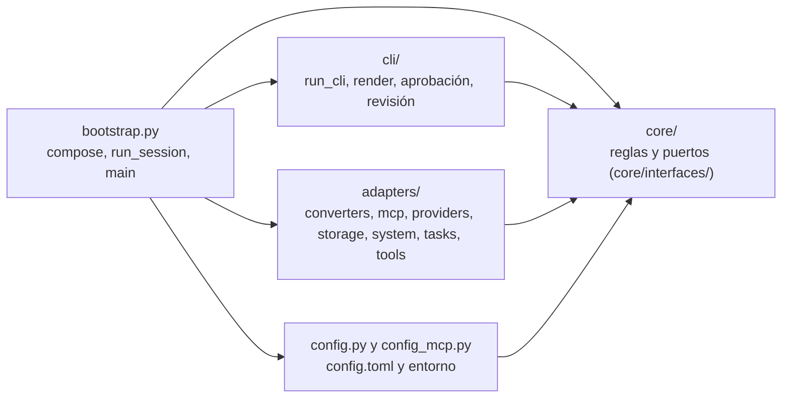
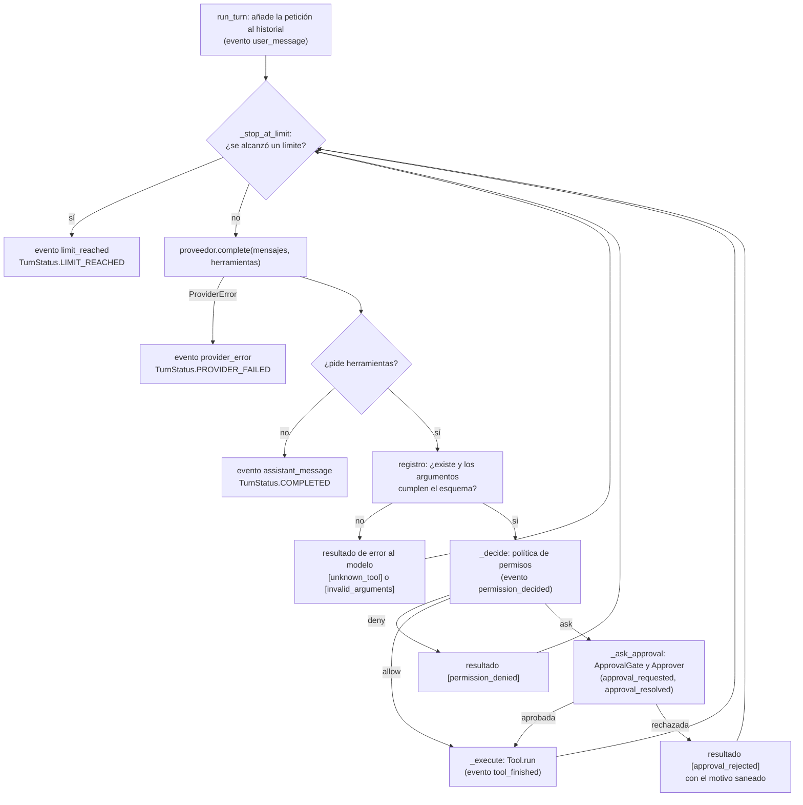
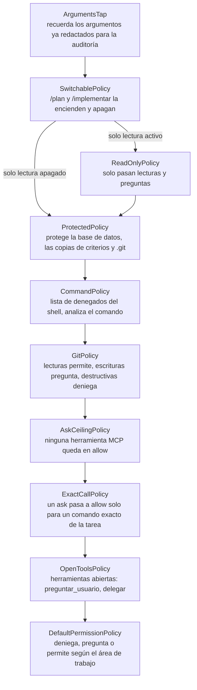
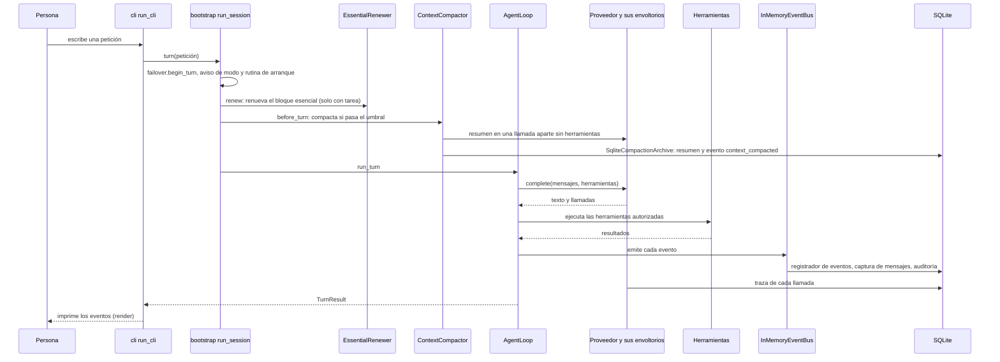
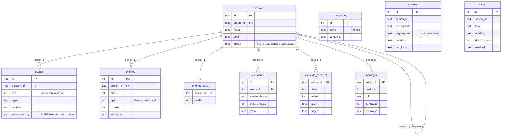
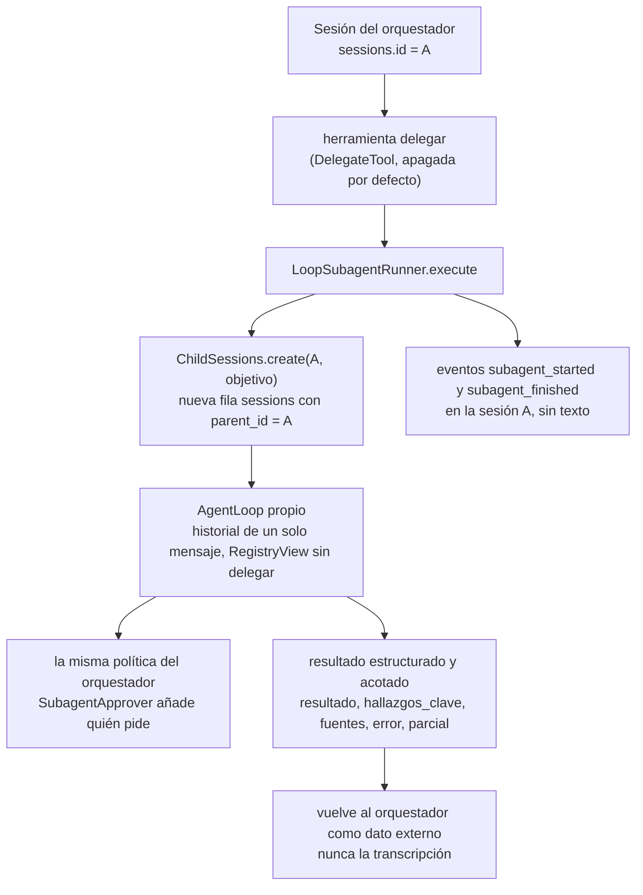

# Arquitectura implementada

> [← README](../README.md) · [Diseño y contratos (02-arquitectura.md)](02-arquitectura.md) · [Guion de demostración](guion-demostracion.md) · [Progreso](PROGRESO.md)

Este documento describe la arquitectura **tal como está construida hoy** en `src/harness_agent/`, con diagramas Mermaid. [`02-arquitectura.md`](02-arquitectura.md) sigue siendo la fuente de los **contratos de diseño** (puertos, eventos, modelo de datos); aquí se dibuja lo que de verdad existe y se anotan las diferencias (sección 6). Lo implementado se llama «en revisión»: ninguna historia está cerrada del todo mientras HU-00-01 no se ratifique (estado en [`PROGRESO.md`](PROGRESO.md)). Cada nombre de clase o módulo dibujado se comprobó con `grep` contra el código (sección 7).

## 1. Capas y reglas de dependencia

Las flechas son «depende de»: todo apunta hacia `core/`. `bootstrap.py` es la **única raíz de composición**: crea las piezas de los adaptadores y de la consola y se las entrega al núcleo por constructor.

| Regla | Qué significa | Guarda que la vigila (`tests/architecture/`) |
|---|---|---|
| `core/` importa solo biblioteca estándar y `harness_agent.core` | Sin `adapters`, `cli`, `config`, SDKs ni `sqlite3` | `test_core_boundaries.py`, `test_core_reads_no_config.py` |
| El núcleo no usa la terminal | No hay `print` ni `input`: todo sale por el bus de eventos | `test_core_no_terminal.py` |
| `cli/` solo usa biblioteca estándar y la API pública del núcleo | No importa `adapters`, `config` ni `bootstrap` | `test_cli_boundaries.py` |
| `adapters/` no importa `cli/` | Cada adaptador usa solo biblioteca estándar y la API pública del núcleo | `test_adapters_boundaries.py` |
| Solo `bootstrap.py` une las capas | Importa la API pública y dos submódulos autorizados | `test_bootstrap_boundaries.py` |
| Sin secretos en el repositorio | Claves solo en variables de entorno o `.env` (ignorado) | `test_no_secrets_in_repo.py` |

Hay además una guarda por cada subpaquete o módulo nuevo del núcleo (permisos, contexto, subagentes, auditoría, trazas…); en total son 45 archivos de prueba en `tests/architecture/`.

## 2. Bucle del agente y cadena de permisos

### 2.1 Un turno del bucle (`core/loop.py`, `AgentLoop.run_turn`)

Una `CancelledError` nunca se captura: el bucle publica `interrupted` y la relanza. Una excepción de una herramienta (`Exception`) vuelve al modelo como resultado `[tool_exception]` acotado; una `BaseException` ajena a la cancelación se propaga sin convertirse.

### 2.2 La cadena de permisos (de fuera hacia dentro, tal como la arma `compose()`)

Orden de decisión: denegar > preguntar > permitir, y **falla cerrada**: lo no previsto se pregunta o se deniega. Las capas exteriores solo pueden endurecer lo que decide la política de dentro. El `ApprovalGate` recuerda las aprobaciones de la sesión (herramienta y argumentos exactos); el `Approver` real de la consola es `ConsoleApprover` (`cli/approval.py`).

## 3. Flujo de una petición

El proveedor es una cadena de envoltorios (de fuera hacia dentro): `TracingProvider` (una traza por llamada del bucle) → `FailoverProvider` (conmutación entre modelos, apagada por defecto) → `RetryingProvider` (reintentos con espera exponencial) → `ModelSwitch` (modelo activo y alias) → `LiteLLMProvider` (el adaptador real). Las herramientas pasan por `TracingRegistry` y, con límite de salida, por `TruncatingTool`. Con una tarea, `run_session` entrega la petición a `ReviewingRunner` (revisión del diff, commit y Pull Request), que envuelve a `VerifyingRunner` (verifica los criterios al terminar), que a su vez llama al bucle; sin tarea llama directamente al bucle.

El **bloque de memoria** no entra en cada petición: `MemoryLoader.load_into` lo coloca una vez al abrir una sesión nueva (al arrancar y con `/nueva`), tras el prefijo y antes de la petición inicial. El bloque esencial de la tarea sí se renueva antes de cada petición. El historial original nunca se borra: la compactación solo marca los eventos cubiertos (`events.compacted_by`).

Suscriptores del bus, en orden: `ConversationCapture` (guarda cada mensaje en `mensajes`, antes que el registrador), `attach_event_recorder` (cada evento en `events`, salvo `context_compacted`, que escribe el archivo de compactación) y `AuditRecorder` (una fila de `auditoria` por decisión). La CLI se suscribe al mismo bus para imprimir.

## 4. Esquema SQLite v7

El archivo (`.harness/sessions.db` por defecto) lleva la versión en `PRAGMA user_version` (7). Una base nueva recibe el esquema actual; una de versión anterior migra en una transacción; una más nueva o sin versión se rechaza sin tocarla.

| Tabla | Versión | Para qué sirve |
|---|---|---|
| `sessions`, `events` | 1 | Sesiones (con `parent_id` para las hijas) y cada evento al ocurrir |
| `criterios`, `criterios_sello` | 2 | Criterios de la tarea y su huella de integridad; solo el verificador marca `passes` |
| `resumenes` | 3 | Resúmenes de la compactación; los eventos cubiertos llevan su id en `events.compacted_by` |
| `contexto_esencial` | 4 | Ticket, objetivo, reglas y referencia a los criterios de una tarea (escritura única) |
| `mensajes` | 5 | Cada mensaje real, para reanudar una sesión sin tarea |
| `memorias` | 6 | Memoria persistente, **sin clave foránea**: borrar o compactar una sesión no la toca |
| `auditoria`, `trazas` | 7 | Decisiones de permisos y llamadas medidas, **sin clave foránea** y solo con metadatos o datos ya redactados |

## 5. Sesiones hijas de los subagentes

La sesión hija guarda sus eventos con su propio identificador, pero no sus mensajes (no se reanuda). `/sesiones` no lista las sesiones con `parent_id`, y `/auditoria` y `/trazas` muestran también las de las hijas. Un subagente tiene un solo nivel (no puede delegar) y límites propios (`[subagents]`).

## 6. Diseñado frente a construido

| Tema | Diseño ([`02-arquitectura.md`](02-arquitectura.md)) | Construido |
|---|---|---|
| Carpeta de observabilidad | `observability/` (trazas, auditoría, redacción) | **No existe.** La auditoría (`core/audit.py`), las trazas (`core/tracing.py`) y la redacción (`core/redaction.py`, `core/secret_redaction.py`) viven en `core/`; sus tablas las escriben `adapters/storage/audit_store.py` y `trace_store.py` |
| `ContextManager` (`assemble`, `compact`) | Un puerto que arma el contexto y compacta | El ensamblador (`ContextAssembler`) existe pero **aún no está en el bucle** (HU-02-01); la compactación corre en `run_session` antes de cada petición (`ContextCompactor.before_turn`, HU-02-03) |
| Eventos | 17 tipos | Siguen siendo 17 (`core/events.py`); la auditoría y las trazas no añaden eventos |
| Modelo de datos | `sessions`, `events` y criterios | Siete versiones: añade resúmenes, contexto esencial, mensajes, memorias, auditoría y trazas (sección 4) |
| Aislamiento del shell | Entorno aislado como innovación | **Sin aislar** (decisión pendiente del Product Owner): directorio acotado y aprobación |
| Proveedores | Dos con conmutación por fallo | Un adaptador para todos (`LiteLLMProvider`); conmutación opcional con alias de `[models]` (`FailoverProvider`) |
| Reanudar | Sesiones reanudables | Solo sesiones **sin tarea**; un ticket se retoma con una sesión nueva y su archivo de progreso (rutina de arranque) |

## 7. Cómo se comprobaron los nombres

Todos los nombres de los diagramas se buscaron con `grep` en el código el 2026-11-05. Dónde vive cada clase:

| Clase | Archivo (bajo `src/harness_agent/`) |
|---|---|
| `AgentLoop` | `core/loop.py` |
| `ApprovalGate` | `core/permissions/approvals.py` |
| `ProtectedPolicy`, `CommandPolicy`, `GitPolicy`, `AskCeilingPolicy`, `ExactCallPolicy`, `OpenToolsPolicy`, `DefaultPermissionPolicy`, `ReadOnlyPolicy`, `SwitchablePolicy` | `core/permissions/` (`protected.py`, `command_policy.py`, `git_rules.py`, `ask_ceiling.py`, `exact_calls.py`, `open_tools.py`, `policy.py`, `read_only.py`, `mode_switch.py`) |
| `ArgumentsTap`, `AuditRecorder` | `core/audit.py` |
| `TracingProvider`, `TracingRegistry` | `core/tracing.py` |
| `ContextCompactor`, `EssentialRenewer`, `MemoryLoader`, `ConversationCapture` | `core/context/` (`compactor.py`, `renewer.py`, `memory_loader.py`, `conversation.py`) |
| `InMemoryEventBus` | `core/in_memory_event_bus.py` |
| `VerifyingRunner`, `ReviewingRunner` | `core/verification/runner.py`, `core/review/runner.py` |
| `LoopSubagentRunner`, `ChildSessions`, `RegistryView`, `SubagentApprover` | `core/subagents/` (`runner.py`, `registry.py`, `approval.py`) |
| `LiteLLMProvider`, `ModelSwitch`, `RetryingProvider`, `FailoverProvider` | `adapters/providers/` |
| `SqliteSessionStore`, `SqliteCompactionArchive`, `SqliteMessageStore`, `SqliteTaskStore`, `SqliteAuditStore`, `SqliteTraceStore` | `adapters/storage/` |
| `DelegateTool` | `adapters/tools/delegar.py` |
| `ConsoleApprover`, `run_cli` | `cli/approval.py`, `cli/app.py` |
| `compose`, `run_session`, `main` | `bootstrap.py` |

Las tablas de la sección 4 salen de `adapters/storage/_schema.py` (`SCHEMA_VERSION = 7`). La prueba `tests/unit/test_docs_match_cli.py` vigila que este documento solo nombre comandos, opciones y secciones de configuración que existen.
