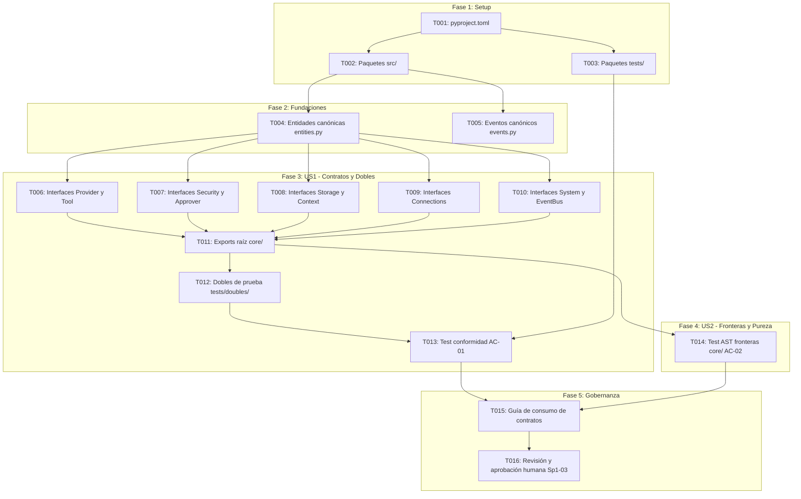

# Tasks: Esqueleto del Repositorio e Interfaces Acordadas (HU-00-01)

**Feature**: Esqueleto del Repositorio e Interfaces Acordadas (HU-00-01)  
**Branch**: `001-repo-skeleton-interfaces`  
**Plan**: [specs/001-repo-skeleton-interfaces/plan.md](plan.md) | **Spec**: [specs/001-repo-skeleton-interfaces/spec.md](spec.md)  
**Sprint**: 1 | **Responsable**: A — Núcleo | **Tareas de referencia**: Sp1-01, Sp1-02, Sp1-03  

---

## Resumen de Ejecución y Dependencias

---

## Phase 1: Setup (Infraestructura y Paquetes Base) [Sp1-01]

**Propósito**: Inicialización del empaquetado del proyecto y creación del árbol de directorios modular.

- [x] **T001** Crear configuración de empaquetado del proyecto en `pyproject.toml`
  - **Archivos**: `pyproject.toml`
  - **Dependencias**: Ninguna (primera tarea)
  - **Criterios relacionados**: RNF-13, RNF-20, Principio III
  - **Verificación**: `pip install -e .` se completa exitosamente en el entorno virtual.
  - **Estimación**: 20 min

- [x] **T002** [P] Crear el layout de paquetes modular de la aplicación en `src/harness_agent/`
  - **Archivos**: `src/harness_agent/__init__.py`, `src/harness_agent/core/__init__.py`, `src/harness_agent/adapters/__init__.py`, `src/harness_agent/cli/__init__.py`
  - **Dependencias**: T001
  - **Criterios relacionados**: RNF-13, Sp1-01
  - **Verificación**: `python -c "import harness_agent.core, harness_agent.adapters, harness_agent.cli"` no arroja errores.
  - **Estimación**: 15 min

- [x] **T003** [P] Crear la estructura de paquetes de pruebas en `tests/`
  - **Archivos**: `tests/__init__.py`, `tests/contracts/__init__.py`, `tests/doubles/__init__.py`, `tests/architecture/__init__.py`
  - **Dependencias**: T001
  - **Criterios relacionados**: Principio IV, Sp1-01
  - **Verificación**: `pytest --collect-only` descubre el árbol de pruebas sin errores de importación.
  - **Estimación**: 15 min

---

## Phase 2: Foundational (Modelos y Tipos Canónicos Compartidos) [Sp1-02 / Sp1-03 / US3]

**Propósito**: Definición del formato unificado de datos para mensajes y el catálogo oficial de eventos del bus.

- [x] **T004** [US3] Definir entidades canónicas de mensajería (`Role`, `ToolCall`, `ToolResult`, `TokenUsage`, `Message`) en `src/harness_agent/core/entities.py`
  - **Archivos**: `src/harness_agent/core/entities.py`
  - **Dependencias**: T002
  - **Criterios relacionados**: User Story 3, FR-012
  - **Verificación**: Instanciar mensajes inmutables con llamadas y resultados de herramientas en una prueba de importación rápida.
  - **Estimación**: 25 min

- [x] **T005** [P] [US3] Definir el catálogo canónico de 17 eventos de bus (`EventType`, `Event`) en `src/harness_agent/core/events.py`
  - **Archivos**: `src/harness_agent/core/events.py`
  - **Dependencias**: T002
  - **Criterios relacionados**: User Story 3, FR-013, docs/02-arquitectura.md §4 («Eventos del bus»)
  - **Verificación**: `len(EventType) == 17` y validación de atributos inmutables de `Event`.
  - **Estimación**: 20 min

---

## Phase 3: User Story 1 - Contratos Abstractos del Núcleo y Dobles de Prueba (Priority: P1) 🎯 MVP [Sp1-02 / AC-01]

**Propósito**: Proveer los 14 contratos de interfaces abstractas tipadas y los dobles de prueba en memoria para desbloquear el desarrollo paralelo de los integrantes A, B y C.

- [x] **T006** [US1] Definir interfaces abstractas de proveedor y herramientas (`Provider`, `Tool`, `ToolRegistry`) en `src/harness_agent/core/interfaces/provider.py` y `src/harness_agent/core/interfaces/tool.py`
  - **Archivos**: `src/harness_agent/core/interfaces/provider.py`, `src/harness_agent/core/interfaces/tool.py`
  - **Dependencias**: T004
  - **Criterios relacionados**: AC-01, FR-002, FR-003, V-14
  - **Verificación**: `Provider.complete` y `Tool.run` cuentan con firmas `async def` provisionales anotadas con `@abstractmethod`.
  - **Estimación**: 30 min

- [x] **T007** [P] [US1] Definir interfaces abstractas de control y seguridad (`PermissionPolicy`, `Approver`) en `src/harness_agent/core/interfaces/security.py`
  - **Archivos**: `src/harness_agent/core/interfaces/security.py`
  - **Dependencias**: T004
  - **Criterios relacionados**: AC-01, FR-004, FR-005, V-01, V-02
  - **Verificación**: `PermissionPolicy.evaluate` es síncrona con falla cerrada (`PermissionDecision`), `Approver.request` es `async def` provisional.
  - **Estimación**: 20 min

- [x] **T008** [P] [US1] Definir interfaces abstractas síncronas de estado y contexto (`SessionStore`, `MemoryStore`, `ContextManager`) en `src/harness_agent/core/interfaces/storage.py` y `src/harness_agent/core/interfaces/context.py`
  - **Archivos**: `src/harness_agent/core/interfaces/storage.py`, `src/harness_agent/core/interfaces/context.py`
  - **Dependencias**: T004, T005
  - **Criterios relacionados**: AC-01, FR-006, FR-007, V-03, V-04, V-05
  - **Verificación**: Métodos de guardado/carga/compactación definidos como síncronos con firmas estáticas estrictas.
  - **Estimación**: 25 min

- [x] **T009** [P] [US1] Definir interfaces abstractas de conexiones externas (`McpClient`, `SubagentRunner`) en `src/harness_agent/core/interfaces/connections.py`
  - **Archivos**: `src/harness_agent/core/interfaces/connections.py`
  - **Dependencias**: T004
  - **Criterios relacionados**: AC-01, FR-008, FR-009, V-06
  - **Verificación**: Firmas asíncronas provisionales para conexión/llamada MCP y ejecución de subagente con retorno estructurado.
  - **Estimación**: 25 min

- [x] **T010** [P] [US1] Definir interfaces abstractas de soporte del sistema y bus (`Shell`, `TaskCriteria`, `AuthorizedArea`, `EventBus`) en `src/harness_agent/core/interfaces/system.py` y `src/harness_agent/core/interfaces/event_bus.py`
  - **Archivos**: `src/harness_agent/core/interfaces/system.py`, `src/harness_agent/core/interfaces/event_bus.py`
  - **Dependencias**: T004, T005
  - **Criterios relacionados**: AC-01, FR-010, FR-011, V-08, V-15, V-17
  - **Verificación**: Firmas síncronas para `Shell.execute`, `TaskCriteria`, `AuthorizedArea.contains` y `EventBus`.
  - **Estimación**: 30 min

- [x] **T011** [US1] Exportar e integrar contratos e interfaces en `src/harness_agent/core/interfaces/__init__.py` y `src/harness_agent/core/__init__.py`
  - **Archivos**: `src/harness_agent/core/interfaces/__init__.py`, `src/harness_agent/core/__init__.py`
  - **Dependencias**: T006, T007, T008, T009, T010
  - **Criterios relacionados**: AC-01, SC-001
  - **Verificación**: `from harness_agent.core import Provider, Tool, SessionStore, Message, Event` importa todos los tipos sin dependencias circulares.
  - **Estimación**: 15 min

- [x] **T012** [US1] Implementar dobles de prueba mínimos en memoria en `tests/doubles/`
  - **Archivos**: `tests/doubles/dummy_provider.py`, `tests/doubles/dummy_tool.py`, `tests/doubles/dummy_approver.py`, `tests/doubles/in_memory_store.py`, `tests/doubles/recording_bus.py`
  - **Dependencias**: T011, T003
  - **Criterios relacionados**: AC-01, SC-003, V-14
  - **Verificación**: Los dobles implementan las ABCs sin lanzar `TypeError: Can't instantiate abstract class`, respetando `async def` en operaciones asíncronas.
  - **Estimación**: 35 min

- [x] **T013** [US1] Implementar suite de pruebas de conformidad de contratos en `tests/contracts/test_contracts.py` (AC-01)
  - **Archivos**: `tests/contracts/test_contracts.py`
  - **Dependencias**: T012
  - **Criterios relacionados**: AC-01, SC-001, SC-003
  - **Verificación**: `pytest tests/contracts/test_contracts.py` ejecuta y pasa al 100 % en menos de 2 segundos.
  - **Estimación**: 35 min

---

## Phase 4: User Story 2 - Pureza del Núcleo y Aislamiento de Proveedores (Priority: P1) [AC-02]

**Propósito**: Asegurar mediante pruebas automatizadas de análisis estático que ningún módulo de `core/` importa SDKs de proveedores de IA.

- [x] **T014** [US2] Implementar prueba automatizada de análisis estático (AST) de fronteras en `tests/architecture/test_core_boundaries.py` (AC-02)
  - **Archivos**: `tests/architecture/test_core_boundaries.py`
  - **Dependencias**: T011, T003
  - **Criterios relacionados**: AC-02, SC-002, RNF-12, Principio III
  - **Verificación**: `pytest tests/architecture/test_core_boundaries.py` inspecciona sintácticamente todo `src/harness_agent/core/` y confirma 0 referencias a `litellm`, `openai`, `anthropic`, `google-genai`.
  - **Estimación**: 25 min

---

## Phase 5: Polish & Gobernanza (Sp1-03 Consensus Gate) [Sp1-03]

**Propósito**: Documentar el uso de los contratos para el equipo y formalizar el punto de control humano de Sp1-03.

- [x] **T015** [P] Documentar guía de consumo de contratos y uso de dobles para los integrantes B y C en `docs/guia-contratos-desarrollo.md`
  - **Archivos**: `docs/guia-contratos-desarrollo.md`
  - **Dependencias**: T013, T014
  - **Criterios relacionados**: Principio VII, Sp1-01
  - **Verificación**: La guía contiene snippets claros de cómo importar contratos e instanciar dobles para B (`SessionStore`, `Provider`) y C (`Tool`, `Shell`).
  - **Estimación**: 20 min

- [ ] **T016** Punto de control humano obligatorio: Reunión de consenso y aprobación formal de contratos por el equipo (Sp1-03)
  - **Archivos**: Ninguno (hito de revisión humana y acta en PR)
  - **Dependencias**: T013, T014, T015
  - **Criterios relacionados**: Sp1-03, Principio IX
  - **Verificación**: Aprobación explícita del Pull Request por los integrantes del equipo (A, B, C / humano) previa al inicio de `HU-00-02` y siguientes.
  - **Estimación**: 30 min (revisión humana)
  - **⚠️ REVISIÓN HUMANA OBLIGATORIA — NO MARCAR AUTOMÁTICAMENTE COMO COMPLETADO**
  - **Nota (2026-10-18)**: el equipo comunicó, a través del Product Owner, la decisión de cerrar las historias pendientes y de usar nomenclatura en inglés (`AuthorizedArea`, 17 eventos). Es una decisión colectiva relayada, sin aprobaciones individuales de A, B y C documentadas; T016 sigue pendiente hasta que cada integrante registre su aprobación (p. ej. en el Pull Request) o se registre una excepción formal a la Definition of Done con responsable y deuda listada.

---

## Métricas y Estimación Total

- **Total de microtareas**: 16 microtareas.
- **Rango de duración por tarea**: 15 a 35 minutos de implementación (todas estrictamente < 60 min).
- **Estimación total acumulada**: 375 minutos (~6,25 horas de ingeniería).
- **Primera tarea desbloqueada**: `T001` (creación de `pyproject.toml`).
- **Oportunidades de paralelización identificadas**:
  - `T002` y `T003` pueden ejecutarse concurrentemente una vez finalizado `T001`.
  - `T004` y `T005` pueden desarrollarse en paralelo una vez finalizado `T002`.
  - `T007`, `T008`, `T009` y `T010` pueden desarrollarse en paralelo por los integrantes del equipo una vez disponible `T004`/`T005`.
  - `T013` (AC-01) y `T014` (AC-02) operan sobre suites de pruebas distintas y pueden ejecutarse/validarse de forma independiente.
- **Punto de bloqueo / aprobación pendiente**: `T016` (Sp1-03), que requiere la participación y aprobación humana de los integrantes antes de cerrar la historia.
