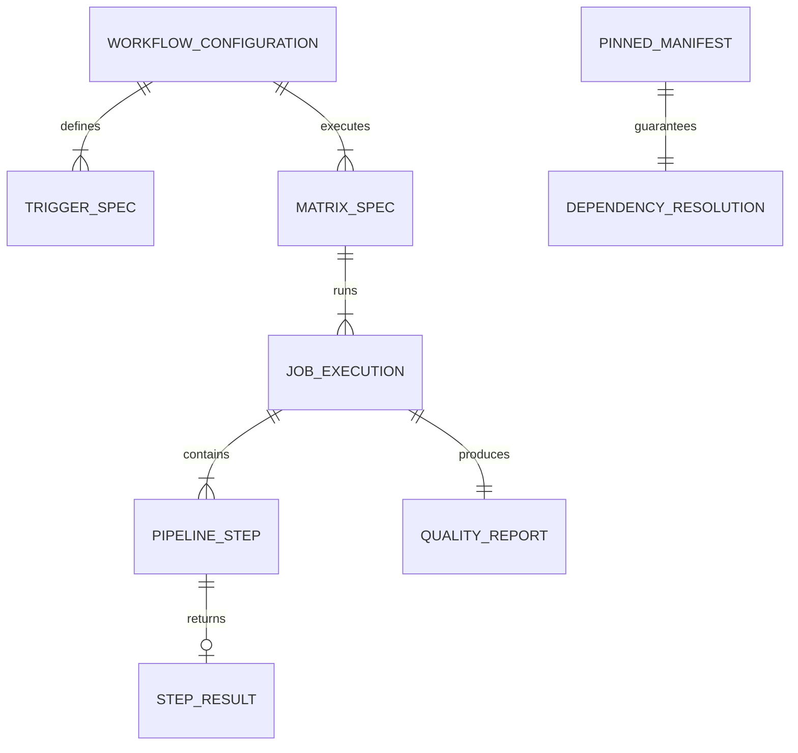
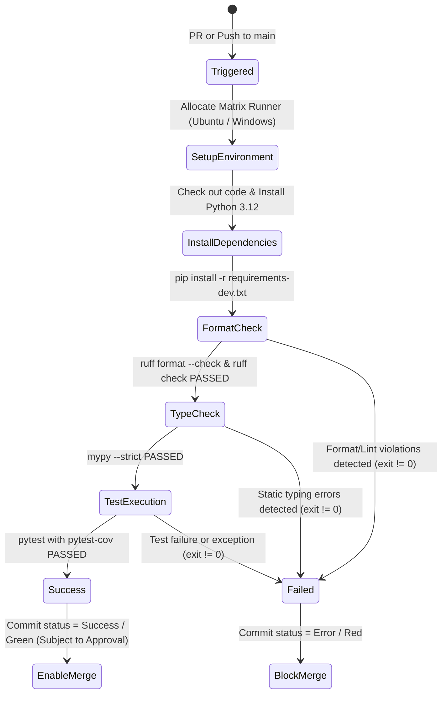

# Data Model & System Architecture: HU-00-02 (CI Pipeline)

> Actualizado por PD-07 (2026-10-17, Product Owner): Python 3.12.x es la única versión soportada; la matriz vigente de CI es `ubuntu-latest` y `windows-latest` con Python 3.12 (2 jobs). Los textos sobre Python 3.11 y la matriz de 4 jobs describen el diseño original y quedan como historial; los criterios de aceptación no cambian.

## 1. CI Subsystem Entities

### 1.1 Entity Definitions

#### `WorkflowConfiguration`
The declarative top-level model defining the continuous integration automation for the repository.
- **`name`**: `string` (e.g., `"CI Pipeline"`)
- **`file_path`**: `string` (`.github/workflows/ci.yml`)
- **`permissions`**: `map` (strictly `contents: read`)
- **`triggers`**: `List[TriggerSpec]` (`pull_request`, `push`)
- **`jobs`**: `List[JobSpec]`

#### `TriggerSpec`
Defines the events and branch filters that trigger workflow execution.
- **`event_type`**: `enum` (`pull_request`, `push`)
- **`target_branches`**: `List[string]` (`["main"]`)

#### `MatrixSpec`
Defines the execution dimensions for multiplatform testing.
- **`os_matrix`**: `List[string]` (`["ubuntu-latest", "windows-latest"]`)
- **`python_matrix`**: `List[string]` (`["3.12"]` after PD-07; originally `["3.11", "3.12"]`)
- **`fail_fast`**: `boolean` (`false`, ensuring all combinations run even if one fails)

#### `JobExecution`
An instance of the pipeline running for a specific (OS, Python) matrix combination.
- **`job_id`**: `string` (e.g., `"test"`)
- **`runner_os`**: `string`
- **`python_version`**: `string`
- **`steps`**: `List[PipelineStep]`
- **`final_status`**: `enum` (`success`, `failure`, `cancelled`)

#### `PipelineStep`
An atomic step executed within a job.
- **`name`**: `string`
- **`step_type`**: `enum` (`action`, `run`)
- **`command`**: `optional[string]`
- **`timeout_minutes`**: `integer` (default: 10)

#### `QualityReport`
The aggregated quality metrics generated by a job run.
- **`test_count`**: `integer` (total collected tests)
- **`passed_count`**: `integer`
- **`failed_count`**: `integer`
- **`type_check_errors`**: `integer` (must be 0)
- **`format_violations`**: `integer` (must be 0)
- **`line_coverage_pct`**: `float` (percentage of covered statements in `src/harness_agent/`)

#### `PinnedManifest`
The concrete dependency lock ensuring deterministic package resolution.
- **`file_path`**: `string` (`requirements-dev.txt`)
- **`entries`**: `List[DependencyPin]` (package name + exact `==` version string)

## 2. Pipeline State Transitions

## 3. Validation Rules

1. **Non-Zero Exit Gating**: Any step that emits an exit code $\neq 0$ immediately transitions the job state to `Failed`.
2. **Read-Only Format Inspection**: The formatting check must execute with `--check` to prevent in-place modifications in CI.
3. **No Network in Tests**: Automated tests executed within `pytest` must only interact with in-memory doubles or simulated providers; network calls to external APIs are prohibited.
4. **Coverage Calculation**: Coverage must be calculated exclusively over the application package `src/harness_agent/` and reported in terminal output.
