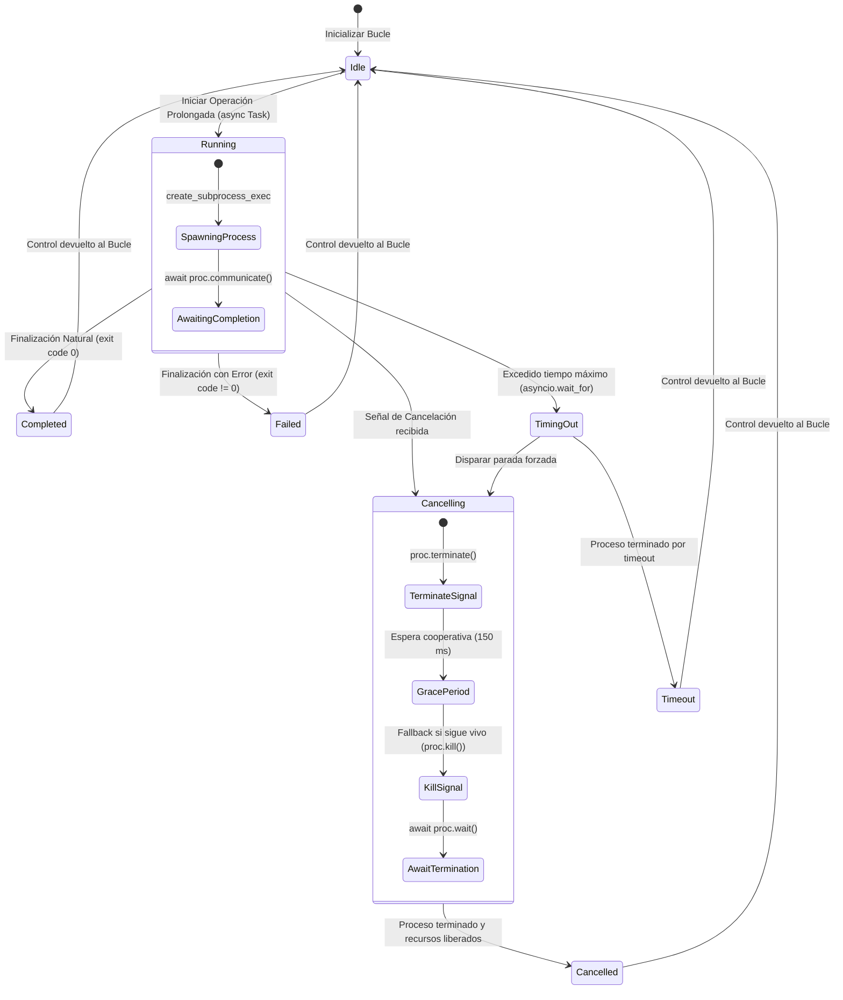

# Data Model: SPK-02 — Prototipo de Cancelación Asíncrona

**Feature**: `specs/003-async-cancellation-spike/spec.md`  
**Date**: 2026-10-17  
**Status**: Alineado con el prototipo tras la auditoría (D-01 pendiente de aprobación)  

---

## 1. Entidades del Prototipo Experimental

### 1.1 `OperationStatus` (Enum)
Representa los estados mutuamente excluyentes en el ciclo de vida de una operación o herramienta ejecutada por el bucle:

```text
+-------------------+
|  OperationStatus  |
+-------------------+
| RUNNING           |  -> La operación o subproceso se encuentra en ejecución
| COMPLETED         |  -> Finalizó naturalmente con éxito (código de salida 0)
| CANCELLED         |  -> Interrumpida a petición voluntaria del bucle/usuario
| TIMEOUT           |  -> Interrumpida por exceder el umbral temporal máximo
| FAILED            |  -> Finalizó con error o código de salida distinto de 0
+-------------------+
```

### 1.2 `OperationResult` (Dataclass Inmutable)
Resultado devuelto al bucle tras la ejecución o cancelación de la operación:

- `status: OperationStatus`: Estado final de la operación.
- `return_code: int | None`: Código de salida del proceso (si aplicó subproceso).
- `duration_ms: float`: Tiempo total transcurrido desde el inicio hasta el retorno del control.
- `output: str`: Salida capturada (stdout/stderr).
- `error_message: str | None`: Motivo del error, cancelación o timeout.

---

## 2. Diagrama de Estados del Ciclo de Vida de la Cancelación



---

## 3. Invariantes del Modelo

1. **Retorno garantizado**: Ninguna operación en estado `Cancelling` o `TimingOut` puede bloquear indefinidamente el bucle.
2. **Ausencia de procesos zombies**: Toda transición hacia `Cancelled`, `Timeout` o `Completed` deja `proc.returncode` como entero y el PID directo fuera del SO (verificado en Windows). El cierre de descriptores no se verifica por objeto: solo se comprueba que el conteo de handles del proceso de pruebas no crece tras 5 ciclos de cancelación (V22).
3. **Reutilización del bucle**: Al transicionar a `Idle`, el bucle de eventos queda en un estado limpio y es capaz de iniciar inmediatamente nuevas operaciones asíncronas.
4. **Limpieza protegida**: la limpieza corre como tarea propia y el llamador la espera en un bucle de `asyncio.shield`; una segunda cancelación no interrumpe `terminate` -> `kill`. `shield` por sí solo no basta (controles V16 y V17).
5. **Semántica de `CancelledError`**: por defecto el prototipo la absorbe y devuelve `CANCELLED` (solo experimento; deja `Task.cancelling() == 1`, V21). Con `reraise_cancel=True` la tarea termina cancelada tras la limpieza (V20), que es la semántica que debe mantener producción. Los estados `COMPLETED`, `FAILED`, `CANCELLED` y `TIMEOUT` son distinguibles (V19).
