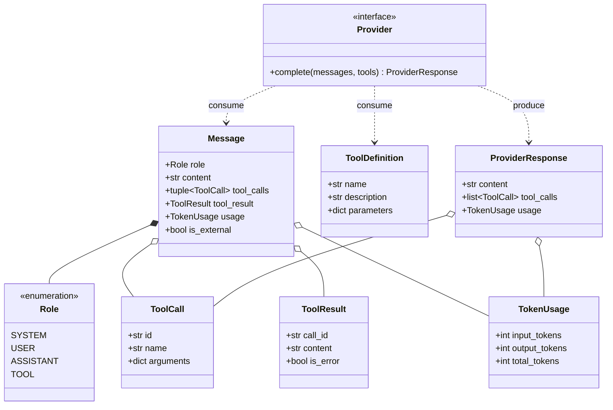

# Data Model: HU-07-01 — Interfaz Provider y formato interno de mensajes

**Feature**: `specs/004-provider-interface-message-format/spec.md`  
**Status**: Complete  
**Date**: 2026-10-18  
**Responsable**: A — Núcleo  

---

## 1. Entidades del Dominio Canónico (`src/harness_agent/core/`)

Todas las entidades del dominio residen en el núcleo, son completamente inmutables (`frozen=True`) y están fuertemente tipadas en Python 3.12 sin dependencias externas.

### 1.1 `Role` (Enum de Cadena)
- **Ruta**: `src/harness_agent/core/entities.py`
- **Valores**:
  - `SYSTEM = "system"`: Instrucciones base del sistema, directivas de desarrollador y prefijo estable.
  - `USER = "user"`: Mensajes e instrucciones suministradas por el usuario humano.
  - `ASSISTANT = "assistant"`: Salidas emitidas por el modelo (texto conversacional y solicitudes de herramientas).
  - `TOOL = "tool"`: Salidas resultantes de la ejecución de herramientas locales o remotas.

### 1.2 `ToolCall` (Dataclass Inmutable)
- **Ruta**: `src/harness_agent/core/entities.py`
- **Atributos**:
  - `id: str`: Identificador único de la invocación asignado por el modelo o proveedor.
  - `name: str`: Nombre unívoco de la herramienta registrada (e.g. `shell`, `leer_archivo`).
  - `arguments: dict[str, Any]`: Diccionario con los parámetros estructurados y parseados.

### 1.3 `ToolResult` (Dataclass Inmutable)
- **Ruta**: `src/harness_agent/core/entities.py`
- **Atributos**:
  - `call_id: str`: Identificador que correlaciona este resultado con el `ToolCall.id` originario.
  - `content: str`: Salida textual procesada o recortada generada por la herramienta.
  - `is_error: bool = False`: Bandera que señala si la ejecución falló o lanzó una excepción.

### 1.4 `TokenUsage` (Dataclass Inmutable)
- **Ruta**: `src/harness_agent/core/entities.py`
- **Atributos**:
  - `input_tokens: int = 0`: Tokens de prompt/contexto consumidos.
  - `output_tokens: int = 0`: Tokens generados en la respuesta del modelo.
- **Propiedad Derivada**:
  - `total_tokens -> int`: Retorna la suma exacta `input_tokens + output_tokens`.

### 1.5 `Message` (Dataclass Inmutable)
- **Ruta**: `src/harness_agent/core/entities.py`
- **Atributos**:
  - `role: Role`: Rol conversacional del emisor.
  - `content: str = ""`: Contenido textual del mensaje.
  - `tool_calls: tuple[ToolCall, ...] = ()`: Colección inmutable de llamadas a herramientas solicitadas (cuando el rol es `ASSISTANT`).
  - `tool_result: ToolResult | None = None`: Resultado de ejecución de herramienta asociado (cuando el rol es `TOOL`).
  - `usage: TokenUsage | None = None`: Desglose de tokens asociado a este mensaje si fue reportado por la API.
  - `is_external: bool = False`: Bandera de seguridad que marca contenido proveniente de fuentes no confiables (archivos, web, MCP) para prevenir inyecciones de prompt.
- **Normalización Post-Init**:
  - Si `role` se suministra como `str`, se normaliza a `Role(role)`.
  - Si `tool_calls` se suministra como `list`, se convierte a `tuple` para asegurar inmutabilidad estricta.

### 1.6 `ToolDefinition` (Dataclass Inmutable)
- **Ruta**: `src/harness_agent/core/interfaces/provider.py`
- **Atributos**:
  - `name: str`: Identificador de la herramienta.
  - `description: str`: Descripción de funcionalidad y propósito para el LLM.
  - `parameters: dict[str, Any] = field(default_factory=dict)`: Esquema JSON Schema con la validación de argumentos esperados.

### 1.7 `ProviderResponse` (Dataclass Inmutable)
- **Ruta**: `src/harness_agent/core/interfaces/provider.py`
- **Atributos**:
  - `content: str = ""`: Texto generado por el modelo.
  - `tool_calls: list[ToolCall] = field(default_factory=list)`: Llamadas a herramientas solicitadas por el modelo en este turno.
  - `usage: TokenUsage | None = None`: Métricas de consumo de tokens reportadas por la API.

### 1.8 `Provider` (Puerto Abstracto ABC)
- **Ruta**: `src/harness_agent/core/interfaces/provider.py`
- **Métodos**:
  - `async def complete(self, messages: list[Message], tools: list[ToolDefinition] | None = None) -> ProviderResponse`: Contrato principal de completado conversacional.

---

## 2. Diagrama Entidad-Relación Canónico

---

## 3. Modelo de Adaptación y Conversores (`src/harness_agent/adapters/converters/`)

La lógica de conversión vive en la capa de adaptadores para preservar la pureza hexagonal del núcleo:

1. **`OpenAIConverter`**:
   - `to_messages(messages: list[Message]) -> list[dict[str, Any]]`: Serializa los mensajes canónicos al formato `[{"role": "...", "content": "..."}]` de OpenAI, empaquetando llamadas en `tool_calls` y resultados en mensajes `role: "tool"`.
   - `to_tools(tools: list[ToolDefinition]) -> list[dict[str, Any]]`: Transforma las definiciones al formato `[{"type": "function", "function": {...}}]`.
   - `from_response(payload: dict[str, Any]) -> ProviderResponse`: Parsea la respuesta de la API de OpenAI, deserializando cadenas JSON de argumentos hacia diccionarios y mapeando `usage`.

2. **`AnthropicConverter`**:
   - `to_payload(messages: list[Message], tools: list[ToolDefinition] | None) -> tuple[str | None, list[dict[str, Any]], list[dict[str, Any]] | None]`: Extrae los mensajes `system` iniciales al parámetro superior `system` (cadena si hay uno, lista de bloques de texto si hay varios; un `system` posterior a otros mensajes es una secuencia inválida y un `system` vacío no es representable; ambos producen `ConversionError`), traduce mensajes a bloques de contenido (`tool_use` y `tool_result`), y traduce herramientas al esquema `input_schema`.
   - `from_response(payload: dict[str, Any]) -> ProviderResponse`: Extrae texto plano y bloques `tool_use` devolviendo `ProviderResponse`.

---

## Tipos de conversión locales (adaptadores, D-02 — 2026-10-18)

No forman parte de `core/` ni modifican `Message`, `ToolResult`, `Provider` ni `ProviderResponse`. Viven en `src/harness_agent/adapters/converters/sidecar.py`.

- **`WireRef(kind, message_index, block_index)`**: referencia a un elemento del payload externo. `kind` ∈ `system`, `system_block`, `message`, `message_block`.
- **`MessageMeta`**: metadatos locales de un mensaje canónico: `index`, `role`, `refs`, `wire_digest`, `is_external`, `tool_call_id`, `tool_is_error`, `tool_message_content` (D9, solo si difiere de `ToolResult.content`), `usage` (D8) y `omitted` (`SYSTEM` vacío omitido del payload de Anthropic).
- **`ConversionEnvelope`**: inmutable; `provider`, `conversion_id` (identificador local de trazabilidad, no un token de seguridad), `partial_window`, `payload_digest`, `entries` y `payload` (copia nueva de una instantánea JSON estricta en cada acceso). Se crea solo con `to_*_envelope`; `matches(payload)` compara contenido.
- **Límites:** las huellas prueban integridad de contenido, no identidad de conversión; elegir el envelope equivocado no es detectable; no hay protección frente a código del mismo proceso.
