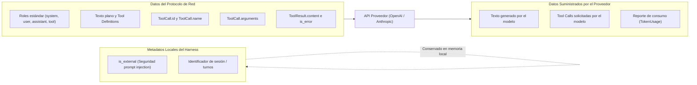

# Technical Research: HU-07-01 — Interfaz Provider y formato interno de mensajes

**Feature**: `specs/004-provider-interface-message-format/spec.md`  
**Status**: Complete  
**Date**: 2026-10-18  
**Responsable**: A — Núcleo  

---

## 1. Contexto y Estado de Dependencias

### 1.1 Estado Real de SPK-01
- **Situación en el repositorio**: Conforme a [`docs/PROGRESO.md`](../../docs/PROGRESO.md), `SPK-01` (*Spike: traducir herramientas entre OpenAI y Anthropic con LiteLLM*) está en estado `Pendiente` y asignada al Desarrollador B — Estado para el Sprint 1. No existen registros de ejecución empírica ni artefactos de prueba previos de SPK-01 en el repositorio.
- **Decisión arquitectónica**: HU-07-01 no inventa resultados empíricos ni equivalencias simuladas sobre LiteLLM. En su lugar, diseña la especificación canónica y los convertidores abstractos tomando como fuente las especificaciones oficiales y públicas de la industria (OpenAI Chat Completions API v1 y Anthropic Messages API v1).
- **Aislamiento de la validación**: La validación dependiente de la librería LiteLLM se mantiene bloqueada hasta que el Desarrollador B implemente `HU-07-02` / `SPK-01`. HU-07-01 entrega los contratos y conversores base contra los cuales se probará dicha integración.

### 1.2 Estado de HU-00-01 y D-01 de SPK-02
- `HU-00-01`: Esqueleto del repositorio e interfaces acordadas en [`src/harness_agent/core/`](../../src/harness_agent/core/). Posee 9 pruebas aprobadas (conteo a la fecha del 2026-10-18 de la clarificación) y validación formal del Product Owner (2026-10-17). La ratificación colegiada Sp1-03 (A, B, C) continúa en curso como hito de gobernanza.
- `SPK-02`: Validada experimentalmente (en la fecha de esta investigación 7/7 pruebas; hoy más de 30, en Windows y WSL2); sigue «En revisión». El dictamen [`docs/decisiones/D-01-asyncio-cancelacion.md`](../../docs/decisiones/D-01-asyncio-cancelacion.md) propone que `Provider.complete` sea un método asíncrono (`async def complete(messages, tools) -> ProviderResponse`) y está **PENDIENTE DE APROBACIÓN**.

---

## 2. Análisis Comparativo de Protocolos de Proveedor

Para garantizar la independencia del núcleo (RNF-12) y el criterio de conversión sin pérdida (AC-01), se analizaron las diferencias estructurales entre los modelos canónicos y los dos dialectos predominantes:

| Aspecto | Formato Canónico HARNESS | Protocolo OpenAI (Chat API) | Protocolo Anthropic (Messages API) |
|---|---|---|---|
| **Roles soportados** | `system`, `user`, `assistant`, `tool` | `system`, `user`, `assistant`, `tool` | `user`, `assistant` (el sistema es parámetro superior `system`) |
| **Declaración de herramientas** | `ToolDefinition(name, description, parameters)` | `type: "function"`, `function: {name, description, parameters}` | `name`, `description`, `input_schema` |
| **Llamada a herramientas (emisión)** | `ToolCall(id, name, arguments: dict)` | `tool_calls: [{"id": "...", "type": "function", "function": {"name": "...", "arguments": "{\"k\":\"v\"}"}}]` | Bloques en contenido: `[{"type": "tool_use", "id": "...", "name": "...", "input": {"k": "v"}}]` |
| **Serialización de argumentos** | Diccionario Python validado (`dict[str, Any]`) | Cadena JSON serializada (`str`) | Diccionario/Objeto nativo (`dict[str, Any]`) |
| **Resultados de herramientas** | `ToolResult(call_id, content, is_error)` en `Message(role=TOOL)` | Mensaje individual con `role: "tool"`, `tool_call_id: "..."`, `content: "..."` | Bloque dentro de mensaje `user`: `[{"type": "tool_result", "tool_use_id": "...", "content": "...", "is_error": bool}]` |
| **Métricas de tokens** | `TokenUsage(input_tokens, output_tokens, total_tokens)` | `usage: {prompt_tokens, completion_tokens, total_tokens}` | `usage: {input_tokens, output_tokens}` |

---

## 3. Tripartición de Datos y Preservación de Metadatos Locales

Uno de los principales riesgos detectados es asumir que las APIs comerciales preservan metadatos locales del arnés. Se establece una estricta distinción en tres capas:

### 3.1 Tratamiento de `is_external`
- **Problema**: Las APIs de OpenAI y Anthropic tienen validación estricta de esquemas; enviar un campo adicional como `is_external: true` en el payload de red provoca errores `400 Bad Request (extra_forbidden)`.
- **Solución**: `is_external` es un metadato de seguridad que reside exclusivamente en la entidad canónica local `Message`. Al convertir hacia el proveedor, el conversor extrae únicamente los campos del protocolo de red (roles y texto). La capa de contexto del arnés conserva la instancia original de `Message` con su bandera `is_external` intacta para auditorías y políticas de permisos locales.

### 3.2 Correlación de Argumentos de Herramientas
- **Problema**: OpenAI devuelve `arguments` como una cadena de texto JSON escapada (`"{\"param\": 123}"`), mientras que el dominio de HARNESS exige `dict[str, Any]`. Si el LLM genera JSON inválido, la deserialización directa puede lanzar una excepción no controlada.
- **Solución**: La función de conversión a formato canónico parsea de forma segura mediante `json.loads`. Si la cadena no es un JSON válido, el conversor no silencia el fallo: emite un `ToolCall` con un argumento de error o lanza `ValueError` según la política de falla cerrada.

---

## 4. Política de Falla Cerrada (Fail-Closed)

- **Regla**: Si un objeto canónico contiene una estructura no soportada por el proveedor de destino (o viceversa), el conversor DEBE lanzar una excepción explícita (`ValueError` o error tipado de validación), registrando el evento.
- **Prohibición**: Queda terminantemente prohibido omitir herramientas, truncar argumentos o modificar roles silenciosamente para "hacer encajar" el mensaje en la llamada.

---

## 5. Decisiones Técnicas y Alternativas Evaluadas

### Decisión 1: Ubicación de los Conversores fuera de `core/`
- **Decisión**: La lógica de conversión específica de proveedores se ubica en `src/harness_agent/adapters/converters/` (por ejemplo, `openai_converter.py` y `anthropic_converter.py`).
- **Justificación**: Cumple con la regla de oro de la Arquitectura Hexagonal y la skill `estructura-carpetas-harness`: "si cambiaría al cambiar de proveedor, base de datos o interfaz, es adaptador". `core/` permanece 100% libre de lógica o esquemas de terceros.
- **Alternativas consideradas**:
  - *Colocar métodos `to_openai()` en `Message` dentro de `core/entities.py`*: Descartado rotundamente. Acopla el modelo de dominio a los formatos comerciales de terceros y viola la Constitución (Principio III y RNF-12).

### Decisión 2: Intercambiabilidad (AC-02) verificada mediante Consumidor de Prueba
- **Decisión**: Para probar AC-02 sin implementar prematuramente el bucle agéntico de producción (`HU-01-01`), se implementa en la suite de pruebas un consumidor de prueba desacoplado (`TestAgentConsumer`) que utiliza únicamente el puerto `Provider`.
- **Justificación**: Demuestra el Principio de Sustitución de Liskov (LSP) y satisface AC-02 con 0 líneas modificadas en el consumidor, respetando el Principio VI (no anticipar historias de otros sprints).
- **Alternativas consideradas**:
  - *Construir una versión provisional del bucle en `src/harness_agent/core/`*: Descartado. Viola el alcance acotado de HU-07-01 y genera retrabajo para HU-01-01.

### Decisión 3: Estricto apego al contrato `Provider.complete` asíncrono
- **Decisión**: Conservar `async def complete(messages, tools) -> ProviderResponse` tal como fue definido en `HU-00-01` y propuesto en `D-01` de SPK-02 (pendiente de aprobación).
- **Justificación**: Coherencia técnica garantizada. `core/interfaces/provider.py` no requiere mutaciones.
