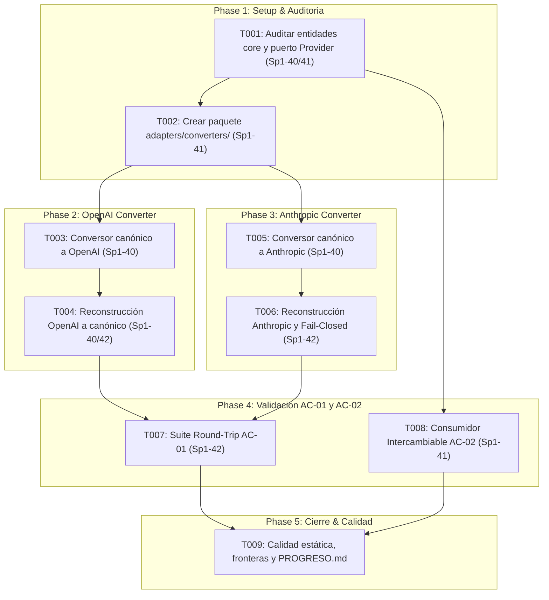

# Implementation Tasks: HU-07-01 — Interfaz Provider y formato interno de mensajes

**Feature**: `specs/004-provider-interface-message-format/spec.md`  
**Plan**: `specs/004-provider-interface-message-format/plan.md`  
**Responsable**: A — Núcleo  
**Sprint**: Sprint 1 | **PHU**: 3 (Estimación base: ~6 horas F5 / ~290 min netos)  

---

## Trazabilidad con la Planificación del Sprint 1

- **Sp1-40**: Definir mensajes, bloques de herramienta y consumo — Estimación original: 2,5 h (Tareas: T001, T003, T004, T005).
- **Sp1-41**: Definir interfaz de comunicación Provider — Estimación original: 2 h (Tareas: T001, T002, T008).
- **Sp1-42**: Pruebas de ida y vuelta — Estimación original: 1,5 h (Tareas: T004, T006, T007).
- **Total Planificado**: 6 horas F5 (3 PHU).

---

## Phase 1: Setup & Auditoría de Contratos Existentes (Sp1-40 / Sp1-41)

**Propósito**: Auditar las entidades canónicas de `HU-00-01` e inicializar el paquete de adaptadores de conversión sin duplicar modelos ni acoplar `core/`.

- [x] **T001** [P] Auditar y ratificar entidades de `core/entities.py` y el puerto `core/interfaces/provider.py` asegurando cero duplicados con HU-00-01 (Sp1-40, Sp1-41)
  - **Archivos**: `src/harness_agent/core/entities.py`, `src/harness_agent/core/interfaces/provider.py`, `tests/contracts/test_contracts.py`
  - **Dependencias**: Ninguna (prerrequisito base de HU-00-01)
  - **Criterios relacionados**: RF-7.1, RF-7.2, Principio III, Sp1-40, Sp1-41
  - **Tarea F5**: Sp1-40, Sp1-41
  - **Estimación**: 25 min (15 min impl/audit + 5 min check + 5 min reg)
  - **Verificación**: `pytest tests/contracts/test_contracts.py` y `mypy src/harness_agent/core/` confirman que las 8 entidades (`Role`, `Message`, `ToolCall`, `ToolResult`, `TokenUsage`, `ToolDefinition`, `ProviderResponse`, `Provider`) existen, son inmutables, están fuertemente tipadas y `Provider.complete` es `async def`.

- [x] **T002** [P] Crear el paquete de adaptadores de conversión `src/harness_agent/adapters/converters/` con protocolo base y exportaciones limpias (Sp1-41, RNF-12)
  - **Archivos**: `src/harness_agent/adapters/converters/__init__.py`, `src/harness_agent/adapters/converters/base.py`
  - **Dependencias**: T001
  - **Criterios relacionados**: RNF-12, Principio III, Sp1-41
  - **Tarea F5**: Sp1-41
  - **Estimación**: 25 min (15 min impl + 5 min check + 5 min reg)
  - **Verificación**: `mypy src/harness_agent/adapters/` pasa sin errores; el paquete exporta el protocolo abstracto de conversión `ProviderMessageConverter` sin acoplarse a librerías de terceros.

---

## Phase 2: Conversión Bidireccional OpenAI (AC-01 / US1 / Sp1-40 / Sp1-42)

**Propósito**: Implementar la transformación invertible entre las entidades canónicas y el dialecto OpenAI Chat Completions v1 preservando metadatos locales.

- [x] **T003** [US1] Implementar el conversor canónico $\to$ OpenAI para mensajes, llamadas paralelas y esquemas de herramientas (`openai_converter.py`) (AC-01, Sp1-40)
  - **Archivos**: `src/harness_agent/adapters/converters/openai_converter.py`
  - **Dependencias**: T002
  - **Criterios relacionados**: AC-01, FR-001, FR-003, FR-006, Sp1-40
  - **Tarea F5**: Sp1-40
  - **Estimación**: 35 min (20 min impl + 10 min check + 5 min reg)
  - **Verificación**: `to_openai_messages` y `to_openai_tools` transforman secuencias con `Role.SYSTEM`, `Role.USER`, `Role.ASSISTANT` (con múltiples `ToolCall`) y `Role.TOOL` al esquema de OpenAI; `is_external` se conserva localmente sin inyectar campos no estándar en el payload de red.

- [x] **T004** [US1] Implementar la reconstrucción OpenAI $\to$ canónico (`from_openai_response`), parseo seguro de argumentos y mapeo de `TokenUsage` (AC-01, Sp1-40, Sp1-42)
  - **Archivos**: `src/harness_agent/adapters/converters/openai_converter.py`
  - **Dependencias**: T003
  - **Criterios relacionados**: AC-01, FR-004, FR-005, Sp1-40, Sp1-42
  - **Tarea F5**: Sp1-40, Sp1-42
  - **Estimación**: 35 min (20 min impl + 10 min check + 5 min reg)
  - **Verificación**: `from_openai_response` reconstruye `ProviderResponse`, deserializa cadenas JSON de argumentos a `dict[str, Any]` y mapea `prompt_tokens`/`completion_tokens` a `TokenUsage` con suma exacta de `total_tokens`.

---

## Phase 3: Conversión Bidireccional Anthropic y Falla Cerrada (AC-01 / US1 / US3 / Sp1-40 / Sp1-42)

**Propósito**: Implementar la transformación invertible para Anthropic Messages v1 y asegurar la política de falla cerrada (*fail-closed*) ante datos no representables.

- [x] **T005** [US1] Implementar el conversor canónico $\to$ Anthropic Messages v1 extrayendo `system` al parámetro superior y traduciendo herramientas a `input_schema` (`anthropic_converter.py`) (AC-01, Sp1-40)
  - **Archivos**: `src/harness_agent/adapters/converters/anthropic_converter.py`
  - **Dependencias**: T002
  - **Criterios relacionados**: AC-01, FR-001, FR-006, Sp1-40
  - **Tarea F5**: Sp1-40
  - **Estimación**: 35 min (20 min impl + 10 min check + 5 min reg)
  - **Verificación**: `to_anthropic_payload` extrae el contenido de `Role.SYSTEM` al parámetro superior `system`, mapea herramientas a `name`, `description` e `input_schema`, y empaqueta resultados en bloques `tool_result` dentro de mensajes con `role="user"`.

- [x] **T006** [US1] Implementar la reconstrucción Anthropic $\to$ canónico y validación estricta de falla cerrada (*fail-closed*) ante esquemas o argumentos incompatibles (AC-01, US3, Sp1-42)
  - **Archivos**: `src/harness_agent/adapters/converters/anthropic_converter.py`
  - **Dependencias**: T005
  - **Criterios relacionados**: AC-01, FR-004, FR-011, Sp1-42
  - **Tarea F5**: Sp1-42
  - **Estimación**: 35 min (20 min impl + 10 min check + 5 min reg)
  - **Verificación**: `from_anthropic_response` parsea bloques `text` y `tool_use`; cualquier argumento no serializable o JSON malformado levanta `ValueError` explícito sin omitir datos silenciosamente.

---

## Phase 4: Suites de Pruebas Automatizadas de AC-01 y AC-02 (AC-01 / AC-02 / US2 / Sp1-41 / Sp1-42)

**Propósito**: Construir la suite de verificación round-trip sin pérdida y el arnés de prueba de sustitución polimórfica de proveedores.

- [x] **T007** [US1] Implementar la suite exhaustiva de pruebas de conversión round-trip sin pérdida para OpenAI y Anthropic (AC-01, Sp1-42)
  - **Archivos**: `tests/adapters/test_converters.py`
  - **Dependencias**: T004, T006
  - **Criterios relacionados**: AC-01, SC-001, SC-005, Sp1-42
  - **Tarea F5**: Sp1-42
  - **Estimación**: 40 min (25 min impl + 10 min check + 5 min reg)
  - **Verificación**: `pytest tests/adapters/test_converters.py -v` aprueba al 100% los escenarios: roles, contenido vacío, llamadas paralelas, correlación `id` $\equiv$ `call_id`, `is_error=True`, `TokenUsage`, preservación de `is_external` y pruebas negativas de falla cerrada.

- [x] **T008** [US2] Implementar el arnés consumidor desacoplado `TestAgentConsumer` y verificar la intercambiabilidad de proveedores con 0 líneas modificadas (AC-02, Sp1-41)
  - **Archivos**: `tests/contracts/test_provider_interchangeability.py`
  - **Dependencias**: T001
  - **Criterios relacionados**: AC-02, FR-009, FR-012, SC-002, Sp1-41
  - **Tarea F5**: Sp1-41
  - **Estimación**: 35 min (20 min impl + 10 min check + 5 min reg)
  - **Verificación**: `pytest tests/contracts/test_provider_interchangeability.py -v` ejecuta el consumidor alternando entre `FakeScriptedProvider` y `AlternativeMockProvider`, comprobando que ambos completan turnos exitosamente sin tocar ninguna línea del consumidor.

---

## Phase 5: Calidad Integral, Fronteras Hexagonales y Registro de Progreso (RNF-12 / Sp1-40 / Sp1-41 / Sp1-42)

**Propósito**: Certificar tipado estricto, análisis estático, fronteras de importación y actualizar la evidencia de progreso del proyecto.

- [x] **T009** *(nota 2026-10-18: la evidencia de AC-01 afirmada aquí fue corregida por la auditoría; ver Phase 6 y T018)* Ejecutar la suite completa de calidad (Mypy estricto, Ruff, tests de fronteras) y actualizar `docs/PROGRESO.md` con evidencias de AC-01 y AC-02 (Principio III, Principio VIII)
  - **Archivos**: `tests/architecture/test_core_boundaries.py`, `docs/PROGRESO.md`
  - **Dependencias**: T007, T008
  - **Criterios relacionados**: RNF-12, SC-003, SC-004, Principio III, Principio VIII
  - **Tarea F5**: Sp1-40, Sp1-41, Sp1-42
  - **Estimación**: 25 min (15 min impl + 5 min check + 5 min reg)
  - **Verificación**: `mypy --strict` limpio (0 errores en `src/` y `tests/`), `ruff check` limpio, 100% tests pasando en $< 1\text{ s}$, `test_core_boundaries.py` pasando y fila de HU-07-01 actualizada en `docs/PROGRESO.md`.

---

## Phase 6: Corrección de defectos de la auditoría (2026-10-18)

**Propósito**: corregir los defectos D3–D7 detectados al auditar la implementación de T001–T009, sin cambiar los criterios de aceptación. La evidencia de AC-01 declarada en T009 queda **corregida por esta fase**: AC-01 está parcialmente verificado (D1 y D2 pendientes).

**Método**: TDD. Las pruebas de regresión se escribieron primero y se ejecutaron contra el código anterior: 99 fallaron y 31 pasaron (casos positivos y de control) de un total de 130; luego se corrigió el código y las 133 pruebas del archivo pasan (se añadieron 3 pruebas después de la ejecución en rojo: texto tras `tool_use` y dos que fijan D1 y D2).

- [x] **T010** Escribir las pruebas de regresión de D3–D7 y registrar la evidencia en rojo
  - **Archivos**: `tests/adapters/test_converters_regressions.py`
  - **Verificación**: 99 fallos contra la implementación anterior (D3, D4, D5, D6 y D7).
- [x] **T011** D3: validar que los argumentos de `ToolCall` sean un objeto JSON (`parse_tool_arguments`, helper compartido)
  - **Archivos**: `src/harness_agent/adapters/converters/_validation.py`, `openai_converter.py`
  - **Verificación**: `[1,2]`, `5`, `null`, `"text"`, `true` y tipos Python no soportados producen `ConversionError` con el id y el nombre de la llamada y el valor truncado; los argumentos no serializables (o con NaN) también se rechazan al enviar.
- [x] **T012** D4: `from_anthropic_payload` ya no descarta bloques ni convierte bloques desconocidos en mensajes vacíos
  - **Archivos**: `anthropic_converter.py`
  - **Decisión**: se elige `ConversionError` y no la preservación, porque el modelo canónico no puede registrar la agrupación de `tool_result` con texto sin metadatos de correlación locales. También se rechazan roles no soportados, bloques incompletos o mal tipados y listas de contenido vacías.
- [x] **T013** D5: `ToolResult.content` y `Message.content` respetan el contrato `str`
  - **Archivos**: `anthropic_converter.py`, `openai_converter.py`, `_validation.py`
  - **Decisión**: una lista de bloques `text` se une con salto de línea (representación textual aprobada); cualquier otro contenido se rechaza.
- [x] **T014** D6: los mensajes `system` conservan límites y orden
  - **Archivos**: `anthropic_converter.py`
  - **Decisión**: un `system` inicial único va como cadena; varios van como lista de bloques de texto; un `system` posterior a otros mensajes produce `ConversionError`; un `system` vacío también lo produce en la función solo-payload `to_anthropic_payload`, mientras que la ruta del envelope (T021) lo omite del payload y lo conserva en el sidecar.
- [x] **T015** D7: los errores por payloads externos inválidos se normalizan a `ConversionError`
  - **Archivos**: `openai_converter.py`, `anthropic_converter.py`, `_validation.py`
  - **Verificación**: `tool_call` sin `id`, `choice` o `message` inválidos, rol desconocido, `tool_call_id` ausente, `usage` con tipos incompatibles y bloques incompletos; solo se traducen las excepciones de la librería estándar para JSON, los errores de programación se propagan.
- [x] **T016** Actualizar documentación: enlaces relativos, estados, conteos históricos marcados, contrato y modelo de datos, `docs/PROGRESO.md`
- [x] **T017** Validación: pruebas de HU-07-01 (148 pasan), suite completa (206 pasan y 5 omitidas en Windows; 211 pasan en WSL2 Ubuntu), `mypy src tests` (40 archivos), `ruff check` y `ruff format --check` limpios
- [ ] **T018** **SIN MARCAR — falta la aprobación técnica individual**: diseñar y aprobar un canal de metadatos local (o equivalente) para preservar `is_external` (D1) y `is_error` en OpenAI (D2).
  - **Diseño**: [D-02](../../docs/decisiones/D-02-preservacion-metadatos-conversion.md), estado **PROPUESTA — PENDIENTE DE APROBACIÓN TÉCNICA** de A, B y C.
  - **Nota (2026-10-18)**: la implementación técnica (T019–T024) se ejecutó con la autorización colectiva comunicada por el Product Owner (consenso del equipo, no firmas individuales). La parte de *diseñar* está hecha; la parte de *aprobar* sigue pendiente, por eso esta casilla permanece sin marcar. Se marcará cuando A, B y C registren su aprobación de forma identificable.
- [x] **T019** Tipos del envelope (`WireRef`, `MessageMeta`, `ConversionEnvelope`), instantánea JSON estricta, huellas SHA-256 y `matches`. Evidencia: `src/harness_agent/adapters/converters/sidecar.py`; `tests/adapters/test_envelope_types.py` (21 pruebas, escritas primero en rojo).
- [x] **T020** `to_openai_envelope` y restauración para OpenAI: D1, D2, D8, D9 y política de correlación con `partial_window`. Evidencia: `openai_converter.py`, `_validation.py`; `tests/adapters/test_envelope_roundtrip.py`.
- [x] **T021** `to_anthropic_envelope` y restauración para Anthropic con `WireRef`, verificación de cobertura y `SYSTEM` vacío omitido del payload y registrado en el sidecar. Evidencia: `anthropic_converter.py`; `test_envelope_roundtrip.py`, `test_envelope_security.py`.
- [x] **T022** Pruebas de seguridad y concurrencia (28 escenarios de D-02 §11, fixtures escritas a mano). Evidencia: `tests/adapters/test_envelope_security.py`, `test_envelope_roundtrip.py`.
- [x] **T023** `test_pending_d1_*` y `test_pending_d2_*` transformadas en pruebas de preservación; barrido de AC-01 sobre secuencias válidas; documentos actualizados. Evidencia: `tests/adapters/test_converters_regressions.py`, `docs/PROGRESO.md`.
- [x] **T024** `DeprecationWarning` (con `stacklevel=2`) en `from_openai_messages` y `from_anthropic_payload`, sin cambiar su comportamiento. Evidencia: `tests/adapters/test_deprecation.py`.
- [x] **T025** D10: rechazar con `ConversionError` los mensajes canónicos incoherentes (`tool_calls` fuera de `ASSISTANT`, `tool_result` fuera de `TOOL`, `TOOL` sin `tool_result`) en ambos conversores. Ejecutada el 2026-10-18 con pruebas de regresión escritas primero (`tests/adapters/test_canonical_validation.py`). *(Nota de numeración: en D-02 §10, T025 se proponía como tarea de D10; se ejecuta aquí fuera de D-02, sin envelope ni metadatos.)*
- [x] **T026** D6 (decisión del Product Owner, 2026-10-18): validar que los mensajes `system` solo sean prefijo contiguo, en ambos proveedores y en ambas direcciones, y registrar la aclaración del dominio válido de AC-01 sin modificar su texto (spec.md, D-02 §5). *(Nota de numeración: T026 es un identificador nuevo; D-02 propone T019–T024 y reservaba T025 para D10, por lo que no hay colisión.)*

---

## Tareas Informativas Bloqueadas y Dependencias Externas

> Estas tareas NO forman parte de la ejecución inmediata autónoma de HU-07-01. Se documentan formalmente para visibilidad de gobernanza.

- **`T_SPK01_DEP`**: *Validación experimental de traducción con endpoints reales de LiteLLM*.  
  - **Estado**: **BLOQUEADA** a la espera de que el Desarrollador B complete `SPK-01` y el adaptador `HU-07-02`.  
  - **Mitigación**: HU-07-01 define los modelos canónicos y los conversores abstractos contra los esquemas estándar de OpenAI y Anthropic, listos para que LiteLLM los consuma.
- **`T_HUMAN_REV`**: *Hito de revisión colegiada y ratificación de contratos (Sp1-03 / T016)*.  
  - **Estado**: **PENDIENTE DE REUNIÓN COLEGIADA** entre Desarrolladores A, B y C conforme al Principio IX de la Constitución.

---

## Dependencias & Orden de Ejecución

---

## Resumen de Estimaciones

| Tarea | Descripción breve | Tiempo Impl. | Tiempo Check | Tiempo Reg. | Total |
|---|---|---|---|---|---|
| **T001** | Auditoría y ratificación de modelos en `core/` | 15 min | 5 min | 5 min | 25 min |
| **T002** | Inicialización del paquete `adapters/converters/` | 15 min | 5 min | 5 min | 25 min |
| **T003** | Conversor canónico a OpenAI (mensajes/herramientas) | 20 min | 10 min | 5 min | 35 min |
| **T004** | Reconstrucción OpenAI a canónico y parseo seguro | 20 min | 10 min | 5 min | 35 min |
| **T005** | Conversor canónico a Anthropic Messages v1 | 20 min | 10 min | 5 min | 35 min |
| **T006** | Reconstrucción Anthropic y validación *fail-closed* | 20 min | 10 min | 5 min | 35 min |
| **T007** | Suite de pruebas de conversión round-trip (AC-01) | 25 min | 10 min | 5 min | 40 min |
| **T008** | Arnés de consumidor e intercambiabilidad (AC-02) | 20 min | 10 min | 5 min | 35 min |
| **T009** | Calidad estática, test de fronteras y `PROGRESO.md` | 15 min | 5 min | 5 min | 25 min |
| **Total** | **9 microtareas atómicas desbloqueadas** | **170 min** | **75 min** | **45 min** | **290 min (~4.8 h)** |
