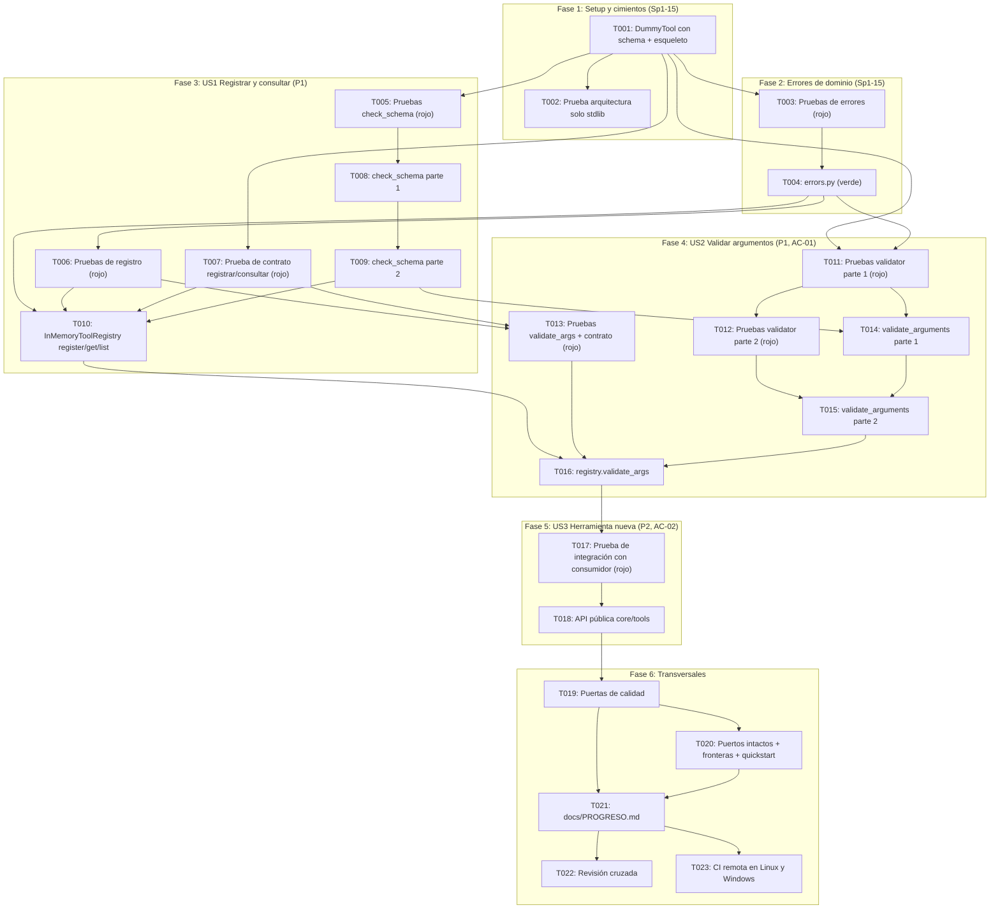

# Implementation Tasks: HU-01-02 — Registro de herramientas con esquema y validación

**Feature**: `specs/006-tool-registry-validation/spec.md`  
**Plan**: `specs/006-tool-registry-validation/plan.md`  
**Responsable**: C — Control y conexiones  
**Sprint**: Sprint 1 | **PHU**: 3  
**Tareas de referencia**: Sp1-15, Sp1-16, Sp1-17  

---

## Cómo leer este documento

**Pruebas primero.** Dentro de cada historia, las tareas de prueba van antes de las de implementación. Cada tarea de implementación se da por terminada cuando pasan las pruebas escritas antes. Antes de implementar, ejecutar la prueba y confirmar que falla **por la razón esperada** (`ImportError` o una aserción), no por un error de sintaxis o de tipos.

**Reglas que valen para todas las tareas:**
- No modificar nada bajo `src/harness_agent/core/interfaces/`. Si una tarea parece exigirlo, detenerse y acordarlo con A y B (los puertos solo cambian con el visto bueno de los tres).
- En `src/harness_agent/core/tools/` solo se importa biblioteca estándar y `harness_agent.core`. Python 3.12 es la única versión soportada (PD-07).
- Todo el código y las pruebas deben pasar `mypy --strict` y `ruff` (línea de 100 columnas).
- Los textos de error y los nombres de campo siguen [contracts/tool_registry_contract.md](contracts/tool_registry_contract.md); las reglas de validación, [data-model.md](data-model.md).
- **Registro**: los 5 min de registro de cada estimación se emplean en anotar, al terminar la tarea, una línea en *Registro de cambios* de `docs/PROGRESO.md` con el ID de la tarea, el comando de verificación y su resultado (Principio VIII). T021 consolida después la fila de la historia.

**Correspondencia con las tareas del plan de sprint** (la columna *Tarea F5* de cada microtarea). Las pruebas de argumentos mal formados (Sp1-17) se **escriben antes** que la implementación que ejercitan (Sp1-16), porque el orden de ejecución sigue la regla "pruebas primero":

| Tarea F5 | Descripción en `docs/03-plan-sprints.md` | Presupuesto | Microtareas |
|---|---|---|---|
| **Sp1-15** | Definir la clase base Tool con esquema | 180 min | T001, T002, T003, T004, T005, T008, T009 |
| **Sp1-16** | Implementar el registro y la validación con el esquema | 150 min | T006, T007, T010, T014, T015, T016, T018 |
| **Sp1-17** | Pruebas con argumentos mal formados | 120 min | T011, T012, T013, T017 |
| Transversal | Puertas de calidad, fronteras, registro, revisión y CI remota (Principios VIII y IX) | — | T019, T020, T021, T022, T023 |

La clase base `Tool` y la interfaz `ToolRegistry` ya existen desde HU-00-01. En Sp1-15 el trabajo es lo que define a una herramienta válida con su esquema: los errores de dominio, la comprobación de esquemas y la ampliación del doble de prueba.

---

## Phase 1: Setup y cimientos de prueba (Sp1-15)

**Propósito**: Dejar el esqueleto de paquetes, el doble `DummyTool` capaz de declarar esquemas propios y la barrera automática de "solo biblioteca estándar" antes de escribir ninguna regla.

- [x] **T001** Ampliar `DummyTool` con un parámetro `schema` opcional y crear el esqueleto de paquetes de código y de prueba, y marcar la historia `En curso` (Sp1-15)
  - **Archivos**: `tests/doubles/dummy_tool.py`, `src/harness_agent/core/tools/__init__.py`, `tests/unit/__init__.py`, `tests/unit/core/__init__.py`, `tests/unit/core/tools/__init__.py`, `tests/integration/__init__.py`, `tests/unit/test_dummy_tool_schema.py`, `docs/PROGRESO.md`
  - **Dependencias**: Ninguna
  - **Criterios relacionados**: Plan (Structure Decision), research R-12, Principio IV, Principio VIII
  - **Tarea F5**: Sp1-15
  - **Estimación**: 35 min (25 min impl + 5 min check + 5 min registro)
  - **Verificación**: `DummyTool.__init__` acepta `schema: dict[str, Any] | None = None` como último argumento por nombre; si es `None`, la propiedad `schema` devuelve el mismo esquema de hoy (campos `input` y `call_id` de tipo cadena); si se pasa, devuelve ese mismo diccionario sin copiarlo (así una prueba puede mutarlo después de registrar la herramienta). `core/tools/__init__.py` solo contiene el docstring del subpaquete, sin importaciones. Los demás `__init__.py` están vacíos. `pytest tests/contracts` sigue pasando sin cambios, `mypy src tests` pasa y `python -c "import harness_agent.core.tools"` no falla. En `docs/PROGRESO.md`, la fila de HU-01-02 pasa de `Pendiente` a `En curso` con responsable C — Control y conexiones (paso 1 de «Cómo mantenerlo»). La prueba `tests/unit/test_dummy_tool_schema.py` cubre el parámetro `schema` de `DummyTool` (último argumento, esquema por defecto intacto y no compartido, objeto devuelto sin copiar y mutable después de construir) y se escribe antes del cambio.

- [x] **T002** Crear la prueba de arquitectura que exige solo biblioteca estándar en `core/tools/` (Sp1-15)
  - **Archivos**: `tests/architecture/test_core_tools_stdlib_only.py`
  - **Dependencias**: T001
  - **Criterios relacionados**: RNF-13, FR-016, Principio III, research R-12
  - **Tarea F5**: Sp1-15
  - **Estimación**: 25 min (15 min impl + 5 min check + 5 min registro)
  - **Verificación**: La prueba recorre con `ast` todos los `.py` bajo `src/harness_agent/core/tools/`, exige que haya al menos uno y que cada importación absoluta pertenezca a `sys.stdlib_module_names` o a `harness_agent.core` (se rechazan `harness_agent.adapters`, `harness_agent.cli`, `harness_agent.observability` y cualquier paquete de terceros; las importaciones relativas se permiten). La lógica de comprobación vive en una función auxiliar que recibe el código fuente, y una segunda prueba la ejercita con textos sintéticos para demostrar que detecta `import jsonschema` y `from harness_agent.adapters import x` (evita una prueba vacía). `pytest tests/architecture` pasa sobre el esqueleto de T001.

---

## Phase 2: Foundational — Errores de dominio (Sp1-15)

**Propósito**: Definir los errores y el formato de los mensajes para el modelo, que bloquean a las tres historias porque todas rechazan algo.

- [x] **T003** [P] Escribir las pruebas de la jerarquía de errores y del formato de los mensajes (Sp1-15)
  - **Archivos**: `tests/unit/core/tools/test_errors.py`
  - **Dependencias**: T001
  - **Criterios relacionados**: FR-007, FR-008, FR-009, FR-010, research R-07
  - **Tarea F5**: Sp1-15
  - **Estimación**: 30 min (20 min impl + 5 min check + 5 min registro)
  - **Verificación**: Las pruebas importan desde `harness_agent.core.tools.errors` y fallan con `ImportError` hasta T004. Cubren: `Violation` congelada (modificarla lanza `FrozenInstanceError`) e igualdad por valor; las cuatro subclases heredan de `ToolRegistryError` y de `ValueError`; `ToolValidationError` conserva `tool_name` y todas las `violations`; `str()` coincide con el formato del contrato (cabecera `Argumentos inválidos para la herramienta '<nombre>':` y una línea `- <ruta>: <motivo>` por violación); ruta vacía mostrada como `(argumentos)`; con 21 violaciones se muestran 20 más `- … y 1 violación más.` y con 23, `- … y 3 violaciones más.` (el atributo `violations` mantiene las 23); una ruta de más de 80 caracteres y un nombre de herramienta de más de 64 se recortan con `…`; los textos de `UnknownToolError`, `DuplicateToolError` e `InvalidToolDefinitionError` (cabecera más una línea por problema) coinciden con el contrato.

- [x] **T004** Implementar `Violation` y la jerarquía de errores de dominio (Sp1-15)
  - **Archivos**: `src/harness_agent/core/tools/errors.py`
  - **Dependencias**: T003
  - **Criterios relacionados**: FR-007, FR-008, FR-009, FR-010, RNF-13, research R-07, data-model (Entidades nuevas)
  - **Tarea F5**: Sp1-15
  - **Estimación**: 25 min (15 min impl + 5 min check + 5 min registro)
  - **Verificación**: `errors.py` define `Violation` (`@dataclass(frozen=True)` con `path` y `message`), `ToolRegistryError(ValueError)` y sus cuatro subclases con los atributos del modelo de datos, y las constantes `MAX_NAME_LENGTH = 64`, `MAX_RENDERED_VIOLATIONS = 20` y `MAX_PATH_DISPLAY = 80`. `__str__` produce los textos del contrato en español sin reproducir ningún valor recibido. Solo importa biblioteca estándar. `pytest tests/unit/core/tools/test_errors.py` pasa al 100 % y `mypy --strict` no reporta errores.

---

## Phase 3: User Story 1 — Registrar una herramienta con su definición completa (P1)

**Objetivo de la historia**: Registrar una herramienta con nombre, descripción, esquema JSON y nivel de riesgo, consultarla por nombre y listar el catálogo, rechazando duplicados y definiciones inválidas sin alterar el catálogo.

**Prueba independiente**: Con `DummyTool` se registran herramientas válidas e inválidas; las válidas quedan consultables con sus cuatro atributos y en orden de registro, y las inválidas o duplicadas se rechazan con un motivo claro dejando el catálogo idéntico. No requiere validar argumentos, bucle ni proveedor.

### Pruebas primero (US1)

- [x] **T005** [P] [US1] Escribir las pruebas de `check_schema`: esquemas válidos e inválidos (Sp1-15)
  - **Archivos**: `tests/unit/core/tools/test_schema_check.py`
  - **Dependencias**: T001
  - **Criterios relacionados**: FR-003, US1 escenario 3, reglas S-1 a S-10 del modelo de datos, research R-03 y R-04
  - **Tarea F5**: Sp1-15
  - **Estimación**: 40 min (30 min impl + 5 min check + 5 min registro)
  - **Verificación**: Las pruebas importan `check_schema` desde `harness_agent.core.tools.schema_validator` y fallan con `ImportError` hasta T008. Se agrupan en dos clases para poder ejecutarlas por separado con `-k`: `TestEstructura` (raíz que no es objeto; `type` desconocido, lista vacía o con repetidos; `properties` que no es mapa; `required` con repetidos o con un campo no declarado en `properties`; `additionalProperties` no booleano; palabras clave no soportadas `$ref`, `anyOf`, `oneOf`, `allOf`, `not`, `pattern`, `format`, `const`, `if`, en la raíz y anidadas, con un problema que nombra la palabra y el lugar, por ejemplo `properties.limite: palabra clave no soportada 'pattern'.`; anotaciones `description`, `title`, `default`, `examples`, `$comment` y `$schema` aceptadas; uniones de tipo válidas como `["string", "null"]`; un esquema mínimo `{"type": "object"}` válido) y `TestRestricciones` (`enum` vacío o no lista; `minimum`/`maximum` booleanos, no numéricos, infinitos o con `minimum > maximum`; `minLength`/`maxLength`/`minItems`/`maxItems` negativos, booleanos o no enteros, o con mínimo mayor que máximo; `items` en forma de lista; anidamiento de más de 32 niveles; un esquema circular, que debe producir un problema y no `RecursionError`). Un esquema válido devuelve `[]`.

- [x] **T006** [P] [US1] Escribir las pruebas de registro, consulta y listado con `DummyTool` (Sp1-16)
  - **Archivos**: `tests/unit/core/tools/test_registry.py`
  - **Dependencias**: T004
  - **Criterios relacionados**: FR-001, FR-002, FR-004, FR-005, SC-004, US1 escenarios 1 a 5
  - **Tarea F5**: Sp1-16
  - **Estimación**: 35 min (25 min impl + 5 min check + 5 min registro)
  - **Verificación**: Las pruebas importan `InMemoryToolRegistry` desde `harness_agent.core.tools.registry` y fallan con `ImportError` hasta T010. Cubren: registrar y recuperar con `get` la misma instancia; `list()` en orden de registro y como lista nueva en cada llamada; `get` de un nombre inexistente devuelve `None`; nombre repetido lanza `DuplicateToolError` (que también es `ValueError`) y conserva la herramienta original; la unicidad distingue mayúsculas y minúsculas (`Shell` y `shell` se registran como herramientas distintas, y repetir exactamente `shell` lanza `DuplicateToolError`); nombres válidos (`leer_archivo`, `a-b_1`, 64 caracteres) y rechazados (vacío, con espacios, con acento, con punto, 65 caracteres, `"nombre\n"` con salto de línea final); descripción vacía o solo espacios; `risk` que no es `RiskLevel` (un subtipo de `DummyTool` cuya propiedad `risk` devuelve `cast(RiskLevel, "low")`; el `cast` mantiene limpio `mypy --strict` sobre `tests` sin recurrir a un `# type: ignore` que `warn_unused_ignores` podría marcar como sobrante) y los tres `RiskLevel` aceptados; esquema inválido lanza `InvalidToolDefinitionError` con un problema que empieza por `esquema`; una definición con nombre, descripción y esquema inválidos juntos informa todos los problemas a la vez; tras **cada** rechazo, `list()` es idéntica a la de antes (atomicidad).

- [x] **T007** [P] [US1] Crear la prueba de contrato del puerto `ToolRegistry`: registrar, consultar y listar (Sp1-16)
  - **Archivos**: `tests/contracts/test_tool_registry_contract.py`
  - **Dependencias**: T001
  - **Criterios relacionados**: RF-1.2, RNF-13, plan (Trazabilidad), research R-12
  - **Tarea F5**: Sp1-16
  - **Estimación**: 20 min (10 min impl + 5 min check + 5 min registro)
  - **Verificación**: El archivo define una fábrica de registros parametrizable (fixture que devuelve un `ToolRegistry`) para que cualquier implementación futura reutilice la suite, con `InMemoryToolRegistry` como única instancia hoy. Comprueba solo comportamiento del puerto: registrar y recuperar, orden de `list()`, `ValueError` ante nombre repetido y `None` para un nombre desconocido. Falla con `ImportError` hasta T010.

### Implementación (US1)

- [x] **T008** [US1] Implementar `check_schema`, parte 1: estructura, tipos y palabras clave (Sp1-15)
  - **Archivos**: `src/harness_agent/core/tools/schema_validator.py`
  - **Dependencias**: T005
  - **Criterios relacionados**: FR-003, reglas S-1 a S-6, research R-03, R-04 y R-05
  - **Tarea F5**: Sp1-15
  - **Estimación**: 35 min (25 min impl + 5 min check + 5 min registro)
  - **Verificación**: `check_schema(schema: object) -> list[str]` devuelve problemas como frases completas que terminan en punto y empiezan por el lugar dentro del esquema (`(raíz)` para la raíz, `properties.limite` para un campo; el registro les antepondrá `esquema `). Implementa la raíz `type: "object"`, la lista blanca de palabras clave de validación y de anotaciones inertes con rechazo nominal del resto, `type` como nombre o lista sin repetidos, `properties` recursivo, `required` sin repetidos y contenido en `properties`, y `additionalProperties` booleano. Solo biblioteca estándar. Pasan todos los casos de `TestEstructura` de T005 (`pytest tests/unit/core/tools/test_schema_check.py -k TestEstructura`); los de `TestRestricciones` siguen en rojo hasta T009.

- [x] **T009** [US1] Implementar `check_schema`, parte 2: restricciones, `items` y profundidad máxima (Sp1-15)
  - **Archivos**: `src/harness_agent/core/tools/schema_validator.py`
  - **Dependencias**: T008
  - **Criterios relacionados**: FR-003, reglas S-7 a S-10, research R-05 y R-08
  - **Tarea F5**: Sp1-15
  - **Estimación**: 30 min (20 min impl + 5 min check + 5 min registro)
  - **Verificación**: `check_schema` añade `enum` no vacío, `minimum`/`maximum` numéricos finitos y no booleanos con `minimum <= maximum`, límites de longitud y de elementos enteros no negativos con mínimo no mayor que máximo, `items` como subesquema único, y la constante `MAX_SCHEMA_DEPTH = 32` que corta también esquemas circulares sin lanzar `RecursionError`. `pytest tests/unit/core/tools/test_schema_check.py` pasa al 100 %.

- [x] **T010** [US1] Implementar `InMemoryToolRegistry`: `register`, `get` y `list` (Sp1-16)
  - **Archivos**: `src/harness_agent/core/tools/registry.py`
  - **Dependencias**: T004, T006, T007, T009
  - **Criterios relacionados**: FR-001, FR-002, FR-003, FR-004, FR-005, SC-004, research R-08, R-10 y R-11
  - **Tarea F5**: Sp1-16
  - **Estimación**: 35 min (25 min impl + 5 min check + 5 min registro)
  - **Verificación**: La clase hereda de `ToolRegistry`, no recibe argumentos de constructor y guarda las herramientas en un `dict` con una entrada interna congelada que contiene la herramienta y una copia profunda del esquema. `register` lee una sola vez `name`, `description`, `risk` y `schema`; comprueba con `fullmatch` el formato `[A-Za-z0-9_-]{1,64}`, la descripción no vacía tras recortar espacios, `isinstance(risk, RiskLevel)` y `check_schema`; acumula todos los problemas con el prefijo `nombre:`, `descripción:`, `riesgo:` o `esquema ` y lanza `InvalidToolDefinitionError`; después comprueba la colisión (`DuplicateToolError`); solo entonces modifica el catálogo. `get` devuelve la herramienta o `None`. `list` devuelve una lista nueva en orden de registro. `validate_args` queda con un cuerpo provisional que lanza `NotImplementedError("T016")`, necesario para poder instanciar la clase abstracta. Pasan todos los casos de T006 y T007 (los de validación de argumentos se añaden en T013). Solo biblioteca estándar y `harness_agent.core`.

---

## Phase 4: User Story 2 — Validar argumentos y devolver al modelo un error accionable (P1) [AC-01]

**Objetivo de la historia**: Validar los argumentos de cada llamada contra el esquema registrado antes de ejecutar; si no cumplen, no se ejecuta nada y el error nombra cada campo inválido.

**Prueba independiente**: Con un `DummyTool` registrado se envían llamadas con campo requerido ausente, tipo incorrecto, valor fuera de rango o de enumeración, campos anidados inválidos, campos no declarados y argumentos que no son un objeto; en todos los casos `recorded_executions` queda vacío y el mensaje nombra el campo.

### Pruebas primero (US2)

- [x] **T011** [P] [US2] Escribir las pruebas de `validate_arguments`, parte 1: tipos, requeridos, campos no declarados y propiedades generales (Sp1-17)
  - **Archivos**: `tests/unit/core/tools/test_schema_validator.py`
  - **Dependencias**: T001, T004
  - **Criterios relacionados**: AC-01, FR-006, FR-007, FR-008, FR-009, FR-011, FR-012, reglas A-1 a A-4, A-9 y A-10, research R-05 y R-06
  - **Tarea F5**: Sp1-17
  - **Estimación**: 35 min (25 min impl + 5 min check + 5 min registro)
  - **Verificación**: Las pruebas importan `validate_arguments` desde `harness_agent.core.tools.schema_validator` y fallan con `ImportError` hasta T014. Se agrupan en la clase `TestTiposYRequeridos`. Cubren: campo requerido ausente (ruta = nombre del campo y motivo `falta el campo requerido.`); valor `None` en un campo requerido de tipo cadena; un caso por tipo (`string`, `integer`, `number`, `boolean`, `array`, `object`, `null`) con el nombre del tipo esperado en español en el motivo; `True` rechazado como `integer` y como `number`; `3.0` aceptado y `3.5`, `"3"` rechazados como `integer`; `NaN` e infinitos rechazados como `integer` y `number`; uniones (`["integer", "null"]`) con el motivo `se esperaba uno de: entero, nulo.`; argumentos que no son un `dict` (`None`, lista, texto) producen una única violación con ruta vacía; con un tipo incorrecto no se evalúan las demás restricciones de ese campo; campo no declarado rechazado por defecto con `campo no declarado en el esquema.`, también dentro de objetos anidados, y aceptado con `additionalProperties: true` explícito; herramienta sin argumentos (esquema `{"type": "object"}` sin `properties`): `{}` pasa y `{"x": 1}` se rechaza con `campo no declarado en el esquema.`; ruta anidada `opciones.tiempo_maximo`; varias violaciones a la vez en una sola respuesta y en el orden determinista del contrato (requeridos ausentes, declarados presentes, no declarados); la misma entrada produce dos veces exactamente el mismo resultado; los argumentos no se modifican (se comparan con una copia profunda previa); ningún mensaje contiene un valor recibido (se envía una cadena centinela, por ejemplo `SECRETO-123`, en campos inválidos y se comprueba que no aparece); argumentos válidos devuelven `[]`.

- [x] **T012** [US2] Escribir las pruebas de `validate_arguments`, parte 2: `enum`, límites y listas (Sp1-17)
  - **Archivos**: `tests/unit/core/tools/test_schema_validator.py`
  - **Dependencias**: T011
  - **Criterios relacionados**: AC-01, FR-007, SC-001, SC-002, SC-005, reglas A-5 a A-8
  - **Tarea F5**: Sp1-17
  - **Estimación**: 30 min (20 min impl + 5 min check + 5 min registro)
  - **Verificación**: Se añaden al mismo archivo, en la clase `TestRestriccionesYListas` y sin tocar las de T011: `enum` (valor fuera de la lista con `valores permitidos` en el motivo, y `True` distinto de `1`); `minimum`/`maximum` inclusivos en el límite exacto y fuera de él; `minLength`/`maxLength`; `items` con rutas con índice como `archivos[2].ruta`, `minItems` y `maxItems`; una lista con más de 20 elementos inválidos produce todas las violaciones en `validate_arguments` (el tope de 20 solo afecta al texto del error, no a la función); prueba de humo de rendimiento: la media de 200 validaciones de un esquema de 20 campos queda por debajo de 10 ms.

- [x] **T013** [P] [US2] Ampliar las pruebas de registro y de contrato con la validación de argumentos (Sp1-17)
  - **Archivos**: `tests/unit/core/tools/test_registry.py`, `tests/contracts/test_tool_registry_contract.py`
  - **Dependencias**: T006, T007
  - **Criterios relacionados**: AC-01, FR-006, FR-007, FR-010, FR-011, FR-012, US2 escenarios 1 a 8
  - **Tarea F5**: Sp1-17
  - **Estimación**: 30 min (20 min impl + 5 min check + 5 min registro)
  - **Verificación**: En `test_registry.py` se añaden, sin tocar los casos de T006: nombre no registrado lanza `UnknownToolError` (también `ValueError`) citando el nombre; argumentos inválidos lanzan `ToolValidationError` con `violations` y con un texto que nombra el campo; tras cualquier rechazo `DummyTool.recorded_executions` sigue vacío (el registro nunca ejecuta); argumentos válidos devuelven un `dict` igual pero no el mismo objeto y sin modificar el original; el esquema se toma al registrar (mutar después `DummyTool.schema` para quitar `required` no debilita la validación). En `test_tool_registry_contract.py` se añade que `validate_args` lanza `ValueError` ante nombre desconocido y ante argumentos inválidos, y devuelve un `dict` ante argumentos válidos. Los casos nuevos fallan con `NotImplementedError("T016")` hasta T016.

### Implementación (US2)

- [x] **T014** [US2] Implementar `validate_arguments`, parte 1: tipos, requeridos, campos no declarados y recursión (Sp1-16)
  - **Archivos**: `src/harness_agent/core/tools/schema_validator.py`
  - **Dependencias**: T009, T011
  - **Criterios relacionados**: AC-01, FR-006, FR-007, FR-009, FR-011, FR-012, reglas A-1 a A-4, A-9 y A-10, research R-05 y R-06
  - **Tarea F5**: Sp1-16
  - **Estimación**: 35 min (25 min impl + 5 min check + 5 min registro)
  - **Verificación**: `validate_arguments(schema: dict[str, Any], args: object) -> list[Violation]` devuelve todas las violaciones sin modificar `args`. Implementa las comprobaciones de tipo con las reglas de R-05 (`bool` excluido de `integer`/`number`; `integer` acepta `int` y `float` entero; `NaN` e infinitos inválidos), los argumentos que no son `dict`, los requeridos ausentes, los campos no declarados (rechazados salvo `additionalProperties: true`), la construcción de rutas (`a.b`, `lista[2].campo`) y el descenso recursivo por `properties`, en el orden determinista del contrato. Los motivos no contienen valores recibidos. Pasan todos los casos de `TestTiposYRequeridos` de T011 (`pytest tests/unit/core/tools/test_schema_validator.py -k TestTiposYRequeridos`); los de `TestRestriccionesYListas` siguen en rojo hasta T015.

- [x] **T015** [US2] Implementar `validate_arguments`, parte 2: `enum`, límites y listas (Sp1-16)
  - **Archivos**: `src/harness_agent/core/tools/schema_validator.py`
  - **Dependencias**: T012, T014
  - **Criterios relacionados**: AC-01, FR-007, FR-008, FR-012, SC-002, SC-005, reglas A-5 a A-8
  - **Tarea F5**: Sp1-16
  - **Estimación**: 30 min (20 min impl + 5 min check + 5 min registro)
  - **Verificación**: Se añaden `enum` con una igualdad que distingue booleanos de números, `minimum`/`maximum` inclusivos, `minLength`/`maxLength`, `items`, `minItems` y `maxItems`, con los motivos del contrato (`valor no permitido; valores permitidos: <valores>.`, `debe ser mayor o igual que N.`, `debe tener al menos N caracteres.`, etc.). `pytest tests/unit/core/tools/test_schema_validator.py` pasa al 100 %, incluida la prueba de humo de rendimiento.

- [x] **T016** [US2] Implementar `InMemoryToolRegistry.validate_args` (Sp1-16)
  - **Archivos**: `src/harness_agent/core/tools/registry.py`
  - **Dependencias**: T010, T013, T015
  - **Criterios relacionados**: AC-01, FR-006, FR-007, FR-010, FR-011, FR-012, research R-09
  - **Tarea F5**: Sp1-16
  - **Estimación**: 20 min (10 min impl + 5 min check + 5 min registro)
  - **Verificación**: Reemplaza el cuerpo provisional de T010. Busca la entrada por nombre (`UnknownToolError` si no existe, citando el nombre), llama a `validate_arguments` con la **copia del esquema guardada al registrar**, lanza `ToolValidationError(tool_name, tuple(violations))` si hay violaciones y devuelve `dict(args)` en caso contrario. No ejecuta la herramienta. Pasan T013 y toda la suite de contrato (`pytest tests/unit/core/tools tests/contracts`).

---

## Phase 5: User Story 3 — Incorporar una herramienta nueva sin modificar el bucle (P2) [AC-02]

**Objetivo de la historia**: Demostrar que una herramienta nueva, registrada después de escribir el consumidor, funciona de extremo a extremo sin cambiar el consumidor ni el registro, y que la política de permisos puede leer su riesgo.

**Prueba independiente**: Un consumidor mínimo que imita al bucle (consulta, valida, ejecuta, devuelve `ToolResult`) se escribe primero; después se registra una herramienta que ese consumidor desconoce y funciona sin tocar una línea del consumidor.

- [x] **T017** [US3] Escribir la prueba de integración con un consumidor mínimo que imita al bucle (Sp1-17)
  - **Archivos**: `tests/integration/test_tool_registry_consumer.py`
  - **Dependencias**: T016
  - **Criterios relacionados**: AC-01, AC-02, RNF-2, FR-013, FR-014, FR-015, SC-001, SC-003
  - **Tarea F5**: Sp1-17
  - **Estimación**: 35 min (25 min impl + 5 min check + 5 min registro)
  - **Verificación**: El módulo define, **antes** de cualquier prueba que registre la herramienta "nueva", una función `execute_tool_call(registry: ToolRegistry, call: ToolCall) -> ToolResult` que solo conoce el puerto `ToolRegistry` (no importa `InMemoryToolRegistry` ni nombra herramientas): captura `ToolRegistryError`, devuelve `ToolResult(call.id, str(error), is_error=True)` sin ejecutar nada, y si la llamada es válida ejecuta `run` y devuelve su contenido con `call_id=call.id`. Las pruebas comprueban: llamada válida con una ejecución registrada; llamada inválida con `is_error=True`, texto que nombra el campo y **0 ejecuciones**; herramienta desconocida con `is_error=True`; AC-02: se registra un `DummyTool` de nombre, esquema y riesgo distintos (por ejemplo `RiskLevel.HIGH`) y se invoca con la misma función sin modificarla; el riesgo de cada herramienta se lee desde `registry.list()` sin código específico; se arma una lista de `ToolDefinition` (`name`, `description`, `parameters=schema`) a partir de `registry.list()`. Importa `InMemoryToolRegistry` desde `harness_agent.core` y falla con `ImportError` hasta T018.

- [x] **T018** [US3] Exponer la API pública de `core/tools` (Sp1-16)
  - **Archivos**: `src/harness_agent/core/tools/__init__.py`, `src/harness_agent/core/__init__.py`, `tests/integration/test_core_public_api.py`
  - **Dependencias**: T017
  - **Criterios relacionados**: AC-02, RNF-2, FR-013, FR-014, plan (Structure Decision), contrato sección 1
  - **Tarea F5**: Sp1-16
  - **Estimación**: 20 min (10 min impl + 5 min check + 5 min registro)
  - **Verificación**: `core/tools/__init__.py` reexporta `InMemoryToolRegistry`, `ToolRegistryError`, `InvalidToolDefinitionError`, `DuplicateToolError`, `UnknownToolError`, `ToolValidationError`, `Violation`, `check_schema` y `validate_arguments` con `__all__`. `core/__init__.py` reexporta el registro, los errores y `Violation`, con la importación de `core.tools` después de la de `core.interfaces` (orden alfabético que `ruff` ya exige). No se modifica ningún archivo de `core/interfaces/`. Un intérprete nuevo importa sin error `harness_agent`, `harness_agent.core` y `harness_agent.core.tools.registry` por separado (sin ciclos). `pytest tests/integration` pasa al 100 %.

---

## Phase 6: Polish y tareas transversales

**Propósito**: Verificar las puertas de calidad, que los puertos no cambiaron, y dejar registro y revisión conforme a la constitución.

- [x] **T019** Ejecutar y corregir las puertas de calidad completas (Sp1-15, Sp1-16, Sp1-17)
  - **Archivos**: `src/harness_agent/core/tools/`, `tests/unit/`, `tests/integration/`, `tests/contracts/`, `tests/architecture/`, `tests/doubles/dummy_tool.py`
  - **Dependencias**: T018
  - **Criterios relacionados**: SC-006, Principio IV, DoD (4)
  - **Tarea F5**: Sp1-15, Sp1-16, Sp1-17
  - **Estimación**: 30 min (15 min impl + 10 min check + 5 min registro)
  - **Verificación**: Ejecutar `ruff format --check .`, `ruff check .`, `mypy src tests` y `pytest --cov=harness_agent --cov-report=term-missing`; los cuatro terminan con código de salida 0. Si `ruff format --check` falla, aplicar `ruff format` solo a los archivos de esta historia. Anotar en el registro el número de pruebas, el tiempo total y el porcentaje de cobertura de `core/tools/`.

- [x] **T020** Verificar que los puertos no cambiaron, las fronteras del núcleo y el recorrido del quickstart (Sp1-15, Sp1-16, Sp1-17)
  - **Archivos**: `src/harness_agent/core/interfaces/` (solo lectura), `specs/006-tool-registry-validation/quickstart.md` (solo lectura)
  - **Dependencias**: T019
  - **Criterios relacionados**: RNF-13, FR-016, AC-01, AC-02, Principio III
  - **Tarea F5**: Sp1-15, Sp1-16, Sp1-17
  - **Estimación**: 25 min (15 min impl + 5 min check + 5 min registro)
  - **Verificación**: `git diff --exit-code -- src/harness_agent/core/interfaces` termina con código 0 y sin salida; `pytest tests/architecture` pasa (`test_core_boundaries.py` y `test_core_tools_stdlib_only.py`); se ejecuta el recorrido manual de la sección 5 de `quickstart.md` con un intérprete en la raíz del repositorio y se confirma que cada paso produce lo descrito (incluido que `list()` queda igual tras los rechazos). Si algún paso no coincide con el quickstart, se corrige el código o el documento y se anota.

- [x] **T021** Actualizar `docs/PROGRESO.md` con el estado técnico, evidencias y registro de la historia HU-01-02 (Sp1-15, Sp1-16, Sp1-17)
  - **Archivos**: `docs/PROGRESO.md`
  - **Dependencias**: T019, T020
  - **Criterios relacionados**: Principio VIII, Principio IX
  - **Tarea F5**: Sp1-15, Sp1-16, Sp1-17
  - **Estimación**: 20 min (10 min impl + 5 min check + 5 min registro)
  - **Verificación**: La fila de `HU-01-02` en la tabla de Sprint 1 pasa a `En revisión` (no a `Hecha` hasta la revisión cruzada y la CI en Windows y Linux), con las rutas bajo `src/harness_agent/` y `tests/`, y la evidencia verificable (comandos de T019 y T020 con su resultado). Se añade una entrada en *Registro de cambios* con enlace a HU-01-02 y a las decisiones de la historia (tope de 20 violaciones, rechazo de palabras clave no soportadas, `integer` que admite `3.0`). La tabla *Resumen* no cambia hasta que la historia quede `Hecha`. Se anota además que AC-01 y AC-02 se verificaron con un consumidor de prueba que imita al bucle, y que deben revalidarse con el bucle real al integrar HU-01-01, que es quien convierte `ToolRegistryError` en `ToolResult(is_error=True)`.

- [ ] **T022** Solicitar la revisión cruzada y registrar su resultado (Principio IX)
  - **Archivos**: `docs/PROGRESO.md`
  - **Dependencias**: T021
  - **Criterios relacionados**: Principio IX, DoD (6), DoD (7)
  - **Tarea F5**: Sp1-15, Sp1-16, Sp1-17
  - **Estimación**: 15 min (5 min impl + 5 min check + 5 min registro)
  - **Verificación**: Un integrante de otra área (A o B) revisa el cambio contra la lista de comprobación de `arquitectura-hexagonal-clean` y confirma que `core/interfaces/` no cambió. Su resultado se anota en `docs/PROGRESO.md`. Esta tarea es humana: no se marca como completada sin esa confirmación. Queda registrado, además, que HU-00-01 sigue `Pendiente de aprobación técnica` (Sp1-03): la ratificación de `Tool` y `ToolRegistry` por el integrante C, que firma en la fila C del [§7.1 de `docs/decisiones/revision-conjunta-abc.md`](../../docs/decisiones/revision-conjunta-abc.md#71-hu-00-01--contratos-t016--sp1-03), debe producirse antes de pasar HU-01-02 a `Hecha`. También queda registrado que la revalidación de AC-01 y AC-02 con el bucle real queda pendiente de HU-01-01.

- [ ] **T023** Confirmar la ejecución de la CI en Linux y Windows y registrar la evidencia (Sp1-15, Sp1-16, Sp1-17)
  - **Archivos**: `docs/PROGRESO.md`
  - **Dependencias**: T021
  - **Criterios relacionados**: SC-006, Principio IV, Principio IX, DoD (1)
  - **Tarea F5**: Sp1-15, Sp1-16, Sp1-17
  - **Estimación**: 20 min (10 min impl + 5 min check + 5 min registro)
  - **Verificación**: Tras el push o la solicitud de cambios (acción que realiza una persona con acceso al remoto), comprobar que los dos trabajos de la matriz, `quality (ubuntu-latest, py3.12)` y `quality (windows-latest, py3.12)`, terminan en verde y anotar en `docs/PROGRESO.md` el enlace o el ID de la ejecución. Si el push aún no se ha hecho, dejar escrito explícitamente que la ejecución remota queda pendiente de él, como en HU-00-02. HU-01-02 no pasa a `Hecha` sin esta confirmación y la de T022. Cuando T022 y T023 estén confirmadas: llenar la columna Commit/PR de la fila de HU-01-02, pasar su estado a Hecha y actualizar la tabla Resumen.

---

## Dependencias & Orden de Ejecución

### Oportunidades de Paralelización:
- **T003**, **T005** y **T007** (`[P]`) afectan archivos distintos y solo dependen de **T001**; pueden escribirse a la vez. **T006** (`[P]`) se suma en cuanto termine **T004**.
- **T008 → T009** y **T014 → T015** son secuenciales porque editan el mismo archivo (`schema_validator.py`); **T011 → T012** también (`test_schema_validator.py`).
- **T011** y **T012** (pruebas de US2) pueden escribirse mientras se implementa US1 (**T008–T010**), porque tocan archivos distintos; **T014** no puede empezar hasta terminar **T009**, que edita el mismo módulo.
- **T013** es `[P]` respecto de **T011** y **T012** (otros archivos), pero edita los mismos archivos que **T006** y **T007**, por lo que va después de ellas.

### Puntos de atención:
- **Ratificación de contratos pendiente**: HU-00-01 sigue `Pendiente de aprobación técnica` (Sp1-03) y la ratificación de `Tool` y `ToolRegistry` corresponde al integrante C, responsable también de esta historia. El plan no modifica esos puertos; si la ratificación cambiara su firma, habría que revisar T010 y T016.
- **`validate_args` provisional** (T010): el cuerpo que lanza `NotImplementedError("T016")` es transitorio. Entre T010 y T016 los casos de validación están en rojo a propósito.

---

## Estrategia de Implementación

1. **Cimientos y errores (T001–T004)**: esqueleto, doble de prueba, barrera "solo stdlib" y los errores de dominio que todo lo demás usa.
2. **MVP — US1 + US2 (T005–T016)**: son las dos historias P1. Con ellas están completos el registro, la comprobación de definiciones y la validación de argumentos con AC-01; el consumidor real (HU-01-01) ya podría usarlos. Detenerse aquí permite una demostración parcial: registrar y rechazar llamadas inválidas.
3. **US3 (T017–T018)**: la prueba de integración demuestra AC-02 y deja la API pública cerrada.
4. **Cierre (T019–T022)**: puertas de calidad, verificación de que los puertos no cambiaron, registro en `docs/PROGRESO.md` y revisión cruzada.

En cada par prueba/implementación: escribir la prueba, verla fallar por la razón esperada, implementar lo mínimo para que pase y ejecutar `mypy` y `ruff` antes de seguir.

---

## Resumen de Estimaciones

| Tarea | Descripción breve | Tiempo Impl. | Tiempo Check | Tiempo Reg. | Total |
|---|---|---|---|---|---|
| **T001** | `DummyTool` con `schema`, esqueleto de paquetes y estado `En curso` | 25 min | 5 min | 5 min | 35 min |
| **T002** | Prueba de arquitectura: solo stdlib en `core/tools/` | 15 min | 5 min | 5 min | 25 min |
| **T003** | Pruebas de errores y mensajes | 20 min | 5 min | 5 min | 30 min |
| **T004** | `errors.py` | 15 min | 5 min | 5 min | 25 min |
| **T005** | Pruebas de `check_schema` | 30 min | 5 min | 5 min | 40 min |
| **T006** | Pruebas de registro, consulta y listado | 25 min | 5 min | 5 min | 35 min |
| **T007** | Prueba de contrato: registrar/consultar | 10 min | 5 min | 5 min | 20 min |
| **T008** | `check_schema` parte 1 | 25 min | 5 min | 5 min | 35 min |
| **T009** | `check_schema` parte 2 | 20 min | 5 min | 5 min | 30 min |
| **T010** | `InMemoryToolRegistry` register/get/list | 25 min | 5 min | 5 min | 35 min |
| **T011** | Pruebas de `validate_arguments` parte 1 (tipos, requeridos, no declarados) | 25 min | 5 min | 5 min | 35 min |
| **T012** | Pruebas de `validate_arguments` parte 2 (`enum`, límites, listas) | 20 min | 5 min | 5 min | 30 min |
| **T013** | Pruebas de `validate_args` y de contrato | 20 min | 5 min | 5 min | 30 min |
| **T014** | `validate_arguments` parte 1 | 25 min | 5 min | 5 min | 35 min |
| **T015** | `validate_arguments` parte 2 | 20 min | 5 min | 5 min | 30 min |
| **T016** | `registry.validate_args` | 10 min | 5 min | 5 min | 20 min |
| **T017** | Prueba de integración con consumidor | 25 min | 5 min | 5 min | 35 min |
| **T018** | API pública de `core/tools` | 10 min | 5 min | 5 min | 20 min |
| **T019** | Puertas de calidad completas | 15 min | 10 min | 5 min | 30 min |
| **T020** | Puertos intactos, fronteras y quickstart | 15 min | 5 min | 5 min | 25 min |
| **T021** | Registro en `docs/PROGRESO.md` | 10 min | 5 min | 5 min | 20 min |
| **T022** | Revisión cruzada | 5 min | 5 min | 5 min | 15 min |
| **T023** | Confirmación de la CI en Linux y Windows | 10 min | 5 min | 5 min | 20 min |
| **Total** | **23 microtareas acotadas** | **420 min** | **120 min** | **115 min** | **655 min (10,9 h)** |

**Comparación con el presupuesto de Sprint 1** (`docs/03-plan-sprints.md`):

| Tarea F5 | Presupuesto | Estimado aquí | Diferencia |
|---|---|---|---|
| Sp1-15 | 180 min | 220 min | +40 min |
| Sp1-16 | 150 min | 195 min | +45 min |
| Sp1-17 | 120 min | 130 min | +10 min |
| Transversal (T019–T023) | — | 110 min | +110 min |
| **Total** | **450 min (7,5 h)** | **655 min (10,9 h)** | **+205 min** |

Sin las tareas transversales, el exceso es de 95 min (21 %). Viene de que el diseño incluye un validador propio con subconjunto de JSON Schema, errores de dominio con formato fijo y una prueba de arquitectura propia, que el plan de sprint no contemplaba al estimar Sp1-15 a Sp1-17.
