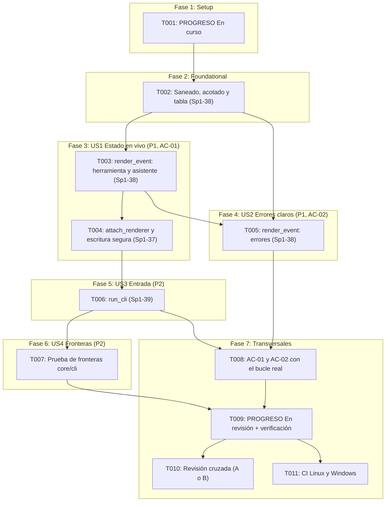

# Implementation Tasks: HU-06-01 — CLI básica con eventos en tiempo real

**Feature**: `specs/009-basic-cli-events/spec.md`  
**Plan**: `specs/009-basic-cli-events/plan.md`  
**Responsable**: C — Control y conexiones  
**Sprint**: Sprint 1 | **PHU**: 2  
**Tareas de referencia**: Sp1-37, Sp1-38, Sp1-39  

---

## Cómo leer este documento

**Pruebas primero, dentro de cada tarea.** Cada tarea agrupa las pruebas y la implementación de un módulo completo: se escriben las pruebas, se ejecutan y se confirma que fallan **por la razón esperada** (`ImportError` del módulo nuevo, aserción por un comportamiento que aún no existe), se implementa lo mínimo para que pasen y se ejecutan `mypy` y `ruff` antes de seguir. No hay tareas separadas para grupos de casos de prueba ni para el registro: los 5 min de registro de cada estimación se emplean en anotar, al terminar, una línea en *Registro de cambios* de `docs/PROGRESO.md` con el ID de la tarea, el comando de verificación y su resultado (Principio VIII).

**Ritmo**: 7 tareas de trabajo (T002 a T008) de 40 min como máximo, una tarea de inicio (T001), una de cierre (T009) y dos humanas (T010, T011). Ninguna pasa de 40 min (la Constitución permite 40; el límite absoluto es 60).

**Reglas que valen para todas las tareas:**
- **Archivos protegidos**: no modificar nada bajo `src/harness_agent/core/` (en particular `core/interfaces/`, `core/events.py`, `core/loop.py` y `core/in_memory_event_bus.py`), ni `tests/doubles/`, ni `docs/archivo/`. Los archivos de código que se crean o tocan son solo `src/harness_agent/cli/render.py`, `src/harness_agent/cli/app.py` y `src/harness_agent/cli/__init__.py`. Si una tarea parece exigir otra cosa, detenerse y acordarlo con A.
- `cli/` solo importa biblioteca estándar, módulos de `harness_agent.cli` (relativos) y nombres de `harness_agent.core.__all__` con `from harness_agent.core import ...` (nunca submódulos como `harness_agent.core.loop`). Sin dependencias nuevas. Python 3.12 es la única versión soportada (PD-07).
- Todo el código y las pruebas deben pasar `mypy --strict` y `ruff` (línea de 100 columnas).
- Los textos, los formatos y las reglas siguen [contracts/cli_contract.md](contracts/cli_contract.md); las constantes y la clasificación de entrada, [data-model.md](data-model.md); las decisiones, [research.md](research.md) (R-01 a R-12) y [plan.md](plan.md) (D1 a D12).
- **Aislamiento**: ninguna prueba usa red, proveedor real, consola real ni el entorno; la entrada y la salida son `io.StringIO` (o flujos de prueba), el bus es `InMemoryEventBus`. Los textos con valor centinela usan `VALOR-DE-PRUEBA-123` para comprobar que no se filtran. Los datos de los eventos se construyen con `Event.create(...)`.
- **Sin literales detectables**: ninguna prueba contiene texto que la comprobación de AC-02 de HU-00-04 (`tests/architecture/test_no_secrets_in_repo.py`) detecte como clave; no usar nombres como `secret`, `token` o `password` en asignaciones con un valor largo.
- **Al cerrar cada tarea que toca código o pruebas**, ejecutar `ruff format --check .`, `ruff check .`, `mypy src tests` y `pytest --cov=harness_agent --cov-report=term-missing`; los cuatro con código 0.

**Correspondencia con las tareas del plan de sprint** (columna *Tarea F5*):

| Tarea F5 | Descripción en `docs/03-plan-sprints.md` | Presupuesto | Microtareas |
|---|---|---|---|
| **Sp1-37** | Suscribir la CLI al bus de eventos | 90 min (1,5 h) | T004 |
| **Sp1-38** | Formato de mensajes y errores | 120 min (2 h) | T002, T003, T005 |
| **Sp1-39** | Entrada de comandos | 90 min (1,5 h) | T006 |
| Transversal | Estado, fronteras de arquitectura, verificación con el bucle real, cierre, revisión y CI remota (Principios VIII y IX) | — | T001, T007, T008, T009, T010, T011 |

**Nota sobre la PHU**: la historia vale 2 PHU, unidad de capacidad del sprint (velocidad hipotética de 39 PHU por sprint), no de tiempo; el presupuesto en horas es el de las tres tareas F5 (5 h en total). La comparación está al final.

---

## Phase 1: Setup (estado)

**Propósito**: Marcar la historia `En curso`.

- [x] **T001** Marcar HU-06-01 como `En curso` en `docs/PROGRESO.md` (transversal)
  - **Archivos**: `docs/PROGRESO.md`
  - **Dependencias**: Ninguna
  - **Criterios relacionados**: Principio VIII
  - **Tarea F5**: Transversal
  - **Estimación**: 20 min (10 min impl + 5 min check + 5 min registro)
  - **Verificación**: La fila de `HU-06-01` de la tabla de Sprint 1 pasa de `Pendiente` a `En curso` con responsable `C — Control y conexiones`; la columna Commit/PR queda vacía; ninguna otra fila ni la tabla *Resumen* cambian (`git diff -U0 docs/PROGRESO.md` muestra solo esa fila y la línea nueva del *Registro de cambios*). El archivo conserva sus saltos de línea CRLF sin LF sueltos y cada fila de tabla ocupa una sola línea.

---

## Phase 2: Foundational — Utilidades de texto y tabla de categorías (Sp1-38)

**Propósito**: Las funciones puras y las tablas de las que dependen todas las historias.

- [x] **T002** Implementar el saneado, el acotado y la tabla de categorías en `render.py` con sus pruebas (Sp1-38)
  - **Archivos**: `tests/unit/cli/__init__.py`, `tests/unit/cli/test_render_text.py`, `src/harness_agent/cli/render.py`
  - **Dependencias**: T001
  - **Criterios relacionados**: FR-009, FR-010, FR-011, FR-012, SC-003, SC-004, contrato §3 y §4, data-model §1 a §3, research R-04 y R-06
  - **Tarea F5**: Sp1-38
  - **Estimación**: 35 min (20 min impl + 10 min check + 5 min registro)
  - **Verificación**: **Pruebas primero** en `test_render_text.py` (más el `__init__.py` vacío del paquete de pruebas). `sanitize`: elimina cada carácter de los rangos `0x00`–`0x1F` (salvo `\n` y `\t`), `0x7F`, `0x80`–`0x9F` y los controles bidireccionales U+202A–U+202E y U+2066–U+2069 (una prueba parametrizada por carácter), incluido `\r` y el escape (`"a\x1b[31mb"` queda `"a[31mb"`); conserva `\n`, `\t`, tildes, `ñ` y emojis; es idempotente. `bounded(texto, límite)`: un texto de hasta `límite` caracteres no cambia; uno más largo queda con exactamente `límite` caracteres y termina en `...`. Constantes: `MAX_NAME_CHARS` 64, `MAX_PROVIDER_MESSAGE_CHARS` 200, `MAX_COMMAND_CHARS` 40, `ELLIPSIS` `"..."`, `UNKNOWN_NAME` `"(sin nombre)"`. Tablas: `TOOL_ERROR_GUIDE` tiene exactamente las claves `unknown_tool`, `invalid_arguments`, `tool_exception`, `invalid_tool_result` y `tool_error`; `PERMISSION_GUIDE`, las de §3.2 del contrato; `PROVIDER_GUIDE`, `provider_exception` e `invalid_response`; los textos coinciden **carácter a carácter** con el contrato §3, cada causa y sugerencia es una frase que termina en punto y las tablas son inmutables (`MappingProxyType`; asignar lanza `TypeError`). **Cobertura de categorías**: una prueba extrae de `core/loop.py` (solo lectura) con una expresión regular los nombres entre corchetes de los mensajes (`[unknown_tool]`, `[invalid_arguments]`, `[permission_denied]`, `[approval_required_unavailable]`, `[tool_exception]`) y, junto con `invalid_tool_result`, `tool_error` y `ok` (lista fija), exige que cada categoría sea `ok`, esté en `TOOL_ERROR_GUIDE` o esté en el conjunto de solo estado final (`permission_denied`, `approval_required_unavailable`). Se ejecutan y fallan con `ImportError` de `harness_agent.cli.render`. **Implementación**: `render.py` con las constantes, `sanitize`, `bounded`, la clase inmutable `ErrorGuide(cause, suggestion)` y las tres tablas, solo biblioteca estándar (`unicodedata`, `types`, `dataclasses`). Pasan todas las pruebas de T002; `render.py` no importa nada de `harness_agent` salvo, si hace falta, nombres de `harness_agent.core`; cierre con los cuatro comandos en 0.

---

## Phase 3: User Story 1 — Ver en vivo qué herramienta ejecuta el agente (P1) [AC-01]

**Objetivo de la historia**: La terminal muestra en vivo el nombre y el estado de cada herramienta y los mensajes del asistente, suscrita al bus.

**Prueba independiente**: Con eventos construidos a mano emitidos a un bus real, la salida contiene las líneas de «ejecutando», «correcto» y el mensaje del asistente, en el orden de emisión, y los demás tipos no producen salida.

- [x] **T003** [US1] Implementar `render_event` para herramienta solicitada, herramienta terminada correcta y mensaje del asistente (Sp1-38)
  - **Archivos**: `tests/unit/cli/test_render_events.py`, `src/harness_agent/cli/render.py`
  - **Dependencias**: T002
  - **Criterios relacionados**: AC-01, FR-001, FR-002, FR-003, FR-005, FR-012, FR-014, SC-001, SC-008, escenarios 1 a 5 de la historia 1, contrato §2, research R-02, R-03 y R-06
  - **Tarea F5**: Sp1-38
  - **Estimación**: 35 min (25 min impl + 5 min check + 5 min registro)
  - **Verificación**: **Pruebas primero** en `test_render_events.py`, clase `TestEstadoDeHerramienta`. `render_event(Event.create(...))` devuelve: `"... ejecutando: buscar"` para `TOOL_REQUESTED` con `{"name": "buscar"}`; `"v buscar: correcto"` para `TOOL_FINISHED` con `is_error` falso; para `ASSISTANT_MESSAGE`, cada línea del texto precedida de `"> "` (un texto de tres líneas da tres líneas), `None` si el texto está vacío, solo con espacios o no es una cadena. Un nombre ausente da `(sin nombre)`; un nombre con caracteres de control o con un salto de línea queda saneado y uno de 100 caracteres queda acotado a 64 con `...`. **Los argumentos nunca aparecen**: una carga con `{"name": "buscar", "arguments": {"ruta": "VALOR-DE-PRUEBA-123"}}` no deja el centinela en la salida. Los 11 tipos restantes (`USER_MESSAGE`, `INTERRUPTED`, `APPROVAL_REQUESTED`, `APPROVAL_RESOLVED`, `CONTEXT_COMPACTED`, `CRITERIA_TAMPERED`, `PROVIDER_SWITCHED`, `SUBAGENT_STARTED`, `SUBAGENT_FINISHED`, `SESSION_STARTED`, `CRITERION_VERIFIED`) devuelven `None` sin error (una prueba parametrizada con los 17 tipos exige además que los seis mostrados queden en `SHOWN_TYPES`). Una carga vacía `{}` para los tipos implementados no lanza. Un turno de tres herramientas (secuencia de eventos a mano) da las líneas en el mismo orden. Humo: 1000 renders de `TOOL_REQUESTED` promedian menos de 1 ms. Se ejecutan y fallan por la razón esperada (`AttributeError`/`ImportError` de `render_event` y `SHOWN_TYPES`). **Implementación**: en `render.py`, `SHOWN_TYPES` (los seis tipos) y `render_event` que despacha por tipo; para `TOOL_FINISHED` con error, decisiones de permiso, error del proveedor y límite devuelve provisionalmente `None` (T005 los completa; sus pruebas se escriben allí). Pasan las pruebas de T002 y T003; cierre con los cuatro comandos en 0.

- [x] **T004** [US1] Implementar `attach_renderer` en `app.py` con la escritura segura y los fallos de salida (Sp1-37)
  - **Archivos**: `tests/unit/cli/test_app_output.py`, `src/harness_agent/cli/app.py`, `src/harness_agent/cli/__init__.py`
  - **Dependencias**: T003
  - **Criterios relacionados**: AC-01, FR-001, FR-013, FR-014, FR-015, FR-020, SC-001, SC-006, escenarios 1 a 5 de la historia 1 y 4 de la historia 4, contrato §1, §4 y §6, research R-07 y R-08, plan D3 y D4
  - **Tarea F5**: Sp1-37
  - **Estimación**: 40 min (25 min impl + 10 min check + 5 min registro)
  - **Verificación**: **Pruebas primero** en `test_app_output.py`, con `InMemoryEventBus` real y `io.StringIO`. `attach_renderer(bus, salida)`: solo los seis tipos de `SHOWN_TYPES` escriben (se emiten los 17 tipos con cargas válidas y se compara); cada línea termina en `\n` y se llama a `flush` tras cada una (flujo espía); el orden de la salida es el de emisión; con `output=None` se escribe en `sys.stdout` resuelto **en la llamada** (se comprueba con `monkeypatch.setattr(sys, "stdout", StringIO())`); con una salida inyectada no se escribe nada en la salida estándar real (`capsys`); suscribir dos veces el mismo bus duplica la salida (comportamiento documentado). **Fallos de escritura**: un flujo cuyo `write` lanza `OSError`, un `StringIO` cerrado (`ValueError`) y un flujo cuyo `flush` lanza hacen que `bus.emit(...)` lance `EventDeliveryError` cuya `.exceptions` contiene la excepción original (SC-006); la CLI no captura nada. **Codificación**: un `io.TextIOWrapper(io.BytesIO(), encoding="cp1252")` recibe un texto con un carácter que `cp1252` no puede representar (por ejemplo, un emoji) sin error y con un `?` en su lugar, y conserva `ñ` y las tildes; un `StringIO` recibe el texto sin cambios; el flujo no se reconfigura (su `encoding` y su `errors` no cambian). Se ejecutan y fallan con `ImportError` de `harness_agent.cli.app`. **Implementación**: `app.py` con `attach_renderer` (un manejador por tipo de `SHOWN_TYPES` que llama a `render_event` y escribe la línea) y la función interna de escritura segura (codifica con la codificación declarada del flujo y `errors="replace"`, escribe, termina la línea y vacía); `cli/__init__.py` expone `render_event` y `attach_renderer`. Pasan las pruebas de T002 a T004; `app.py` solo importa biblioteca estándar y nombres de `harness_agent.core`; cierre con los cuatro comandos en 0.

---

## Phase 4: User Story 2 — Errores claros, con causa y acción sugerida (P1) [AC-02]

**Objetivo de la historia**: Cada error mostrado indica la causa y una acción sugerida, sin trazas, objetos internos ni carga cruda.

**Prueba independiente**: Con eventos de error construidos a mano (todas las categorías, permiso, proveedor, límite y una categoría desconocida con centinela), cada línea contiene causa y sugerencia y no aparece ninguna traza ni el centinela.

- [x] **T005** [US2] Completar `render_event` con errores de herramienta, permisos, proveedor y límite (Sp1-38)
  - **Archivos**: `tests/unit/cli/test_render_events.py`, `src/harness_agent/cli/render.py`
  - **Dependencias**: T002, T003
  - **Criterios relacionados**: AC-02, FR-004, FR-006, FR-007, FR-008, FR-009, FR-010, FR-011, FR-012, SC-002, SC-003, escenarios 1 a 6 de la historia 2, contrato §2 y §3, research R-02, R-04 y R-05, plan D6 y D7
  - **Tarea F5**: Sp1-38
  - **Estimación**: 40 min (25 min impl + 10 min check + 5 min registro)
  - **Verificación**: **Pruebas primero**: se añade la clase `TestErrores` a `test_render_events.py` sin tocar las de T003. Cubre, con los textos **exactos** del contrato: `TOOL_FINISHED` con error de cada categoría de `TOOL_ERROR_GUIDE` (`x Error: <causa> Sugerencia: <sugerencia>` con el nombre sustituido); categoría desconocida, `is_error` ausente o no booleano → la línea genérica «Ocurrió un error de categoría desconocida…» con «Revisa el registro de eventos.» **sin reproducir la categoría** (una carga con `{"category": "VALOR-DE-PRUEBA-123"}` no deja el centinela en la salida); `permission_denied` y `approval_required_unavailable` → `x <nombre>: no se ejecutó.`; `PERMISSION_DECIDED` con `allow` → `None`, con `deny` sin motivo, `deny` con `policy_error`, `ask` y una decisión desconocida → la línea `x Permiso: …` del contrato §3.2; la secuencia decisión de denegación + herramienta terminada por permiso muestra la sugerencia **una sola vez**; `PROVIDER_ERROR` con `provider_exception` (mensaje con punto añadido si falta, acotado a 200 caracteres con `...`, saneado), con `invalid_response`, con razón desconocida o ausente y con `error_type` ausente (`Error`); `LIMIT_REACHED` con cualquier carga (incluido el centinela) → la línea fija. Todas las líneas de error empiezan por `x `, contienen ` Sugerencia: ` y ninguna contiene `Traceback`, `File "`, nombres de clases internas ni el texto crudo de la carga. Para los seis tipos mostrados, una carga `{}` o con tipos inesperados (números, listas, `None`) **nunca lanza**. Humo: 1000 renders de un error promedian menos de 1 ms. Se ejecutan y fallan por la razón esperada (los casos devuelven `None`, que es lo provisional de T003). **Implementación**: se completa `render_event` en `render.py` con la construcción de causa y sugerencia desde las tablas, la sustitución del nombre saneado y acotado, el tratamiento de lo desconocido y el punto final del mensaje del proveedor. Pasan todas las pruebas de T002, T003 y T005; `render.py` conserva solo biblioteca estándar; cobertura de `render.py` al 100 % (toda línea sin cubrir se justifica por escrito); cierre con los cuatro comandos en 0.

---

## Phase 5: User Story 3 — Entrada de comandos mínima (P2)

**Objetivo de la historia**: Una tarea llega al agente sin interpretar, `/ayuda` y `/salir` funcionan, y un comando desconocido, una línea vacía y el fin de la entrada se manejan sin error.

**Prueba independiente**: Con una entrada en memoria y una función de turno de prueba que registra lo que recibe, se comprueba la clasificación de cada línea y que el ciclo termina limpio.

- [x] **T006** [US3] Implementar `run_cli` (ciclo de entrada y comandos) con sus pruebas (Sp1-39)
  - **Archivos**: `tests/unit/cli/test_app_input.py`, `src/harness_agent/cli/app.py`, `src/harness_agent/cli/render.py`, `src/harness_agent/cli/__init__.py`
  - **Dependencias**: T004
  - **Criterios relacionados**: FR-016, FR-017, FR-018, FR-019, FR-020, FR-022, FR-026, SC-005, SC-010, escenarios 1 a 6 de la historia 3, contrato §1, §3.4, §5 y §6, data-model §4 y §5, research R-09, R-10 y R-13, plan D5 y D9 (decidida)
  - **Tarea F5**: Sp1-39
  - **Estimación**: 40 min (25 min impl + 10 min check + 5 min registro)
  - **Verificación**: **Pruebas primero** en `test_app_input.py` (pruebas asíncronas; la entrada y la salida son `io.StringIO`, el bus es `InMemoryEventBus` y `run_turn` es una función asíncrona de prueba que registra sus argumentos). Cubre: una tarea llega **una sola vez** y **sin cambios** (con espacios internos y finales conservados, sin el salto de línea final, también con terminadores `\r\n`); una línea con espacios iniciales y luego `/ayuda` es una tarea, no un comando; `/ayuda` (y `/ayuda con argumentos`) escribe exactamente el texto del contrato §5 y no llama a `run_turn`; `/salir` escribe `Sesión terminada.`, termina el ciclo y **no lee** las líneas siguientes (quedan sin consumir en el flujo); un comando desconocido (`/sesiones`) escribe el aviso del contrato con el comando saneado y acotado a 40 caracteres (probado con un comando de 100 caracteres y con controles) y no llama a `run_turn`; una línea vacía o solo con espacios se ignora; el fin de la entrada escribe un salto de línea y termina sin error; el indicador `tarea> ` se escribe antes de cada lectura (una vez más que el número de líneas leídas) y se vacía el búfer; `run_turn` se espera en orden (la segunda tarea no empieza antes de que termine la primera); `run_cli` suscribe el render **una vez** (un evento emitido por el `run_turn` de prueba aparece una vez en la salida); `run_cli` devuelve `0` al terminar limpio (`/salir` y fin de la entrada) y es de tipo `int`; **D9, fallo del turno**: una `Exception` ordinaria de `run_turn` (`RuntimeError` con un mensaje centinela, y un `EventDeliveryError`) hace que la salida tenga **una sola** línea `x Error: el turno terminó con un fallo interno (<TipoDeError>). Sugerencia: revisa el registro de eventos.` con el nombre del tipo (sin el centinela, sin traza y sin la carga), que las líneas de entrada siguientes **no** se lean, que el ciclo termine y que `run_cli` devuelva `1`; un tipo de excepción con un nombre de 100 caracteres o con controles queda saneado y acotado a 64; `KeyboardInterrupt`, `asyncio.CancelledError` y `SystemExit` lanzados por `run_turn` **suben sin cambios** (la misma instancia) a quien llamó a `run_cli` y no se escribe la línea de fallo; si escribir la línea de fallo también falla (una salida cuyo `write` lanza ante ese texto), esa excepción **sube** (no se traga) con la original como contexto; con `input_stream=None` y `output=None` se usan `sys.stdin` y `sys.stdout` resueltos en la llamada (`monkeypatch.setattr(sys, ...)`). Se ejecutan y fallan por la razón esperada (`ImportError`/`AttributeError` de `run_cli`). **Implementación**: `render.py` añade la función pura que construye la línea del fallo del turno (contrato §3.4); `run_cli` en `app.py` con `PROMPT = "tarea> "`, `EXIT_OK` y `EXIT_FAILURE`, el `try` que captura solo `Exception` alrededor de `await run_turn(...)`, la clasificación del data-model §4 y los textos del contrato §5 (ayuda, salida y comando desconocido); `cli/__init__.py` añade `run_cli` a la API pública. Pasan todas las pruebas de T002 a T006; cobertura de `app.py` al 100 % (toda línea sin cubrir se justifica por escrito); cierre con los cuatro comandos en 0.

---

## Phase 6: User Story 4 — La CLI es solo un suscriptor (P2)

**Objetivo de la historia**: Una barrera automática impide que el núcleo dependa de `cli/` y que `cli/` use algo que no sea la API pública del núcleo.

**Prueba independiente**: La prueba recorre `core/` y `cli/`; sus detectores se prueban con fragmentos sintéticos y con copias de los directorios en `tmp_path`.

- [x] **T007** [US4] Escribir la prueba de fronteras entre `core/` y `cli/` con su autoprueba (transversal)
  - **Archivos**: `tests/architecture/test_cli_boundaries.py`
  - **Dependencias**: T006
  - **Criterios relacionados**: FR-021, FR-023, FR-024, SC-007, escenarios 1, 2 y 5 de la historia 4, regla de negocio 1, research R-11
  - **Tarea F5**: Transversal
  - **Estimación**: 25 min (15 min impl + 5 min check + 5 min registro)
  - **Verificación**: Sin código fuente nuevo. Con `ast`: (a) ningún módulo de `src/harness_agent/core/` importa `harness_agent.cli` (absoluta ni relativa: `from .. import cli`, `from ..cli import x`); (b) los módulos de `src/harness_agent/cli/` solo importan biblioteca estándar, módulos de `harness_agent.cli` (absolutos o relativos) y `from harness_agent.core import <nombres>` donde cada nombre pertenece a `harness_agent.core.__all__` (se importa `harness_agent.core` para leer `__all__`); se rechazan `import harness_agent.core.loop`, `from harness_agent.core.loop import AgentLoop`, `from harness_agent.core.interfaces import X`, `harness_agent.adapters`, `harness_agent.observability`, `harness_agent.bootstrap`, `harness_agent.config` y cualquier paquete de terceros; (c) línea base: 18 módulos en `core/` y 3 en `cli/`, 0 hallazgos. Incluye una **autoprueba** de los detectores con fragmentos sintéticos prohibidos y permitidos y una **prueba de mutación sobre copias** en `tmp_path` (se añade `from harness_agent.cli import render` a una copia de `core/` y `from harness_agent.core.loop import AgentLoop` a una copia de `cli/`: ambos detectores fallan), sin editar nunca el código real (huella de los archivos idéntica y `git diff --exit-code` de los archivos protegidos termina en 0 antes y después). Pasan al ejecutarla (la línea base es limpia); cierre con los cuatro comandos en 0.

---

## Phase 7: Polish y tareas transversales

**Propósito**: Verificar AC-01 y AC-02 con el bucle real, registrar el estado, comprobar que no se tocaron los archivos protegidos y dejar la revisión humana y la CI como pendientes explícitos.

- [x] **T008** Verificar AC-01 y AC-02 con el bucle real de A, el bus real y flujos en memoria (transversal)
  - **Archivos**: `tests/integration/test_cli_agent_loop.py`
  - **Dependencias**: T005, T006
  - **Criterios relacionados**: AC-01, AC-02, FR-004, FR-006, FR-007, FR-010, FR-013, FR-016, FR-021, FR-026, SC-001, SC-002, SC-006, SC-010, research R-12 y R-13
  - **Tarea F5**: Transversal
  - **Estimación**: 35 min (25 min impl + 5 min check + 5 min registro)
  - **Verificación**: Prueba de integración, sin código fuente nuevo (el bucle y la CLI ya existen; el bucle no se toca). Con `make_rig(script, tools, bus=InMemoryEventBus(), decisions=…)` de `tests/core/support.py`, `attach_renderer(bus, StringIO())` y los dobles de `tests/doubles` (`RecordingTool`, `FailingTool`, `RaisingTool`, `ScriptedPolicy`): (1) **turno con una herramienta correcta**: la salida son, en orden, `... ejecutando: <nombre>`, `v <nombre>: correcto` y el mensaje final del asistente con `> `; (2) **herramienta no registrada**: `... ejecutando` seguida de `x Error: La herramienta '…' no está registrada. Sugerencia: …`; (3) **argumentos inválidos** (herramienta con esquema y una llamada que lo incumple, según los dobles disponibles); (4) **permiso denegado** y (5) **pregunta sin aprobador**: la línea `x Permiso: …` una sola vez y luego `x <nombre>: no se ejecutó.`; (6) **excepción de la herramienta** y (7) **herramienta que devuelve error**; (8) **error del proveedor**: `x Error: El proveedor del modelo falló (RuntimeError): … Sugerencia: …`. En todos los turnos la salida no contiene `Traceback`, `File "`, nombres de clases internas ni los argumentos de la llamada (se pasa un centinela como argumento). (9) **Ciclo completo**: `run_cli` con la entrada `haz la tarea`, una línea vacía, `/desconocido`, `/ayuda` y `/salir` y una función de turno que llama a `loop.run_turn(session_id=…, task=…, history=…)` del mismo rig: la tarea llega una vez al bucle, se ven las líneas de la herramienta y el mensaje del asistente, el comando desconocido avisa y el ciclo termina con `Sesión terminada.` y devuelve 0. (10) **Fallo de escritura con el bucle real**: con una salida cuyo `write` lanza, el bus agrupa el fallo y `run_turn` termina lanzando `EventDeliveryError` (Q4 y SC-006). (11) **Fallo del turno dentro de `run_cli`** (D9, FR-026): con esa salida rota, `run_cli` intenta mostrar la línea del fallo, la escritura también falla y esa excepción **sube** (no se traga); con una salida sana y una función de turno que lanza `RuntimeError` con un mensaje centinela, `run_cli` escribe una sola línea `x Error: el turno terminó con un fallo interno (RuntimeError). Sugerencia: revisa el registro de eventos.` sin el centinela y devuelve 1. Pasan sin implementar nada nuevo; si falla por una diferencia real del bucle, se investiga antes de tocar nada. Cierre con los cuatro comandos en 0.

- [x] **T009** Pasar HU-06-01 a `En revisión` en `docs/PROGRESO.md` y verificar puertos, fronteras y puertas de calidad (Sp1-37, Sp1-38, Sp1-39)
  - **Archivos**: `docs/PROGRESO.md`
  - **Dependencias**: T007, T008
  - **Criterios relacionados**: SC-007, SC-009, FR-023, Principio III, Principio VIII, Principio IX, Principio X
  - **Tarea F5**: Transversal
  - **Estimación**: 30 min (15 min impl + 10 min check + 5 min registro)
  - **Verificación**: Se ejecuta `ruff format --check .`, `ruff check .`, `mypy src tests` y `pytest --cov=harness_agent --cov-report=term-missing` (los cuatro con código 0; se anotan el número de pruebas, el tiempo y la cobertura de `render.py` y `app.py`, objetivo 100 %). Se ejecuta `git fetch origin` y `base=$(git merge-base HEAD origin/main)`: `git diff --exit-code $base -- src/harness_agent/core tests/doubles docs/archivo` termina en 0 y sin salida (la historia no toca `core/`); `pytest tests/architecture` pasa; se hace el recorrido manual de la sección 4 del [quickstart.md](quickstart.md) y cada paso produce lo descrito; el detector de claves de HU-00-04 no encuentra coincidencias en los archivos versionados ni en los nuevos. La fila de `HU-06-01` pasa de `En curso` a `En revisión` (no a `Hecha`) con responsable `C — Control y conexiones`, las rutas de los archivos de la historia y la evidencia (comandos y resultados); Commit/PR queda vacío hasta T011. Se añade una nota «Observaciones de HU-06-01» con: (a) el **aviso a C y a B de la comparación con el presupuesto** (335 min estimados frente a los 300 min presupuestados para Sp1-37, Sp1-38 y Sp1-39; las tres tareas F5 suman 190 min, por debajo; el exceso viene de las tareas transversales), sin recorte de alcance; (b) la **diferencia con el prototipo**: la carga de los eventos del bucle no incluye los argumentos de la herramienta ni el texto del error, así que la línea «ejecutando» muestra solo el nombre y la causa sale de la categoría; ampliarlo corresponde al núcleo (A); (c) que **«límite alcanzado» se muestra con un texto fijo** porque el bucle no lo publica todavía (HU-01-06, Sprint 2); (d) que **HU-00-01 sigue `Pendiente de aprobación técnica`** (Sp1-03) y debe ratificarse antes de pasar HU-06-01 a `Hecha`; (e) la decisión D9, decidida por el responsable: `run_cli` captura las `Exception` del turno, muestra una línea y devuelve un código de salida distinto de cero; las `BaseException` que no son `Exception` se propagan. **Trazabilidad de PRs fusionados**: en la tabla de Sprint 1 se rellena **solo la celda Commit/PR** de las filas de HU-01-02 (PR #4, merge f4e0df2), HU-00-04 (PR #5, merge 2d5c9d3) y HU-01-05 (PR #6, merge 884f9d1), con el formato de otras filas que ya la tengan (si no hay, `PR #N (merge <hash>)`); sus estados siguen `En revisión` hasta que se apruebe HU-00-01; una sola fila nueva del *Registro de cambios* lo explica; un guion comprueba que de esas tres filas solo cambió esa celda. La tabla *Resumen* no cambia hasta que la historia quede `Hecha`. Sin LF sueltos ni filas partidas. Si algún comando falla, se corrige en la tarea que corresponda y se anota.

- [x] **T010** Solicitar la revisión cruzada y registrar su resultado (Principio IX)
  - **Archivos**: `docs/PROGRESO.md`
  - **Dependencias**: T009
  - **Criterios relacionados**: Principio IX, DoD (5), DoD (6), DoD (7)
  - **Tarea F5**: Transversal
  - **Estimación**: 15 min (5 min impl + 5 min check + 5 min registro)
  - **Verificación**: Un integrante del **área A o B** (la DoD exige un área distinta de quien implementa; el bucle es de A y el bus de B) revisa el cambio contra la lista de comprobación de `arquitectura-hexagonal-clean`, confirma que `core/` y `tests/doubles/` no cambiaron, que `cli/` solo usa la API pública del núcleo, que ningún mensaje muestra trazas ni datos crudos y que el saneado de caracteres de control cubre los casos de la tarea T002. Su resultado se anota en `docs/PROGRESO.md`, junto con el recordatorio de que HU-00-01 sigue `Pendiente de aprobación técnica` y debe ratificarse antes de pasar HU-06-01 a `Hecha`. **Esta tarea es humana: no se marca como completada sin esa confirmación.**

- [x] **T011** Confirmar la ejecución de la CI en Linux y Windows y registrar la evidencia (Sp1-37, Sp1-38, Sp1-39)
  - **Archivos**: `docs/PROGRESO.md`
  - **Dependencias**: T009
  - **Criterios relacionados**: FR-025, SC-009, Principio IV, Principio VIII, Principio IX, DoD (1)
  - **Tarea F5**: Transversal
  - **Estimación**: 20 min (10 min impl + 5 min check + 5 min registro)
  - **Verificación**: Tras el push o la solicitud de cambios (acción que realiza una persona con acceso al remoto), comprobar que los dos trabajos de la matriz, `quality (ubuntu-latest, py3.12)` y `quality (windows-latest, py3.12)`, terminan en verde; anotar en `docs/PROGRESO.md` el enlace o el ID de la ejecución y **rellenar la columna Commit/PR de la fila de `HU-06-01`** con el commit o la solicitud de cambios (Principio VIII). Se comprueba que las pruebas de `tests/unit/cli`, `test_cli_agent_loop.py` y `test_cli_boundaries.py` se ejecutaron en ambos sistemas (en Windows, además, la prueba de codificación `cp1252` de T004). Si el push aún no se ha hecho, la tarea queda **pendiente** y se anota.

---

## Dependencias & Orden de Ejecución

### Oportunidades de Paralelización:
- **T004** (`app.py`) y **T005** (`render.py`) tocan archivos distintos y solo dependen de T003: pueden escribirse a la vez; **T006** necesita T004, no T005.
- **T002 → T003 → T005** son secuenciales (editan `render.py` y `test_render_events.py`); **T004 → T006** también (ambas editan `app.py` y `cli/__init__.py`).
- **T007** y **T008** tocan archivos de prueba distintos y pueden hacerse a la vez una vez terminadas sus dependencias.
- T010 y T011 son humanas y pueden hacerse en cualquier orden tras T009.

### Puntos de atención:
- **Diferencia con el prototipo**: el bucle no publica los argumentos de la herramienta ni el texto del error (decisión de HU-01-01); las líneas se construyen solo con `name`, `category` y los demás campos publicados. T009 lo registra como observación; ampliar la carga corresponde al núcleo.
- **«Límite alcanzado»** se muestra con un texto fijo: el bucle no lo publica todavía (HU-01-06).
- **Una denegación se informa una sola vez**: la decisión de permiso lleva causa y sugerencia; la herramienta terminada por permiso solo dice «no se ejecutó» (T005).
- **El bus no tiene desuscripción**: `attach_renderer` dos veces sobre el mismo bus duplica la salida; `run_cli` lo llama una vez (T004, T006).
- **Decisión D9 (decidida)**: `run_cli` captura solo las `Exception` ordinarias de la función de turno (incluido el error de entrega por un fallo de escritura), muestra una línea con el tipo, termina la sesión y devuelve un código de salida distinto de cero; las `BaseException` que no son `Exception` y el fallo de escribir esa línea se propagan (T006, T008).
- **Ratificación de HU-00-01 pendiente**: la historia no modifica ningún puerto, pero debe producirse antes de pasar HU-06-01 a `Hecha`; T009 y T010 lo registran.
- **Sin literales detectables en pruebas versionadas**: la comprobación de AC-02 de HU-00-04 escanea los archivos versionados; las pruebas nuevas no usan nombres de clave con valores largos.

---

## Estrategia de Implementación

1. **Estado (T001)**: la historia pasa a `En curso`.
2. **Cimientos (T002)**: el saneado, el acotado y la tabla de categorías, de las que dependen todas las líneas de salida.
3. **MVP — US1 + US2 (T003 a T005)**: con el render completo y la suscripción al bus están AC-01 y AC-02; ya se puede ver en vivo lo que hace el agente aunque todavía no haya entrada.
4. **US3 y US4 (T006, T007)**: el ciclo de entrada y la barrera de fronteras.
5. **Verificación con el bucle real y cierre (T008 a T011)**: AC-01 y AC-02 con el bucle de A, `En revisión`, revisión cruzada y CI.

En cada tarea: escribir las pruebas, verlas fallar por la razón esperada, implementar lo mínimo y ejecutar `mypy` y `ruff` antes de seguir.

---

## Resumen de Estimaciones

| Tarea | Descripción breve | Tiempo Impl. | Tiempo Check | Tiempo Reg. | Total |
|---|---|---|---|---|---|
| **T001** | PROGRESO: `En curso` | 10 min | 5 min | 5 min | 20 min |
| **T002** | Saneado, acotado y tabla de categorías | 20 min | 10 min | 5 min | 35 min |
| **T003** | `render_event`: herramienta y asistente | 25 min | 5 min | 5 min | 35 min |
| **T004** | `attach_renderer` y escritura segura | 25 min | 10 min | 5 min | 40 min |
| **T005** | `render_event`: errores | 25 min | 10 min | 5 min | 40 min |
| **T006** | `run_cli`: ciclo de entrada | 25 min | 10 min | 5 min | 40 min |
| **T007** | Fronteras `core/` y `cli/` | 15 min | 5 min | 5 min | 25 min |
| **T008** | AC-01 y AC-02 con el bucle real | 25 min | 5 min | 5 min | 35 min |
| **T009** | PROGRESO: `En revisión` y verificación | 15 min | 10 min | 5 min | 30 min |
| **T010** | Revisión cruzada por A o B (humana) | 5 min | 5 min | 5 min | 15 min |
| **T011** | CI en Linux y Windows y Commit/PR (humana) | 10 min | 5 min | 5 min | 20 min |
| **Total** | **11 microtareas (ninguna pasa de 40 min; 7 de trabajo)** | **200 min** | **80 min** | **55 min** | **335 min (5,6 h)** |

**Comparación con el presupuesto de Sprint 1** (`docs/03-plan-sprints.md`; 2 PHU es capacidad, no tiempo, así que se compara con las horas de las tareas F5):

| Tarea F5 | Presupuesto | Estimado aquí | Diferencia |
|---|---|---|---|
| Sp1-37 (suscribir la CLI al bus) | 90 min (1,5 h) | 40 min (T004) | −50 min |
| Sp1-38 (formato de mensajes y errores) | 120 min (2 h) | 110 min (T002, T003, T005) | −10 min |
| Sp1-39 (entrada de comandos) | 90 min (1,5 h) | 40 min (T006) | −50 min |
| Transversal (T001, T007, T008, T009, T010, T011) | — | 145 min | +145 min |
| **Total** | **300 min (5 h)** | **335 min (5,6 h)** | **+35 min (1,12 veces)** |

**Las estimaciones se pasan ligeramente del presupuesto.** Las tres tareas F5 suman 190 min, 110 min por debajo de su presupuesto de 300 min. El exceso total de 35 min (12 %) viene de lo que el plan de sprint no presupuesta: las fronteras de arquitectura (T007), la verificación de AC-01 y AC-02 con el bucle real (T008), el estado y el cierre (T001, T009) y las dos tareas humanas (T010, T011), que suman 145 min.

**Decisión del responsable: sin recorte de alcance.** El aviso queda declarado aquí y en el [plan](plan.md) (D11), y T009 lo anota en `docs/PROGRESO.md`. Sprint 1 ya supera la disponibilidad media del equipo (R-20 de `docs/03-plan-sprints.md`).
