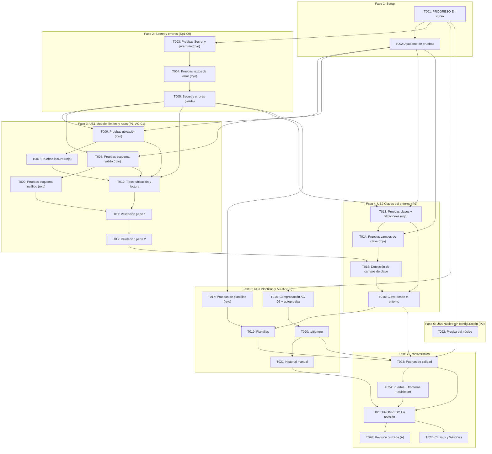

# Implementation Tasks: HU-00-04 — Configuración por archivo y variables de entorno

**Feature**: `specs/010-file-env-configuration/spec.md`  
**Plan**: `specs/010-file-env-configuration/plan.md`  
**Responsable**: B — Estado (la implementa Gustavo en nombre de B)  
**Sprint**: Sprint 1 | **PHU**: 1  
**Tareas de referencia**: Sp1-09, Sp1-10, Sp1-11  

---

## Cómo leer este documento

**Pruebas primero.** Dentro de cada historia, las tareas de prueba van antes de las de implementación. Cada tarea de implementación se da por terminada cuando pasan las pruebas escritas antes. Antes de implementar, ejecutar la prueba y confirmar que falla **por la razón esperada** (`ImportError`, `FileNotFoundError` de una plantilla o una aserción), no por un error de sintaxis o de tipos. **Ninguna microtarea pasa de 30 minutos.**

**Reglas que valen para todas las tareas:**
- No modificar nada bajo `src/harness_agent/core/interfaces/` ni nada bajo `src/harness_agent/core/`. Si una tarea parece exigirlo, detenerse y acordarlo con A (los puertos solo cambian con el visto bueno de los tres). Ninguna tarea edita `core/`, ni siquiera de forma temporal: lo que necesite probar un cambio en `core/` lo hace sobre una copia en `tmp_path`.
- `src/harness_agent/config.py` solo importa biblioteca estándar (`tomllib`, `os`, `re`, `dataclasses`, `pathlib`, `collections.abc`, `typing`). Sin dependencias nuevas. Python 3.12 es la única versión soportada (PD-07).
- Todo el código y las pruebas deben pasar `mypy --strict` y `ruff` (línea de 100 columnas).
- Los textos de error, los nombres de campo y el orden de las comprobaciones siguen [contracts/config_loading_contract.md](contracts/config_loading_contract.md); los tipos y las reglas C-1 a C-14, [data-model.md](data-model.md).
- **Aislamiento**: las pruebas escriben sus archivos en `tmp_path`, pasan un `environ` en forma de diccionario a `load_config` y solo usan `monkeypatch` donde la tarea lo indica. Ninguna prueba lee ni cambia el entorno real, ni escribe fuera de `tmp_path`. Las claves de prueba llevan un valor centinela reconocible (`VALOR-DE-PRUEBA-123`); jamás una clave real.
- **Sin literales detectables en el código versionado**: ninguna prueba contiene un texto que la comprobación de AC-02 (T018) detecte como clave, en particular una asignación del tipo `nombre_de_clave = "valor de 16 o más caracteres"`. Los archivos TOML de prueba con un campo de clave y el centinela se construyen en tiempo de ejecución con el ayudante de T002 (concatenando `"api_" + "key"`), y los ejemplos con forma de clave de T018 también.
- **Registro**: los 5 min de registro de cada estimación se emplean en anotar, al terminar la tarea, una línea en *Registro de cambios* de `docs/PROGRESO.md` con el ID de la tarea, el comando de verificación y su resultado (Principio VIII). T001 marca la historia `En curso`; T025 la pasa a `En revisión` y consolida la fila.

**Correspondencia con las tareas del plan de sprint** (la columna *Tarea F5* de cada microtarea):

| Tarea F5 | Descripción en `docs/03-plan-sprints.md` | Presupuesto | Microtareas |
|---|---|---|---|
| **Sp1-09** | Definir el esquema de configuración y sus valores por defecto | 90 min (1,5 h) | T002, T003, T004, T005, T006, T007, T008, T009, T010, T011, T012 |
| **Sp1-10** | Cargar claves solo desde variables de entorno | 60 min (1 h) | T013, T014, T015, T016 |
| **Sp1-11** | Añadir .gitignore y plantilla de ejemplo sin secretos | 30 min (0,5 h) | T017, T018, T019, T020, T021 |
| Transversal | Estado, núcleo sin configuración, puertas de calidad, registro, revisión y CI remota (Principios VIII y IX) | — | T001, T022, T023, T024, T025, T026, T027 |

**Nota sobre la PHU**: la historia vale 1 PHU, que es una unidad de capacidad del sprint (velocidad hipotética de 39 PHU por sprint), no de tiempo; el presupuesto en horas es el de las tres tareas F5 (3 h en total). La comparación está al final.

---

## Phase 1: Setup (estado y ayudante de pruebas)

**Propósito**: Marcar la historia `En curso` y dejar el ayudante que comparten las pruebas de configuración, antes de escribir ninguna regla.

- [x] **T001** Marcar HU-00-04 como `En curso` en `docs/PROGRESO.md` (transversal)
  - **Archivos**: `docs/PROGRESO.md`
  - **Dependencias**: Ninguna
  - **Criterios relacionados**: Principio VIII
  - **Tarea F5**: Transversal
  - **Estimación**: 20 min (10 min impl + 5 min check + 5 min registro)
  - **Verificación**: La fila de `HU-00-04` de la tabla de Sprint 1 pasa de `Pendiente` a `En curso` con responsable `B — Estado`; la columna Commit/PR queda vacía; ninguna otra fila ni la tabla *Resumen* cambian (`git diff -U0 docs/PROGRESO.md` muestra solo esa fila y la línea nueva del *Registro de cambios*). El archivo conserva sus saltos de línea CRLF (sin ningún LF suelto) y la fila sigue siendo una sola línea.

- [x] **T002** Crear el ayudante compartido de las pruebas de configuración (Sp1-09)
  - **Archivos**: `tests/unit/config_support.py`
  - **Dependencias**: T001
  - **Criterios relacionados**: FR-023, plan (Structure Decision), research R-12 y R-15
  - **Tarea F5**: Sp1-09
  - **Estimación**: 20 min (10 min impl + 5 min check + 5 min registro)
  - **Verificación**: El módulo (sin pruebas) define `SENTINEL = "VALOR-DE-PRUEBA-123"`, `MINIMAL_CONFIG = 'model = "fake/test"\n'`, `SECRET_FIELD = "api_" + "key"` (concatenado, para que el archivo no contenga el nombre completo junto a un valor) y dos funciones: `write_config(directory, content, *, name="config.toml") -> Path`, que escribe el contenido **en bytes** (un `str` se codifica en UTF-8; un `bytes` se escribe tal cual, para probar marca de orden de bytes, CRLF y codificaciones inválidas) y devuelve la ruta absoluta; y `toml_with_field(name, value=SENTINEL) -> str`, que **construye en tiempo de ejecución** una línea TOML `<name> = "<value>"` (con `name` y `value` como parámetros, sin literales detectables). No importa `harness_agent.config` (así sigue importable antes de T005). Pasan `mypy --strict` y `ruff`; `pytest --collect-only tests/unit` no lo toma como módulo de pruebas.

---

## Phase 2: Foundational — Secreto y errores de dominio (Sp1-09)

**Propósito**: Definir `Secret`, `ConfigProblem` y los errores con el formato de los mensajes, que bloquean a las historias porque todas rechazan algo o manejan una clave.

- [x] **T003** [P] Escribir las pruebas de `Secret`, `ConfigProblem` y la jerarquía de errores (Sp1-09)
  - **Archivos**: `tests/unit/test_config_secret.py`
  - **Dependencias**: T001
  - **Criterios relacionados**: FR-016, RNF-16, contrato §4, data-model (Secret, Errores de dominio)
  - **Tarea F5**: Sp1-09
  - **Estimación**: 25 min (15 min impl + 5 min check + 5 min registro)
  - **Verificación**: En la clase `TestSecret` y `TestJerarquia`, las pruebas importan desde `harness_agent.config` y fallan con `ImportError` hasta T005. Cubren: `repr`, `str` y `format` de `Secret` dan `<secreto oculto>` y **no** contienen el valor ni su longitud; `reveal()` devuelve el valor; dos `Secret` con el mismo valor no son iguales (identidad); `pickle.dumps` lanza `TypeError`; **`copy.copy` y `copy.deepcopy` devuelven el mismo objeto** y `dataclasses.asdict` de un dataclass que contiene un `Secret` funciona y muestra `<secreto oculto>` (H1); no tiene `__dict__`; `ConfigProblem` congelada e igual por valor; todos los errores heredan de `ConfigError` (que hereda de `Exception`) y tienen los atributos del modelo de datos (`path`, `origin`, `reason`, `line`, `fields`, `problems`, `variable`, `provider`).

- [x] **T004** Ampliar las pruebas con los textos de los errores (Sp1-09)
  - **Archivos**: `tests/unit/test_config_secret.py`
  - **Dependencias**: T003
  - **Criterios relacionados**: FR-015, FR-017, contrato §5
  - **Tarea F5**: Sp1-09
  - **Estimación**: 25 min (15 min impl + 5 min check + 5 min registro)
  - **Verificación**: Se añade la clase `TestTextosDeError` sin tocar las de T003; falla con `ImportError` hasta T005. `str()` de cada error coincide **carácter a carácter** con los ejemplos del contrato §5: las tres variantes de `ConfigFileNotFoundError`, los cuatro motivos de `ConfigFileUnreadableError`, `ConfigSyntaxError` con y sin línea, `SecretInConfigFileError` en singular y plural, `InvalidConfigError` con varios problemas y `MissingKeyError`; todos terminan en punto final, no contienen trazas ni valores (los errores se construyen con el centinela en algún dato y este no aparece en el texto) y un nombre de campo de más de 64 caracteres se recorta con `…`.

- [x] **T005** Implementar `Secret`, `ConfigProblem` y la jerarquía de errores en `config.py` (Sp1-09)
  - **Archivos**: `src/harness_agent/config.py`
  - **Dependencias**: T004
  - **Criterios relacionados**: FR-015, FR-016, FR-017, RNF-16, research R-07 y R-08, data-model (Entidades)
  - **Tarea F5**: Sp1-09
  - **Estimación**: 30 min (20 min impl + 5 min check + 5 min registro)
  - **Verificación**: Se crea `config.py` (solo biblioteca estándar) con `Secret` (`__slots__`, `reveal()`, `repr`/`str`/`format` ocultos, sin igualdad por valor, **`__copy__` y `__deepcopy__` que devuelven el mismo objeto**, `__reduce__` que lanza `TypeError` para bloquear solo `pickle`), `ConfigProblem` (`@dataclass(frozen=True)`), `ConfigError(Exception)` y sus seis subclases con los atributos del modelo de datos, y la constante `MAX_FIELD_DISPLAY = 64`. Todos los errores se construyen con los datos (no con texto) y su `__str__` produce los textos del contrato en español. Pasan todos los casos de T003 y T004 (`pytest tests/unit/test_config_secret.py`), `mypy --strict` y `ruff`.

---

## Phase 3: User Story 1 — Cambiar de modelo y de límites editando un archivo (P1) [AC-01]

**Objetivo de la historia**: Una persona edita `config.toml` y al arrancar el sistema usa ese modelo, esos límites y esas rutas, sin cambios de código; todo lo que el archivo hace mal se rechaza con un mensaje claro.

**Prueba independiente**: Con archivos de prueba en `tmp_path` y un `environ` de diccionario, `load_config` devuelve el modelo del archivo (A y luego B), los valores por defecto de lo que no se indica, y un error con frase en español ante archivo ausente, roto o con valores inválidos. No requiere proveedor real, claves ni red.

- [x] **T006** [P] [US1] Escribir las pruebas de localización del archivo (Sp1-09)
  - **Archivos**: `tests/unit/test_config_location.py`
  - **Dependencias**: T002, T005
  - **Criterios relacionados**: AC-01, FR-001, FR-005, FR-023, escenario 6 de la historia 1, research R-04 y R-15
  - **Tarea F5**: Sp1-09
  - **Estimación**: 25 min (15 min impl + 5 min check + 5 min registro)
  - **Verificación**: En la clase `TestUbicacion`, los casos fallan (aserción o `AttributeError` por `load_config` inexistente) hasta T010. Cubren, con `MINIMAL_CONFIG` y `write_config`: el parámetro `path` gana sobre `HARNESS_CONFIG`, que gana sobre `config.toml` del directorio de trabajo (este último con `monkeypatch.chdir(tmp_path)`); `HARNESS_CONFIG` vacía o de solo espacios se ignora; una ruta relativa explícita se interpreta respecto al directorio de trabajo; `HarnessConfig.source` es la ruta absoluta leída; `load_config` no modifica `environ` ni el directorio de trabajo; mismo archivo y entorno, mismo resultado (determinista). **Ruta de producción `environ=None` (N1)**: con `monkeypatch.setenv("HARNESS_CONFIG", ruta)` y sin pasar `environ`, `load_config()` lee ese archivo; tras `monkeypatch.delenv("HARNESS_CONFIG", raising=False)` y `monkeypatch.chdir(tmp_path)`, lee `config.toml` del directorio de trabajo.

- [x] **T007** [US1] Ampliar las pruebas de localización con la lectura del archivo (Sp1-09)
  - **Archivos**: `tests/unit/test_config_location.py`
  - **Dependencias**: T006
  - **Criterios relacionados**: FR-006, FR-017, FR-022, FR-023, escenario 7 de la historia 1, research R-06
  - **Tarea F5**: Sp1-09
  - **Estimación**: 25 min (15 min impl + 5 min check + 5 min registro)
  - **Verificación**: Se añade la clase `TestLectura` sin tocar la de T006; sus casos fallan hasta T010. Cubren: archivo inexistente → `ConfigFileNotFoundError` con el `origin` correcto (parámetro, `HARNESS_CONFIG` o predeterminada) y el texto de cada variante; una ruta que es un directorio y bytes que no son UTF-8 → `ConfigFileUnreadableError` con su motivo; TOML roto → `ConfigSyntaxError` con la línea y **sin** reproducir el contenido (la línea rota lleva el centinela y este no aparece en el mensaje); error lanzado sin causa encadenada (`__cause__ is None`, `__suppress_context__`); un archivo con marca de orden de bytes y otro con saltos CRLF se leen igual que uno LF; nunca se devuelve una configuración parcial.

- [x] **T008** [P] [US1] Escribir las pruebas del esquema: valores válidos, por defecto e inmutabilidad (Sp1-09)
  - **Archivos**: `tests/unit/test_config_schema.py`
  - **Dependencias**: T002, T005
  - **Criterios relacionados**: AC-01, FR-001 a FR-004, FR-009, FR-010, FR-012, SC-001, SC-005, SC-007, escenarios 1, 2, 5 y 8 de la historia 1, research R-03, R-05, R-09 y R-10
  - **Tarea F5**: Sp1-09
  - **Estimación**: 30 min (20 min impl + 5 min check + 5 min registro)
  - **Verificación**: En la clase `TestEsquemaValido`, los casos fallan hasta T010 y T011. Cubren: **AC-01** (dos archivos con `model` distinto, `fake/a` y `fake/b`, devuelven cada uno el suyo sin tocar código); archivo con solo `model` → `limits` 30/600/200000, `workspace_root` `None` y `sessions_db` igual a `<directorio del archivo>/.harness/sessions.db`; límites y rutas indicados se respetan; una ruta relativa se resuelve respecto al **directorio del archivo** aunque el directorio de trabajo sea otro; una ruta absoluta se conserva (normalizada); los tipos de cada campo (`int`, `Path`, `Path | None`); `HarnessConfig`, `Limits` y `Paths` son inmutables (`FrozenInstanceError` al asignar, sin `__dict__`); un `environ` con variables `MODEL`, `HARNESS_MODEL` o `LIMITS_MAX_TURNS` no cambia ningún valor (FR-004); prueba de humo de rendimiento: la media de 200 cargas de la configuración completa queda por debajo de 100 ms (`time.perf_counter`).

- [x] **T009** [US1] Ampliar las pruebas del esquema: valores inválidos y campos desconocidos (Sp1-09)
  - **Archivos**: `tests/unit/test_config_schema.py`
  - **Dependencias**: T008
  - **Criterios relacionados**: FR-007, FR-008, FR-017, SC-004, escenarios 3 y 4 de la historia 1, contrato §3 y §5, research R-07
  - **Tarea F5**: Sp1-09
  - **Estimación**: 30 min (20 min impl + 5 min check + 5 min registro)
  - **Verificación**: Se añade la clase `TestEsquemaInvalido` sin tocar la de T008; sus casos fallan hasta T012. Cubren: `model` ausente, de tipo incorrecto, sin la forma `<proveedor>/<modelo>` (`sin-barra`, `/x`, `fake/`) y con proveedor desconocido (el motivo lista `anthropic, fake, openai`); cada límite con `0`, un negativo, un texto, un decimal y un booleano (`True` **no** es entero); rutas vacías o que no son texto; `limits = 5` → `debe ser una tabla.`; campos desconocidos sin aspecto de clave en la raíz y dentro de `limits` y `paths` (nombrando la ruta con puntos, como `limits.max_turn`) y una tabla desconocida sin descender a sus campos; **todos los problemas juntos** en el orden del contrato (obligatorios ausentes, campos presentes en el orden del esquema, desconocidos en el orden del archivo); el texto de `InvalidConfigError` coincide con el formato del contrato §5; ningún mensaje reproduce el valor inválido (el centinela puesto como valor no aparece); un nombre de campo de más de 64 caracteres se recorta.

- [x] **T010** [US1] Implementar los tipos de configuración, la localización y la lectura del archivo (Sp1-09)
  - **Archivos**: `src/harness_agent/config.py`
  - **Dependencias**: T005, T006, T007, T008
  - **Criterios relacionados**: AC-01, FR-001, FR-005, FR-006, FR-009, FR-012, FR-022, research R-02, R-04, R-06 y R-09, data-model (HarnessConfig, Limits, Paths), reglas C-1 a C-4
  - **Tarea F5**: Sp1-09
  - **Estimación**: 30 min (20 min impl + 5 min check + 5 min registro)
  - **Verificación**: `config.py` define `Limits`, `Paths` y `HarnessConfig` como `@dataclass(frozen=True, slots=True)` con los campos del modelo de datos (`api_key` y `key_variable` en `None` por ahora) y `load_config(path=None, *, environ=None)`: resuelve la ubicación (parámetro, `HARNESS_CONFIG` no vacía, `config.toml` del directorio de trabajo), comprueba existencia y lectura, decodifica con `utf-8-sig`, analiza con `tomllib.loads`, extrae el número de línea del mensaje con una expresión regular sin citar el mensaje, y lanza todo con `from None`. Todavía no valida el esquema ni resuelve rutas: toma `model` como texto y deja el resto en sus valores por defecto sin resolver. Pasan todos los casos de T006 y T007 (`pytest tests/unit/test_config_location.py`) y, de T008, los de **AC-01** (dos modelos) e **inmutabilidad**; los casos de valores por defecto con rutas resueltas siguen en rojo hasta T011. `mypy --strict` y `ruff` limpios.

- [x] **T011** [US1] Implementar la validación del esquema, parte 1: modelo, límites, rutas y valores por defecto (Sp1-09)
  - **Archivos**: `src/harness_agent/config.py`
  - **Dependencias**: T009, T010
  - **Criterios relacionados**: AC-01, FR-002, FR-003, FR-004, FR-007, FR-009, FR-010, reglas C-6 a C-8 y C-11, research R-03, R-05, R-08 (tabla) y R-10
  - **Tarea F5**: Sp1-09
  - **Estimación**: 30 min (20 min impl + 5 min check + 5 min registro)
  - **Verificación**: `config.py` define `PROVIDER_KEY_VARIABLES` (`anthropic` → `ANTHROPIC_API_KEY`, `openai` → `OPENAI_API_KEY`, `fake` → `None`) y valida: `model` obligatorio, texto con la forma `<proveedor>/<modelo>` y proveedor de la tabla; `limits.*` enteros mayores que 0 (un booleano no cuenta) con los valores por defecto 30/600/200000; `paths.*` cadenas no vacías, resueltas respecto al directorio del archivo con `os.path.normpath` (sin `resolve()`, sin expandir `~`, sin comprobar existencia), con `workspace_root` `None` y **`sessions_db` por defecto igual a `<directorio del archivo>/.harness/sessions.db`**. Acumula los problemas en una lista y lanza `InvalidConfigError`. Pasan todos los casos de `TestEsquemaValido` (T008), incluido el de valores por defecto con rutas resueltas, y los de `TestEsquemaInvalido` (T009) sobre `model`, límites y rutas; los de campos desconocidos y orden siguen en rojo hasta T012.

- [x] **T012** [US1] Implementar la validación del esquema, parte 2: campos desconocidos y orden determinista (Sp1-09)
  - **Archivos**: `src/harness_agent/config.py`
  - **Dependencias**: T011
  - **Criterios relacionados**: FR-007, FR-008, FR-017, SC-004, SC-007, reglas C-9 y C-10, research R-07
  - **Tarea F5**: Sp1-09
  - **Estimación**: 30 min (20 min impl + 5 min check + 5 min registro)
  - **Verificación**: Se rechazan los campos que el esquema no conoce (en la raíz y dentro de `limits` y `paths`, con la ruta con puntos) y las tablas desconocidas sin descender a ellas; `limits` o `paths` que no son tablas dan `debe ser una tabla.`; los problemas se informan todos juntos en el orden del contrato (obligatorios ausentes, presentes en el orden del esquema, desconocidos en el orden del archivo) y los nombres se recortan con `MAX_FIELD_DISPLAY`. La lista de nombres desconocidos queda disponible como dato (una función auxiliar que T015 reutiliza). Ningún mensaje reproduce valores. Pasan **todos** los casos de `test_config_schema.py` (T008 y T009), incluida la prueba de humo de 100 ms; `mypy --strict` y `ruff` limpios.

---

## Phase 4: User Story 2 — Claves solo desde variables de entorno, con error claro si faltan (P1) [flujo 4, Regla 1, RNF-16]

**Objetivo de la historia**: Las claves de los proveedores se leen únicamente de variables de entorno; si falta una, el error nombra la variable sin mostrar su valor; si el archivo trae un campo de clave que el esquema no conoce, se rechaza.

**Prueba independiente**: Con un `environ` de diccionario y una clave de prueba con valor centinela, se comprueba que la clave sale del entorno, que su ausencia nombra la variable, que un campo de clave en el archivo se rechaza y que el centinela no aparece en ningún texto ni `repr`.

- [x] **T013** [P] [US2] Escribir las pruebas de claves del entorno y de ausencia de filtraciones (Sp1-10)
  - **Archivos**: `tests/unit/test_config_keys.py`
  - **Dependencias**: T002, T005
  - **Criterios relacionados**: RF-7.6, RNF-16, FR-013, FR-015, FR-016, SC-002, escenarios 1, 2, 4 y 5 de la historia 2, regla C-12 y C-13, research R-08
  - **Tarea F5**: Sp1-10
  - **Estimación**: 25 min (15 min impl + 5 min check + 5 min registro)
  - **Verificación**: Las clases `TestClavesDelEntorno` y `TestSinFiltraciones` fallan (aserción o `MissingKeyError` no lanzado) hasta T016. Cubren: con `anthropic/x` y `ANTHROPIC_API_KEY` en `environ`, `api_key` es un `Secret` con ese valor y `key_variable` el nombre de la variable (igual con `openai/x` y `OPENAI_API_KEY`); con `fake/x` no se exige ni se consulta ninguna variable de clave (un `Mapping` espía lo comprueba) y `api_key` es `None`; variable ausente, vacía o de solo espacios → `MissingKeyError` cuyo texto nombra la variable y el proveedor; el valor se entrega tal cual, sin recortar. **Sin filtraciones**: con el centinela como valor de la clave, **no aparece** en el `str` de ningún error ni en `str`, `repr`, `dataclasses.asdict` o `copy.deepcopy` de la configuración (H1: `asdict` y `deepcopy` funcionan y muestran `<secreto oculto>`), y `pickle.dumps(config)` lanza `TypeError`. **Ruta de producción `environ=None` (N1)**: sin pasar `environ`, con `monkeypatch.setenv` de la variable de la clave (y `monkeypatch.setenv("HARNESS_CONFIG", ...)` hacia un archivo con `anthropic/x`), `load_config()` lee la clave del `os.environ` real; tras `monkeypatch.delenv` de la variable lanza `MissingKeyError`.

- [x] **T014** [US2] Escribir las pruebas de campos de clave en el archivo (Sp1-10)
  - **Archivos**: `tests/unit/test_config_keys.py`
  - **Dependencias**: T002, T013
  - **Criterios relacionados**: FR-014, FR-017, SC-004, escenario 3 de la historia 2, regla C-5, research R-07
  - **Tarea F5**: Sp1-10
  - **Estimación**: 25 min (15 min impl + 5 min check + 5 min registro)
  - **Verificación**: Se añade la clase `TestCamposDeClaveEnArchivo` sin tocar las de T013; sus casos fallan hasta T015. Los archivos de prueba se construyen **en tiempo de ejecución** con `toml_with_field` y `SECRET_FIELD` (T002), sin literales detectables. Cubren: campos desconocidos `api_key`, `ApiKey`, `API-KEY`, `token`, `password` y `secret` → `SecretInConfigFileError`; lo mismo dentro de una tabla desconocida y de una lista de tablas, y `limits.token` (desconocido dentro de `limits`); varios campos juntos, en el orden del archivo; el error se lanza **antes** que cualquier error de esquema (un archivo con un campo de clave y un límite inválido lanza solo el de clave); un campo desconocido sin nombre de clave sigue siendo `InvalidConfigError`; el centinela como valor del campo no aparece en el mensaje y el texto incluye «o es un nombre mal escrito de otro campo» y pide revisar el nombre si el campo es legítimo (N2); **el campo del esquema `limits.max_tokens` es válido: un archivo con `max_tokens = 1000` carga sin error y no se rechaza por llevar «token» en el nombre (C1)**; la clave nunca se toma del archivo.

- [x] **T015** [US2] Implementar la detección de campos desconocidos con nombre de clave o secreto (Sp1-10)
  - **Archivos**: `src/harness_agent/config.py`
  - **Dependencias**: T012, T014
  - **Criterios relacionados**: FR-014, FR-017, SC-004, regla C-5, research R-07
  - **Tarea F5**: Sp1-10
  - **Estimación**: 25 min (15 min impl + 5 min check + 5 min registro)
  - **Verificación**: Tras analizar el TOML y **antes** de informar los problemas de esquema, se toman los nombres que el esquema **no** conoce (los que localiza la función auxiliar de T012, en cualquier nivel, incluidas tablas desconocidas y listas de tablas) y los que en minúsculas y sin `_` ni `-` contienen `key`, `secret`, `token`, `password`, `passwd` o `credential` se reúnen en un `SecretInConfigFileError` con la ruta con puntos de cada campo, en el orden del archivo; su mensaje dice que el nombre parece de clave o de secreto **o es un nombre mal escrito de otro campo**, que las claves van solo en variables de entorno y que, si es un campo legítimo, debe revisarse el nombre (N2). **Un campo declarado en el esquema nunca se rechaza por su nombre** (`limits.max_tokens` carga sin error). El mensaje no reproduce ningún valor. Pasan los casos de `TestCamposDeClaveEnArchivo` de T014 y siguen pasando los de `test_config_schema.py`; `mypy --strict` y `ruff` limpios.

- [x] **T016** [US2] Implementar la lectura de la clave desde el entorno (Sp1-10)
  - **Archivos**: `src/harness_agent/config.py`
  - **Dependencias**: T013, T015
  - **Criterios relacionados**: RF-7.6, RNF-16, FR-013, FR-015, FR-016, SC-002, regla C-12, research R-08
  - **Tarea F5**: Sp1-10
  - **Estimación**: 30 min (20 min impl + 5 min check + 5 min registro)
  - **Verificación**: Una vez validado el esquema y resueltas las rutas, el proveedor del modelo se busca en `PROVIDER_KEY_VARIABLES`; si no requiere clave, `api_key` y `key_variable` son `None` y no se consulta ninguna variable; si la requiere, se lee **solo** de `environ` (por defecto `os.environ`), y una variable ausente, vacía o de solo espacios lanza `MissingKeyError` con el nombre de la variable y el proveedor; si existe, se entrega tal cual dentro de un `Secret`. La clave no se guarda en ninguna otra parte ni se incluye en ningún texto. Pasan **todos** los casos de `test_config_keys.py` y la suite de `tests/unit/test_config_*.py`; `mypy --strict` y `ruff` limpios.

---

## Phase 5: User Story 3 — Ninguna clave en el repositorio: plantillas y `.gitignore` (P2) [AC-02, Regla 2]

**Objetivo de la historia**: Existen plantillas sin secretos, el `.gitignore` excluye los archivos reales y los datos locales, y una comprobación automática verifica los archivos versionados; el historial se comprueba con un procedimiento manual.

**Prueba independiente**: La plantilla `config.example.toml` se carga con `load_config`; `.env.example` está sincronizada con la tabla de proveedores; la comprobación sobre `git ls-files` no encuentra nada y su detector se prueba con ejemplos sintéticos; `git check-ignore` confirma qué se ignora.

- [x] **T017** [P] [US3] Escribir las pruebas de las plantillas (Sp1-11)
  - **Archivos**: `tests/unit/test_config_templates.py`
  - **Dependencias**: T005
  - **Criterios relacionados**: Regla 2, FR-018, escenario 1 de la historia 3, research R-11
  - **Tarea F5**: Sp1-11
  - **Estimación**: 25 min (15 min impl + 5 min check + 5 min registro)
  - **Verificación**: Las pruebas fallan hasta T019 (`FileNotFoundError` de las plantillas o `ImportError` de `PROVIDER_KEY_VARIABLES` hasta T011). Calculan la raíz del repositorio desde `__file__` y comprueban: `config.example.toml` existe y **`load_config(plantilla, environ={})` carga sin error** (la plantilla incluye `limits.max_tokens`, que contiene «token» y es un campo válido) y devuelve `fake/test`, los límites y `sessions_db` por defecto y `workspace_root` `None`; el TOML crudo (`tomllib`) declara **todos** los campos del esquema salvo `workspace_root` (que aparece comentado con su explicación) y con los valores por defecto; `.env.example` existe, nombra **todas** las variables de `PROVIDER_KEY_VARIABLES` que no son `None` y solo esas, y cada línea que no es comentario ni está en blanco termina en `=` (valor vacío); ninguna plantilla contiene un valor con forma de clave (sin `sk-`, sin `AKIA`, sin `BEGIN … PRIVATE KEY`).

- [x] **T018** [P] [US3] Escribir la comprobación automática de AC-02 con su autoprueba (Sp1-11)
  - **Archivos**: `tests/architecture/test_no_secrets_in_repo.py`
  - **Dependencias**: T001
  - **Criterios relacionados**: AC-02, Regla 1, FR-019, FR-020, SC-003, research R-12
  - **Tarea F5**: Sp1-11
  - **Estimación**: 30 min (20 min impl + 5 min check + 5 min registro)
  - **Verificación**: El módulo contiene el detector (patrones de clave y nombres de archivo de secreto del contrato §7), construye sus ejemplos sintéticos **por concatenación en tiempo de ejecución** (para no contener un patrón él mismo; **ningún archivo de pruebas versionado debe contener literales detectables**, regla de «Cómo leer») y define: la **autoprueba** (cada patrón detecta su ejemplo y un texto limpio no da coincidencias; un nombre como `.env` se detecta y `.env.example` no); la comprobación sobre `git ls-files -z`, ejecutada en la raíz calculada desde `__file__`, que falla si hay un archivo versionado con nombre de secreto o con contenido que coincida (los no UTF-8 se cuentan y se omiten); la regla de salto (si no hay repositorio o `git`, `pytest.skip` con motivo explícito, salvo que `CI` esté definida, donde falla); y una prueba con `git check-ignore` de que `.env`, `config.toml` y `.harness/x` están ignorados y `.env.example` y `config.example.toml` no (FR-019). Al ejecutarla **fallan únicamente** las de `.gitignore` (hasta T020); la autoprueba y la del escaneo pasan (línea base: 232 archivos, 0 coincidencias).

- [x] **T019** [US3] Crear las plantillas `config.example.toml` y `.env.example` (Sp1-11)
  - **Archivos**: `config.example.toml`, `.env.example`
  - **Dependencias**: T016, T017
  - **Criterios relacionados**: Regla 2, FR-018, escenario 1 de la historia 3, contrato §6, research R-11
  - **Tarea F5**: Sp1-11
  - **Estimación**: 25 min (15 min impl + 5 min check + 5 min registro)
  - **Verificación**: `config.example.toml` lleva todos los campos con sus valores por defecto y un comentario por campo (`model = "fake/test"`, `[limits]` con `max_turns = 30`, `max_seconds = 600` y `max_tokens = 200000`, `[paths]` con `sessions_db = ".harness/sessions.db"` y `workspace_root` comentada con la explicación de «sin área autorizada»), un encabezado que dice que se copia a `config.toml` y que **no** lleva claves; `.env.example` lista `ANTHROPIC_API_KEY=` y `OPENAI_API_KEY=` vacías con comentarios y las instrucciones para cargarlas en PowerShell y en bash, aclarando que el sistema no lee `.env`. Ambos en UTF-8 y sin secretos. Pasan todos los casos de T017 (la plantilla **carga sin error** con `limits.max_tokens`); `git check-ignore` sigue sin ignorarlos.

- [x] **T020** [US3] Añadir `.env`, `config.toml` y `.harness/` al `.gitignore` (Sp1-11)
  - **Archivos**: `.gitignore`
  - **Dependencias**: T018
  - **Criterios relacionados**: Regla 2, FR-019, escenario 2 de la historia 3, research R-11, plan (D3 aceptada)
  - **Tarea F5**: Sp1-11
  - **Estimación**: 15 min (5 min impl + 5 min check + 5 min registro)
  - **Verificación**: Se añade una sección «Secrets and local configuration» con `.env`, `.env.*`, `!.env.example`, `config.toml` y `.harness/` (FR-019), sin alterar el resto del archivo. `git check-ignore -v .env config.toml .harness/sessions.db` ignora los tres; `git check-ignore .env.example config.example.toml` termina con código 1 (no ignorados). Pasan todos los casos de T018 (`pytest tests/architecture/test_no_secrets_in_repo.py`).

- [x] **T021** [US3] Ejecutar el procedimiento manual del historial y registrar el resultado (Sp1-11)
  - **Archivos**: `docs/PROGRESO.md`
  - **Dependencias**: T020
  - **Criterios relacionados**: AC-02, FR-021, SC-003, research R-13, quickstart §4.2
  - **Tarea F5**: Sp1-11
  - **Estimación**: 20 min (10 min impl + 5 min check + 5 min registro)
  - **Verificación**: Desde un clon **completo** (en una copia superficial, primero `git fetch --unshallow`), ejecutar las tres órdenes de [quickstart.md](quickstart.md) §4.2 (formas conocidas de clave, asignaciones «clave = valor» y archivos de secretos que hayan existido). Resultado esperado: ninguna salida en las tres. Se anota en el *Registro de cambios* la fecha, la versión de `git`, las órdenes y su resultado. Si apareciera una coincidencia, **no se cierra la tarea**: se aplica el procedimiento (revocar y emitir otra clave) y se anota.

---

## Phase 6: User Story 4 — El núcleo recibe la configuración, no la lee (P2) [RNF-21]

**Objetivo de la historia**: Ninguna pieza del núcleo lee archivos ni variables de entorno ni importa `config.py`; solo recibe valores ya cargados.

**Prueba independiente**: Una prueba de arquitectura recorre con `ast` todos los archivos de `core/` y falla ante cualquier lectura de entorno o de archivo; su detector se prueba con fragmentos sintéticos y con una copia de `core/` en `tmp_path`.

- [x] **T022** [P] [US4] Escribir la prueba de que el núcleo no lee configuración (transversal)
  - **Archivos**: `tests/architecture/test_core_reads_no_config.py`
  - **Dependencias**: T001
  - **Criterios relacionados**: FR-011, RNF-21, Principio III, escenarios 1 y 2 de la historia 4, research R-14
  - **Tarea F5**: Transversal
  - **Estimación**: 25 min (15 min impl + 5 min check + 5 min registro)
  - **Verificación**: La prueba recorre con `ast` todos los `.py` bajo `src/harness_agent/core/` (exige que haya al menos uno) y falla si encuentra: la importación de `tomllib` o de `harness_agent.config`; el uso de `os.environ`, `os.getenv` o `os.getenvb`; la llamada a `open(...)` o a `.read_text`/`.read_bytes`. Una **autoprueba** del detector con fragmentos de código sintéticos comprueba que cada construcción prohibida se detecta y que código limpio no. Una **prueba de mutación sobre una copia**: copia `core/` a `tmp_path`, añade `import os` y `os.environ.get("X")` a una copia de uno de sus archivos y comprueba que el detector falla sobre esa copia; el código real de `core/` no se edita en ningún momento (`git diff --exit-code -- src/harness_agent/core` termina en 0 antes y después). La prueba sobre el `core/` real pasa (línea base: no contiene ninguna de esas construcciones).

---

## Phase 7: Polish y tareas transversales

**Propósito**: Verificar las puertas de calidad, que los puertos no cambiaron, y dejar registro y revisión conforme a la constitución.

- [x] **T023** Ejecutar y corregir las puertas de calidad completas (Sp1-09, Sp1-10, Sp1-11)
  - **Archivos**: `src/harness_agent/config.py`, `tests/unit/`, `tests/architecture/`
  - **Dependencias**: T016, T019, T020, T022
  - **Criterios relacionados**: SC-006, SC-007, Principio IV, DoD (4)
  - **Tarea F5**: Transversal
  - **Estimación**: 30 min (15 min impl + 10 min check + 5 min registro)
  - **Verificación**: Ejecutar `ruff format --check .`, `ruff check .`, `mypy src tests` y `pytest --cov=harness_agent --cov-report=term-missing`; los cuatro terminan con código de salida 0. Si `ruff format --check` falla, aplicar `ruff format` solo a los archivos de esta historia. Anotar en el registro el número de pruebas, el tiempo total y el porcentaje de cobertura de `config.py` (objetivo: 100 %; toda línea sin cubrir se justifica por escrito).

- [x] **T024** Verificar que los puertos no cambiaron, las fronteras del núcleo y el recorrido del quickstart (Sp1-09, Sp1-10, Sp1-11)
  - **Archivos**: `src/harness_agent/core/` (solo lectura), `specs/010-file-env-configuration/quickstart.md` (solo lectura)
  - **Dependencias**: T023
  - **Criterios relacionados**: FR-011, AC-01, AC-02, Principio III
  - **Tarea F5**: Transversal
  - **Estimación**: 30 min (20 min impl + 5 min check + 5 min registro)
  - **Verificación**: Ejecutar `git fetch origin` y calcular la base con `git merge-base HEAD origin/main` (así la referencia no está desactualizada); `git diff --exit-code $base -- src/harness_agent/core/interfaces` termina con código 0 y sin salida, y `git diff --stat $base -- src/harness_agent/core` no muestra ningún archivo de esta historia (no toca `core/`); `pytest tests/architecture` pasa (incluidos `test_core_boundaries.py`, `test_core_tools_stdlib_only.py`, `test_loop_boundaries.py`, `test_no_secrets_in_repo.py` y `test_core_reads_no_config.py`); se ejecuta el recorrido manual de la sección 5 de `quickstart.md` en un directorio temporal con un intérprete del `.venv` y se confirma que cada uno de los 8 pasos produce lo descrito. Si algún paso no coincide, se corrige el código o el documento y se anota.

- [x] **T025** Actualizar `docs/PROGRESO.md` con el estado `En revisión`, las evidencias y el registro de la historia (Sp1-09, Sp1-10, Sp1-11)
  - **Archivos**: `docs/PROGRESO.md`
  - **Dependencias**: T021, T023, T024
  - **Criterios relacionados**: Principio VIII, Principio IX
  - **Tarea F5**: Transversal
  - **Estimación**: 20 min (10 min impl + 5 min check + 5 min registro)
  - **Verificación**: La fila de `HU-00-04` pasa de `En curso` a `En revisión` (no a `Hecha` hasta la revisión cruzada y la CI en Windows y Linux), con responsable `B — Estado`, las rutas bajo `src/harness_agent/` y `tests/` más las plantillas y `.gitignore`, y la evidencia verificable (comandos de T023, T024 y T021 con su resultado). Se añade una entrada en *Registro de cambios* con enlace a HU-00-04 y a las decisiones de la historia (valores no secretos solo del archivo, ubicación por parámetro > `HARNESS_CONFIG` > `config.toml`, archivo inexistente detiene el arranque, campos de clave desconocidos rechazados pero nunca los del esquema, `Secret` oculto y copiable, `.env` no se lee, `.harness/` ignorado) y una nota «Observaciones de HU-00-04» con: (a) el **aviso a B** de capacidad: la historia se estimó en 680 min frente a los 180 min presupuestados para Sp1-09, Sp1-10 y Sp1-11 (3,8 veces), sin recorte de alcance por decisión del responsable; (b) que **HU-00-01, de la que depende, sigue `Pendiente de aprobación técnica`** (Sp1-03) y debe ratificarse antes de pasar HU-00-04 a `Hecha`; (c) lo pendiente de confirmar con B y A: nombres de variables de clave y formato `<proveedor>/<modelo>` (D6), valores por defecto de los límites y la futura adopción de los límites de `core/limits.py` (D5). La tabla *Resumen* no cambia hasta que la historia quede `Hecha`. Sin LF sueltos ni filas partidas.

- [ ] **T026** Solicitar la revisión cruzada y registrar su resultado (Principio IX)
  - **Archivos**: `docs/PROGRESO.md`
  - **Dependencias**: T025
  - **Criterios relacionados**: Principio IX, DoD (5), DoD (6), DoD (7)
  - **Tarea F5**: Transversal
  - **Estimación**: 15 min (5 min impl + 5 min check + 5 min registro)
  - **Verificación**: Un integrante del **área A** (la DoD exige un área distinta de quien implementa) revisa el cambio contra la lista de comprobación de `arquitectura-hexagonal-clean`, confirma que `core/interfaces/` y `core/` no cambiaron, y revisa que ningún mensaje, `repr` ni plantilla pueda exponer una clave. Su resultado se anota en `docs/PROGRESO.md`, junto con el recordatorio de que HU-00-01 sigue `Pendiente de aprobación técnica` y debe ratificarse antes de pasar HU-00-04 a `Hecha`. **Esta tarea es humana: no se marca como completada sin esa confirmación.**

- [ ] **T027** Confirmar la ejecución de la CI en Linux y Windows y registrar la evidencia (Sp1-09, Sp1-10, Sp1-11)
  - **Archivos**: `docs/PROGRESO.md`
  - **Dependencias**: T025
  - **Criterios relacionados**: SC-006, FR-022 (segunda frase), Principio IV, Principio VIII, Principio IX, DoD (1)
  - **Tarea F5**: Transversal
  - **Estimación**: 20 min (10 min impl + 5 min check + 5 min registro)
  - **Verificación**: Tras el push o la solicitud de cambios (acción que realiza una persona con acceso al remoto), comprobar que los dos trabajos de la matriz, `quality (ubuntu-latest, py3.12)` y `quality (windows-latest, py3.12)`, terminan en verde; anotar en `docs/PROGRESO.md` el enlace o el ID de la ejecución y **rellenar la columna Commit/PR de la fila de `HU-00-04`** con el commit o la solicitud de cambios (Principio VIII). **La matriz de Windows y Linux es la única verificación de la segunda frase de FR-022** (una ruta con la forma de otro sistema, como `C:\x` en Linux, no se interpreta como absoluta): se anota que ambos trabajos pasaron. Comprobar en el registro de la ejecución que `test_no_secrets_in_repo.py` **se ejecutó y no se saltó** (en la CI la variable `CI` está definida, así que un salto sería un fallo). El historial completo no se escanea en la CI (copia superficial); queda cubierto por T021. Si el push aún no se ha hecho, la tarea queda **pendiente** y se anota.

---

## Dependencias & Orden de Ejecución

### Oportunidades de Paralelización:
- **T003**, **T018** y **T022** (`[P]`) solo dependen de **T001** y tocan archivos distintos; pueden escribirse a la vez. **T006**, **T008**, **T013** y **T017** (`[P]`) se suman en cuanto exista `config.py` (T005) y el ayudante (T002).
- **T003 → T004**, **T006 → T007**, **T008 → T009** y **T013 → T014** son secuenciales porque editan el mismo archivo de pruebas; **T010 → T011 → T012 → T015 → T016** también (todas editan `config.py`).
- Las pruebas de US2 (**T013**, **T014**) y de US3 (**T017**, **T018**) pueden escribirse mientras se implementa US1 (**T010–T012**), porque tocan archivos distintos; **T015** no puede empezar hasta terminar **T012**, que edita el mismo módulo.
- **T019** necesita que la plantilla cargue (T016, con la tabla de proveedores de T011) y **T020** necesita la prueba **T018** en rojo.

### Puntos de atención:
- **Ratificación de HU-00-01 pendiente**: HU-00-01, de la que depende esta historia, sigue `Pendiente de aprobación técnica` (Sp1-03). La historia **no modifica ningún puerto** ni ningún archivo de `core/`, así que no depende de esa ratificación para implementarse, pero la ratificación debe producirse antes de pasar HU-00-04 a `Hecha`; T025 y T026 lo registran.
- **La heurística de «campo de clave» solo se aplica a nombres desconocidos** (T014, T015): `limits.max_tokens` contiene «token» y es un campo válido del esquema; sin esa regla la plantilla no cargaría.
- **`Secret` es copiable pero no serializable** (T003, T005, T013): `copy.deepcopy` y `dataclasses.asdict` funcionan porque `Secret` devuelve el mismo objeto; solo `pickle` queda bloqueado. Los consumidores que hagan `deepcopy` de la configuración (el bucle de `main` copia en profundidad sus datos) no se rompen.
- **Sin literales detectables en pruebas versionadas** (T002, T014, T018): si no, la comprobación de AC-02 fallaría sobre el propio código de pruebas.
- **Valores por confirmar con B y A** (D6 del plan): nombres de las variables de clave (`ANTHROPIC_API_KEY`, `OPENAI_API_KEY`), formato `<proveedor>/<modelo>` y proveedores admitidos. Cambiarlos solo toca `PROVIDER_KEY_VARIABLES`, las plantillas y sus pruebas.
- **Línea base ya medida** (lectura previa del 2026-10-20): 232 archivos versionados sin ninguna coincidencia de clave ni archivo de secretos, y ningún acceso a entorno ni a archivos en `core/`; si alguna prueba de T018 o T022 falla al ejecutarse por primera vez, es una regresión posterior o un falso positivo del detector, y se investiga antes de relajarlo.
- **FR-022, segunda frase** (ruta con la forma de otro sistema): no tiene tarea ni prueba propia; la cubre la matriz de CI de Windows y Linux (T027).
- **`CI` y el salto de T018**: en la matriz de CI la prueba no puede saltarse; en un entorno local sin `git` se salta con motivo.

---

## Estrategia de Implementación

1. **Cimientos y errores (T001–T005)**: estado `En curso`, ayudante de pruebas, `Secret` y errores con sus textos.
2. **MVP — US1 + US2 (T006–T016)**: son las dos historias P1. Con ellas están completos la carga con ubicación, la validación del esquema y las claves solo desde el entorno (AC-01, flujo 4 y regla 1); el bucle y los adaptadores ya podrían consumir `load_config`. Detenerse aquí permite una demostración parcial: cambiar de modelo editando el archivo y ver el error de clave ausente.
3. **US3 y US4 (T017–T022)**: plantillas, `.gitignore`, comprobación automática de AC-02, procedimiento manual del historial y la barrera de que el núcleo no lee configuración.
4. **Cierre (T023–T027)**: puertas de calidad, puertos y recorrido del quickstart, registro `En revisión`, revisión cruzada por A y CI.

En cada par prueba/implementación: escribir la prueba, verla fallar por la razón esperada, implementar lo mínimo para que pase y ejecutar `mypy` y `ruff` antes de seguir.

---

## Resumen de Estimaciones

| Tarea | Descripción breve | Tiempo Impl. | Tiempo Check | Tiempo Reg. | Total |
|---|---|---|---|---|---|
| **T001** | PROGRESO: `En curso` | 10 min | 5 min | 5 min | 20 min |
| **T002** | Ayudante de pruebas de configuración | 10 min | 5 min | 5 min | 20 min |
| **T003** | Pruebas de `Secret`, `ConfigProblem` y jerarquía | 15 min | 5 min | 5 min | 25 min |
| **T004** | Pruebas de los textos de error | 15 min | 5 min | 5 min | 25 min |
| **T005** | `Secret`, `ConfigProblem` y errores | 20 min | 5 min | 5 min | 30 min |
| **T006** | Pruebas de localización | 15 min | 5 min | 5 min | 25 min |
| **T007** | Pruebas de lectura del archivo | 15 min | 5 min | 5 min | 25 min |
| **T008** | Pruebas de esquema válido e inmutabilidad | 20 min | 5 min | 5 min | 30 min |
| **T009** | Pruebas de esquema inválido | 20 min | 5 min | 5 min | 30 min |
| **T010** | Tipos, localización y lectura | 20 min | 5 min | 5 min | 30 min |
| **T011** | Validación parte 1 | 20 min | 5 min | 5 min | 30 min |
| **T012** | Validación parte 2 | 20 min | 5 min | 5 min | 30 min |
| **T013** | Pruebas de claves del entorno y filtraciones | 15 min | 5 min | 5 min | 25 min |
| **T014** | Pruebas de campos de clave en el archivo | 15 min | 5 min | 5 min | 25 min |
| **T015** | Detección de campos de clave desconocidos | 15 min | 5 min | 5 min | 25 min |
| **T016** | Clave desde el entorno | 20 min | 5 min | 5 min | 30 min |
| **T017** | Pruebas de plantillas | 15 min | 5 min | 5 min | 25 min |
| **T018** | Comprobación AC-02 + autoprueba | 20 min | 5 min | 5 min | 30 min |
| **T019** | Plantillas `.env.example` y `config.example.toml` | 15 min | 5 min | 5 min | 25 min |
| **T020** | `.gitignore` | 5 min | 5 min | 5 min | 15 min |
| **T021** | Procedimiento manual del historial | 10 min | 5 min | 5 min | 20 min |
| **T022** | Prueba: el núcleo no lee configuración | 15 min | 5 min | 5 min | 25 min |
| **T023** | Puertas de calidad completas | 15 min | 10 min | 5 min | 30 min |
| **T024** | Puertos, fronteras y quickstart | 20 min | 5 min | 5 min | 30 min |
| **T025** | PROGRESO: `En revisión` y aviso a B | 10 min | 5 min | 5 min | 20 min |
| **T026** | Revisión cruzada por A (humana) | 5 min | 5 min | 5 min | 15 min |
| **T027** | CI en Linux y Windows y Commit/PR (humana) | 10 min | 5 min | 5 min | 20 min |
| **Total** | **27 microtareas acotadas (ninguna pasa de 30 min)** | **405 min** | **140 min** | **135 min** | **680 min (11,3 h)** |

**Comparación con el presupuesto de Sprint 1** (`docs/03-plan-sprints.md`; 1 PHU es capacidad, no tiempo, así que se compara con las horas de las tres tareas F5):

| Tarea F5 | Presupuesto | Estimado aquí | Diferencia |
|---|---|---|---|
| Sp1-09 (esquema y valores por defecto) | 90 min (1,5 h) | 300 min | **+210 min** |
| Sp1-10 (claves solo del entorno) | 60 min (1 h) | 105 min | **+45 min** |
| Sp1-11 (.gitignore y plantilla sin secretos) | 30 min (0,5 h) | 115 min | **+85 min** |
| Transversal (T001, T022–T027) | — | 160 min | +160 min |
| **Total** | **180 min (3 h)** | **680 min (11,3 h)** | **+500 min (3,8 veces)** |

**Las estimaciones se pasan del presupuesto.** Sin las tareas transversales, el exceso es de 340 min (189 %: 520 min frente a 180). Viene de lo que el plan de sprint no contemplaba al estimar: pruebas primero con casos de rechazo y de filtración de secretos (T003, T004, T006 a T009, T013, T014), mensajes de error con formato fijo (T004, T005), una barrera de arquitectura propia (T022), la comprobación automática de AC-02 con autoprueba (T018) y el procedimiento manual del historial (T021). Dividir tres tareas para respetar los 30 minutos (T003 en T003 y T004, T005 en T006 y T007, T011 en T013 y T014) sumó 60 min respecto a la versión anterior (620 min). Las tareas transversales (estado, puertas de calidad, revisión humana, CI) tampoco tenían presupuesto en el plan de sprint; en HU-01-02 pasó lo mismo (+205 min).

**Decisión del responsable: sin recorte de alcance.** La discrepancia queda declarada aquí y en el [plan](plan.md) (aviso de capacidad), y T025 la anota como aviso a B en `docs/PROGRESO.md`. Sprint 1 ya supera la disponibilidad media del equipo (R-20 de `docs/03-plan-sprints.md`).
