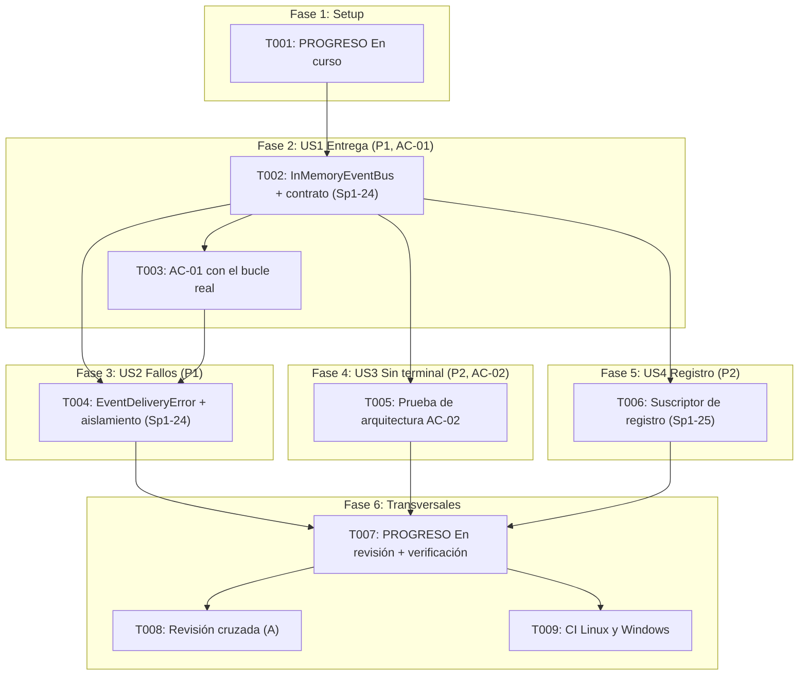

# Implementation Tasks: HU-01-05 — Bus de eventos desacoplado de la interfaz

**Feature**: `specs/011-event-bus/spec.md`  
**Plan**: `specs/011-event-bus/plan.md`  
**Responsable**: B — Estado (la implementa Gustavo en nombre de B)  
**Sprint**: Sprint 1 | **PHU**: 2  
**Tareas de referencia**: Sp1-24, Sp1-25 (Sp1-23 ya la cumplió HU-00-01)  

---

## Cómo leer este documento

**Pruebas primero, dentro de cada tarea.** Cada tarea agrupa las pruebas y la implementación de un módulo completo: se escriben las pruebas, se ejecutan y se confirma que fallan **por la razón esperada** (`ImportError` del módulo nuevo, aserción por un comportamiento que aún no existe), se implementa lo mínimo para que pasen y se ejecutan `mypy` y `ruff` antes de seguir. No hay tareas separadas para grupos de casos de prueba ni para el registro: los 5 min de registro de cada estimación se emplean en anotar, al terminar, una línea en *Registro de cambios* de `docs/PROGRESO.md` con el ID de la tarea, el comando de verificación y su resultado (Principio VIII).

**Ritmo**: 5 tareas de trabajo (T002 a T006) de 40 min como máximo, una tarea de inicio (T001), una de cierre (T007) y dos humanas (T008, T009). Ninguna pasa de 40 min (la Constitución permite 40; el límite absoluto es 60).

**Reglas que valen para todas las tareas:**
- **Archivos protegidos**: no modificar nada bajo `src/harness_agent/core/interfaces/`, ni `src/harness_agent/core/events.py`, ni `src/harness_agent/core/loop.py`, ni `tests/doubles/`, ni `docs/archivo/`. Los únicos archivos de `core/` que se tocan son el módulo nuevo `in_memory_event_bus.py` y, para exportarlo, `core/__init__.py`. Si una tarea parece exigir otra cosa, detenerse y acordarlo con A (los puertos solo cambian con el visto bueno de los tres).
- `in_memory_event_bus.py` solo importa biblioteca estándar y `harness_agent.core` (puerto y catálogo) y **no define tipos de evento**. Sin dependencias nuevas. Python 3.12 es la única versión soportada (PD-07).
- Todo el código y las pruebas deben pasar `mypy --strict` y `ruff` (línea de 100 columnas).
- El comportamiento, los mensajes y las cláusulas C-1 a C-15 siguen [contracts/event_bus_contract.md](contracts/event_bus_contract.md); el estado y el flujo, [data-model.md](data-model.md); las decisiones, [research.md](research.md) (R-01 a R-13) y [plan.md](plan.md) (D1 a D11).
- **Aislamiento**: ninguna prueba usa red, proveedor real, entorno real ni consola; solo `caplog` y los dobles existentes (`RecordingEventBus`, `ScriptedProvider`, `ScriptedPolicy` y `make_rig` de `tests/core/support.py`). Las cargas de eventos de prueba llevan un valor centinela reconocible (`VALOR-DE-PRUEBA-123`) para comprobar que no se filtran a los mensajes.
- **Sin literales detectables**: ninguna prueba contiene texto que la comprobación de AC-02 de HU-00-04 (`tests/architecture/test_no_secrets_in_repo.py`) detecte como clave; en particular no usar nombres como `secret`, `token` o `password` en asignaciones con un valor largo.
- **Al cerrar cada tarea que toca código o pruebas**, ejecutar `ruff format --check .`, `ruff check .`, `mypy src tests` y `pytest --cov=harness_agent --cov-report=term-missing`; los cuatro con código 0.

**Correspondencia con las tareas del plan de sprint** (columna *Tarea F5*):

| Tarea F5 | Descripción en `docs/03-plan-sprints.md` | Presupuesto | Microtareas |
|---|---|---|---|
| **Sp1-23** | Definir los tipos de evento | 60 min (1 h) | **Ya cumplida por HU-00-01** (`core/events.py` y `tests/contracts/test_event_catalog.py`); sin tarea nueva |
| **Sp1-24** | Implementar el emisor y la suscripción | 150 min (2,5 h) | T002, T004 |
| **Sp1-25** | Prueba con un suscriptor de registro | 90 min (1,5 h) | T006 |
| Transversal | Estado, verificación de AC-01 y AC-02, cierre, revisión y CI remota (Principios VIII y IX) | — | T001, T003, T005, T007, T008, T009 |

**Nota sobre la PHU**: la historia vale 2 PHU, unidad de capacidad del sprint (velocidad hipotética de 39 PHU por sprint), no de tiempo; el presupuesto en horas es el de las tareas F5 (5 h con Sp1-23, 4 h sin ella). La comparación está al final.

---

## Phase 1: Setup (estado)

**Propósito**: Marcar la historia `En curso` y dejar constancia de que Sp1-23 ya está cumplida.

- [x] **T001** Marcar HU-01-05 como `En curso` en `docs/PROGRESO.md` y registrar Sp1-23 como cumplida (transversal)
  - **Archivos**: `docs/PROGRESO.md`
  - **Dependencias**: Ninguna
  - **Criterios relacionados**: Principio VIII, plan D9
  - **Tarea F5**: Transversal
  - **Estimación**: 20 min (10 min impl + 5 min check + 5 min registro)
  - **Verificación**: La fila de `HU-01-05` de la tabla de Sprint 1 pasa de `Pendiente` a `En curso` con responsable `B — Estado`; la columna Commit/PR queda vacía; ninguna otra fila ni la tabla *Resumen* cambian (`git diff -U0 docs/PROGRESO.md` muestra solo esa fila y las líneas nuevas del *Registro de cambios*). Una entrada del registro dice que **Sp1-23 («definir los tipos de evento») ya la cumplió HU-00-01** (`core/events.py`, 17 tipos y `Event`; `tests/contracts/test_event_catalog.py`) y que esta historia no los vuelve a definir. El archivo conserva sus saltos de línea CRLF sin LF sueltos y cada fila de tabla ocupa una sola línea.

---

## Phase 2: User Story 1 — Los eventos de un turno llegan a quien se suscriba (P1) [AC-01]

**Objetivo de la historia**: Un bus real en memoria entrega los eventos a los suscriptores de su tipo, de forma síncrona y en orden, y el bucle real de A puede usarlo sin cambios.

**Prueba independiente**: Con el bucle real conectado al bus real y un proveedor guionizado, un suscriptor por tipo recoge, en el orden de emisión, los eventos que el bucle emite hoy; y el mismo contrato pasa contra el doble.

- [x] **T002** [US1] Implementar `InMemoryEventBus` (entrega, validación y exportación) con su contrato de pruebas (Sp1-24)
  - **Archivos**: `tests/contracts/test_event_bus_contract.py`, `tests/unit/core/test_in_memory_event_bus.py`, `src/harness_agent/core/in_memory_event_bus.py`, `src/harness_agent/core/__init__.py`
  - **Dependencias**: T001
  - **Criterios relacionados**: FR-001 a FR-009, FR-012 (parte `TypeError`), FR-015, FR-019, FR-021, SC-002, SC-007, contrato §2, §4 y §5 (C-1 a C-9, C-13, C-14), research R-01, R-02, R-08 y R-09
  - **Tarea F5**: Sp1-24
  - **Estimación**: 40 min (25 min impl + 10 min check + 5 min registro)
  - **Verificación**: **Pruebas primero.** En `test_event_bus_contract.py`, una fixture parametrizada con las fábricas de `RecordingEventBus` y de `InMemoryEventBus` y la clase `TestClausulasComunes` con C-1 a C-8 (mismo evento una vez, orden de suscripción, tipo exacto, tipo sin suscriptores sin error y `emit` devuelve `None`, mismo manejador N veces, los 17 tipos de `EventType`, entrega anidada inmediata antes del siguiente manejador, tipos distintos no se mezclan); el archivo documenta en su docstring la tabla de aplicabilidad del contrato §5. En `test_in_memory_event_bus.py`, solo contra el bus real: C-9 (un manejador suscrito durante una entrega solo recibe eventos posteriores), C-13 y C-14 (`subscribe` rechaza un tipo que no es `EventType`, incluida la cadena `"user_message"`, y un manejador no invocable; `emit` rechaza un `dict`, un `str` y `None`; `TypeError` con los textos exactos del contrato §4, que nombran el tipo recibido y **no** su valor —se comprueba con el centinela—, sin registrar ni entregar nada tras el rechazo; el tipo se valida antes que el manejador), la exportación (`harness_agent.core.InMemoryEventBus` es la clase definida en el módulo y `"InMemoryEventBus"` figura en `core.__all__` sin repeticiones), una prueba de humo (10 suscriptores, 1000 emisiones, promedio < 1 ms por emisión) y la comprobación de que el bus es subclase del puerto `EventBus`. Se ejecutan y fallan por la razón esperada: `ImportError` del módulo `in_memory_event_bus` para el bus real (los casos del doble **pasan** desde el principio, lo que valida el contrato). **Implementación**: `in_memory_event_bus.py` define `InMemoryEventBus(EventBus)` con `_handlers: dict[EventType, tuple[EventHandler, ...]]` (invariantes I-1 a I-4 del modelo de datos), `subscribe` (valida y reemplaza la tupla) y `emit` (valida el `Event`, lee la tupla una vez y llama a cada manejador en orden; **sin** aislamiento de fallos todavía: eso es T004), solo biblioteca estándar y `harness_agent.core`, con un docstring que documenta entrega síncrona, orden, copia al empezar, entrega anidada inmediata y «un solo hilo»; `core/__init__.py` exporta `InMemoryEventBus` (añadir el nombre a `__all__`). Pasan todas las pruebas de T002 y `tests/integration/test_core_public_api.py` sigue verde; el módulo no importa nada fuera de `collections.abc`, `typing` y `harness_agent.core`; el doble y el puerto no cambian (`git diff --exit-code -- src/harness_agent/core/interfaces src/harness_agent/core/events.py tests/doubles` termina en 0); cierre con los cuatro comandos en 0.

- [x] **T003** [US1] Verificar AC-01 con el bucle real de A conectado al bus real (transversal)
  - **Archivos**: `tests/integration/test_event_bus_agent_loop.py`
  - **Dependencias**: T002
  - **Criterios relacionados**: AC-01, FR-016, FR-007, FR-021, SC-001, escenarios 4 y 5 de la historia 1, research R-10, plan D8
  - **Tarea F5**: Transversal
  - **Estimación**: 35 min (25 min impl + 5 min check + 5 min registro)
  - **Verificación**: Prueba de integración, sin código fuente nuevo (el bus y el bucle ya existen; el bucle no se toca). Con `make_rig(script, tools, bus=InMemoryEventBus())` de `tests/core/support.py` y un suscriptor por cada uno de los 17 `EventType` que anota `(tipo, id)` en una lista: (1) **turno completo con una herramienta** (guion: una llamada a herramienta y respuesta final, política que permite): los eventos recogidos coinciden en tipo y **orden** con los que registra el propio bucle en la secuencia esperada (`USER_MESSAGE`, `PERMISSION_DECIDED`, `TOOL_REQUESTED`, `TOOL_FINISHED`, `ASSISTANT_MESSAGE`, en el orden real que el bucle emite; se fija mirando la ejecución, no suponiendo) y cada evento llega **una sola vez** al suscriptor de su tipo; (2) **error del proveedor** (guion con una excepción): aparece `PROVIDER_ERROR` tras `USER_MESSAGE`; (3) el conjunto de tipos recogidos entre (1) y (2) contiene mensaje, herramienta solicitada, herramienta terminada y error, que son los que pide AC-01 y existen hoy; (4) **observación**: `APPROVAL_REQUESTED` **no** se emite en ninguno de los turnos (lo hará el bucle en HU-05-03, Sprint 2) y la prueba lo documenta con un comentario y una aserción que se invierte cuando llegue esa historia, no con un fallo; el bus sí entrega ese tipo cuando alguien lo emite (se emite a mano un `APPROVAL_REQUESTED` y llega); (5) el núcleo no imprime: `capsys` no captura nada durante los turnos. Pasan sin implementar nada nuevo (la prueba valida lo ya hecho en T002); si falla por una diferencia real del bucle, se investiga antes de tocar nada. Cierre con los cuatro comandos en 0.

---

## Phase 3: User Story 2 — Un suscriptor que falla no oculta nada (P1)

**Objetivo de la historia**: Un manejador que lanza una excepción no deja a los demás sin evento y el error llega al emisor, también a través del bucle (Q4).

**Prueba independiente**: Con tres manejadores del mismo tipo, el segundo falla: los tres se ejecutan una vez, `emit` lanza `EventDeliveryError` con la excepción original y, con el bucle real, el error llega a quien llamó al turno.

- [x] **T004** [US2] Implementar el aislamiento de fallos y `EventDeliveryError` con sus pruebas (Sp1-24)
  - **Archivos**: `tests/contracts/test_event_bus_contract.py`, `tests/unit/core/test_in_memory_event_bus.py`, `tests/integration/test_event_bus_agent_loop.py`, `src/harness_agent/core/in_memory_event_bus.py`, `src/harness_agent/core/__init__.py`
  - **Dependencias**: T002, T003
  - **Criterios relacionados**: FR-010 a FR-014, FR-012, SC-003, escenarios 1 a 6 de la historia 2, contrato §3 y §5 (C-10 a C-12, C-15), research R-03 a R-07, plan D3 y D4
  - **Tarea F5**: Sp1-24
  - **Estimación**: 40 min (25 min impl + 10 min check + 5 min registro)
  - **Verificación**: **Pruebas primero.** En `test_event_bus_contract.py`, la clase `TestClausulasDelBusReal` (solo el bus real; el doble queda fuera por el contrato §5) con: C-10 (con n manejadores de los que k fallan, 0 ≤ k ≤ n, para varias combinaciones: todos se invocan **una vez**, `emit` lanza `EventDeliveryError` con exactamente k excepciones en el orden de entrega y las **mismas instancias** que lanzaron los manejadores; con k = 0 no lanza), C-11 (un manejador que lanza `KeyboardInterrupt` o `asyncio.CancelledError` se propaga **de inmediato, sin agrupar** y los manejadores restantes no se invocan; con fallos ordinarios previos, la excepción propagada lleva una nota con su número y tipos y **sin** la carga del evento), C-12 (tras un fallo, la siguiente emisión funciona y las suscripciones no cambian) y C-15 (con el centinela en la carga del evento, ningún `str` ni `repr` del error agrupado ni de la nota lo contiene). En `test_in_memory_event_bus.py`: el mensaje exacto en singular y plural («Falló 1 manejador …» / «Fallaron 2 manejadores …» con el tipo entre comillas simples), `EventDeliveryError` es subclase de `ExceptionGroup` y de `Exception`, `split` y `subgroup` conservan el tipo y el mensaje (`derive`), `except*` funciona, y un manejador que emite un evento anidado que falla recibe el `EventDeliveryError` interno (si no lo captura, cuenta como un fallo suyo en la emisión externa). En `test_event_bus_agent_loop.py`, la clase de Q4 con el bucle real: un suscriptor que lanza al recibir `TOOL_REQUESTED` hace que `run_turn` termine lanzando `EventDeliveryError` **sin cambios** y que la herramienta **no se ejecute** (Q4), y un suscriptor que falla con `USER_MESSAGE` no deja sin ese evento a los demás suscriptores. Se ejecutan y fallan por la razón esperada (`ImportError` de `EventDeliveryError` o el bus real sin aislamiento: el primer error corta la entrega). **Implementación**: en `in_memory_event_bus.py` se define `EventDeliveryError(ExceptionGroup[Exception])` con `derive` sobreescrito y el mensaje del contrato §3, y `emit` llama a cada manejador dentro de `try` (acumula las `Exception`, relanza las `BaseException` no ordinarias con `add_note` de los fallos previos y, al terminar, lanza el error agrupado si hay fallos); se exporta `EventDeliveryError` desde `core/__init__.py` y se añade a `__all__`. Pasan todas las pruebas de T002, T003 y T004; el módulo conserva solo biblioteca estándar y `harness_agent.core`; `core/loop.py` no cambia; cobertura de `in_memory_event_bus.py` al 100 % (toda línea sin cubrir se justifica por escrito); cierre con los cuatro comandos en 0.

---

## Phase 4: User Story 3 — El núcleo no imprime ni depende de la terminal (P2) [AC-02]

**Objetivo de la historia**: Una barrera automática impide que cualquier módulo de `core/` use la terminal, sin duplicar lo que ya comprueban las pruebas de arquitectura.

**Prueba independiente**: La prueba recorre todo `core/`; su detector se prueba con fragmentos sintéticos y con una copia de `core/` en `tmp_path` a la que se añade una impresión.

- [x] **T005** [P] [US3] Escribir la comprobación de AC-02 sobre todo el núcleo con su autoprueba (transversal)
  - **Archivos**: `tests/architecture/test_core_no_terminal.py`
  - **Dependencias**: T002
  - **Criterios relacionados**: AC-02, FR-018, FR-019, SC-004, escenarios 1 a 4 de la historia 3, regla de negocio 1 y 2, research R-12, plan D10
  - **Tarea F5**: Transversal
  - **Estimación**: 35 min (25 min impl + 5 min check + 5 min registro)
  - **Verificación**: Sin código fuente nuevo. La prueba **reutiliza** `console_uses` de `tests/architecture/test_loop_boundaries.py` (impresión, lectura y `sys.stdout`/`stderr`/`stdin`) y **no lo copia**, y añade lo que ese archivo y `test_core_boundaries.py` no cubren: importaciones de bibliotecas de terminal (`curses`, `readline`, `rich`, `typer`, `click`, `prompt_toolkit`, `colorama`, `blessed`, `urwid`, `textual`, `tty`, `termios`, `msvcrt`, `getpass`, `pty`), alias de `sys` (`import sys as s; s.stdout`), `from sys import stdout` y `builtins.print`. Recorre con `ast` todos los `.py` de `src/harness_agent/core/` (exige al menos uno; línea base medida el 2026-10-20: 17 módulos, 0 hallazgos). Incluye: una **autoprueba** del detector con fragmentos sintéticos (cada construcción prohibida se detecta, el código limpio no); una **prueba de mutación sobre una copia**: copia `core/` a `tmp_path`, añade `print("x")` a una copia de uno de sus archivos y comprueba que el detector falla sobre esa copia, sin editar nunca el código real (`git diff --exit-code -- src/harness_agent/core` termina en 0 antes y después); y las comprobaciones del módulo del bus: `in_memory_event_bus.py` solo importa biblioteca estándar y `harness_agent.core` (sin `adapters`, `cli` ni `observability`) y **no define ninguna clase que herede de `Enum` ni de `Event`** ni redefine `EventType` (regla de negocio 2). Pasan al ejecutarla (la línea base es limpia); cierre con los cuatro comandos en 0.

---

## Phase 5: User Story 4 — Suscriptor de registro y contrato único (P2)

**Objetivo de la historia**: Una segunda interfaz se suscribe sin tocar el núcleo (demostrado con un suscriptor de registro en pruebas); el contrato único ya cubre al doble y al bus real (T002 y T004).

**Prueba independiente**: Un suscriptor de registro (`logging`, solo en pruebas) conectado a todos los tipos registra una entrada por evento de un turno completo.

- [x] **T006** [P] [US4] Probar el bus con un suscriptor de registro (Sp1-25)
  - **Archivos**: `tests/integration/test_event_bus_logging_subscriber.py`
  - **Dependencias**: T002
  - **Criterios relacionados**: FR-017, FR-016, FR-021, escenarios 1 y 3 de la historia 4, research R-11
  - **Tarea F5**: Sp1-25
  - **Estimación**: 25 min (15 min impl + 5 min check + 5 min registro)
  - **Verificación**: Sin código fuente nuevo; el suscriptor vive **solo** en el archivo de pruebas (no hay ningún suscriptor de producción: `git ls-files src` no cambia salvo `in_memory_event_bus.py` y `core/__init__.py`). Un manejador de prueba escribe con `logging.getLogger("harness.events")` una línea `INFO` por evento con el tipo, el identificador de sesión y el identificador del evento (**nunca** la carga) y se suscribe a los 17 tipos; con `caplog.at_level(logging.INFO, logger="harness.events")`: (1) tras un turno completo del bucle real (`make_rig` con `InMemoryEventBus`, una herramienta), hay **una entrada por evento emitido**, en el mismo orden y cada una con su tipo; (2) un evento con el centinela en la carga **no** aparece en ningún registro; (3) emitir directamente un evento de cada uno de los 17 tipos produce 17 entradas; (4) el suscriptor de registro y otro suscriptor conviven (los dos reciben cada evento) y `capsys` no captura salida del núcleo. Pasan sin implementar nada nuevo; si el bus o el bucle no se comportan como se espera, se investiga antes de tocar nada. Cierre con los cuatro comandos en 0.

---

## Phase 6: Polish y tareas transversales

**Propósito**: Registrar el estado, comprobar que no se tocaron los archivos protegidos y dejar la revisión humana y la CI como pendientes explícitos.

- [x] **T007** Pasar HU-01-05 a `En revisión` en `docs/PROGRESO.md` y verificar puertos, fronteras y puertas de calidad (Sp1-24, Sp1-25)
  - **Archivos**: `docs/PROGRESO.md`
  - **Dependencias**: T004, T005, T006
  - **Criterios relacionados**: SC-005, SC-006, FR-020, Principio III, Principio VIII, Principio IX, Principio X
  - **Tarea F5**: Transversal
  - **Estimación**: 30 min (15 min impl + 10 min check + 5 min registro)
  - **Verificación**: Se ejecuta `ruff format --check .`, `ruff check .`, `mypy src tests` y `pytest --cov=harness_agent --cov-report=term-missing` (los cuatro con código 0; se anotan el número de pruebas, el tiempo y la cobertura de `in_memory_event_bus.py`, objetivo 100 %). Se ejecuta `git fetch origin` y `base=$(git merge-base HEAD origin/main)`: `git diff --exit-code $base -- src/harness_agent/core/interfaces src/harness_agent/core/events.py src/harness_agent/core/loop.py tests/doubles docs/archivo` termina en 0 y sin salida; `git diff --stat $base -- src/harness_agent/core` muestra solo `in_memory_event_bus.py` y `__init__.py`; `pytest tests/architecture` pasa; se hace el recorrido manual de la sección 4 del [quickstart.md](quickstart.md) y cada paso produce lo descrito. La fila de `HU-01-05` pasa de `En curso` a `En revisión` (no a `Hecha`) con responsable `B — Estado`, las rutas de los archivos de la historia y la evidencia (comandos y resultados); Commit/PR queda vacío hasta T009. Se añade una nota «Observaciones de HU-01-05» con: (a) el aviso a B de la comparación con el presupuesto (260 min estimados frente a los 240 min presupuestados para Sp1-24 y Sp1-25; Sp1-23 ya cumplida por HU-00-01), sin recorte de alcance; (b) que **«aprobación pedida» no la emite aún el bucle** (llega con HU-05-03, Sprint 2): AC-01 verificado con los tipos que emite hoy, no es un incumplimiento; (c) que **HU-00-01 sigue `Pendiente de aprobación técnica`** (Sp1-03) y debe ratificarse antes de pasar HU-01-05 a `Hecha`; (d) la decisión que confirmar con B: las excepciones no ordinarias propagadas llevan una nota con los fallos ordinarios previos (plan D3). La tabla *Resumen* no cambia hasta que la historia quede `Hecha`. Sin LF sueltos ni filas partidas. Si algún comando falla, se corrige en la tarea que corresponda y se anota.

- [ ] **T008** Solicitar la revisión cruzada y registrar su resultado (Principio IX)
  - **Archivos**: `docs/PROGRESO.md`
  - **Dependencias**: T007
  - **Criterios relacionados**: Principio IX, DoD (5), DoD (6), DoD (7)
  - **Tarea F5**: Transversal
  - **Estimación**: 15 min (5 min impl + 5 min check + 5 min registro)
  - **Verificación**: Un integrante del **área A** (la DoD exige un área distinta de quien implementa; el bucle es de A) revisa el cambio contra la lista de comprobación de `arquitectura-hexagonal-clean`, confirma que `core/interfaces/`, `core/events.py`, `core/loop.py` y `tests/doubles/` no cambiaron, que el bus no añade dependencias y que ningún mensaje de error reproduce la carga de un evento. Su resultado se anota en `docs/PROGRESO.md`, junto con el recordatorio de que HU-00-01 sigue `Pendiente de aprobación técnica` y debe ratificarse antes de pasar HU-01-05 a `Hecha`. **Esta tarea es humana: no se marca como completada sin esa confirmación.**

- [ ] **T009** Confirmar la ejecución de la CI en Linux y Windows y registrar la evidencia (Sp1-24, Sp1-25)
  - **Evidencia disponible (2026-10-25)**: CI en verde en Linux y Windows en `main` c12c4cb (workflow CI, run n.º 47, `quality (ubuntu-latest, py3.12)` y `quality (windows-latest, py3.12)`), https://github.com/Theboul/harness-agent/actions/runs/40149368199; falta que una persona la confirme y marque la tarea.
  - **Archivos**: `docs/PROGRESO.md`
  - **Dependencias**: T007
  - **Criterios relacionados**: SC-006, Principio IV, Principio VIII, Principio IX, DoD (1)
  - **Tarea F5**: Transversal
  - **Estimación**: 20 min (10 min impl + 5 min check + 5 min registro)
  - **Verificación**: Tras el push o la solicitud de cambios (acción que realiza una persona con acceso al remoto), comprobar que los dos trabajos de la matriz, `quality (ubuntu-latest, py3.12)` y `quality (windows-latest, py3.12)`, terminan en verde; anotar en `docs/PROGRESO.md` el enlace o el ID de la ejecución y **rellenar la columna Commit/PR de la fila de `HU-01-05`** con el commit o la solicitud de cambios (Principio VIII). Se comprueba que el contrato de pruebas (`test_event_bus_contract.py`) y `test_core_no_terminal.py` se ejecutaron en ambos sistemas. Si el push aún no se ha hecho, la tarea queda **pendiente** y se anota.

---

## Dependencias & Orden de Ejecución

### Oportunidades de Paralelización:
- **T005** y **T006** (`[P]`) solo dependen de **T002** y tocan archivos distintos entre sí y de T003/T004; pueden escribirse a la vez mientras se hace T003 y T004.
- **T002 → T004** son secuenciales (editan `in_memory_event_bus.py` y los mismos archivos de pruebas); **T003 → T004** también, porque T004 añade una clase al archivo de integración que crea T003.
- T008 y T009 son humanas y pueden hacerse en cualquier orden tras T007.

### Puntos de atención:
- **Sp1-23 ya cumplida** por HU-00-01: no hay tarea nueva de tipos de evento; el bus importa `Event` y `EventType` y no los define (T005 lo comprueba).
- **«Aprobación pedida» no se emite todavía** (HU-05-03, Sprint 2): T003 lo trata como observación, no como fallo; el bus sí la entrega.
- **El doble no cumple todas las cláusulas** (lista viva, sin aislamiento, sin validación): el contrato las separa (cláusulas comunes y del bus real) y el doble no se modifica.
- **Decisión a confirmar con B** (plan D3): las excepciones no ordinarias propagadas llevan una nota con los fallos ordinarios previos.
- **Ratificación de HU-00-01 pendiente**: la historia no modifica ningún puerto, pero la ratificación debe producirse antes de pasar HU-01-05 a `Hecha`; T007 y T008 lo registran.
- **Sin literales detectables en pruebas versionadas**: la comprobación de AC-02 de HU-00-04 escanea los archivos versionados; las pruebas nuevas no usan nombres de clave con valores largos.

---

## Estrategia de Implementación

1. **Estado (T001)**: la historia pasa a `En curso` y Sp1-23 queda registrada como cumplida.
2. **MVP — US1 + US2 (T002 a T004)**: con el bus real, AC-01 verificado con el bucle real y el aislamiento de fallos con propagación (Q4) están completos los dos comportamientos que HU-03-02 y la CLI necesitan.
3. **US3 y US4 (T005, T006)**: la barrera de AC-02 sobre todo el núcleo y el suscriptor de registro (Sp1-25); pueden hacerse en paralelo.
4. **Cierre (T007 a T009)**: `En revisión`, verificación de puertos y fronteras, revisión cruzada por A y CI.

En cada tarea: escribir las pruebas, verlas fallar por la razón esperada, implementar lo mínimo y ejecutar `mypy` y `ruff` antes de seguir.

---

## Resumen de Estimaciones

| Tarea | Descripción breve | Tiempo Impl. | Tiempo Check | Tiempo Reg. | Total |
|---|---|---|---|---|---|
| **T001** | PROGRESO: `En curso` y Sp1-23 cumplida | 10 min | 5 min | 5 min | 20 min |
| **T002** | `InMemoryEventBus` + contrato de pruebas | 25 min | 10 min | 5 min | 40 min |
| **T003** | AC-01 con el bucle real | 25 min | 5 min | 5 min | 35 min |
| **T004** | `EventDeliveryError` y aislamiento de fallos | 25 min | 10 min | 5 min | 40 min |
| **T005** | AC-02 sobre todo el núcleo | 25 min | 5 min | 5 min | 35 min |
| **T006** | Suscriptor de registro | 15 min | 5 min | 5 min | 25 min |
| **T007** | PROGRESO: `En revisión` y verificación | 15 min | 10 min | 5 min | 30 min |
| **T008** | Revisión cruzada por A (humana) | 5 min | 5 min | 5 min | 15 min |
| **T009** | CI en Linux y Windows y Commit/PR (humana) | 10 min | 5 min | 5 min | 20 min |
| **Total** | **9 microtareas (ninguna pasa de 40 min; 5 de trabajo)** | **155 min** | **60 min** | **45 min** | **260 min (4,3 h)** |

**Comparación con el presupuesto de Sprint 1** (`docs/03-plan-sprints.md`; 2 PHU es capacidad, no tiempo, así que se compara con las horas de las tareas F5):

| Tarea F5 | Presupuesto | Estimado aquí | Diferencia |
|---|---|---|---|
| Sp1-23 (tipos de evento) | 60 min (1 h) | 0 min (cumplida por HU-00-01) | −60 min |
| Sp1-24 (emisor y suscripción) | 150 min (2,5 h) | 80 min (T002, T004) | −70 min |
| Sp1-25 (suscriptor de registro) | 90 min (1,5 h) | 25 min (T006) | −65 min |
| Transversal (T001, T003, T005, T007, T008, T009) | — | 155 min | +155 min |
| **Total** | **300 min (5 h); aplicable 240 min (4 h) sin Sp1-23** | **260 min (4,3 h)** | **−40 min frente a 300; +20 min (1,08 veces) frente a 240** |

**Las estimaciones se pasan ligeramente del presupuesto aplicable.** Una vez descontada Sp1-23, que ya está cumplida, el plan de sprint deja 240 min (Sp1-24 y Sp1-25) y la estimación es de 260 min: 20 min de más (8 %). El exceso no viene del bus en sí (las dos tareas F5 suman 105 min, 135 min por debajo de su presupuesto) sino de lo que el plan de sprint no presupuesta: la verificación de AC-01 con el bucle real (T003), la barrera de AC-02 (T005), el estado y el cierre (T001, T007) y las dos tareas humanas (T008, T009), que suman 155 min. Frente al presupuesto de 300 min con Sp1-23 incluida, la estimación queda 40 min por debajo.

**Decisión del responsable: sin recorte de alcance.** El aviso queda declarado aquí y en el [plan](plan.md) (D9), y T007 lo anota en `docs/PROGRESO.md` como aviso a B. Sprint 1 ya supera la disponibilidad media del equipo (R-20 de `docs/03-plan-sprints.md`).
